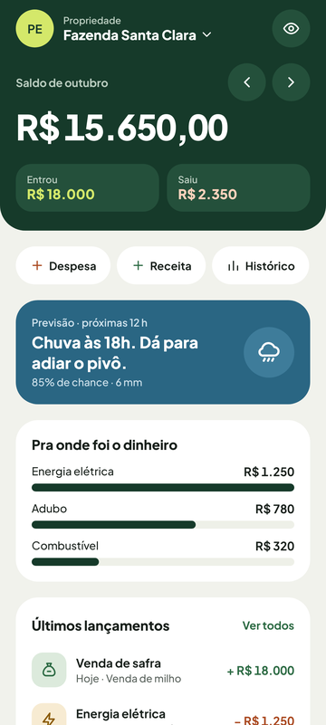
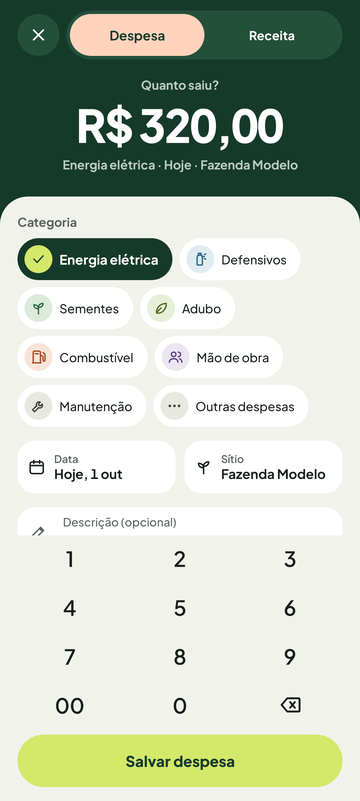
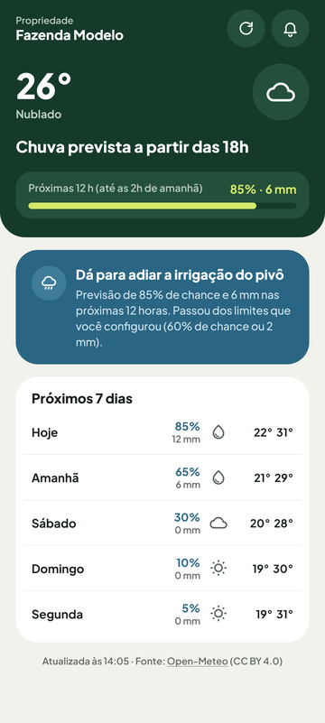
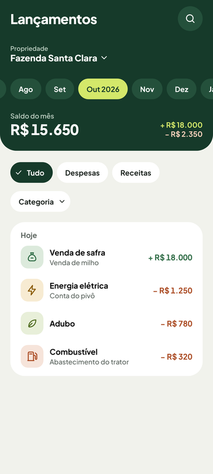
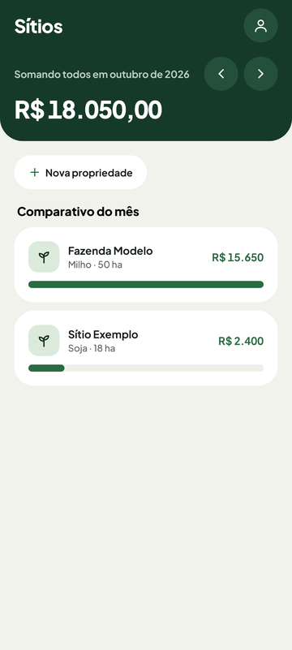
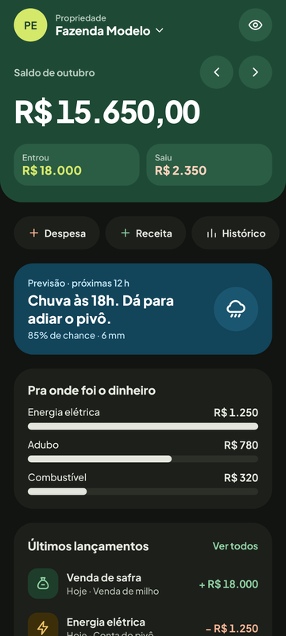
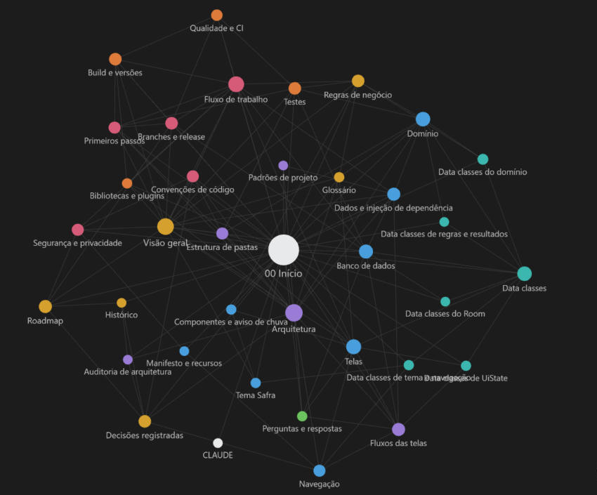

<div align="center">

# AgroSaldo

**Controle financeiro e aviso de chuva para o pequeno produtor rural.**

App Android nativo para registrar receitas e despesas por propriedade, acompanhar o saldo do mês e do ano e receber um aviso quando vai chover, para adiar a irrigação do pivô.

[](https://github.com/Morettys2/AgroSaldo/actions/workflows/android.yml)


-3DDC84?logo=android&logoColor=white)






</div>

---

## Sumário

- [Sobre o projeto](#sobre-o-projeto)
- [Funcionalidades](#funcionalidades)
- [Arquitetura](#arquitetura)
- [Tecnologias](#tecnologias)
- [Estrutura](#estrutura)
- [Como rodar](#como-rodar)
- [Testes e qualidade](#testes-e-qualidade)
- [Privacidade e segurança](#privacidade-e-segurança)
- [Status e próximos passos](#status-e-próximos-passos)
- [Documentação](#documentação)
- [Base de conhecimento](#base-de-conhecimento)

## Sobre o projeto

O AgroSaldo resolve um problema real do campo: saber **quanto entrou e quanto saiu em cada propriedade** e **evitar ligar a irrigação quando a chuva já está prevista**. O app está em uso por um produtor rural no dia a dia.

Desenvolvido como projeto acadêmico do curso de Engenharia de Software da UNIFAE, com dois requisitos centrais: arquitetura **MVVM** e persistência local com **Room**.

- **100% local:** os dados ficam no celular, sem servidor e sem conta na nuvem.
- **Funciona offline:** só a previsão do tempo usa a internet ([Open-Meteo](https://open-meteo.com/)).
- **Pensado para o campo:** textos simples, alvos de toque de 48 dp, alto contraste, suporte a fonte grande e modo escuro.

## Funcionalidades

| Funcionalidade | Descrição |
| --- | --- |
| **Lançamentos** | Receitas e despesas por categoria, com teclado numérico de calculadora, busca e filtros |
| **Propriedades** | Vários sítios por conta, com cultura, área e localização pelo GPS |
| **Resumo do mês** | Saldo, entradas e saídas, para onde foi o dinheiro e os últimos lançamentos |
| **Histórico** | O ano mês a mês, melhor e pior mês e maiores gastos |
| **Clima** | Previsão das próximas horas e dos 7 dias para cada propriedade |
| **Aviso de chuva** | Notificação em segundo plano quando vai chover, com limites ajustáveis |
| **Desfazer** | Exclusões de lançamentos e propriedades podem ser desfeitas, restaurando exatamente o que foi removido |
| **Privacidade** | Bloqueio por digital ou PIN, valores ocultos com um toque, senha com hash forte e consentimento LGPD |

<div align="center">




</div>

## Arquitetura

**MVVM + Repository em três camadas**, como recomenda o guia oficial de arquitetura do Android. As regras de negócio ficam num **módulo Gradle separado, em Kotlin puro**: o compilador impede que o domínio dependa de Android, banco ou tela.

```text
  Tela (Compose)            ViewModel                Domínio (:domain)             Dados (:app)
┌───────────────┐ eventos ┌────────────┐  chama    ┌───────────────────┐ implementa ┌──────────────────┐
│ *Route/*Screen│────────▶│ *ViewModel │──────────▶│ regras puras +    │◀───────────│ Room, prefs,     │
│ (só desenha)  │◀────────│ (UiState)  │           │ interfaces de     │            │ Open-Meteo,      │
└───────────────┘ UiState └────────────┘           │ repositório       │            │ WorkManager      │
                                ▲                  └───────────────────┘            └──────────────────┘
                                └──────────── tudo ligado pelo Hilt (di/) ─────────────────┘
```

- **Fluxo de dados unidirecional:** a tela recebe o estado (`StateFlow<UiState>`) e devolve eventos; ela não guarda regra.
- **Reativo de ponta a ponta:** o Room devolve `Flow`, então uma gravação atualiza todas as telas abertas sozinha.
- **Inversão de dependência:** o domínio define as interfaces dos repositórios e a camada de dados as implementa.
- **Injeção de dependência com Hilt:** ViewModels, Worker e Activity recebem tudo pelo construtor.

## Tecnologias

| Área | Tecnologia |
| --- | --- |
| Linguagem e UI | Kotlin 2.4, Jetpack Compose (Material 3), Navigation Compose |
| Arquitetura | MVVM, Repository, módulo `:domain` em Kotlin puro, Coroutines e Flow |
| Banco local | Room 2.8 (SQLite), com migrações versionadas e testadas |
| Injeção de dependência | Hilt (Dagger), via KSP |
| Segundo plano | WorkManager (aviso de chuva a cada 12 h) |
| Rede | `HttpURLConnection` + `org.json`, só HTTPS, API Open-Meteo |
| Segurança | PBKDF2-HMAC-SHA256 (600 mil iterações), Biometric, `FLAG_SECURE`, backup só criptografado |
| Testes | JUnit 4, Coroutines Test, Robolectric, Roborazzi, fakes em memória |
| Qualidade | ktlint, detekt (zero achados, sem baseline), Android Lint, GitHub Actions |

## Estrutura

```text
AgroSaldo/
├── domain/                  Módulo Kotlin puro: modelos, regras de negócio e interfaces
│   └── src/main/.../domain/
│       ├── model/           Lancamento, Propriedade, Usuario (validam os próprios dados)
│       ├── financeiro/      ResumoFinanceiro: saldo, totais, ranking, histórico
│       ├── clima/           RegraDeChuva e VerificadorDeChuva
│       ├── conta/           ContaService, HashDeSenha, regras de senha e bloqueio
│       └── repository/      Contratos dos repositórios
└── app/                     Módulo Android
    └── src/main/.../agrosaldo/
        ├── feature/         Uma pasta por funcionalidade: *Screen + *ViewModel + *UiState
        ├── data/            Room (entidades, DAOs, migrações), preferências, Open-Meteo
        ├── di/              Módulos do Hilt
        ├── aviso/           Worker, agendamento e notificação de chuva
        ├── core/            Navegação, componentes de UI, utilitários, biometria
        └── ui/theme/        Design system "Safra": cores, tipografia, espaçamentos
```

## Como rodar

**Requisitos**

- Android Studio atualizado (o projeto usa AGP 9.5 e `compileSdk` 37).
- Aparelho ou emulador com Android 8.0 (API 26) ou superior.
- O JDK do build é baixado automaticamente pelo Gradle.
- No Windows, clone o projeto num caminho sem acentos ou espaços (por exemplo, `C:\dev\AgroSaldo`).

```bash
git clone https://github.com/Morettys2/AgroSaldo.git
cd AgroSaldo
./gradlew assembleDebug        # gera o APK de debug
./gradlew installDebug         # instala no aparelho conectado
```

Ou abra a pasta no Android Studio e clique em **Run**. O app começa vazio: crie uma conta, cadastre uma propriedade e registre os primeiros lançamentos. Nenhuma chave de API ou configuração extra é necessária.

## Testes e qualidade

**606 testes automáticos:** 585 rodam no computador, sem emulador, e 21 de banco rodam também no aparelho.

```bash
./gradlew :domain:test          # regras de negócio (JVM puro, segundos)
./gradlew testDebugUnitTest     # ViewModels, dados, Worker, telas (Robolectric) e capturas (Roborazzi)
./gradlew connectedAndroidTest  # DAOs e migração do banco num aparelho ou emulador
./gradlew ktlintCheck detekt lintDebug
```

- **Regras de negócio** testadas em funções puras, com relógio e threads injetados: testes determinísticos, sem `sleep`.
- **Banco de verdade:** os testes de DAO e de migração usam SQLite real, no computador e no aparelho.
- **Atualização sem perder dados:** a migração é testada campo a campo sobre o schema exato da versão anterior.
- **CI:** cada push na `prod` e cada pull request rodam ktlint, detekt, os testes, o build e o Lint. As capturas de tela dos testes ficam na branch [`ci/capturas`](https://github.com/Morettys2/AgroSaldo/tree/ci/capturas).

## Privacidade e segurança

- Os dados ficam **só no aparelho**; a previsão do tempo recebe coordenadas arredondadas, por HTTPS.
- A senha nunca é guardada: só o hash PBKDF2 com sal aleatório, conferido em tempo constante.
- Bloqueio por tentativas imune a mudar a hora do celular; bloqueio opcional por digital.
- Backup do Android só com criptografia de ponta a ponta; sessão e segurança nunca saem do aparelho.
- Consentimento LGPD versionado, e excluir a conta apaga todos os dados.

## Status e próximos passos

A versão **1.6** está estável e em uso real. Próxima etapa prevista:

- publicação na Google Play Store;
- política de privacidade pública;
- exportação dos dados (portabilidade prevista na LGPD).

Uma API própria com sincronização entre aparelhos está fora do escopo desta versão. O app foi mantido 100% local por decisão de produto.

## Documentação

| Documento | Conteúdo |
| --- | --- |
| [`docs/DOCUMENTACAO_TECNICA.mdx`](docs/DOCUMENTACAO_TECNICA.mdx) | Documentação técnica completa: arquitetura, cada pasta e arquivo, banco, testes, build e decisões |
| [`CLAUDE.md`](CLAUDE.md) | Guia de contribuição: convenções obrigatórias, segurança, regras de negócio e fluxo de trabalho |

## Base de conhecimento

A documentação também é mantida como uma base de conhecimento no [Obsidian](https://obsidian.md/), gerada a partir deste repositório: 37 notas interligadas (produto, arquitetura, código, data classes, qualidade, regras do projeto e estudo), usadas como contexto de consulta no desenvolvimento.

<div align="center">

</div>

| Cor | Grupo de notas |
| --- | --- |
| Amarelo | Produto: visão geral, regras de negócio, decisões, roadmap |
| Roxo | Arquitetura e fluxos das telas |
| Azul | Código: domínio, dados, banco, navegação, telas, tema |
| Verde-água | Data classes |
| Laranja | Qualidade: testes, CI, build, bibliotecas |
| Rosa | Regras do projeto: convenções, segurança, fluxo de trabalho |
| Verde | Estudo: perguntas e respostas |

A fonte da verdade continua sendo este repositório: as notas espelham o `CLAUDE.md` e a `docs/DOCUMENTACAO_TECNICA.mdx`.

---

<div align="center">
Desenvolvido por <a href="https://github.com/Morettys2">Morettys2</a> · Engenharia de Software · UNIFAE
</div>
