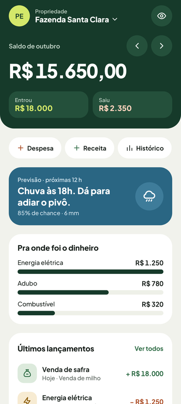
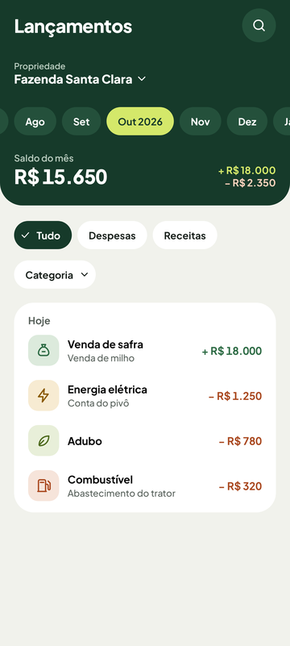
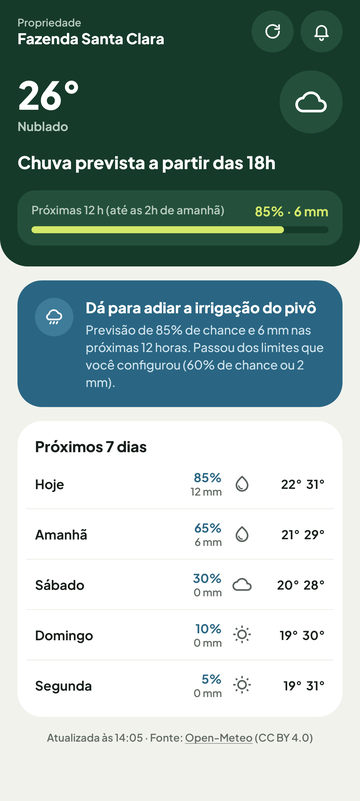
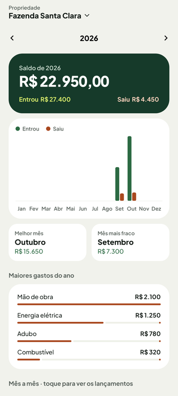
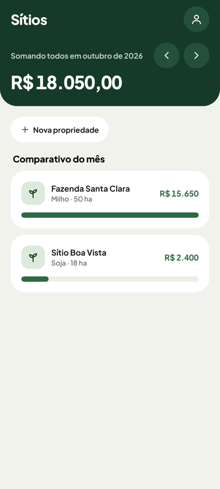
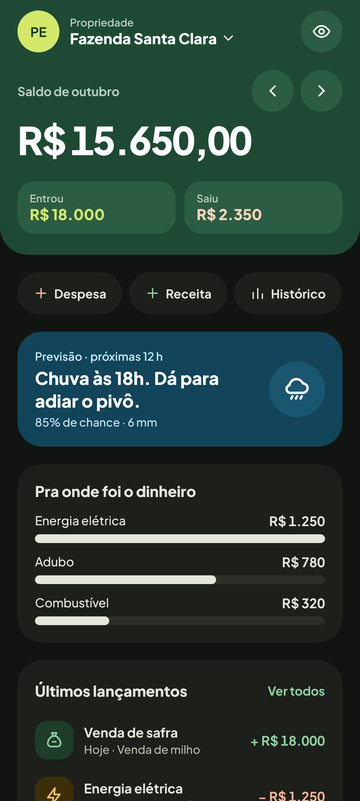
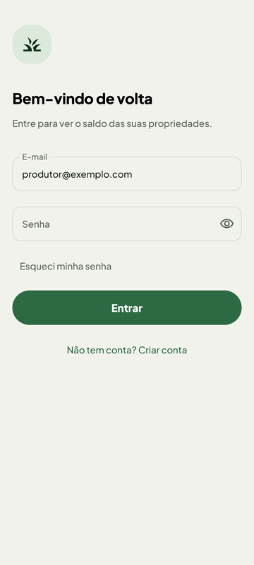
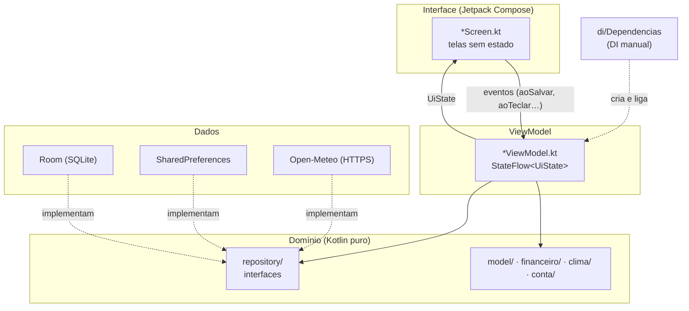

# AgroSaldo 🌱

App Android para o pequeno produtor rural controlar **o que entra e o que sai de cada propriedade** e receber **aviso de chuva** antes de ligar o pivô de irrigação.

Funciona **sem internet**: os dados ficam no celular. A internet só é usada para baixar a previsão do tempo.

Projeto da disciplina UCE (Engenharia de Software, UNIFAE), feito para um produtor de verdade, que já usa o app no dia a dia.

| Início | Lançamentos | Novo lançamento | Clima |
|:---:|:---:|:---:|:---:|
|  |  |  |  |

| Histórico | Sítios | Modo escuro | Login |
|:---:|:---:|:---:|:---:|
|  |  |  |  |

> As imagens são geradas pelos próprios testes (`CapturasDeTelaTest`), com dados fictícios. Para atualizar: `./gradlew testDebugUnitTest` e copie de `app/build/capturas/`.

---

## O que o app faz

- **Propriedades:** cada sítio tem nome, cultura, área e coordenadas, que dá para preencher pelo GPS.
- **Lançamentos:** receitas e despesas por categoria (energia, adubo, venda de safra…), com teclado numérico próprio, busca e filtros.
- **Resumos:**
  - saldo do mês;
  - "pra onde foi o dinheiro";
  - histórico do ano com melhor e pior mês;
  - comparativo entre propriedades.
- **Clima:** previsão de 7 dias e a recomendação "dá para adiar o pivô?".
- **Aviso de chuva:** o app confere a previsão de 12 em 12 horas e avisa quando a chance ou o volume de chuva passa do limite escolhido.
- **Conta e privacidade:**
  - login com senha (PBKDF2);
  - bloqueio por digital;
  - olho para esconder os valores;
  - consentimento LGPD;
  - excluir a conta apaga tudo.

---

## Arquitetura

**MVVM** com camada de domínio pura. Cada camada só conhece a de baixo, e o domínio não conhece nenhuma:



- **Telas** (`feature/*/…Screen.kt`): recebem o `UiState` e lambdas, sem estado próprio. Por isso cada uma tem `@Preview` e pode ser testada sozinha.
- **ViewModels** (`feature/*/…ViewModel.kt`): juntam os Flows do banco, chamam o domínio e expõem um `StateFlow<UiState>`. Não importam nada de Compose.
- **Domínio** (`domain/`): modelos, regras e interfaces dos repositórios, sem nada de Android. A conta do saldo (`ResumoFinanceiro`) e a regra da chuva (`RegraDeChuva`) são funções puras, testadas no JVM em milissegundos.
- **Dados** (`data/`): Room (DAOs, entidades, migrações versionadas em `app/schemas`), preferências e o cliente da Open-Meteo, implementando as interfaces do domínio.

O desenho completo, com contexto, implantação, modelo de dados e o fluxo do aviso de chuva, está na entrega de Arquitetura de Software.

### Por que DI manual (e não Hilt)?

O `di/Dependencias.kt` cria, uma vez, o banco, os repositórios e os serviços. Ele fica guardado pelo `AgroSaldoApp`, e cada `ViewModel.Factory` lê dele pelo `APPLICATION_KEY`. É o padrão do guia oficial ["Manual dependency injection"](https://developer.android.com/training/dependency-injection/manual).

- O Hilt gera esse mesmo código por anotação. Num projeto de aprendizado, ver a fiação ensina mais.
- Não acrescenta plugin nem processador de anotação.
- Os ViewModels recebem tudo pelo construtor, então trocar para o Hilt depois é mecânico.

---

## Estrutura

```
app/src/
├── main/java/br/joao/agrosaldo/
│   ├── aviso/        Worker e notificação do aviso de chuva
│   ├── core/         navegação, componentes de UI compartilhados, formatadores, GPS, biometria
│   ├── data/         Room, repositórios, preferências, cliente da Open-Meteo
│   ├── di/           Dependencias (container da DI manual)
│   ├── domain/       modelos, regras de negócio e interfaces (Kotlin puro)
│   ├── feature/      uma pasta por área: inicio, lancamento, propriedade, clima, historico, conta
│   └── ui/theme/     cores, tipografia, formas, espaços e ícones
├── test/             testes no JVM: domínio, ViewModels, telas (Robolectric) e capturas
├── testFixtures/     fakes em memória e dados de exemplo, fora do APK
└── androidTest/      testes no aparelho: banco e migrações
```

### Convenção de nomes

- O **domínio** fala português: `Lancamento`, `Propriedade`, `aoSalvar`, `saldoCentavos`.
- Os **sufixos técnicos** do Android ficam em inglês: `Repository`, `Entity`, `Dao`, `Screen`, `ViewModel`, `UiState`.
- **Callbacks** começam com `ao…` (`aoSalvar`, `aoMudarFiltro`).
- **Dinheiro** é `Long` em centavos e **datas** são `java.time`.

---

## Como rodar

Precisa do **Android Studio** (com o JDK 21 que vem nele) e de um celular ou emulador com Android 8.0 ou mais novo.

1. Clone o repositório e abra a pasta no Android Studio.
2. Espere o **Gradle Sync** terminar.
3. Rode o app (▶️).

Pelo terminal:

```bash
./gradlew assembleDebug          # gera o APK de desenvolvimento
./gradlew testDebugUnitTest      # testes no JVM (domínio, ViewModels, telas e capturas)
./gradlew connectedAndroidTest   # testes no aparelho (banco e migrações)
./gradlew lintDebug              # Android Lint
./gradlew ktlintCheck            # formatação (ktlintFormat corrige sozinho)
./gradlew detekt                 # análise estática
```

O **GitHub Actions** (`.github/workflows/android.yml`) roda testes, build e lint em todo PR.

---

## Testes

| Onde | O quê | Ferramentas |
|---|---|---|
| `test/…/domain` | regras de negócio: saldo, ranking, chuva, senha, conta | JUnit |
| `test/…/feature` | ViewModels com fakes em memória | JUnit, coroutines-test |
| `test/…/ui` | telas de verdade recebendo toques, e as capturas de tela | Robolectric, Compose UI Test, Roborazzi |
| `test/…/aviso`, `test/…/data` | Worker do aviso de chuva, preferências gravadas | JUnit, Robolectric |
| `androidTest/` | Room de verdade: CASCADE, migrações v1→v3, isolamento entre contas | AndroidX Test |

---

## Privacidade e segurança

- Os dados ficam **só no celular**: Room, mais o backup do Android, que só acontece com criptografia de ponta a ponta.
- Senhas com **PBKDF2-HMAC-SHA256** (600 mil iterações, sal aleatório) e bloqueio progressivo contra tentativas.
- A Open-Meteo recebe só as coordenadas, arredondadas, e o IP do aparelho.
- A chave de assinatura e o `local.properties` nunca entram no repositório.

---

## Créditos

- Previsão do tempo: [Open-Meteo](https://open-meteo.com/), dados sob CC BY 4.0. O plano gratuito é para uso não comercial.
- Fonte: [Plus Jakarta Sans](https://fonts.google.com/specimen/Plus+Jakarta+Sans), sob a SIL Open Font License.
- Desenvolvimento: João Pedro Moretti ([@Morettys2](https://github.com/Morettys2)).
