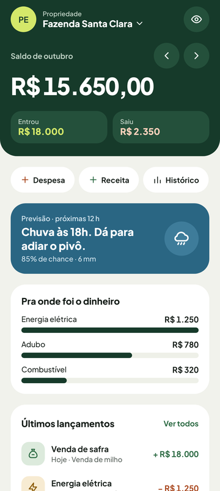
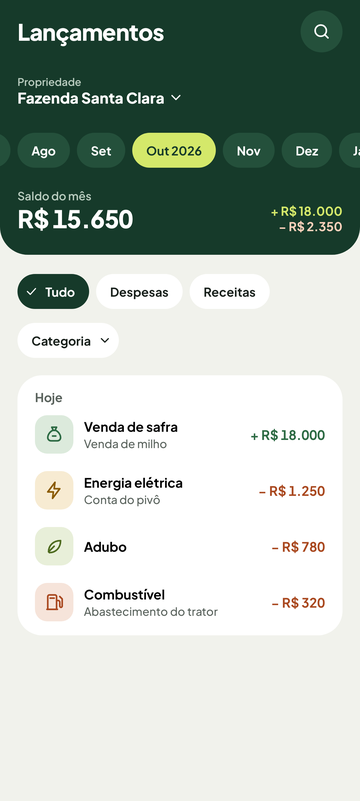
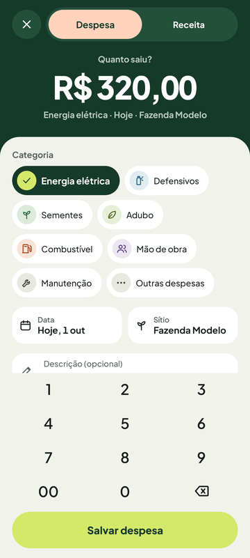
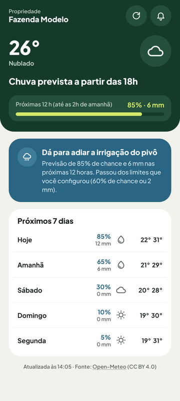
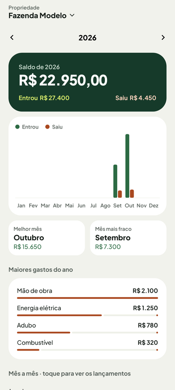
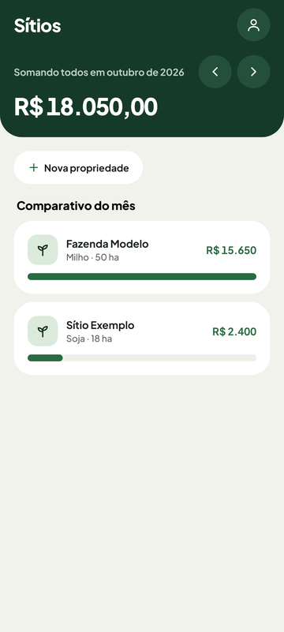
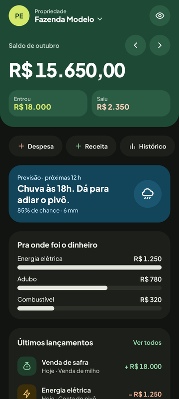
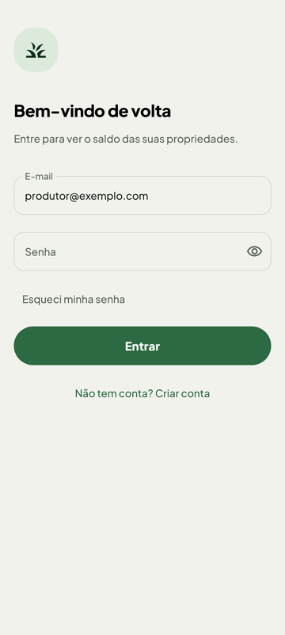

# AgroSaldo: documentação técnica

Esta é a documentação técnica completa do AgroSaldo, em um único arquivo, para os desenvolvedores do grupo. Ela descreve a branch `prod` (a principal), versão `1.5` (`versionCode 6`), em 28/10/2026, já com as correções da auditoria de código.

## Sumário

1. [Visão geral](#1-visão-geral)
2. [Primeiros passos](#2-primeiros-passos)
3. [Como contribuir](#3-como-contribuir)
4. [Arquitetura](#4-arquitetura)
5. [Padrões de projeto e design](#5-padrões-de-projeto-e-design)
6. [Estrutura de pastas](#6-estrutura-de-pastas)
7. [Regras de negócio](#7-regras-de-negócio)
8. [Regras de código](#8-regras-de-código)
9. [Módulo :domain](#9-módulo-domain)
10. [Dados e injeção de dependência](#10-dados-e-injeção-de-dependência)
11. [Banco de dados e arquivos da raiz](#11-banco-de-dados-e-arquivos-da-raiz)
12. [Ponto de entrada e navegação](#12-ponto-de-entrada-e-navegação)
13. [Funcionalidades e telas](#13-funcionalidades-e-telas)
14. [Componentes, utilitários e aviso de chuva](#14-componentes-utilitários-e-aviso-de-chuva)
15. [Tema e design system Safra](#15-tema-e-design-system-safra)
16. [Manifesto e recursos](#16-manifesto-e-recursos)
17. [Data classes: domínio](#17-data-classes-domínio)
18. [Data classes: regras e resultados](#18-data-classes-regras-e-resultados)
19. [Data classes: tabelas do Room](#19-data-classes-tabelas-do-room)
20. [Data classes: UiState das telas](#20-data-classes-uistate-das-telas)
21. [Data classes: tema e navegação](#21-data-classes-tema-e-navegação)
22. [Segurança e privacidade](#22-segurança-e-privacidade)
23. [Testes](#23-testes)
24. [Qualidade de código e CI](#24-qualidade-de-código-e-ci)
25. [Build e versões](#25-build-e-versões)
26. [Bibliotecas e plugins](#26-bibliotecas-e-plugins)
27. [Branches e release](#27-branches-e-release)
28. [Escopo e decisões](#28-escopo-e-decisões)
29. [Auditoria de arquitetura](#29-auditoria-de-arquitetura)
30. [Histórico do projeto](#30-histórico-do-projeto)
31. [Roadmap](#31-roadmap)
32. [Glossário](#32-glossário)

---

## 1. Visão geral

O AgroSaldo é um app Android nativo, em Kotlin, que o pequeno produtor rural usa para controlar **receitas e despesas por propriedade** (sítio) e para receber **aviso de chuva**, que recomenda adiar a irrigação do pivô.

Esta documentação foi escrita para os desenvolvedores do grupo: quem nunca abriu o projeto consegue entender **o que existe, onde fica e por que foi feito assim**. Ela descreve a branch `prod` (a principal) na versão `1.5` (`versionCode 6`), em 28/10/2026, já com as correções da auditoria de código.

> **Dica:** se você vem de NestJS ou React, procure as analogias nos textos e no [Glossário](#32-glossário). Exemplo: o ViewModel é como um service com estado, e o Compose é como React com state.

### O app em uma tabela

| Área | O que o produtor consegue fazer |
| --- | --- |
| Conta | Criar conta local com senha, aceitar a política de privacidade (LGPD), entrar, trocar a senha, excluir a conta e ligar o bloqueio por digital |
| Sítios | Cadastrar, editar e excluir propriedades. A exclusão leva os lançamentos junto e tem "Desfazer" |
| Lançamentos | Registrar receitas e despesas por categoria, com teclado numérico próprio; editar, copiar ("lançar de novo"), filtrar e excluir |
| Início | Ver o saldo do mês, receitas, despesas, maiores gastos e o cartão de chuva |
| Histórico | Ver o ano mês a mês e o ranking de gastos |
| Clima | Ver a previsão por hora e por dia e ajustar o aviso de chuva |
| Aviso de chuva | Receber notificação em segundo plano quando a chance ou o volume de chuva passa do limite escolhido |

### O que é importante saber antes de mexer

- **O app é 100% local.** Os dados ficam no celular, em um banco Room (SQLite). Não há servidor nem sincronização. A única chamada de rede é a previsão do tempo da Open-Meteo.
- **O projeto é acadêmico** (UCE, Engenharia de Software, UNIFAE), tem usuário real e segue **MVVM** com **persistência local em Room**.
- **O domínio é um módulo à parte** (`:domain`, Kotlin puro). O compilador recusa qualquer `import android.*` ali.
- **A injeção de dependência é do Hilt**, com módulos na pasta `di/`.
- **O código de produção não tem dado de exemplo.** O app sempre abre vazio. Fakes e dados de exemplo ficam só nos testes.

### Em números

| Item | Quantidade |
| --- | --- |
| Módulos Gradle | 2 (`:app` e `:domain`) |
| Arquivos Kotlin de produção | 120 no `:app` e 24 no `:domain` |
| Telas (arquivos `*Screen.kt`) | 15, com 13 ViewModels de tela (o consentimento usa o `CadastroViewModel` e a política não tem estado) |
| Tabelas no banco | 4 (`usuarios`, `propriedades`, `lancamentos`, `previsoes`), banco na versão 4 |
| Testes de JVM | 585: 90 no `:domain` e 495 no `:app` (com os 21 de banco do `src/sharedTest`: 16 de DAO e 5 de migração) |
| Testes no aparelho | 21 (os mesmos testes de banco do `src/sharedTest`, que também rodam no JVM) |
| Achados do detekt | 0, sem baseline |

### Stack

| Camada | Tecnologia | Versão |
| --- | --- | --- |
| Linguagem | Kotlin | 2.4.21 |
| Interface | Jetpack Compose + Material 3 | BOM 2026.09.00 |
| Arquitetura | MVVM + Repository, com o domínio puro | |
| Banco local | Room (SQLite) | 2.8.5 |
| Injeção de dependência | Hilt | 2.60.1 |
| Segundo plano | WorkManager | 2.12.0 |
| Navegação | Navigation Compose | 2.10.2 |
| Rede | `HttpURLConnection` e `org.json` (só a Open-Meteo, por HTTPS) | da plataforma |
| Build | Android Gradle Plugin e Gradle | 9.5.0 e 9.8.2 |
| Testes | JUnit 4, coroutines-test, Robolectric, Roborazzi | 4.13.2, 1.11.0, 4.17, 1.77.0 |
| Qualidade | ktlint, detekt, Android Lint, GitHub Actions | 14.2.0, 1.23.8 |

SDKs: `minSdk 26` (Android 8.0), `compileSdk 37` e `targetSdk 37`. O código compila para Java 11.

### Por onde começar

1. [Primeiros passos](#2-primeiros-passos): instalar o ambiente, rodar o app e os testes.
2. [Como contribuir](#3-como-contribuir) e [Branches e release](#27-branches-e-release): o fluxo de trabalho do grupo.
3. [Arquitetura](#4-arquitetura): as camadas e o porquê de cada decisão.
4. [Estrutura de pastas](#6-estrutura-de-pastas): o que mora em cada pasta.
5. [Regras de código](#8-regras-de-código) e [Regras de negócio](#7-regras-de-negócio): o que não pode ser quebrado.

### Se você vai mexer em...

| Assunto | Leia |
| --- | --- |
| Uma regra de negócio, validação ou cálculo de saldo | [Módulo :domain](#9-módulo-domain) e [Regras de negócio](#7-regras-de-negócio) |
| Banco, DAOs, repositórios ou injeção de dependência | [Dados e injeção de dependência](#10-dados-e-injeção-de-dependência) e [Banco de dados](#11-banco-de-dados-e-arquivos-da-raiz) |
| Uma tela existente ou uma tela nova | [Funcionalidades e telas](#13-funcionalidades-e-telas) e [Componentes e utilitários](#14-componentes-utilitários-e-aviso-de-chuva) |
| Navegação, abas, bloqueio ou notificação aberta | [Ponto de entrada e navegação](#12-ponto-de-entrada-e-navegação) |
| Cores, fontes, ícones ou espaçamentos | [Tema Safra](#15-tema-e-design-system-safra) |
| Aviso de chuva ou previsão do tempo | [Componentes, utilitários e aviso de chuva](#14-componentes-utilitários-e-aviso-de-chuva) |
| Senha, bloqueio, LGPD ou backup | [Segurança e privacidade](#22-segurança-e-privacidade) |
| Escrever ou entender testes | [Testes](#23-testes) |
| CI, ktlint, detekt ou lint | [Qualidade de código e CI](#24-qualidade-de-código-e-ci) |
| Gradle, versões ou uma biblioteca nova | [Build e versões](#25-build-e-versões) e [Bibliotecas e plugins](#26-bibliotecas-e-plugins) |
| Gerar um APK ou publicar | [Branches e release](#27-branches-e-release) |

### Como esta documentação é mantida

O arquivo `CLAUDE.md`, na raiz do repositório, guarda as regras permanentes do projeto. Este documento descreve o **como** e o **porquê** com mais detalhe. Quando o código mudar de forma relevante, atualize a seção da parte mexida e a data no início do texto.

---

## 2. Primeiros passos

Este guia leva você do repositório recém-clonado até o app rodando e os testes passando.

### O que instalar

| Item | Versão | Para quê |
| --- | --- | --- |
| Android Studio | Uma versão recente, que suporte o AGP 9.3 | IDE, emulador e SDK Manager |
| JDK 25 | 25 (Temurin ou o JetBrains Runtime do Android Studio) | O Gradle roda nele. O projeto declara a exigência em `gradle/gradle-daemon-jvm.properties` (`toolchainVersion=25`) |
| JDK 21 | 21 | Só para o detekt. O Gradle baixa sozinho pelo plugin `foojay-resolver-convention` (precisa de internet na primeira vez) ou você instala o Temurin 21 |
| Android SDK | Plataforma 37 e as build-tools | `compileSdk` e `targetSdk` são 37. Instale pelo SDK Manager |
| Git | Qualquer recente | O repositório é privado: peça acesso ao dono |

O código compila para **Java 11**. O JDK 25 é só o que roda o Gradle.

### Clonar e abrir

```bash
git clone https://github.com/Morettys2/AgroSaldo.git
cd AgroSaldo
```

1. No Android Studio, abra a **pasta raiz** (a que tem `settings.gradle.kts`).
2. Aguarde o *Gradle sync*. O Android Studio cria o `local.properties` sozinho, com o caminho do SDK. Esse arquivo **não vai para o Git**.
3. Em `File > Settings > Build Tools > Gradle`, confira se o **Gradle JDK** é o 25.

Se for rodar o Gradle pelo terminal, aponte o `JAVA_HOME` para o JDK 25.

### Rodar o app

1. Crie um emulador em `Device Manager` (Android 8.0 ou mais novo) ou conecte um celular com **depuração USB** ligada.
2. Escolha o módulo `app` e a variante `debug`, e clique em **Run**.
3. Pelo terminal, o equivalente é `./gradlew installDebug`.

No Windows, use `.\gradlew.bat` no PowerShell.

### Primeiro uso do app

- O app **sempre abre vazio**, até no modo debug. Crie uma conta, aceite a política, cadastre um sítio e lance uma receita.
- A senha precisa ter 8 caracteres, uma letra e um número, e não pode ser previsível (sem seu nome, e-mail ou senhas comuns).
- Com o bloqueio por digital ligado, o app usa `FLAG_SECURE`: **capturas de tela saem pretas**. É esperado.
- No modo debug, a tela "Aviso de chuva" mostra "Ferramentas de teste" para disparar uma notificação e uma verificação na hora.

### Comandos do dia a dia

```bash
./gradlew ktlintCheck        # confere a formatação (ktlintFormat arruma sozinho)
./gradlew detekt             # análise estática dos dois módulos: precisa dar zero achados
./gradlew testDebugUnitTest  # testes JVM do app, incluindo Robolectric e capturas
./gradlew :domain:test       # testes do módulo de domínio (rápidos, sem Android)
./gradlew assembleDebug      # compila o app inteiro
./gradlew lintDebug          # Android Lint (erro quebra o build)
```

Rode todos antes de commitar. É o mesmo conjunto que o CI roda.

Testes que precisam de aparelho (DAOs do Room):

```bash
./gradlew connectedDebugAndroidTest
```

Eles exigem emulador ou celular conectado e **não rodam no CI**. Ao terminar, o Gradle **desinstala o app** do aparelho. Se for usar o app depois, rode `installDebug` de novo.

### Estrutura mínima para se orientar

```text
AgroSaldo/
├── app/       módulo Android: telas, dados, DI, aviso de chuva
├── domain/    módulo Kotlin puro: regras de negócio
├── docs/      esta documentação
├── config/    configuração do detekt
└── CLAUDE.md  regras permanentes do projeto
```

O detalhe de cada pasta está em [Estrutura de pastas](#6-estrutura-de-pastas).

### Problemas comuns

| Sintoma | Causa e saída |
| --- | --- |
| O Gradle reclama da versão do Java | O Gradle precisa do JDK 25. Confira o Gradle JDK do Android Studio ou o `JAVA_HOME` |
| O detekt falha ao baixar a JVM 21 | O toolchain do detekt baixa o JDK 21 pelo foojay. Sem internet, instale o Temurin 21 |
| O lint falha de forma estranha ao rodar junto com outras tarefas | Rode `lintDebug` sozinho. O conjunto do CI (`ktlintCheck detekt testDebugUnitTest assembleDebug lintDebug`) roda limpo |
| O Robolectric quebra com erro de acesso ao JDK | Os argumentos de JVM necessários já estão no `app/build.gradle.kts`. Não os remova |
| O app abre e pede permissão de localização | É o botão "Usar minha localização" do formulário de sítio. A permissão só é pedida quando a pessoa toca nele |
| Print de tela preto | `FLAG_SECURE` com o bloqueio ligado. Desligue o bloqueio em Conta para capturar |

### Próximos passos

- Leia [Como contribuir](#3-como-contribuir) e [Branches e release](#27-branches-e-release).
- Depois, [Arquitetura](#4-arquitetura) para entender as camadas.

---

## 3. Como contribuir

Esta página mostra como uma mudança sai do seu computador e chega na `prod`, e dá as receitas para as tarefas mais comuns.

### O fluxo em 7 passos

1. **Atualize a `prod`** e crie uma branch para a tarefa: `git checkout prod`, `git pull` e `git checkout -b fix/nome-curto`. Prefixos usados: `feature/`, `fix/`, `refactor/`, `docs/`, `chore/`.
2. **Entenda antes de mexer.** Leia a página da pasta que você vai alterar (veja o [mapa na página inicial](#1-visão-geral)) e as [Regras de código](#8-regras-de-código).
3. **Escreva o código e o teste juntos.** Toda regra nova ganha teste. Todo bug corrigido ganha um teste que falharia antes da correção.
4. **Rode o mesmo conjunto do CI** no seu computador:

   ```bash
   ./gradlew ktlintCheck detekt testDebugUnitTest :domain:test assembleDebug lintDebug
   ```

5. **Commite em pedaços pequenos**, no padrão abaixo.
6. **Abra o Pull Request** para a `prod`, com o resumo do que mudou e por quê.
7. **Aguarde o CI ficar verde e a revisão.** Só faça merge depois que outra pessoa revisar e que a mudança tiver sido testada em um celular ou emulador.

Se a mudança depende de decisão de produto (um texto, um comportamento que o produtor vê), **pergunte** em vez de assumir.

### Padrão de commit

Conventional Commits, em português: `tipo(escopo): resumo no imperativo`.

| Tipo | Quando usar | Exemplo |
| --- | --- | --- |
| `feat` | Funcionalidade nova | `feat(clima): mostra a previsão por hora` |
| `fix` | Correção de bug | `fix(propriedade): impede área acima de 1.000.000 ha` |
| `refactor` | Muda a estrutura sem mudar o comportamento | `refactor(inicio): usa ResumoFinanceiro do domínio` |
| `test` | Só testes | `test(conta): cobre o bloqueio por tentativas` |
| `docs` | Documentação | `docs: explica o módulo de domínio` |
| `build`, `chore` | Gradle, dependências, configuração | `chore(detekt): zera o baseline` |

Cada commit deve compilar e passar nos testes. Use o seu próprio nome e e-mail no Git.

### Checklist do Pull Request

- [ ] O CI está verde: ktlint, detekt, testes, build e lint.
- [ ] Não surgiu **warning novo** do Kotlin.
- [ ] Há teste para a regra nova ou para o bug corrigido.
- [ ] Nenhum segredo, chave ou dado pessoal real entrou no código, no teste ou na documentação.
- [ ] A documentação em `docs/` foi atualizada se o comportamento ou a estrutura mudou.
- [ ] Se mexeu em DAO, entidade ou migração, os testes de aparelho (`connectedDebugAndroidTest`) foram rodados.

### Receita: adicionar uma funcionalidade

Siga a direção das dependências, de dentro para fora:

1. **Domínio** (`domain/`): o modelo, a regra pura e a interface de repositório. Valide invariantes no `init` com `require`. Escreva o teste em `domain/src/test`.
2. **Dados** (`app/.../data/`): a entidade e o DAO do Room (se for dado persistido), a implementação do repositório (`*RepositoryRoom`) e o mapeador entre entidade e modelo.
3. **Injeção** (`app/.../di/`): registre o repositório em `RepositoriosModule` com um `@Provides`.
4. **ViewModel** (`feature/<area>/`): `@HiltViewModel` com `@Inject constructor`. Guarde o estado em um `MutableStateFlow` privado e exponha `uiState`.
5. **Tela** (`feature/<area>/`): uma `Route` que liga ao ViewModel com `hiltViewModel()` e uma `Screen` sem estado, que recebe `uiState` e lambdas. Use os componentes de `core/ui` e os espaçamentos de `Espacos`. Marque a prévia principal com `@PreviasDaTela` (claro, escuro e fonte 2×, em `ui/theme`).
6. **Navegação** (`core/navigation/`): crie a rota em `Rotas.kt` e registre o destino em `GrafosDeNavegacao.kt`.
7. **Testes do ViewModel** (`app/src/test`): use os fakes `*Memoria` e os relógios de teste, sem emulador.
8. **Documentação**: atualize [Funcionalidades e telas](#13-funcionalidades-e-telas) e as páginas das camadas que você tocou.

### Receita: mudar o banco

1. Altere a entidade em `data/local/entidade/`.
2. **Suba a versão** em `AgroSaldoDatabase` (hoje é a 4, então a próxima é a 5).
3. Escreva a `Migration(4, 5)` em `data/local/Migracoes.kt` e registre-a no `comMigracoes()`, que a produção e o teste usam.
4. Rebuilde: o Room exporta o novo schema em `app/schemas/.../5.json`. Versione esse arquivo.
5. Acrescente o teste no `MigracaoDoBancoTest` (`app/src/sharedTest`, roda no JVM com Robolectric e no aparelho): monte o arquivo da versão anterior com o SQL do JSON dela, abra com o `comMigracoes()` e confira os dados. Rode também `connectedDebugAndroidTest`.
6. **Nunca** use `fallbackToDestructiveMigration`: ele apagaria os dados do produtor.

Dinheiro é sempre `INTEGER` em centavos, nunca `REAL`. Mais em [Banco de dados](#11-banco-de-dados-e-arquivos-da-raiz).

### Receita: adicionar uma biblioteca

1. Justifique no Pull Request: o problema que ela resolve e por que a plataforma ou uma biblioteca já usada não resolve.
2. Declare a versão e a biblioteca em `gradle/libs.versions.toml`. Nunca escreva a versão direto no `build.gradle.kts`.
3. Registre a biblioteca em [Bibliotecas e plugins](#26-bibliotecas-e-plugins).

### O que nunca fazer

- Usar `!!`. Trate o nulo explicitamente.
- Escrever cor literal fora de `ui/theme`.
- Importar `android.*`, Room, Compose ou Hilt dentro do `:domain`.
- Usar `GlobalScope`, `Dispatchers.*` ou `LocalDate.now()` soltos. Use o que o Hilt injeta: `viewModelScope`, `Despachantes` e `Clock`.
- Enfraquecer a senha (PBKDF2) ou remover `FLAG_SECURE`.
- Colocar dado de exemplo ou fake dentro de `src/main`.
- Colocar `Log` ou `println` com dado pessoal ou financeiro.
- Commitar `local.properties`, chave de assinatura ou APK.

A lista completa, com o porquê de cada regra, está em [Regras de código](#8-regras-de-código) e em [Segurança e privacidade](#22-segurança-e-privacidade).

### Quando atualizar a documentação

| Você mudou... | Atualize |
| --- | --- |
| Uma regra de negócio ou validação | [Regras de negócio](#7-regras-de-negócio) e [Módulo :domain](#9-módulo-domain) |
| Uma tela ou um ViewModel | [Funcionalidades e telas](#13-funcionalidades-e-telas) e a página de data classes de UiState |
| O banco | [Banco de dados](#11-banco-de-dados-e-arquivos-da-raiz) e [Dados e injeção de dependência](#10-dados-e-injeção-de-dependência) |
| Uma dependência ou o Gradle | [Bibliotecas e plugins](#26-bibliotecas-e-plugins) e [Build e versões](#25-build-e-versões) |
| O fluxo de trabalho ou o CI | Esta página e [Qualidade de código e CI](#24-qualidade-de-código-e-ci) |

---

## 4. Arquitetura

O app segue **MVVM + Repository em três camadas** (interface, domínio e dados), com a regra de negócio isolada num domínio em Kotlin puro e as dependências ligadas pelo Hilt. É o padrão recomendado no guia oficial de arquitetura do Android.

```text
 Tela (Compose)            ViewModel                 Domínio (:domain)              Dados (:app)
┌───────────────┐ eventos ┌────────────┐  chama     ┌───────────────────┐ implementa ┌──────────────────┐
│ *Route/*Screen│────────▶│ *ViewModel │───────────▶│ regras puras +    │◀───────────│ Room, prefs,     │
│ (só desenha)  │◀────────│ (UiState)  │  interfaces│ interfaces de     │            │ Open-Meteo,      │
└───────────────┘ UiState └────────────┘            │ Repository        │            │ WorkManager      │
                                ▲                   └───────────────────┘            └──────────────────┘
                                └───────── tudo ligado pelo Hilt (módulos em di/) ─────────────┘
```

As setas mostram quem chama quem: a tela manda eventos e recebe estado, o ViewModel usa o domínio, e a camada de dados implementa as interfaces do domínio. O Hilt monta tudo (módulos em `di/`) e entrega pronto.

### As camadas

| Camada | Pastas | O que faz | O que pode importar |
| --- | --- | --- | --- |
| Interface (UI) | `feature/`, `core/ui/`, `core/navigation/`, `ui/theme/` | Desenha as telas em Compose e repassa os toques ao ViewModel | Domínio, Compose, Android |
| ViewModel | `feature/*/*ViewModel.kt` | Guarda o estado da tela (`StateFlow<UiState>`), junta os dados dos repositórios e chama as regras do domínio | Domínio, coroutines, Lifecycle (nada de Compose) |
| Domínio | `domain/` (**módulo Gradle `:domain`**, Kotlin puro) | Modelos (`Lancamento`, `Propriedade`, `Usuario`), regras puras (`ResumoFinanceiro`, `RegraDeChuva`, `HashDeSenha`) e as **interfaces** dos repositórios | Só Kotlin e `java.time`. Garantido pelo compilador: é um módulo JVM, sem Android no classpath |
| Dados | `data/` | Implementa as interfaces do domínio com Room, `SharedPreferences` e a API da Open-Meteo | Domínio, Room, Android |
| Montagem | `di/` (módulos do Hilt), `AgroSaldoApp.kt` | O Hilt cria cada objeto uma vez (`@Singleton`) e entrega aos ViewModels, ao Worker e à Activity | Tudo |

A seta de dependência aponta **para dentro**: a interface e os dados conhecem o domínio, e o domínio não conhece ninguém. Por isso o domínio inteiro é testado no JVM, sem emulador. Para quem vem do NestJS: o ViewModel é um *service* com estado, o Repository é o *repository* do TypeORM, o DAO é a query, e os módulos do Hilt em `di/` fazem o papel do `@Module` e dos `providers` do NestJS.

### Como um dado chega na tela (leitura)

1. O `LancamentoDao` expõe `observarDoUsuario(usuarioId)`, uma `@Query` que devolve `Flow<List<LancamentoEntity>>`. O Room emite de novo sozinho sempre que a tabela muda.
2. O `LancamentoRepositoryRoom` converte cada `LancamentoEntity` no modelo `Lancamento` (`data/local/Mapeadores.kt`) e expõe `observarTodos()`, da interface `LancamentoRepository` do domínio.
3. O `InicioViewModel` faz `combine` desse fluxo com a `SelecaoAtual` (propriedade e mês escolhidos) e chama `ResumoFinanceiro.resumoDoMes(...)` e `rankingDeGastos(...)`.
4. O resultado vira um `InicioUiState` dentro de um `StateFlow`. Se a leitura falhar, `repetirAposErro { }` põe a mensagem em `uiState.erro` e tenta de novo.
5. A `InicioRoute` coleta com `collectAsStateWithLifecycle()` e passa o estado para a `InicioScreen`, que só desenha.

### Como um toque vira gravação (escrita)

1. Na `LancamentoFormScreen`, o botão Salvar chama a ação recebida em `LancamentoFormAcoes`.
2. O `LancamentoFormViewModel` monta o `Lancamento`; o `init` do modelo confere as invariantes (RN01, RN06) e o ViewModel confere a data (RN07, `dataDentroDoLimite`).
3. A gravação roda em `viewModelScope` dentro de `tentar { }`, que transforma exceção em mensagem sem engolir o cancelamento da coroutine.
4. O repositório chama `LancamentoDao.salvar(...)` (`@Upsert`). Gravações em mais de uma tabela, como excluir uma propriedade com os lançamentos, passam por `Transacao`.
5. O `Flow` da leitura emite de novo e todas as telas abertas se atualizam sozinhas.

### Decisões de arquitetura

| Decisão | Alternativa | Por que assim |
| --- | --- | --- |
| Injeção de dependência com Hilt | DI manual (`Dependencias` + `Factory`, usada até out/2026) | Elimina as 16 `Factory` e o container gigante, o Dagger valida todas as ligações na compilação e injeta ViewModel, Worker e Activity. É o padrão do mercado. Custo: uma biblioteca e geração de código (KSP) |
| Interfaces de repositório no domínio | ViewModel falando direto com o DAO | O ViewModel pode ser testado com um fake em memória, e trocar o Room por uma API não mexe nas telas |
| Modelos separados das entidades do Room | Usar a `@Entity` na tela | O domínio fica sem Room, e o formato do banco (centavos, `epochDay`, nomes de coluna) não vaza para a interface |
| `SelecaoAtual` injetada | `object` global | Estado compartilhado entre abas sem singleton; cada teste cria a sua |
| Activity única + Navigation Compose | Uma Activity por tela | Padrão atual do Compose: uma só pilha de navegação e transições sem recriar janelas |
| Tudo local | API própria em NestJS | Decidido em out/2026: o produtor usa um celular só. Os ids são UUID e as entidades têm `atualizado_em`, então dá para sincronizar no futuro |
| Fakes em `src/testFixtures` | MockK | Fakes reais em memória são reaproveitados pelos testes de JVM e de aparelho e não vão para o APK |

---

## 5. Padrões de projeto e design

No código, o app segue o **guia oficial de arquitetura do Android** (MVVM, fluxo de dados unidirecional e repositórios); no visual, segue o **Material 3** com uma identidade própria chamada **Safra**, desenhada no protótipo do Figma.

### Padrões de projeto usados

| Padrão | Onde aparece | Para que serve aqui |
| --- | --- | --- |
| MVVM (Model-View-ViewModel) | Toda `feature/`: `XxxScreen` + `XxxViewModel` + `XxxUiState` | Separa o desenho da tela do estado e da lógica; o ViewModel sobrevive à rotação da tela |
| Repository | Interfaces em `domain/repository/`; implementações em `data/repository/`, `data/preferencias/` e `data/sessao/` | Esconde de onde vem o dado (Room, `SharedPreferences`, API) atrás de uma interface |
| DAO (Data Access Object) | `data/local/dao/` | Concentra o SQL de cada tabela, conferido pelo Room em tempo de compilação |
| Mapper | `data/local/Mapeadores.kt` (`paraDominio()` / `paraEntidade()`) | Converte entre a linha do banco e o modelo do domínio |
| Injeção de dependência (Hilt) | módulos em `di/` + `@HiltViewModel` | Cada classe recebe o que usa pelo construtor; o teste troca por fakes |
| Service locator (evitado) | — | Antes, as `Factory` buscavam tudo num container global; com o Hilt cada ViewModel declara o que precisa e o Dagger entrega |
| Observer (fluxos reativos) | `Flow` do Room, `StateFlow` no ViewModel, `collectAsStateWithLifecycle` na tela | Quando o banco muda, todas as telas abertas se atualizam sozinhas |
| Unidirectional Data Flow + State hoisting | Telas recebem `uiState` e lambdas `aoXxx` | Estado desce, eventos sobem: a tela não guarda regra e vira fácil de testar e de pré-visualizar |
| Single Activity | `MainActivity` + Navigation Compose | Uma janela só, com todas as telas como destinos do `NavHost` |
| Command / Memento | `Desfazer` + `PropriedadeExcluida` | Guarda o que foi apagado para o botão "Desfazer" regravar |
| Unit of Work | `data/local/Transacao.kt` | Gravações em várias tabelas dão certo juntas ou não acontecem |
| Fake objects | `src/testFixtures` (`*Memoria`) | Implementações em memória das interfaces, no lugar de mocks |

### Princípios que o código segue

- **Inversão de dependência:** o domínio define as interfaces e as outras camadas dependem dele, nunca o contrário.
- **Regra de negócio pura:** saldo, ranking, regra de chuva e hash de senha são funções sem Android, testadas no JVM.
- **Invariantes no modelo:** `Lancamento`, `Propriedade` e `Usuario` validam os próprios dados no `init` (`require`), então um objeto inválido não chega a existir.
- **Dinheiro em centavos (`Long`) e datas em `java.time`:** nada de `Double` para valor nem `Date` legado.
- **Erros visíveis, nunca engolidos:** `tentar { }` e `repetirAposErro { }` levam a falha até a tela como mensagem.
- **Privacidade por padrão:** dados só no aparelho, senha com PBKDF2, `FLAG_SECURE` com o bloqueio ligado e backup só criptografado.

### Design visual: Safra

O visual tem nome próprio por causa dos componentes de `core/ui/Safra.kt` (`CabecalhoSafra`, `CartaoSafra`, `ChipSafra`). A tela típica tem:

- **cabeçalho verde-escuro** (VerdeNoite) com cantos de baixo arredondados, onde ficam o título, o seletor de sítio e o saldo;
- **cartões brancos** sobre um fundo cor de papel;
- **barra inferior em pílula**, com o item ativo em verde-limão.

| Elemento | Escolha | Por quê |
| --- | --- | --- |
| Base | Material 3 (Compose) | Componentes acessíveis prontos, tema claro e escuro |
| Cores | Verde = receita e marca, Terra = despesa, Água = clima, VerdeNoite = cabeçalho | Cada cor tem um significado fixo no app inteiro |
| Cor dinâmica (Material You) | Desligada | A cor de receita e despesa não pode mudar com o papel de parede |
| Contraste | Todo par texto/fundo ≥ 4,5:1 (WCAG AA) | Leitura no sol, no campo |
| Fonte | Plus Jakarta Sans, embutida no app | Funciona offline; algarismos tabulares (`tnum`) alinham os valores |
| Espaços | Escala única em `Espacos` | Margens iguais em todas as telas |
| Toque | Alvos de no mínimo 48 dp e botões de 56 dp que crescem com a fonte | Público com fonte grande no celular |
| Cor nunca sozinha | Categoria sempre com ícone e nome | Quem não distingue cores entende igual |
| Modo escuro | Segue o sistema, com tons mais claros e menos saturados | Evita "vibração" das cores sobre o fundo escuro |

Os valores exatos de cada cor, estilo de texto, forma e espaçamento estão na seção **Tema e design system Safra**, mais abaixo.

---

## 6. Estrutura de pastas

O projeto tem **dois módulos Gradle**:

- **`:domain`**: as regras de negócio em Kotlin puro. Não conhece Android, Room, Compose nem Hilt.
- **`:app`**: tudo que depende do Android (telas, banco, rede, injeção de dependência, aviso de chuva). Ele usa o `:domain`.

Os dois usam o pacote `br.joao.agrosaldo`. No `:app`, o código é dividido por **camada** e, dentro da interface, por **funcionalidade**.

### Raiz do repositório

```text
AgroSaldo/
├── .github/workflows/android.yml   CI: formatação, análise, testes, build e lint em todo push na prod e em todo PR
├── .editorconfig                   regras do ktlint (estilo Android Studio)
├── .gitignore                      deixa de fora build, chaves (*.jks), APK/AAB e local.properties
├── .idea/                          configurações locais do Android Studio (fora do Git, no `.gitignore`)
├── CLAUDE.md                       regras permanentes e decisões do projeto
├── docs/                           esta documentação (MDX)
├── build.gradle.kts                build da raiz: só declara os plugins
├── settings.gradle.kts             nome do projeto, repositórios e os módulos :app e :domain
├── gradle.properties               opções do Gradle (memória, configuration cache, estilo Kotlin)
├── gradle/
│   ├── libs.versions.toml          catálogo com todas as versões de bibliotecas e plugins
│   ├── gradle-daemon-jvm.properties  JDK 25 do daemon do Gradle (toolchain)
│   └── wrapper/                    Gradle Wrapper (versão fixa do Gradle)
├── gradlew / gradlew.bat           rodam o Gradle sem instalar nada
├── config/detekt/detekt.yml        regras do detekt
├── domain/                         módulo :domain (regras de negócio)
└── app/                            módulo :app (o aplicativo)
```

### Módulo `:domain`

```text
domain/
├── build.gradle.kts                plugin Kotlin JVM, java-test-fixtures e ktlint
└── src/
    ├── main/java/br/joao/agrosaldo/domain/
    │   ├── Despachantes.kt         em que thread cada tipo de trabalho roda (cálculo e io)
    │   ├── RelogioMonotonico.kt    relógio que não muda quando a hora do aparelho muda
    │   ├── model/                  Lancamento, Propriedade, Usuario, InstanteMonotonico
    │   ├── financeiro/             ResumoFinanceiro (saldo do mês, ranking de gastos)
    │   ├── clima/                  Previsao, RegraDeChuva, VerificadorDeChuva
    │   ├── conta/                  ContaService, HashDeSenha, RegrasDeConta, SenhasComuns
    │   └── repository/             10 interfaces de repositório
    ├── test/                       90 testes do domínio (JVM puro)
    └── testFixtures/               fakes em memória (*Memoria), DadosDeExemplo e relógios de teste
```

Os fakes das interfaces do domínio moram aqui porque implementam interfaces daqui. O `:app` os reaproveita nos testes dele.

### Módulo `:app`

```text
app/
├── build.gradle.kts                SDKs, versão do app, dependências, tarefas do detekt e dos testes
├── schemas/                        JSON de cada versão do banco, da 3 em diante (exportados pelo Room)
├── release/                        APKs assinados gerados pelo Android Studio (fora do Git)
└── src/
    ├── main/                       o app que vai para o celular
    │   ├── AndroidManifest.xml
    │   ├── java/br/joao/agrosaldo/ código Kotlin (abaixo)
    │   ├── res/                    cores do sistema, textos, ícone, fontes, regras de backup
    │   └── assets/licencas/        licença da fonte Plus Jakarta Sans
    ├── testFixtures/               AjustesAvisoMemoria, Semeador e TransacaoDireta (dependem do app)
    ├── test/                       testes no JVM: ViewModels, dados, Worker, telas, capturas e o grafo do Hilt
    └── sharedTest/                 testes de DAO e de migração do Room: no JVM (Robolectric) e no aparelho
```

#### Pacote `br.joao.agrosaldo` (módulo `:app`)

```text
agrosaldo/
├── AgroSaldoApp.kt         Application (@HiltAndroidApp): monta o grafo do Hilt, cria o canal e agenda o aviso
├── MainActivity.kt         Activity única: tema, splash, FLAG_SECURE, toque na notificação
├── di/                     módulos do Hilt (6 arquivos): Tempo, Banco, Preferências, Repositórios, Serviços e o qualificador EscopoDoApp
├── data/                   implementações das interfaces do domínio
│   ├── SelecaoAtual.kt     propriedade e mês escolhidos, compartilhados entre as abas
│   ├── Desfazer.kt         guarda a última exclusão para o botão "Desfazer"
│   ├── LimpezaDaConta.kt   o que o app limpa ao trocar ou excluir a conta
│   ├── RelogioDoAparelho.kt e RelogioMonotonicoDoAndroid.kt   os relógios reais
│   ├── local/              Room: AgroSaldoDatabase, Mapeadores, Transacao, TransacaoRoom
│   │   ├── dao/            UsuarioDao, PropriedadeDao, LancamentoDao, PrevisaoDao
│   │   └── entidade/       as 4 tabelas (@Entity)
│   ├── repository/         5 implementações: 4 *RepositoryRoom e UsuarioLogadoRoom
│   ├── clima/              OpenMeteo (endereço e leitura do JSON) e FontePrevisao (HTTP)
│   ├── preferencias/       ajustes do aviso e do "olho" (SharedPreferences)
│   └── sessao/             sessão, bloqueio por digital e contador de senhas erradas
├── feature/                uma pasta por área do app (Screen + ViewModel + partes)
│   ├── inicio/             resumo do mês (3 arquivos)
│   ├── lancamento/         lista e formulário de lançamentos (10)
│   ├── propriedade/        lista e formulário de sítios (4)
│   ├── clima/              previsão e ajustes do aviso (6)
│   ├── historico/          resumo do ano (2)
│   ├── sessao/             ViewModels globais da navegação: sessão/bloqueio e valores ocultos (2)
│   └── conta/              login, cadastro, LGPD, conta, senha, bloqueio (14)
├── core/                   peças compartilhadas pelas features
│   ├── navigation/         rotas, NavHost, barra inferior, transições, regras de navegação (7)
│   ├── ui/                 componentes Safra, botões, estados, campos, seletores (12)
│   ├── util/               dinheiro, datas, números, erros, textos (8)
│   ├── localizacao/        GPS para preencher as coordenadas do sítio (2)
│   └── seguranca/          Biometria (1)
├── aviso/                  Worker, notificação e textos do aviso de chuva (3)
└── ui/theme/               Color, Type, Shape, Espacos, IconesAgro, Theme (6)
```

### Pastas de teste

| Pasta | O que tem | Como rodar |
| --- | --- | --- |
| `domain/src/test` | Testes das regras de negócio, das contas e das validações | `./gradlew :domain:test` |
| `domain/src/testFixtures` | Fakes `*Memoria` das interfaces do domínio, `DadosDeExemplo` e relógios de teste | (compilada junto com os testes) |
| `app/src/test` | ViewModels, dados com DAOs falsos, Worker, preferências, telas (Robolectric), capturas (Roborazzi) e o grafo do Hilt | `./gradlew testDebugUnitTest` |
| `app/src/testFixtures` | `AjustesAvisoMemoria`, `Semeador` e `TransacaoDireta` | (compilada junto com os testes) |
| `app/src/sharedTest` | DAOs do Room, no JVM com Robolectric e no aparelho | `./gradlew testDebugUnitTest` (também no CI) e `connectedDebugAndroidTest` |

Detalhes em [Testes](#23-testes).

### Convenção de nomes

- **Negócio em português:** `Lancamento`, `Propriedade`, `aoSalvar`, `valorCentavos`, `repetirAposErro`.
- **Sufixos técnicos do Android em inglês:** `Repository`, `Entity`, `Dao`, `Screen`, `ViewModel`, `UiState`, `Route`.
- **Callbacks começam com `ao`:** `aoSalvar`, `aoClicar`, `aoAvancarMes` (como `onSave` em inglês).
- **A implementação leva a tecnologia no nome:** `LancamentoRepositoryRoom` implementa `LancamentoRepository`; `SessaoPreferencias` implementa `SessaoRepository`; os fakes de teste terminam em `Memoria`.
- **Comentários de código em português**, explicando a intenção.

### Onde colocar um arquivo novo

| O arquivo é... | Vai para |
| --- | --- |
| Uma regra de negócio ou um modelo | `domain/.../model`, `financeiro`, `clima` ou `conta` |
| A interface de um repositório | `domain/.../repository` |
| A implementação de um repositório | `app/.../data/repository` |
| Uma tabela ou um DAO do Room | `app/.../data/local/entidade` ou `dao` |
| A ligação de dependências | um módulo em `app/.../di` |
| Uma tela nova | `app/.../feature/<area>`, como `XxxScreen.kt` e `XxxViewModel.kt` |
| Um componente de UI usado por mais de uma tela | `app/.../core/ui` |
| Uma função de formatação (dinheiro, data, texto) | `app/.../core/util` |
| Cor, fonte, forma ou espaçamento | `app/.../ui/theme` |
| Um fake para teste de uma interface do domínio | `domain/src/testFixtures` |
| Uma rota de navegação | `app/.../core/navigation/Rotas.kt` e `GrafosDeNavegacao.kt` |

### Regras que decidem a arquitetura

- **O `:domain` não importa Android.** Se tentar, o build quebra.
- **O ViewModel não importa Compose.**
- **A tela não fala com repositório nem com DAO.** Ela só recebe `UiState` e lambdas.
- **Fakes e dados de exemplo ficam em `testFixtures`**, nunca em `src/main`.

A lista completa está em [Regras de código](#8-regras-de-código). O desenho das camadas está em [Arquitetura](#4-arquitetura).

---

## 7. Regras de negócio

| Regra | O que diz | Onde |
|---|---|---|
| RN01 | Todo lançamento pertence a exatamente uma propriedade | `Lancamento` (`init`) |
| RN02 | Excluir propriedade apaga os lançamentos e a previsão dela (CASCADE), com "Desfazer" | entidades Room + `excluirComLancamentos` / `restaurar` |
| RN03 | Saldo do período = receitas − despesas | `domain/financeiro/ResumoFinanceiro.kt` |
| RN04 | Aviso de chuva (abaixo) | `domain/clima/RegraDeChuva.kt` |
| RN06 | Valor sempre positivo; o sinal vem do tipo | `Lancamento` (`init`) e `ResumoFinanceiro.totais` |
| RN07 | Data no máximo 12 meses no futuro, checada ao salvar | `Lancamento.dataDentroDoLimite` |

**RN04 — aviso de chuva:** avisa quando, nas próximas N horas (padrão 12), **chance máxima ≥ limite (padrão 60%) OU chuva somada ≥ limite (padrão 2 mm)**.

- Os limites são do usuário (tela "Aviso de chuva").
- A regra é a função pura `RegraDeChuva` e é toda coberta por teste.
- Os textos da chuva ficam num lugar só, `core/util/TextosDaChuva.kt`, usados pelo Início, pelo Clima e pela notificação.

---

## 8. Regras de código

1. **Nada de `!!`.** Trate nulo explicitamente.
2. **Nenhuma cor literal fora de `ui/theme`.** Use `MaterialTheme.colorScheme` ou `MaterialTheme.agro`.
3. **Nada de `GlobalScope`.** Use `viewModelScope`.
4. **O módulo `:domain` não importa Android**: nada de `android.*`, `androidx.*`, Room, Compose nem Hilt. Não é só convenção: é um módulo Kotlin JVM, e o build quebra se alguém tentar.
5. **ViewModel não importa Compose.**
6. **Dinheiro é `Long` em centavos.** Formatação só na UI (`core/util/Moeda.kt`). No banco, `INTEGER`, nunca `REAL`.
7. **Datas são `java.time`** (`LocalDate`, `YearMonth`, `Instant`). Nada de `LocalDate.now()` no `init` de modelo: foi o crash corrigido na R5. A regra de data futura (RN07) é checada ao salvar, com `Lancamento.dataDentroDoLimite`.
8. **Regra de negócio mora no domínio.** Saldo, ranking e afins são funções puras em `domain/` (ex.: `ResumoFinanceiro`), testadas sem Android. O ViewModel só junta dados e chama o domínio.
9. **Nada de estado global.** Estado compartilhado (ex.: `SelecaoAtual`, `Desfazer`) é `@Singleton` num módulo do Hilt e chega pelo construtor.
10. **Fakes e dados de exemplo ficam em `src/testFixtures`**, nunca em `src/main`: o APK não leva código de teste e o app começa sempre vazio, também no debug.
11. **Erros em coroutine:** use `tentar { }` (`core/util/Erros.kt`), que não engole `CancellationException`, e mostre a mensagem com `mensagemParaUsuario(...)`. Todo `Flow` lido do banco tem `.catch` e um campo de erro no UiState.
12. **Gravações que mexem em mais de uma tabela** vão numa transação (`data/local/Transacao.kt`).
13. **Composables sem estado** quando possível: recebem `uiState` e lambdas (ou uma classe `*Acoes` quando são muitas), não o ViewModel. Todo composable que desenha recebe `modifier`. Toda tela tem as prévias clara, escura e com fonte 2×: a multiprévia `@PreviasDaTela` (`ui/theme`).
14. **Use os componentes de `core/ui`** (`BotaoPrincipal`, `BotaoSecundario`, `BotaoDestaque`, `BotaoTonal`, `Carregando`, `EstadoVazio`, `EstadoErro`, `FaixaDeAviso`) e os espaçamentos de `Espacos`. Nada de botão refeito à mão nem `dp` solto para margem. Alvos de toque com no mínimo 48 dp e `heightIn`, não `height` fixo.
15. **Callback dentro de `LaunchedEffect`** passa por `rememberUpdatedState`.
16. **Propriedade privada com `_`** só existe se houver a pública correspondente (`_uiState` / `uiState`).
17. **Biblioteca nova** só com justificativa, e sempre pelo `libs.versions.toml`.
18. **Todo texto digitado tem limite**, valido no domínio (`require`) e cortado no ViewModel ao digitar ou colar: descrição do lançamento 200, nome da propriedade 80, cultura 60, e-mail 254, área até 1.000.000 ha (e sempre finita). O domínio é a última barreira: nunca confie só na tela.
19. **Ler e apagar vão na mesma transação.** `LancamentoRepository.excluir` devolve um `LancamentoExcluido` (o lançamento e o instante da última gravação) ou `null`, e `restaurar` regrava com o mesmo instante: o "Desfazer" devolve exatamente o que saiu do banco, no mesmo lugar da lista.
20. **Tempo e threads vêm injetados:** hora do calendário por `java.time.Clock` (`LocalDate.now(relogio)`, nunca `now()` solto), duração por `RelogioMonotonico` e `Despachantes` no lugar de `Dispatchers.*`. Nos testes use `relogioEm`, `relogioPorMs`, `RelogioMutavel` e `DespachantesDeTeste` (`testFixtures`).

---

## 9. Módulo :domain

A camada de domínio concentra as **regras de negócio** do AgroSaldo: modelos, validações, cálculos financeiros, regra de chuva e casos de uso de conta. É Kotlin puro **e vive no módulo Gradle `:domain`** (pasta `domain/` na raiz do projeto, plugin `org.jetbrains.kotlin.jvm`): o Android nem está no classpath, então o compilador recusa qualquer `import android.*`, Room, Compose ou Hilt. Isso permite testar tudo direto na JVM, sem emulador. Ela também declara as **interfaces de repositório** (`domain/repository/`), que dizem *o que* o app precisa persistir; *como* isso é feito (Room, SharedPreferences, HTTP) fica na camada `data/`. Para quem vem do NestJS, é parecido com ter os services e as interfaces de repositório num módulo que não sabe se o banco é TypeORM, Prisma ou um mock.

### domain/model/

Entidades de negócio (data classes imutáveis) e os enums que o resto do app usa. Os invariantes são checados no `init`, com `require`, então um objeto inválido nem chega a existir.

#### Lancamento.kt

Define o lançamento financeiro (receita ou despesa) de uma propriedade e as categorias fixas.

- `TipoLancamento`: enum com `RECEITA` e `DESPESA`.
- `CategoriaLancamento`: enum das categorias fixas (RF06). Cada constante tem um `tipo` e um `rotulo`. As despesas são `ENERGIA`, `DEFENSIVOS`, `SEMENTES`, `ADUBO`, `COMBUSTIVEL`, `MAO_DE_OBRA`, `MANUTENCAO` e `OUTRAS_DESPESAS`; as receitas são `VENDA_SAFRA`, `ARRENDAMENTO` e `OUTROS`. `porTipo(tipo)` devolve as categorias de um tipo, na ordem em que foram declaradas.
- `Lancamento`: data class com `id`, `propriedadeId`, `tipo`, `categoria`, `valorCentavos`, `data` (`LocalDate`) e `descricao` (até `DESCRICAO_MAXIMA = 200` caracteres, checado no `init`).
  - `ehReceita`: atalho booleano.
  - `MESES_NO_FUTURO = 12` e `dataDentroDoLimite(data, hoje)`: implementam a RN07 (a data não pode passar de 12 meses à frente).

Regras e decisões:

- **RN01**: `propriedadeId` não pode ser vazio, então todo lançamento pertence a uma propriedade.
- **RN06**: `valorCentavos` precisa ser maior que zero. O sinal vem do `tipo`, nunca do número.
- **Dinheiro em centavos (`Long`)**, nunca em `Double`, para evitar erro de ponto flutuante.
- A categoria precisa ser do mesmo tipo do lançamento (`categoria.tipo == tipo`).
- A RN07 depende do relógio, por isso **não** é checada no `init`: se fosse, um registro já gravado poderia falhar ao ser lido do banco. Ela é validada ao salvar.
- O **nome da constante** do enum é o que vai para o banco. Não dá para renomear sem migração (o rótulo pode mudar à vontade). Os rótulos ficam no domínio, e não em `strings.xml`, para a camada continuar sem dependência de Android.
- O `id` padrão é `UUID.randomUUID().toString()`.

#### Propriedade.kt

Modelo da propriedade rural e utilitários ligados a ela.

- `Propriedade`: `id`, `nome`, `cultura`, `areaHectares`, `latitude`, `longitude`. O `init` exige nome não vazio e com até `NOME_MAXIMO = 80` caracteres, cultura com até `CULTURA_MAXIMA = 60`, área **finita**, maior que zero e de no máximo `AREA_MAXIMA_HECTARES = 1.000.000`, latitude entre −90 e 90 e longitude entre −180 e 180.
- `PropriedadeExcluida`: "foto" de uma exclusão em cascata (RN02), com a propriedade, os lançamentos dela e o instante da última gravação de cada um, guardando os ids originais. Serve para desfazer a exclusão sem mudar a ordem da lista.
- `LancamentoExcluido` (em `Lancamento.kt`): um lançamento apagado e o instante da última gravação (`gravadoEm`). É o que `LancamentoRepository.excluir` devolve para o "Desfazer".
- `List<Propriedade>.emOrdemAlfabetica()`: ordena pelo nome com um `Collator` pt-BR e desempata pelo `id`.

Decisões:

- O **id é um UUID gerado no cliente**. Assim ele não colide com ids de um backend futuro, coisa que um autoincremento local não garantiria.
- A ordenação usa `Collator` porque o `COLLATE NOCASE` do SQLite mandaria nomes acentuados para o fim da lista. O desempate pelo id deixa estável a primeira da lista, que é a "propriedade padrão" das telas. O código cria um `Collator` novo a cada chamada porque ele não garante uso seguro entre threads.

#### Usuario.kt

Conta local do aparelho e versão do termo de privacidade.

- `Usuario`: `id` (UUID), `nome`, `email`, `senhaHash`, `consentimentoEm`, `versaoTermo` e `criadoEm`. O `init` exige nome, e-mail e hash preenchidos.
- `TermoDePrivacidade.VERSAO_ATUAL = 3`: versão vigente do termo. Histórico das versões (o código não o guarda mais): 1 é o texto inicial, 2 acrescenta o uso opcional da localização e 3 trata do backup do Android e do que a exclusão da conta apaga.

Regras: `senhaHash` segue o formato de `HashDeSenha`, e a senha em texto puro nunca é guardada. `consentimentoEm` e `versaoTermo` registram o aceite LGPD (RNF10). Quando `VERSAO_ATUAL` sobe, quem aceitou uma versão anterior vê o termo de novo.

#### InstanteMonotonico.kt

Representa um instante no relógio monotônico do aparelho, usado no bloqueio por tentativas de senha.

- `InstanteMonotonico(boot, desdeOBootMs)`: identificador do boot e milissegundos desde aquele boot.
- `mais(ms)`: devolve uma cópia avançada em `ms`.

Decisão: o relógio monotônico (no Android, `SystemClock.elapsedRealtime`) **não muda quando o usuário altera a data/hora** do sistema, mas volta a zero a cada reinício. Por isso dois instantes só podem ser comparados quando têm o mesmo `boot`.

### domain/conta/

Casos de uso de conta: cadastro, login, troca de senha, exclusão, hash de senha e validação de dados.

#### ContaService.kt

Serviço central de conta local (RF01, RF02, RNF10, RF16). Ele encapsula hash, sessão e bloqueio por tentativas. Os ViewModels só consomem os resultados.

Tipos de resultado (sealed interfaces, parecidos com uniões discriminadas do TypeScript):

- `ResultadoCadastro`: `Sucesso`, `EmailJaCadastrado`, `TermoNaoAceito`, `DadosInvalidos(motivo)`.
- `ResultadoLogin`: `Sucesso`, `CredenciaisInvalidas`, `Bloqueado(segundosRestantes)`.
- `ResultadoExclusao`: `Sucesso`, `SenhaIncorreta`, `Bloqueado`, `SemSessao`.
- `ResultadoAlteracaoSenha`: `Sucesso`, `SenhaAtualIncorreta`, `NovaIgualAAtual`, `NovaNaoCumpreRequisitos`, `Bloqueado`, `SemSessao`.

Membros principais de `ContaService`:

- `usuarioLogadoId`, `estaLogado()` e `observarUsuarioLogado()`: estado da sessão. O Flow volta a emitir em login, logout e alterações do registro.
- `sessaoDeContaNova` e `esquecerContaNova()`: ficam `true` quando a sessão começou num cadastro, para oferecer uma única vez o que só faz sentido para quem acabou de chegar (o comentário cita ligar o bloqueio por digital).
- `precisaNovoAceite()`: devolve `true` se o usuário aceitou uma versão anterior do termo, `false` sem sessão e `null` enquanto a conta ainda não foi lida do banco. `registrarNovoAceite()` grava o aceite da versão atual.
- `emailEmUso(email)`: diz se o e-mail já tem conta no aparelho.
- `cadastrar(nome, email, senha, aceitouTermo)`: revalida tudo (o serviço é "a última barreira", mesmo que a UI já tenha validado), normaliza o e-mail, gera o UUID e o hash e conecta a sessão.
- `entrar(email, senha)`: faz o login, com bloqueio por tentativas.
- `sair()`: encerra a sessão.
- `alterarSenha(senhaAtual, novaSenha)`: exige a senha atual e aplica as regras de senha à nova.
- `excluirConta(senha)`: exclusão de dados (LGPD art. 18, VI) com reautenticação por senha.
- `validarSessao()`: chamado na abertura do app. Encerra a sessão se ela aponta para uma conta que não existe mais.

Regras e decisões visíveis no código:

- **Bloqueio por tentativas**: depois de `MAXIMO_TENTATIVAS = 5` falhas seguidas, bloqueia por `BLOQUEIO_MS = 30 s`. O tempo dobra a cada falha extra, até `BLOQUEIO_MAXIMO_MS = 15 min` (no máximo 5 dobras).
- O contador é **um por e-mail**, e é o mesmo para login, troca de senha e exclusão, para nenhum desses fluxos virar atalho para força bruta. A chave é o **SHA-256 do e-mail normalizado**, então o e-mail não fica gravado em claro. De propósito, não há contador global: com ele, quem pegasse o celular conseguiria bloquear todas as contas.
- **Dois relógios no bloqueio**: o fim do bloqueio é gravado no relógio de parede (`bloqueadoAte`) e no monotônico (`fimMonotonico`). Enquanto o aparelho não reinicia, vale o monotônico, então mudar a data/hora não adianta. Depois de um reinício, a espera recomeça inteira no boot novo (`recomecarDepoisDoReinicio`), porque o relógio de parede pode ter sido adiantado: reiniciar nunca encurta o bloqueio. O relógio de parede só decide quando o sistema não informa o boot; se o tempo restante passar do máximo (relógio alterado), o bloqueio é reancorado no máximo.
- **Proteção contra enumeração por tempo de resposta**: quando o e-mail não existe, a senha é conferida contra um `hashFicticio`. Assim a resposta demora o mesmo que uma senha errada, e o login responde igual nos dois casos.
- **Rehash transparente**: no login, se `hash.precisaAtualizar(...)` indicar menos iterações que o padrão atual, o hash é recalculado e salvo.
- O PBKDF2 consome bastante CPU (centenas de ms), então roda sempre em `despachantes.calculo` (`Dispatchers.Default` em produção), nunca na main thread.
- Corrida no cadastro: se dois cadastros com o mesmo e-mail passam juntos pela checagem, o índice único do e-mail barra o segundo, e `criar` devolve `false`.
- Os callbacks `aoTrocarDeUsuario` e `aoExcluirConta` deixam o serviço limpar estado externo (seleção, notificações, preferências) sem conhecer o Android. O `aoExcluirConta` recebe também `ultimaConta`, que diz se sobrou alguma conta no aparelho (`UsuarioRepository.contar()`).
- `emailEmUso` revela de propósito se o e-mail já existe e não passa pelo limite de tentativas. O comentário explica o motivo: as contas são locais, o cadastro precisa dessa informação, e a proteção contra adivinhação de senha fica no login.

#### HashDeSenha.kt

Gera e confere hashes de senha usando só a JCA da plataforma, sem biblioteca externa.

- `gerar(senha)`: cria um sal aleatório e deriva o hash.
- `confere(senha, armazenado)`: recalcula com o sal e as iterações gravados e compara em **tempo constante** (`MessageDigest.isEqual`). Um formato inválido devolve `false`.
- `precisaAtualizar(armazenado)`: devolve `true` se o hash gravado usa menos iterações que o configurado.
- `ficticio()`: monta um registro bem formado com bytes aleatórios, sem rodar o PBKDF2 (usado pelo `ContaService`).

Parâmetros e decisões:

- Algoritmo **PBKDF2-HMAC-SHA256** (`PBKDF2WithHmacSHA256`), **600.000 iterações** (`ITERACOES_PADRAO`, o mínimo da OWASP; o comentário estima de 0,5 a 1 s num aparelho intermediário), **sal de 16 bytes** e **hash de 256 bits**.
- Formato gravado: `pbkdf2_sha256$<iterações>$<sal base64>$<hash base64>`, em Base64 sem padding. Como as iterações ficam dentro do registro, dá para aumentar o custo sem invalidar hashes antigos.
- A senha é normalizada em **NFKC** (NIST 800-63B) antes de derivar o hash, e `clearPassword()` apaga a cópia guardada pelo `PBEKeySpec`.

#### RegrasDeConta.kt

Validação e normalização compartilhadas entre os formulários (feedback por campo) e o `ContaService` (validação final).

- `RequisitosSenha`: checklist com `temTamanhoMinimo`, `temLetraENumero`, `naoEhPrevisivel` e `todosCumpridos`.
- `RegrasDeConta.normalizarEmail(email)`: aplica `trim` e minúsculas. É a forma usada para busca e unicidade.
- `emailValido(email)`: validação mínima `x@y.z`, sem espaços, com até `EMAIL_MAXIMO = 254` caracteres. O comentário avisa que não há confirmação por e-mail.
- `nomeValido(nome)`: não vazio e com até `NOME_MAXIMO = 80` caracteres.
- `requisitosDaSenha(senha, email, nome)` e `senhaValida(...)`: senha de `SENHA_MINIMO = 8` a `SENHA_MAXIMO = 128` caracteres. O máximo comporta frases-senha e limita o custo do PBKDF2.
- `iniciais(nome)`: iniciais do primeiro e do último nome, ou `"?"` se o nome estiver vazio.

Uma senha é considerada **previsível** (NIST 800-63B) se:

- está em `SENHAS_COMUNS`, mesmo com um caractere a mais no início ou no fim;
- tem uma sequência crescente ou decrescente de 6 ou mais caracteres;
- contém "agrosaldo";
- usa 2 caracteres distintos ou menos;
- contém a parte local do e-mail ou partes do nome com 4 ou mais caracteres.

#### SenhasComuns.kt

Declara `SENHAS_COMUNS` (`internal`), um `Set<String>` curto e embutido no app com senhas frequentes em vazamentos no Brasil, todas em minúsculas. As senhas da lista são recusadas, seguindo a NIST SP 800-63B.

### domain/financeiro/

Cálculos financeiros puros, que recebem listas e devolvem valores.

#### ResumoFinanceiro.kt

Reúne num lugar só os totais, o saldo e o ranking de gastos. O comentário registra que, antes deste arquivo, cada ViewModel tinha sua própria versão da mesma conta. O código é testado em `ResumoFinanceiroTest`.

- `TotaisDoPeriodo(receitasCentavos, despesasCentavos)`:
  - `saldoCentavos`: receitas − despesas (RN03).
  - `temMovimento`: indica se houve alguma receita ou despesa.
  - `proporcaoReceitas`: receitas / (receitas + despesas). Vale `0.5` quando não há movimento, para a barra ficar neutra.
- `GastoPorCategoria(categoria, totalCentavos, proporcao)`: a `proporcao` é relativa à **maior** categoria (não ao total), então a primeira barra do ranking fica sempre cheia.
- `ResumoFinanceiro.totais(lancamentos)`: soma receitas e despesas sem filtrar nada.
- `doMes(lancamentos, propriedadeId, mes)`: filtra por propriedade e por `YearMonth`.
- `resumoDoMes(...)`: totais do mês (RN03).
- `rankingDeGastos(lancamentos, quantos)`: as `quantos` categorias de despesa com maior total, ignorando receitas. Num empate, vale a ordem do enum, para o ranking não "pular" entre duas recomposições iguais.
- `propriedadeAtual(propriedades, idSelecionado)`: devolve a propriedade selecionada ou, se ela não existir mais, a primeira da lista (`null` se a lista estiver vazia).

Decisão: são funções puras, sem banco, sem Android e sem relógio. O mesmo cálculo atende o Início, a lista de lançamentos, o Histórico e a lista de propriedades.

### domain/clima/

Modelo da previsão do tempo e regra do aviso de chuva (RN04).

#### Previsao.kt

Modelo da previsão, independente do provedor.

- `CondicaoTempo`: enum com `rotulo` (`CEU_LIMPO`, `POUCAS_NUVENS`, `NUBLADO`, `NEBLINA`, `GAROA`, `CHUVA`, `PANCADAS`, `TEMPESTADE`, `NEVE`, `DESCONHECIDA`). `doCodigoWmo(codigo)` converte o código WMO da Open-Meteo, e códigos não mapeados viram `DESCONHECIDA`.
- `PrevisaoDia`: `data`, `condicao`, `temperaturaMaxima` e `temperaturaMinima` (anuláveis, porque a API pode não mandar o valor do último dia), `chuvaMm` e `probabilidadeChuva` (0 a 100).
- `PrevisaoHora`: `horario` (hora local da propriedade), `probabilidadeChuva` e `chuvaMm`.
- `Previsao`: `latitude`, `longitude`, `obtidaEm`, `fusoSegundos`, `temperaturaAtual`, `condicaoAtual`, `dias` e `horas`. `horaLocal(instante)` converte um `Instant` para a hora local da propriedade.

Decisão: os horários estão no **fuso da propriedade** (`fusoSegundos`), não no fuso do aparelho.

#### RegraDeChuva.kt

Decide se a previsão justifica um aviso de chuva (RN04) e define as políticas de repetição de aviso e de cache.

- `LimitesChuva(probabilidadeMinima = 60, chuvaMinimaMm = 2.0, janelaHoras = 12)`: limites configuráveis. O `init` rejeita valores fora das faixas permitidas: probabilidade de 10 a 100, chuva de 0,5 a 50 mm e janela de 3 a 48 h.
- `MotivoChuva`: `PROBABILIDADE`, `VOLUME` ou `AMBOS`.
- `AvaliacaoChuva`: `vaiChover`, `probabilidadeMaxima`, `chuvaTotalMm`, `inicioPrevisto`, `motivo` e `temDados` (`false` quando a previsão guardada não cobre a janela).
- `RegraDeChuva.avaliar(previsao, agora, limites)`: função pura que calcula a avaliação.
- `ControleDeAvisos.podeAvisar(ultimoAvisoEm, agora)`: evita repetir o aviso. Exige pelo menos `INTERVALO_MINIMO = 11 h` desde o último aviso da propriedade.
- `PoliticaDeAtualizacao`: `VALIDADE = 1 h` (tempo até buscar de novo), `VALIDADE_MAXIMA_CACHE = 2 dias` (idade máxima para mostrar a previsão em cache como "última conhecida") e `precisaAtualizar(obtidaEm, agora)`.

Regra de chuva:

- **Vai chover** se, nas próximas `janelaHoras` horas, a **maior probabilidade horária for ≥ 60%** **OU** a **chuva somada for ≥ 2 mm** (padrões). As duas comparações incluem o próprio limite.
- A janela começa no início da hora corrente (14h40 vira 14h).
- `inicioPrevisto` é a primeira hora da janela que atinge o limite de probabilidade ou tem pelo menos `CHUVA_MINIMA_POR_HORA_MM = 0.1` mm. Abaixo disso, o comentário chama de "traço de garoa".
- Uma `TOLERANCIA = 1e-9` absorve erro de arredondamento da soma de `Double` (por exemplo, 1,9999999 mm contra 2 mm).
- O intervalo mínimo de 11 h, e não 12 h, tolera a imprecisão de agendamento do WorkManager (a verificação roda a cada 12 h).
- A validade de 1 h existe porque a Open-Meteo atualiza os modelos de hora em hora. Buscar com mais frequência só gastaria dados móveis e a cota gratuita.

#### VerificadorDeChuva.kt

Caso de uso da verificação periódica de chuva (RN04), executada a cada 12 h pelo Worker. Não tem dependência de Android: o Worker passa uma função `notificar` que mostra a notificação.

- `AvisoDeChuva`: `propriedadeId`, `nomePropriedade`, `avaliacao` e `verificadoEm` (hora local, base para textos como "amanhã às 2h").
- `ResultadoVerificacao`: `avisos` notificados e `falhaPassageira` (sem rede ou serviço fora do ar).
- `VerificadorDeChuva.verificar(notificar)`: o fluxo principal.
  1. Não faz nada se o aviso estiver desligado ou não houver sessão.
  2. Esquece o registro de aviso das propriedades excluídas (`esquecerAvisosExceto`).
  3. Para cada propriedade com aviso ativo, chama `clima.atualizar`. Numa falha passageira (`SemConexao`/`Indisponivel`), usa o cache se ele tiver **até 12 h** (`VALIDADE_PARA_AVISO`). Numa `Falha` definitiva, pula a propriedade.
  4. Aplica `RegraDeChuva` e `ControleDeAvisos`.
  5. Notifica e **só então** registra o aviso (`registrarAviso`).

Decisões:

- **Checagem de conta (`mesmaConta()`)** antes e durante o laço: se houver logout ou troca de conta no meio da verificação, ela para, para não expor nomes de propriedades de outra conta.
- Um aviso que não pôde ser exibido (permissão negada) não é registrado. Assim ele não bloqueia o próximo aviso.
- `falhaPassageira` só é devolvido como `true` se a conta continua a mesma, porque uma nova tentativa só faz sentido para quem começou a verificação.

### domain/repository/

Interfaces que a camada `data/` implementa (a "porta" do padrão ports & adapters) e alguns tipos auxiliares.

#### UsuarioRepository.kt

Interface das contas locais: `observar(id)`, `buscarPorId(id)`, `buscarPorEmail(email)` (o e-mail precisa vir normalizado), `criar(usuario)` (devolve `false` se o e-mail já existir), `atualizarSenha(id, senhaHash)`, `registrarConsentimento(id, em, versao)`, `excluir(id)` (remove a conta e, em cascata, as propriedades e os lançamentos dela) e `contar()` (quantas contas há no aparelho: só sem nenhuma, excluir a conta volta o bloqueio e os valores ocultos ao padrão).

#### PropriedadeRepository.kt

Acesso às propriedades do usuário conectado: `observarTodas()`, `buscarPorId`, `salvar`, `excluirComLancamentos(id)` (RN02: uma transação só, devolvendo uma `PropriedadeExcluida` para desfazer, ou `null`) e `restaurar(excluida)` (reinsere tudo numa transação, com os instantes de gravação originais).

#### LancamentoRepository.kt

Acesso aos lançamentos do usuário conectado: `observarTodos()`, `buscarPorId`, `salvar`, `excluir(id)`, que lê e apaga na **mesma transação** e devolve um `LancamentoExcluido` (o lançamento e o instante da última gravação; `null` se não existia ou era de outra conta), e `restaurar(excluido)`, que regrava com o mesmo instante, para o "Desfazer" devolver exatamente o que saiu do banco. A interface expõe a lista completa, e os filtros por propriedade e período ficam no ViewModel.

#### ClimaRepository.kt

Previsão do tempo por propriedade, no modelo **cache-first**: a UI observa o cache, e a rede só substitui o valor guardado.

- `ResultadoAtualizacao`:
  - `Sucesso(previsao)`;
  - `SemConexao`: falha de rede ou tempo esgotado;
  - `Indisponivel(motivo)`: HTTP 429 ou 5xx, uma falha passageira;
  - `Falha(motivo)`: resposta inválida ou propriedade excluída, em que tentar de novo não resolve.
- Métodos: `observar(propriedade)`, `emCache(propriedade)`, `atualizar(propriedade)` (ignora a validade) e `atualizarSeNecessario(propriedade)` (só busca se o cache venceu; devolve `null` se não buscou).

#### SessaoRepository.kt

Sessão local: `usuarioId: StateFlow<String?>`, `iniciar(usuarioId)` e `encerrar()`. A navegação e os repositórios observam `usuarioId` para reagir a login/logout e filtrar os dados pelo dono.

#### TentativasRepository.kt

- `EstadoTentativas(falhasSeguidas, bloqueadoAte, fimMonotonico)`: `bloqueadoAte` é o fim do bloqueio em epoch ms (0 significa sem bloqueio) e vale depois de reiniciar o aparelho. `fimMonotonico` é anulável.
- `TentativasRepository`: `ler(chave)` e `gravar(chave, estado)`. Gravar o estado inicial `EstadoTentativas()` apaga o registro. O contrato exige que o estado sobreviva ao fechamento do app; senão, reiniciar o processo zeraria o bloqueio.

#### BloqueioRepository.kt

`ativo: StateFlow<Boolean>` e `definir(ativo)`: indicam se o app exige autenticação do aparelho (biometria ou credencial) ao abrir. É um ajuste **por aparelho**, não por conta, e fica fora do backup.

#### PrivacidadeRepository.kt

`valoresOcultos: StateFlow<Boolean>` e `definir(ocultos)`: ocultação global dos valores em dinheiro na UI, mantida entre sessões.

#### AjustesAvisoRepository.kt

- `AjustesAviso(ativo = true, limites = LimitesChuva(), propriedadesSemAviso = emptySet())`. `avisaSobre(propriedadeId)` diz se a propriedade é monitorada. É uma **lista de exclusão**, para que propriedades novas já nasçam monitoradas.
- `AjustesAvisoRepository`: `ajustes` (da conta conectada; sem sessão, os padrões), `salvar`, `ultimoAvisoEm`, `registrarAviso`, `esquecerAvisosExceto(existentes)` e `excluirDadosDoUsuario(usuarioId)`.
- `AgendaDeVerificacao`: `ligar()`, `desligar()` e `verificarAgora()`. Abstrai o WorkManager, que exige `Context`.

#### Tempo, threads e usuário conectado (interfaces injetadas)

- **`RelogioMonotonico`** (`domain/RelogioMonotonico.kt`): `milissegundos()` e `instante()` (com o boot, comparável entre processos). Serve para bloqueio por senhas erradas, tempo em segundo plano e validade do "Desfazer". Nos testes, `RelogioMonotonicoIndisponivel` (em `domain/src/testFixtures`) faz o papel do relógio sem boot conhecido.
- **`Despachantes`** (`domain/Despachantes.kt`): `calculo` e `io`. O `ContaService` roda o PBKDF2 em `despachantes.calculo`. `DespachantesDoSistema` usa `Dispatchers.Default` e `Dispatchers.IO`.
- **`UsuarioLogadoRepository`** (`domain/repository/`): `observarNome()`, o que as telas precisam saber de quem está conectado.
- A hora do calendário usa o `java.time.Clock` do JDK: `ContaService` e `VerificadorDeChuva` recebem um `Clock` e leem `relogio.instant()`.

---

## 10. Dados e injeção de dependência

### Camada de dados (data/)

A camada de dados implementa as interfaces do domínio com tecnologia Android: o **Room** (ORM sobre SQLite, no papel que o TypeORM tem no NestJS), **SharedPreferences** (chave-valor) e um cliente HTTP mínimo para a **Open-Meteo**. O banco local é a fonte da verdade offline (RNF01). Os repositórios convertem entidades de banco em modelos de domínio, então as camadas de cima nunca veem `*Entity`.

#### data/local/

Banco Room: a definição do banco, entidades, DAOs, mapeadores e a abstração de transação.

##### AgroSaldoDatabase.kt

Classe `@Database` do Room (versão 4, `exportSchema = true`). O arquivo do banco é `NOME_ARQUIVO = "agrosaldo.db"`, no armazenamento privado do app.

- Entidades registradas: `UsuarioEntity`, `PropriedadeEntity`, `LancamentoEntity` e `PrevisaoEntity`.
- DAOs: `usuarioDao()`, `propriedadeDao()`, `lancamentoDao()` e `previsaoDao()`.
- `criar(context)`: monta o banco com `Room.databaseBuilder` e registra as migrações com `comMigracoes()` (hoje só a 3 → 4). A versão 3 é a base da produção (as migrações 1→2 e 2→3 foram removidas na branch `prod`, pois não havia dados reais a preservar).

Decisões:

- Não usa **`fallbackToDestructiveMigration`**: se faltar uma migração, o app falha, mas nunca apaga dados do usuário.
- O banco começa sempre vazio, sem dados de exemplo.
- Deve existir uma única instância por processo, garantida pelo Hilt (`@Singleton` no `BancoModule`).
- O schema exportado fica versionado em `app/schemas/` (`3.json` e `4.json`).

##### Tabelas (entidades e schema v4)

Fonte: as classes `@Entity` e `app/schemas/br.joao.agrosaldo.data.local.AgroSaldoDatabase/4.json`. Os instantes ficam em epoch ms (`INTEGER`) e as datas em epochDay.

**`usuarios`** (`UsuarioEntity.kt`)

| Coluna | Tipo SQLite | Nulo? | Observação |
|---|---|---|---|
| `id` | TEXT | NOT NULL | PK (UUID) |
| `nome` | TEXT | NOT NULL | |
| `email` | TEXT | NOT NULL | normalizado |
| `senha_hash` | TEXT | NOT NULL | formato `HashDeSenha`, nunca a senha |
| `consentimento_em` | INTEGER | NOT NULL | epoch ms |
| `versao_termo` | INTEGER | NOT NULL | |
| `criado_em` | INTEGER | NOT NULL | epoch ms |

- PK: `id`, sem autogeração.
- Índice: `index_usuarios_email` (**único**) em `email`.
- Não tem FK.

**`propriedades`** (`PropriedadeEntity.kt`)

| Coluna | Tipo SQLite | Nulo? | Observação |
|---|---|---|---|
| `id` | TEXT | NOT NULL | PK (UUID) |
| `nome` | TEXT | NOT NULL | |
| `cultura` | TEXT | NOT NULL | |
| `area_hectares` | REAL | NOT NULL | |
| `latitude` | REAL | NOT NULL | |
| `longitude` | REAL | NOT NULL | |
| `atualizado_em` | INTEGER | NOT NULL | epoch ms; não exibido, reservado para sincronização futura |
| `usuario_id` | TEXT | NOT NULL | dono (obrigatório desde a versão 4) |

- PK: `id`.
- FK: `usuario_id` → `usuarios(id)`, **ON DELETE CASCADE** (ON UPDATE NO ACTION).
- Índice: `index_propriedades_usuario_id` em `usuario_id`.
- `usuario_id` é obrigatório desde a versão 4: toda propriedade tem dono, e uma conta nova começa sem propriedades. Ele **precisa ser a última coluna**, para a ordem coincidir com o schema exportado (`4.json`).

**`lancamentos`** (`LancamentoEntity.kt`)

| Coluna | Tipo SQLite | Nulo? | Observação |
|---|---|---|---|
| `id` | TEXT | NOT NULL | PK (UUID) |
| `propriedade_id` | TEXT | NOT NULL | |
| `tipo` | TEXT | NOT NULL | nome da constante de `TipoLancamento` |
| `categoria` | TEXT | NOT NULL | nome da constante de `CategoriaLancamento` |
| `valor_centavos` | INTEGER | NOT NULL | centavos; nunca REAL |
| `data` | INTEGER | NOT NULL | epochDay (dias desde 1970-01-01) |
| `descricao` | TEXT | NOT NULL | |
| `atualizado_em` | INTEGER | NOT NULL | epoch ms |

- PK: `id`.
- FK: `propriedade_id` → `propriedades(id)`, **ON DELETE CASCADE** (RN02).
- Índices: `index_lancamentos_propriedade_id` (filtro) e `index_lancamentos_data` (ordenação).
- A tabela **não tem coluna de dono**. A posse vem do JOIN com `propriedades.usuario_id`.

**`previsoes`** (`PrevisaoEntity.kt`)

| Coluna | Tipo SQLite | Nulo? | Observação |
|---|---|---|---|
| `propriedade_id` | TEXT | NOT NULL | PK e FK |
| `latitude` | REAL | NOT NULL | coordenada **arredondada** usada na requisição |
| `longitude` | REAL | NOT NULL | idem |
| `resposta_json` | TEXT | NOT NULL | JSON bruto da Open-Meteo |
| `obtida_em` | INTEGER | NOT NULL | epoch ms |

- PK: `propriedade_id`, então há uma previsão por propriedade.
- FK: `propriedade_id` → `propriedades(id)`, **ON DELETE CASCADE**.
- Não tem índices extras.
- A tabela guarda o **JSON bruto** para que mudanças no parser não exijam migração. Se as coordenadas da propriedade mudarem, o cache deixa de valer.

A cadeia de CASCADE fica `usuarios` → `propriedades` → (`lancamentos`, `previsoes`): excluir uma conta apaga tudo o que pertence a ela.

##### Os DAOs (data/local/dao/)

Os DAOs são interfaces anotadas: o Room gera a implementação, mais ou menos como os repositórios do TypeORM com `@Query` escrito à mão. Quase todas as consultas recebem `usuarioId` para **isolar os dados de cada conta**.

**`UsuarioDao`**

| Método | O que faz |
|---|---|
| `inserir(usuario)` | `@Insert(onConflict = IGNORE)`: com e-mail duplicado, devolve -1 sem inserir. REPLACE apagaria a conta existente e, pelo CASCADE, todos os dados dela. |
| `observar(id)` | `Flow` do usuário pelo id. |
| `buscarPorId(id)` | Busca única pelo id. |
| `buscarPorEmail(email)` | Busca pelo e-mail. |
| `registrarConsentimento(id, em, versao)` | `UPDATE` de `consentimento_em` e `versao_termo`. |
| `atualizarSenha(id, senhaHash)` | `UPDATE` de `senha_hash`. |
| `excluir(id)` | `DELETE` do usuário. O CASCADE remove propriedades, lançamentos e previsões. |
| `contar()` | `COUNT(*)` de todas as contas do aparelho. |

**`PropriedadeDao`**

| Método | O que faz |
|---|---|
| `observarDoUsuario(usuarioId)` | `Flow` das propriedades do usuário, **sem ORDER BY**, porque o repositório ordena em pt-BR. |
| `buscarPorId(id, usuarioId)` | Busca restrita ao dono. |
| `existeSemSerDoUsuario(id, usuarioId)` | `true` se o id existe e é de outra conta. Usado na checagem de posse. |
| `salvar(propriedade)` | `@Upsert`. **Não deve ser trocado** por `@Insert(REPLACE)`: o REPLACE do SQLite faz DELETE + INSERT, que dispara o CASCADE e apaga os lançamentos e a previsão. O upsert faz UPDATE (há teste cobrindo isso). |
| `excluir(id, usuarioId)` | `DELETE` restrito ao dono. |

**`LancamentoDao`**

| Método | O que faz |
|---|---|
| `observarDoUsuario(usuarioId)` | `Flow` com JOIN em `propriedades`, ordenado por `data DESC, atualizado_em DESC`. Observa as duas tabelas. |
| `buscarPorId(id, usuarioId)` | Busca com JOIN, restrita ao dono. |
| `propriedadeEhDoUsuario(propriedadeId, usuarioId)` | Confere antes de gravar que a propriedade é do usuário. |
| `existeSemSerDoUsuario(id, usuarioId)` | `true` se o lançamento existe numa propriedade de outra conta. Necessário porque o upsert casa só pelo id. |
| `salvar(lancamento)` | `@Upsert`. |
| `salvarTodos(lancamentos)` | `@Upsert` em lote, usado para desfazer a exclusão de uma propriedade. |
| `daPropriedade(propriedadeId, usuarioId)` | Snapshot dos lançamentos antes de excluir a propriedade. |
| `excluir(id, usuarioId)` | `DELETE` restrito às propriedades do dono. |
| `excluirDaPropriedade(propriedadeId, usuarioId)` | Apaga os lançamentos da propriedade. É redundante com o CASCADE, mas é chamado de propósito na mesma transação para não depender só da FK. |

**`PrevisaoDao`**

| Método | O que faz |
|---|---|
| `observar(propriedadeId)` | `Flow` da previsão em cache. |
| `buscar(propriedadeId)` | Leitura única. |
| `salvar(previsao)` | `@Upsert`. |
| `propriedadeExiste(propriedadeId)` | Diz se a propriedade ainda existe, para distinguir "propriedade excluída" de um erro real do banco. |

##### Mapeadores.kt

Funções de extensão que convertem entidade ↔ domínio (o papel que um mapper/DTO teria num backend):

- `PropriedadeEntity.paraDominio()` e `Propriedade.paraEntidade(usuarioId, agora)`. O `usuarioId` vem da sessão, porque não faz parte do modelo de domínio, e `agora` preenche `atualizado_em`.
- `LancamentoEntity.paraDominio()` e `Lancamento.paraEntidade(agora)`.
- `UsuarioEntity.paraDominio()` e `Usuario.paraEntidade()`.
- `LancamentoEntity.paraExcluido()`: o lançamento junto com o `atualizado_em`, para o "Desfazer" regravar o mesmo instante.

Os limites de texto e de área entraram no domínio em 18/10/2026, e um registro gravado antes pode passar deles. Os `paraDominio()` leem esses registros ajustados ao limite (descrição, nome, cultura, e-mail cortados; área com teto, inclusive a infinita), sem migração: uma linha antiga não esconde a lista nem fecha o app, e o `require` do modelo continua barrando as gravações novas.

Formatos gravados: datas em **epochDay**, instantes em **epoch ms** e enums pelo **nome da constante** (lidos com `valueOf`). Por isso, renomear ou remover uma constante de `TipoLancamento`/`CategoriaLancamento` quebra a leitura de dados já gravados. Adicionar constantes novas é seguro.

##### Migracoes.kt

- **`comMigracoes()`**: extensão do `RoomDatabase.Builder<AgroSaldoDatabase>` que registra as migrações a partir da versão 3. A produção (`AgroSaldoDatabase.criar`) e o `MigracaoDoBancoTest` usam a mesma função, então o teste roda exatamente as migrações do app.
- **`MIGRACAO_3_4`**: deixa `propriedades.usuario_id` obrigatório. Dá a propriedade sem dono à conta mais antiga (`ORDER BY criado_em, id`); sem conta nenhuma, apaga a propriedade, os lançamentos e a previsão dela. Como o SQLite não transforma uma coluna em `NOT NULL`, a tabela é recriada: cria `propriedades_nova` com o `createSql` do `4.json`, copia, apaga a velha, renomeia e recria o índice. O Room só liga as chaves estrangeiras depois das migrações, então trocar a tabela não apaga os lançamentos em cascata.

##### Transacao.kt

A interface `Transacao` tem um único método, `executar(bloco)`, que roda o bloco de forma atômica (tudo ou nada). Ela abstrai o `withTransaction` do Room para que os repositórios possam ser testados na JVM com a `TransacaoDireta`, que só executa o bloco sem transação e por isso fica em `app/src/testFixtures` (não vai no APK). A implementação real, `TransacaoRoom`, é fornecida pelo `BancoModule`. Os repositórios recebem a transação **sem valor padrão**: não há como construir um repositório Room sem dizer qual transação ele usa.

#### data/repository/

Implementações das interfaces de repositório do domínio sobre o Room.

##### UsuarioRepositoryRoom.kt

Implementa `UsuarioRepository`. Quase tudo repassa para o `UsuarioDao` e converte com os mapeadores. `criar(usuario)` insere a conta e devolve `false` se o e-mail já existir (o `IGNORE` do índice único devolve -1). Uma conta nova começa sem propriedades: a adoção das propriedades sem dono saiu na migração 4.

##### PropriedadeRepositoryRoom.kt

Implementa `PropriedadeRepository`. Toda consulta é filtrada pelo usuário da sessão, e qualquer escrita sem sessão lança `IllegalStateException`.

- `observarTodas()`: usa `sessao.usuarioId.flatMapLatest`, então a consulta recomeça a cada troca de usuário. Sem sessão, devolve uma lista vazia. O resultado sai em `emOrdemAlfabetica()`.
- `salvar`: dentro de uma transação, faz a **checagem de posse** (`existeSemSerDoUsuario`) e depois o upsert. Sem essa checagem, o upsert poderia sobrescrever a propriedade de outra conta.
- `excluirComLancamentos(id)` (RN02): numa transação, lê a propriedade e os lançamentos, apaga os lançamentos, apaga a propriedade e devolve uma `PropriedadeExcluida` com o `atualizado_em` de cada registro (`paraExcluido`). O `restaurar` regrava com esses mesmos instantes.
- `restaurar(excluida)`: numa transação, regrava a propriedade **antes** dos lançamentos, por causa da FK.

##### LancamentoRepositoryRoom.kt

Implementa `LancamentoRepository`, restrito ao usuário da sessão.

- `observarTodos()`: mesmo padrão com `flatMapLatest`, e lista vazia sem sessão.
- `salvar(lancamento)`: numa transação, exige que a propriedade seja do usuário ("Escolha uma das suas propriedades.") e que o id não pertença a um lançamento de outra conta ("Este lançamento pertence a outra conta."). Só então faz o upsert. As violações viram `IllegalArgumentException` (via `require`), e a falta de sessão vira `IllegalStateException`.
- `excluir(id)` e `contar()`: delegam ao DAO.

##### ClimaRepositoryRoom.kt

Implementa `ClimaRepository` no modelo cache-first: a leitura vem sempre do Room, e a rede só troca o JSON guardado.

- `observar` e `emCache`: leem a `PrevisaoEntity` e convertem com `paraPrevisaoValida`, fora da thread de quem chamou (`despachantes.calculo`, `Dispatchers.Default` em produção).
- `atualizar` e `atualizarSeNecessario`: ficam protegidos por um `Mutex` (`trava`). Se duas telas pedirem a atualização ao mesmo tempo (por exemplo, Início e Clima), a segunda encontra o cache já renovado.
- `buscarEGuardar`: arredonda as coordenadas, baixa o JSON, **valida com `LeitorOpenMeteo.ler` antes de gravar** (uma resposta inválida não sobrescreve um cache bom) e grava. As exceções viram resultados: `IOException` vira `SemConexao`, `ServicoIndisponivelException` vira `Indisponivel` e `RespostaInvalidaException` vira `Falha`.
- O cache só vale se as coordenadas arredondadas forem iguais às atuais da propriedade e se ele não tiver passado de `VALIDADE_MAXIMA_CACHE` (2 dias).
- `guardar`: se a propriedade foi excluída durante o download, o upsert viola a FK. O método confere com `propriedadeExiste` e, nesse caso, descarta a previsão e devolve `Falha("A propriedade foi excluída.")`. Qualquer outro erro do banco é relançado.

#### data/clima/

Cliente da API Open-Meteo, que não exige chave. O código observa que o plano gratuito é só para uso não comercial. Todo o acoplamento com o provedor fica nestes dois arquivos.

##### OpenMeteo.kt

- `OpenMeteo.arredondar(coordenada)`: arredonda para **2 casas decimais** (`HALF_UP`, cerca de 1 km), abaixo da resolução dos modelos. Assim a coordenada exata não sai do aparelho (privacidade por padrão, LGPD art. 46).
- `OpenMeteo.endereco(latitude, longitude)`: monta a URL `https://api.open-meteo.com/v1/forecast` com os parâmetros abaixo.

  | Parâmetro | Valor |
  |---|---|
  | `latitude` e `longitude` | arredondados, formatados com `Locale.ROOT` (em pt-BR, `%.2f` usaria vírgula, que a API rejeita) |
  | `current` | `temperature_2m,weather_code` |
  | `hourly` | `precipitation_probability,precipitation` |
  | `daily` | `weather_code,temperature_2m_max,temperature_2m_min,precipitation_sum,precipitation_probability_max` |
  | `timezone` | `auto` |
  | `forecast_days` | `7` |

- `OpenMeteo.erroHttp(codigo, corpo)`: HTTP **429 ou 5xx** vira `ServicoIndisponivelException` (passageiro). Qualquer outro código diferente de 200 vira `RespostaInvalidaException`. A mensagem inclui até 200 caracteres do corpo.
- `RespostaInvalidaException`: resposta de erro ou corpo fora do formato esperado.
- `ServicoIndisponivelException`: serviço sobrecarregado ou fora do ar; vale tentar de novo mais tarde.
- `LeitorOpenMeteo.ler(json, obtidaEm)`: converte o JSON em `Previsao` usando `org.json`, que já vem no Android.
  - Se o JSON trouxer `"error": true`, a resposta é tratada como inválida.
  - Lança erro se as listas horárias tiverem tamanhos diferentes ou se a previsão vier vazia.
  - Limita a probabilidade a 0–100 e a chuva a no mínimo 0.
  - Trata `null` da API (e índices fora do array) como ausentes.
  - Qualquer outra exceção (`JSONException`, erro de data etc.) é unificada em `RespostaInvalidaException`, com a original guardada como causa.

##### FontePrevisao.kt

- `FontePrevisao`: `fun interface` com `baixar(latitude, longitude): String`, que devolve o JSON bruto. Nos testes, é trocada por uma implementação falsa.
- `OpenMeteoHttp(despachantes)`: implementação com `HttpURLConnection`. O comentário justifica que uma única chamada não justifica uma biblioteca de rede. É fornecida pelo `RepositoriosModule` como `FontePrevisao` e roda a leitura bloqueante em `despachantes.io`.
  - Envia os headers `Accept: application/json` e `User-Agent: AgroSaldo-Android`.
  - Timeouts: **conexão de 10 s**, **leitura de 15 s** e **download inteiro de 30 s** (`TEMPO_TOTAL_MS`).
  - Se a resposta não for 200, lê o `errorStream` e lança `OpenMeteo.erroHttp(...)`. O servidor respondeu, então não é falta de conexão.
- `chamadaBloqueante(tempoTotalMs, despachante, interromper, bloqueante)` (`internal`): roda a E/S bloqueante no `despachante` recebido (o de E/S, em produção) com um limite total de tempo. Os testes passam `Dispatchers.IO`, porque precisam de uma thread de verdade travada no "socket".
  - Como E/S de rede bloqueante não responde à interrupção da thread, uma corrotina "vigia" chama `interromper` (`conexao::disconnect`) quando há cancelamento ou o tempo acaba.
  - Quando o tempo esgota, lança `IOException` (que o repositório trata como `SemConexao`). Um cancelamento de quem chamou continua chegando como `CancellationException`.

#### data/preferencias/ e data/sessao/

Persistência chave-valor em **SharedPreferences privadas** (`MODE_PRIVATE`), sempre usando o `applicationContext`. Cada classe expõe um `StateFlow` lido de forma síncrona na construção e atualizado a cada gravação.

| Classe | Implementa | Arquivo | Chaves e significado |
|---|---|---|---|
| `SessaoPreferencias` | `SessaoRepository` | `"sessao"` | `usuario_id`: id do usuário conectado (só o id, nenhuma credencial). `encerrar()` remove a chave. |
| `BloqueioPreferencias` | `BloqueioRepository` | `"seguranca"` | `bloqueio_ativo` (Boolean, padrão `false`): exige autenticação do aparelho ao abrir o app. |
| `TentativasPreferencias` | `TentativasRepository` | `"seguranca"` | Por contador, com o sufixo `_<chave>` (a chave é o hash do e-mail): `falhas_seguidas_<chave>` (Int), `bloqueado_ate_<chave>` (Long, epoch ms), `bloqueio_boot_<chave>` (Int) e `bloqueio_fim_desde_boot_<chave>` (Long). |
| `PrivacidadePreferencias` | `PrivacidadeRepository` | `"privacidade"` | `valores_ocultos` (Boolean, padrão `false`). |
| `AjustesAvisoPreferencias` | `AjustesAvisoRepository` | `"aviso_chuva"` | Chaves com prefixo `<usuarioId>:` (veja abaixo). |
| (em `PreferenciasModule`) | usado por `SelecaoAtual` | `"selecao"` | `propriedade_id`: última propriedade selecionada (só o UUID, sem dado pessoal). |

##### SessaoPreferencias.kt

Guarda a sessão de forma persistente. A leitura é síncrona na construção, então a primeira tela já sabe se há alguém logado. `iniciar` grava o id e `encerrar` remove.

##### BloqueioPreferencias.kt

Liga ou desliga o bloqueio do app pela autenticação do aparelho. Usa o mesmo arquivo `"seguranca"` de `TentativasPreferencias`, que fica **fora do backup**.

##### TentativasPreferencias.kt

Guarda os contadores de tentativas de senha, um conjunto de campos por chave. Gravar `EstadoTentativas()` remove todos os campos daquela chave. Quando `fimMonotonico` é `null`, os campos de boot e de fim monotônico são removidos. No `init`, se encontrar o campo `falhas_seguidas` sem sufixo (o contador único de versões anteriores), apaga os campos antigos. O estado é por aparelho e fica fora do backup (`res/xml/data_extraction_rules.xml`, segundo o comentário).

##### PrivacidadePreferencias.kt

Guarda se a UI deve ocultar os valores em dinheiro.

##### AjustesAvisoPorConta.kt

Implementação de `AjustesAvisoRepository` que **separa os ajustes por conta**, sobre uma interface `ArmazenamentoDeAjustes` (`todos()` e `editar(gravar, remover)`): SharedPreferences no app e um mapa nos testes.

- Chaves gravadas, todas com o prefixo `<usuarioId>:`:
  - `ativo` (Boolean);
  - `probabilidade_minima` (Int);
  - `chuva_minima_mm` (Float);
  - `janela_horas` (Int);
  - `propriedades_sem_aviso` (Set\&lt;String\>);
  - `ultimo_aviso_<propriedadeId>` (Long, epoch ms).
- `ajustes` acompanha a conta conectada: no `init`, uma corrotina no `escopo` recebido pelo construtor (em produção, o `@EscopoDoApp`, com `SupervisorJob` + `Dispatchers.Unconfined`) coleta `sessao.usuarioId` e recarrega a cada troca. Sem sessão, valem os padrões.
- Ao ler, se os valores gravados estiverem fora da faixa, o `init` de `LimitesChuva` lança erro e o código volta aos padrões (`runCatching ... getOrDefault`).
- **Migração de chaves antigas**: as chaves sem prefixo, da época em que os ajustes valiam para o aparelho todo, são adotadas pela primeira conta carregada, sem sobrescrever o que essa conta já tinha gravado.
- `esquecerAvisosExceto` remove os `ultimo_aviso_*` de propriedades que não existem mais. `excluirDadosDoUsuario` apaga todas as chaves com o prefixo da conta.
- `aoEntrarEmConta`: callback chamado quando outra conta entra na sessão. No `PreferenciasModule`, ele liga ou desliga o agendamento do WorkManager conforme o ajuste dessa conta.
- Os métodos de escrita são `@Synchronized`.

##### AjustesAvisoPreferencias.kt

Liga `AjustesAvisoPorConta` ao SharedPreferences do arquivo `"aviso_chuva"` usando **delegação de interface** do Kotlin (`AjustesAvisoRepository by AjustesAvisoPorConta(...)`). A classe privada `ArmazenamentoPreferencias` traduz `editar` para `putBoolean`, `putInt`, `putLong`, `putFloat` e `putStringSet`. Qualquer outro tipo lança erro.

#### Arquivos soltos em data/

##### SelecaoAtual.kt

Guarda a **propriedade e o mês selecionados**, compartilhados entre as telas: escolher a propriedade no Início vale também em Lançamentos, Clima e Histórico.

- `propriedadeId: StateFlow<String?>` e `mes: StateFlow<YearMonth>`.
- `selecionar(id)` e `limparSeFor(id)`: mudam ou limpam a propriedade. A cada mudança, o callback `aoMudarPropriedade` grava o novo valor.
- `selecionarMes`, `avancarMes` e `voltarMes`: navegam entre os meses.
- `acompanharMesCorrente(agora)`: chamado no `ON_RESUME`. Se o calendário virou o mês com o app aberto e a seleção estava no mês corrente, passa para o novo mês. Um mês escolhido pela pessoa é mantido.
- `limpar(agora)`: zera a seleção ao trocar de conta.

Decisão: há **uma instância por app**, criada no `PreferenciasModule` (`@Singleton`) e injetada no construtor dos ViewModels. O comentário conta que antes era um `object` global, que os testes precisavam zerar à mão. Como classe, cada teste cria a sua instância, e nenhum estado vaza de um teste para outro. Só a propriedade é persistida; o mês começa sempre no mês corrente.

##### Desfazer.kt

Implementa o "desfazer" de exclusões compartilhado entre telas.

- `ExclusaoRecente(mensagem, restaurar, criadaEm)`: guarda o texto do snackbar, a função que reinsere os dados e o instante da exclusão. A flag `usada` impede que a restauração rode duas vezes.
- `Desfazer`:
  - `pendente: StateFlow<ExclusaoRecente?>`: a oferta atual, se houver.
  - `oferecer(mensagem, restaurar)`: registra uma nova oferta. Só a mais recente pode ser desfeita, e uma oferta nova descarta a anterior.
  - `expirou(exclusao)`: devolve `true` se passaram mais de `VALIDADE_MS = 15 s` (uma margem sobre os 10 s do snackbar longo do Material).
  - `desfazerExclusao(exclusao)`: restaura e só depois limpa `pendente`. Ignora ofertas que não são a pendente, que já foram usadas ou que expiraram. Roda em `NonCancellable`, então a restauração não é interrompida se o escopo de quem chamou for cancelado (por exemplo, numa mudança de configuração). Devolve `false` se a restauração falhar, mas repassa `CancellationException`.
  - `esquecer()`: descarta a oferta pendente na troca de conta.
  - `dispensar(exclusao)`: o snackbar fechou sem desfazer, então a exclusão vira definitiva.

Decisão: o ViewModel que exclui chama `oferecer`, mas quem exibe o snackbar é a `AppNavegacao`, que observa `pendente`. Isso porque a tela de origem pode já ter sido fechada. No `RepositoriosModule`, o `Desfazer` recebe o relógio monotônico (`SystemClock.elapsedRealtime`).

### Injeção de dependência (di/)

A injeção de dependência é feita pelo **Hilt** (Dagger), decisão de out/2026 no lugar do antigo container manual `Dependencias`. Para quem vem do NestJS: cada módulo em `di/` é um `@Module` com `providers`, e o Hilt monta o grafo e valida as ligações **na compilação** (faltou uma ligação, o build quebra, em vez de falhar na hora de abrir a tela).

#### Os módulos

Todos são `object` com `@Module` e `@InstallIn(SingletonComponent::class)`. Os objetos com `@Singleton` nascem na primeira injeção, uma vez só: o banco não abre enquanto ninguém pede.

| Módulo | O que fornece |
|---|---|
| `TempoModule` | `Clock` (o `RelogioDoAparelho`), `RelogioMonotonico` (`RelogioMonotonicoDoAndroid`), `Despachantes` (`DespachantesDoSistema`) e o `CoroutineScope` do app (`@EscopoDoApp`, `SupervisorJob` + `Unconfined`) |
| `BancoModule` | `AgroSaldoDatabase` (`AgroSaldoDatabase.criar`), os quatro DAOs e a `Transacao` real (`TransacaoRoom`) |
| `PreferenciasModule` | `SessaoRepository`, `BloqueioRepository`, `TentativasRepository`, `PrivacidadeRepository`, `AjustesAvisoRepository` (liga ou desliga o agendamento ao trocar de conta) e o `SelecaoAtual` (lê e grava `propriedade_id` no arquivo `"selecao"`) |
| `RepositoriosModule` | `UsuarioRepository`, `UsuarioLogadoRepository`, `PropriedadeRepository`, `LancamentoRepository`, a `FontePrevisao` (`OpenMeteoHttp`) e o `ClimaRepository` (Room e Open-Meteo), mais o `Desfazer` com o relógio monotônico |
| `ServicosModule` | `AgendaDeVerificacao` (`AgendaWorkManager`), `LimpezaDaConta`, `ContaService` e `VerificadorDeChuva` |

As classes do domínio e da camada de dados **não têm anotação do Hilt**: quem as constrói é um `@Provides` nos módulos. Isso mantém o `domain/` livre de Android e de bibliotecas de DI. Só os ViewModels, o Worker, a Activity e o Application são anotados.

#### Como cada peça recebe suas dependências

- **ViewModel:** `@HiltViewModel` e `@Inject constructor(...)`. A tela chama `hiltViewModel()` (do pacote `androidx.hilt.lifecycle.viewmodel.compose`), que cria um ViewModel por entrada da navegação. O `CadastroViewModel` é compartilhado com o consentimento pegando a entrada `criar_conta` como dono: `hiltViewModel(donoDoCadastro)`.
- **Formulários com argumento de rota:** `LancamentoFormViewModel` e `PropriedadeFormViewModel` têm um construtor secundário `@Inject` que lê `id`, `copia` e `tipo` do `SavedStateHandle` (o Navigation coloca os argumentos da rota nele) e delega ao construtor principal, que os testes continuam usando direto. As chaves do rascunho levam o prefixo `rascunho_` para não colidir com os argumentos.
- **Application:** `@HiltAndroidApp`, com `@Inject` do `AjustesAvisoRepository` e do `AgendaDeVerificacao` para sincronizar o agendamento no `onCreate`. É também o `Configuration.Provider` do WorkManager, que usa a `HiltWorkerFactory`; por isso o iniciador padrão do WorkManager foi removido do manifesto.
- **Activity:** `@AndroidEntryPoint`, com `@Inject` do `SelecaoAtual`, `BloqueioRepository`, `Desfazer` e `Clock`.
- **Worker:** `@HiltWorker` com `@AssistedInject`: o contexto e os parâmetros são assistidos, e o `VerificadorDeChuva` e os ajustes vêm do grafo.

#### LimpezaDaConta (data/)

Antes, o container tinha lógica de negócio dentro. Agora a classe `LimpezaDaConta` cuida do que o app limpa fora do domínio, e o `ContaService` a chama nos momentos certos:

- `limparEstadoDaContaAnterior()`: limpa a seleção, descarta o desfazer pendente e cancela todas as notificações (que contêm nomes de propriedades).
- `apagarRastrosDaConta(usuarioId, ultimaConta)`: só com `ultimaConta` volta a privacidade e o bloqueio ao padrão (são ajustes do aparelho: com outra conta no celular, excluir uma conta qualquer desligaria a proteção de quem continua usando, sem pedir a digital); apaga os ajustes de aviso da conta, avisa o `BackupManager` (`dataChanged()`) e roda o `VACUUM` e o `wal_checkpoint(TRUNCATE)` em `Despachantes.io` para tirar do arquivo as páginas que ainda guardam os registros apagados. Se faltar espaço (`SQLiteException`), o erro é ignorado de propósito.

#### Tempo, threads e usuário conectado

- **`Clock`:** `RelogioDoAparelho` lê a hora e o fuso do aparelho **a cada leitura** (um `Clock.systemDefaultZone()` guardaria o fuso de quando foi criado). Os ViewModels usam `LocalDate.now(relogio)`; nos testes, `relogioEm`, `relogioPorMs` e `RelogioMutavel`.
- **`RelogioMonotonico`:** para medir duração (bloqueio por senhas erradas, tempo em segundo plano, validade do "Desfazer"). No Android, `SystemClock.elapsedRealtime` mais o boot atual (`Settings.Global.BOOT_COUNT`).
- **`Despachantes`:** `calculo` e `io` no lugar de `Dispatchers.Default` e `Dispatchers.IO` escritos no meio do código. Nos testes, `DespachantesDeTeste`.
- **`UsuarioLogadoRepository` (`UsuarioLogadoRoom`):** entrega o nome de quem está conectado (as iniciais do Início), sem passar a conta inteira para o ViewModel.
- **Mapeadores:** `paraEntidade(agora = ...)` não tem mais relógio escondido; os repositórios passam o horário do `Clock`.

#### Testes e o Hilt

Os testes de ViewModel e de serviço continuam construindo tudo com fakes pelo construtor, sem Hilt. O `GrafoDeDependenciasTest` (Robolectric com `HiltTestApplication`) sobe o grafo de verdade e confere que o app começa vazio e que os singletons são compartilhados.

---

## 11. Banco de dados e arquivos da raiz

### Banco: esquema e migrações (`app/schemas`)

#### Para que servem os JSON

Com `exportSchema = true` no `@Database` e o argumento `room.schemaLocation` do KSP, o Room grava, a cada compilação, um retrato do banco em `app/schemas/br.joao.agrosaldo.data.local.AgroSaldoDatabase/<versão>.json`. Cada arquivo traz tabelas, colunas, chaves primárias, índices, chaves estrangeiras, o SQL de criação e um `identityHash`. Eles ficam versionados no git porque são "a referência para escrever e testar migrações" (comentário do build). Assim dá para saber exatamente como era o banco instalado nos celulares de cada versão, algo parecido com o histórico de migrations de um ORM no NestJS.

| Arquivo | Versão | Tabelas | O que mudou |
|---|---|---|---|
| `4.json` | 4 | as mesmas | `propriedades.usuario_id` passa a ser `NOT NULL` (migração 3 → 4) |
| `3.json` | 3 | `usuarios`, `propriedades`, `lancamentos`, `previsoes` | Base da produção: schema completo (contas, propriedades com `usuario_id`, lançamentos e cache de previsão com CASCADE) |

#### Migrações (a partir da versão 3)

- **3 → 4** (`MIGRACAO_3_4`, em `data/local/Migracoes.kt`): `propriedades.usuario_id` passa a ser obrigatório. Uma propriedade sem dono, que só os dados de exemplo antigos geravam, vai para a conta mais antiga do aparelho (`criado_em`); sem conta nenhuma, ninguém conseguiria vê-la, e ela sai com os lançamentos e a previsão dela. O `comMigracoes()` registra as migrações no builder da produção e do teste.

- As migrações 1→2 e 2→3 (`MigracoesSql`) e o `MigracaoTest` foram removidos: não havia dados reais a preservar, então a versão 3 é o ponto de partida.
- O banco é aberto **sem** `fallbackToDestructiveMigration`: uma migração que falte faz o app falhar em vez de apagar os dados do usuário.
- Ao mudar entidade: suba a versão (5), escreva a `Migration(4, 5)` em `Migracoes.kt`, exporte o `5.json` e acrescente o teste no `MigracaoDoBancoTest`, sem biblioteca nova: o teste monta o arquivo antigo com o SQL do JSON dele. Recriar uma tabela (criar a nova, copiar, apagar a velha, renomear) é seguro dentro da migração: o Room só liga as chaves estrangeiras depois dela, então apagar `propriedades` não leva os lançamentos em cascata. O `MigracaoDoBancoTest` confere isso no JVM e no aparelho.
- A branch `desenvolvimento` (a antiga `main`, congelada como backup) ainda guarda o histórico completo das migrações 1→3, caso precise consultar.

### Arquivos da raiz

| Arquivo / pasta | Para que serve |
|---|---|
| `gradlew` / `gradlew.bat` | **Gradle Wrapper** para Linux/macOS e Windows. Baixa e roda a versão exata do Gradle definida no projeto (`9.5.0`), sem precisar instalá-lo, mais ou menos como um `npx` com versão travada. Use sempre `./gradlew` |
| `gradle/wrapper/gradle-wrapper.jar` e `gradle-wrapper.properties` | O programa do wrapper e a configuração dele: URL da distribuição, `distributionSha256Sum` (confere se o download não foi adulterado), `validateDistributionUrl=true` e `networkTimeout=10000` |
| `gradle/libs.versions.toml` | Version catalog: todas as versões de bibliotecas e plugins |
| `gradle/gradle-daemon-jvm.properties` | JDK do daemon do Gradle (`25`) e links de download por sistema |
| `settings.gradle.kts` | Primeiro arquivo lido pelo Gradle. Ver detalhes abaixo |
| `build.gradle.kts` | Script da raiz: só declara os 6 plugins do catálogo com `apply false` (Android, Compose, Kotlin JVM, KSP, Hilt e ktlint) |
| `gradle.properties` | Memória do daemon, configuration cache e estilo Kotlin |
| `app/` | O módulo Android: código (`src/`), `build.gradle.kts`, e `schemas/` |
| `domain/` | O módulo `:domain` (Kotlin puro): regras de negócio, `src/test` e `src/testFixtures` |
| `config/detekt/detekt.yml` | Ajustes do detekt |
| `.editorconfig` | Regras de formatação (ktlint e Android Studio) |
| `.github/workflows/android.yml` | Pipeline de CI |
| `.idea/` | Configurações locais do Android Studio. Ficam fora do Git (`/.idea/` no `.gitignore`): mudam a cada máquina e a cada sincronização |
| `docs/DOCUMENTACAO_TECNICA.mdx` | Esta documentação técnica, para os devs do grupo |
| `CLAUDE.md` | Regras permanentes e decisões: contexto, stack, regras de código, segurança, comandos, CI e histórico; é o arquivo que o assistente de IA consulta antes de mexer no projeto |

**Detalhes do `settings.gradle.kts`:**

- **Repositórios de plugins:** `google()` (filtrado aos grupos `com.android.*`, `com.google.*` e `androidx.*`), `mavenCentral()` e `gradlePluginPortal()`.
- **Plugin `foojay-resolver-convention`:** permite baixar JDKs automaticamente.
- **`repositoriesMode.set(RepositoriesMode.FAIL_ON_PROJECT_REPOS)`:** só valem os repositórios `google()` e `mavenCentral()` declarados aqui. Um módulo que tente declarar outro repositório faz o build falhar, o que evita baixar dependências de fontes não autorizadas.
- **Projeto:** `rootProject.name = "AgroSaldo"`, `include(":app")` e `include(":domain")`.

#### `.gitignore` e por que ele importa para a segurança

O `.gitignore` da raiz impede que entrem no repositório:

| Entrada | O que é | Por que ignorar |
|---|---|---|
| `*.jks`, `*.keystore` | **Keystore**: o arquivo com a chave privada que assina o APK/AAB de release | **Nunca deve ser commitado.** Quem tiver a keystore e a senha pode publicar atualizações se passando pelo app. Ela fica só com o dono, com backup fora do git |
| `local.properties`, `/local.properties` | Caminho do Android SDK na máquina (e, às vezes, segredos locais) | É específico de cada computador e pode conter dados sensíveis |
| `/app/release/`, `*.apk`, `*.aab` | Pacotes gerados (APK e Android App Bundle) | São binários de build: não pertencem ao código-fonte e podem conter o app assinado |
| `/build`, `.gradle`, `.kotlin/`, `.externalNativeBuild`, `.cxx`, `/captures` | Saídas e caches do Gradle, do Kotlin, do código nativo e capturas do Android Studio | Gerados a cada build; só incham o repositório |
| `*.iml`, `/.idea/` | Arquivos pessoais e caches da IDE | Mudam a cada máquina e geram conflitos inúteis |
| `.DS_Store`, `Thumbs.db` | Lixo do macOS e do Windows | Sem valor para o projeto |

O `app/.gitignore` ignora ainda `/build` do módulo. Junto com o fato de o `app/build.gradle.kts` não declarar `signingConfig` nem senhas, isso garante que **nenhuma credencial de assinatura vive no repositório**.

---

## 12. Ponto de entrada e navegação

### Ponto de entrada

O app tem dois pontos de entrada no código Kotlin: a classe `Application` (`AgroSaldoApp`), que nasce junto com o processo, e a única `Activity` (`MainActivity`), que nasce quando há uma tela para mostrar. Entender a diferença entre os dois é importante, porque o Android pode iniciar o processo **sem** abrir nenhuma tela (por exemplo, quando o WorkManager precisa rodar o aviso de chuva em segundo plano).

#### `AgroSaldoApp.kt`

`AgroSaldoApp` estende `Application` e está registrada no manifesto (`android:name=".AgroSaldoApp"`). Ela faz três coisas:

1. **Sobe o Hilt.** A classe é `@HiltAndroidApp`: o Hilt monta o grafo de dependências (módulos em `di/`), e o banco e os repositórios só nascem no primeiro uso. Ela é também o `Configuration.Provider` do WorkManager, com a `HiltWorkerFactory`.
2. **Cria o canal de notificação** chamando `NotificadorDeChuva.criarCanal(this)`. O comentário observa que a operação é idempotente: recriar um canal que já existe não muda nada.
3. **Sincroniza o agendamento do aviso de chuva** com o ajuste salvo: se `ajustesAviso.ajustes.value.ativo` (injetado) for verdadeiro, chama `agendaAviso.ligar()`; senão, `agendaAviso.desligar()`. Como o agendamento usa a política `KEEP` (veja a seção do aviso), chamar `ligar()` de novo a cada abertura não muda o horário já marcado.

O KDoc explica por que isso fica no `Application` e não na `MainActivity`: o WorkManager pode subir o processo sem abrir nenhuma Activity, e o canal e o agendamento precisam existir mesmo assim.

#### `MainActivity.kt`

É a **Activity única** do app: aplica o tema (`AgroSaldoTheme`) e entrega toda a interface para o composable `AppNavegacao`. Pontos de projeto que aparecem no código:

- **Estende `FragmentActivity`** (e não `ComponentActivity`), porque o `BiometricPrompt` exige uma `FragmentActivity`.
- **Splash screen:** `installSplashScreen()` é chamado **antes** de `super.onCreate`, porque é o `super.onCreate` que troca o tema da splash (`Theme.AgroSaldo.Abertura`) pelo tema do app (`postSplashScreenTheme`). A biblioteca usada é a `core-splashscreen` do AndroidX.
- **Edge-to-edge:** `enableEdgeToEdge()` faz o app desenhar por baixo das barras do sistema; os *insets* (espaços ocupados pela status bar e pela barra de navegação) são tratados depois pelo `Scaffold` em `AppNavegacao`.
- **`FLAG_SECURE` ligado ao bloqueio:** a função privada `protegerTelaComOBloqueio()` observa `bloqueio.ativo` (o `BloqueioRepository` injetado) dentro de `lifecycleScope`. Com o bloqueio por digital ligado, adiciona `WindowManager.LayoutParams.FLAG_SECURE` à janela (a tela fica fora de capturas, gravações e da miniatura de Recentes, que mostraria o saldo sem pedir a digital). No Android 13+ (`TIRAMISU`) também chama `setRecentsScreenshotEnabled(!ativo)`. Como é um `collect`, a proteção acompanha o ajuste ao vivo.
- **Virada do mês:**
  - Em `onCreate`, quando `savedInstanceState == null` (criação nova, não recriação por rotação), chama `irParaOMesAtual()`, que seleciona `YearMonth.now(relogio)`. O comentário lembra que o processo pode ter sobrevivido desde o mês anterior.
  - Em `onStart`, chama `selecao.acompanharMesCorrente()` (o `SelecaoAtual` injetado), que segue a virada do mês com o app vivo, preservando um mês que a pessoa tenha escolhido à mão.
- **Toque na notificação de chuva:** a Activity guarda o último pedido em `pedidoDoClima` (um `mutableStateOf<PedidoDoClima?>`). A função `receberPedidoDoClima(intent)` só aceita o intent se o extra `NotificadorDeChuva.EXTRA_DESTINO` for igual a `DESTINO_CLIMA`, e cria um `PedidoDoClima` com o id da propriedade (`EXTRA_PROPRIEDADE`). Na criação, um intent vindo de Recentes (`FLAG_ACTIVITY_LAUNCHED_FROM_HISTORY`) é ignorado, para o mesmo toque não ser reprocessado.
- **`singleTop` + `onNewIntent`:** no manifesto a Activity tem `android:launchMode="singleTop"`. Com o app já aberto, um toque na notificação **não recria** a Activity (o que faria perder um formulário em edição): o Android chama `onNewIntent`, que atualiza o intent com `setIntent(intent)` e repassa para `receberPedidoDoClima`.

### Navegação (`core/navigation/`)

A navegação usa o Navigation Compose (`NavHost` + `NavHostController`) com rotas em texto. A pasta tem sete arquivos, cada um com uma responsabilidade. O estado de sessão e o de valores ocultos, que a navegação observa, vêm de dois ViewModels em `feature/sessao/` (descritos logo abaixo).

#### `Rotas.kt`

Objeto `Rotas` com todas as rotas do app. O KDoc pede que as telas usem as funções daqui em vez de montar strings à mão. Argumentos em query (`?id=`) são opcionais, então a mesma rota serve para **criar** e para **editar**.

| Constante | Rota | Argumentos | Tela (composable chamado) |
|---|---|---|---|
| `LOGIN` | `login` | — | `LoginRoute` |
| `CRIAR_CONTA` | `criar_conta` | — | `CadastroRoute` |
| `CONSENTIMENTO` | `consentimento` | — | `ConsentimentoRoute` |
| `POLITICA` | `politica` | — | `PoliticaScreen` |
| `NOVO_CONSENTIMENTO` | `novo_consentimento` | — | `NovoConsentimentoRoute` |
| `CONTA` | `conta` | — | `ContaRoute` |
| `ALTERAR_SENHA` | `conta/senha` | — | `AlterarSenhaRoute` |
| `AJUSTES_AVISO` | `clima/aviso` | — | `AjustesAvisoRoute` |
| `INICIO` | `inicio` | — | `InicioRoute` |
| `LANCAMENTOS` | `lancamentos` | — | `LancamentoListaRoute` |
| `CLIMA` | `clima` | — | `ClimaRoute` |
| `PROPRIEDADES` | `propriedades` | — | `PropriedadeListaRoute` |
| `HISTORICO` | `historico` | — | `HistoricoRoute` (histórico anual, RF10) |
| `FORM_LANCAMENTO` | `lancamento/form?id={id}&copia={copia}&tipo={tipo}` | `id`, `copia`, `tipo` (todos opcionais, texto, `null` por padrão) | `LancamentoFormRoute` |
| `FORM_PROPRIEDADE` | `propriedade/form?id={id}` | `id` (opcional) | `PropriedadeFormRoute` |

Os nomes dos argumentos ficam em `ARG_ID = "id"`, `ARG_COPIA = "copia"` e `ARG_TIPO = "tipo"`. O objeto também define conjuntos usados pelas regras:

- `DE_ENTRADA = setOf(LOGIN, CRIAR_CONTA, CONSENTIMENTO)`: telas do fluxo não autenticado.
- `ABAS = setOf(INICIO, LANCAMENTOS, CLIMA, PROPRIEDADES)`: as quatro abas principais.
- `COM_CABECALHO_ESCURO = ABAS + FORM_LANCAMENTO`: telas cujo cabeçalho escuro se estende por baixo da status bar.

E três funções auxiliares:

- `formLancamento(id, copiaDe, tipo)`: monta a rota do formulário. Os parâmetros são mutuamente exclusivos e seguem esta prioridade: `id` (editar um lançamento), `copiaDe` (novo lançamento pré-preenchido a partir de outro), `tipo` (novo lançamento com o tipo já escolhido). Sem nenhum, devolve `lancamento/form`.
- `tipoDaRota(texto)`: converte o argumento `tipo` em `TipoLancamento`; um valor inválido vira `null`.
- `formPropriedade(id)`: `propriedade/form` ou `propriedade/form?id=…`.

#### `Navegador.kt`

A classe `Navegador` (anotada com `@Stable`) envolve o `NavHostController` e reúne num lugar só as formas de navegar. Cada função resolve um problema que antes se repetia em vários destinos:

| Função | O que faz | Problema que evita |
|---|---|---|
| `abrir(rota)` | `navigate` com `launchSingleTop = true` | Toque duplo empilhando duas telas iguais |
| `abrirFormularioDeLancamento(rota)` | Só navega se o formulário ainda não estiver no topo | Toques rápidos no "+" |
| `irParaAba(rota)` | `popUpTo(Rotas.INICIO) { saveState = true }`, `launchSingleTop`, `restoreState` | Empilhar abas e perder o estado de cada aba |
| `voltar()` | `popBackStack()` | — |
| `fecharSeNoTopo(rota)` | Só faz `popBackStack` se `rota` ainda for a atual | "Voltar" duplo quando a tela termina (salvou, excluiu) depois de a pessoa já ter voltado |
| `substituir(substituida, rota)` | Navega tirando `substituida` da pilha (`popUpTo … inclusive`) | "Voltar" retornar a uma tela que não faz mais sentido |

Um detalhe didático em `irParaAba`: o `popUpTo` usa `Rotas.INICIO`, e não o `startDestination` do grafo, porque o destino inicial pode ser o login, que já foi removido da pilha depois da autenticação.

#### `GrafosDeNavegacao.kt`

Registra os destinos dentro do `NavHost`, divididos em três funções de extensão de `NavGraphBuilder`. As telas **não conhecem o `NavController`**: recebem lambdas (callbacks), o que as mantém testáveis e compatíveis com `@Preview`.

- **`grafoDaConta(navegador)`** — login, cadastro, consentimento LGPD, política e área "Conta".
  - `CRIAR_CONTA` cria um `CadastroViewModel` no escopo da sua entrada da back stack.
  - `CONSENTIMENTO` **reutiliza** esse mesmo `CadastroViewModel`: busca a entrada `CRIAR_CONTA` com `getBackStackEntry` e a passa como dono para `hiltViewModel(donoDoCadastro)`. O acesso fica dentro de `remember(entrada)`, porque depois de criar a conta a pilha é limpa e `getBackStackEntry` lançaria exceção durante a animação de saída.
  - Recusar o consentimento faz `popBackStack(Rotas.LOGIN, inclusive = false)`; o comentário diz que a recusa não grava nada.
  - Em `NOVO_CONSENTIMENTO`, a navegação depois de aceitar ou recusar vem do efeito de sessão em `AppNavegacao`, e não da própria tela.
  - `CONTA` liga os atalhos para política, alterar senha, ajustes do aviso e a aba de propriedades.
- **`grafoDoFinanceiro(navegador, aoAlternarValores)`** — Início, lançamentos, histórico, propriedades e os dois formulários.
  - `aoAlternarValores` é o "olho" do Início, que esconde os valores em todas as telas.
  - No formulário de lançamento: `aoConcluir` usa `fecharSeNoTopo`; sem propriedade cadastrada, `aoCadastrarPropriedade` **substitui** o formulário pelo cadastro de propriedade; `aoLancarDeNovo` abre uma cópia removendo a edição da pilha, para o "voltar" não retornar a ela.
  - `HISTORICO` abre a aba de lançamentos ao escolher um mês (o mês já foi gravado pelo ViewModel).
- **`grafoDoClima(navegador)`** — previsão do tempo (`CLIMA`) e ajustes do aviso de chuva (`AJUSTES_AVISO`).

A função privada `argumentoOpcional(nome)` cria um `navArgument` de texto, anulável e com `defaultValue = null`.

#### `AppNavegacao.kt`

É a **raiz da interface**. Contém o `Scaffold` (barras superior e inferior), o `NavHost`, a snackbar de "Desfazer" e, no lugar de tudo isso quando necessário, a tela de bloqueio. É o **único ponto do app que conhece o `NavController`**. O arquivo também define a classe `PedidoDoClima(propriedadeId)`, que usa igualdade por identidade: cada toque na notificação é um pedido novo, mesmo que repita a propriedade.

Principais decisões:

- **Destino inicial calculado uma única vez:** `remember { if (logado) Rotas.INICIO else Rotas.LOGIN }`. O comentário explica que mudar o `startDestination` de um `NavHost` já montado não tem efeito; as mudanças posteriores de sessão ficam a cargo de um `LaunchedEffect`.
- **Redirecionamento por sessão:** um `LaunchedEffect(logado, precisaNovoAceite, rotaAtual)` pergunta a `RegrasDeNavegacao.destino(...)` se a tela atual é permitida. Se não for, navega para o destino com `popUpTo(navController.graph.id) { inclusive = true }`, que limpa a pilha para o "voltar" não atravessar a fronteira entre login e área autenticada. A rota atual é chave do efeito, para nenhuma navegação (nem um pedido externo) escapar das regras.
- **Tela coberta enquanto a decisão não sai:** se `RegrasDeNavegacao.telaPodeAparecer(...)` for `false`, uma `Surface` opaca cobre o conteúdo (e consome os toques), e o `Scaffold` recebe `clearAndSetSemantics { }`, ficando oculto também para leitores de tela.
- **Medição do tempo em segundo plano:** um `LifecycleEventObserver` chama `sessaoViewModel.aoIrParaSegundoPlano()` em `ON_STOP` e `aoVoltarParaPrimeiroPlano()` em `ON_START`. O comentário explica por que não usar `ON_PAUSE`: diálogos do sistema (inclusive o `BiometricPrompt`) disparam `ON_PAUSE`.
- **Pedido da notificação:** um `LaunchedEffect(pedidoDoClima)` espera o `NavHost` ter a primeira entrada (`currentBackStackEntryFlow.first()`) e, se `sessaoViewModel.prepararAberturaDoClima(...)` devolver `true`, chama `navegador.irParaAba(Rotas.CLIMA)`.
- **Snackbar de desfazer exclusão:** fica na raiz porque a tela que excluiu já foi fechada. Observa `desfazer.pendente`; uma oferta expirada é descartada sem aparecer. A snackbar tem ação "Desfazer", botão de dispensar e duração longa. Se desfazer falhar, mostra "Não foi possível desfazer." usando um escopo de corrotina de fora do efeito, para a mensagem sobreviver ao reinício dele. No formulário de lançamento (que não tem barra inferior), a snackbar ganha 84 dp de margem inferior para não cobrir o botão de salvar.
- **Cor dos ícones da status bar:** um `SideEffect` define `isAppearanceLightStatusBars`. Os ícones ficam escuros só no modo claro e quando a tela tem fundo claro (tela de bloqueio, capa, ou rota fora de `COM_CABECALHO_ESCURO`); nos demais casos ficam claros.
- **Barra superior:** só aparece em algumas rotas, com título fixo por rota: "Criar conta", "Conta", "Alterar senha", "Aviso de chuva", "Privacidade e dados", "Histórico" e "Nova propriedade"/"Editar propriedade" (conforme exista o argumento `id`). As abas e o formulário de lançamento têm cabeçalho próprio; login e consentimento exibem a marca. Fora das abas, há um botão "Voltar" (`Icons.AutoMirrored.Filled.ArrowBack`).
- **Insets:** nas telas com cabeçalho escuro, o `Scaffold` aplica só os insets horizontais (`WindowInsets.safeDrawing.only(WindowInsetsSides.Horizontal)`), e o inset superior fica a cargo do próprio cabeçalho.
- **Barra inferior:** só nas abas principais (`rotaAtual in Rotas.ABAS`).
- **Transições:** o `NavHost` passa `enterTransition`, `exitTransition`, `popEnterTransition` e `popExitTransition` vindos de `TransicoesDeTela.kt`, em vez do crossfade padrão de 700 ms (ver abaixo).
- **Bloqueio sem vazamento:** com `precisaDesbloquear` verdadeiro, o conteúdo **sai da composição** e no lugar aparece `TelaBloqueioRoute`. O comentário explica o motivo: diálogos e menus abrem em janelas próprias, acima de qualquer "capa", e o teclado alcançaria os campos por baixo. O estado salvável das telas é preservado por um `rememberSaveableStateHolder` com a chave `"conteudo"` e volta ao desbloquear (os ViewModels continuam nas entradas da pilha). Com o app bloqueado, o "voltar" manda a task para segundo plano (`moveTaskToBack(true)`). A opção "usar senha" apaga o estado guardado e encerra a sessão.
- **Valores ocultos:** `LocalValoresOcultos` é fornecido aqui, a partir do `PrivacidadeViewModel`.
- **Oferta de bloqueio:** numa conta recém-criada, quando uma aba aparece, mostra `OfertaDeBloqueioRoute`.

#### `BarraInferior.kt`

Composable `internal` `BarraInferior`: uma **barra flutuante em formato de pílula** (`CircleShape`, sombra de 8 dp) na cor `MaterialTheme.agro.cabecalho`, com quatro abas e um botão "+" no centro.

| Aba | Rota | Ícone |
|---|---|---|
| Início | `inicio` | `IconesAgro.Inicio` |
| Lançamentos | `lancamentos` | `IconesAgro.Lista` |
| *(botão "+")* | abre o formulário de lançamento | `IconesAgro.Mais` |
| Clima | `clima` | `IconesAgro.Nuvem` |
| Sítios | `propriedades` | `IconesAgro.Sitio` |

- Cada item tem altura mínima de 56 dp, usa `selectable(role = Role.Tab)` dentro de um `selectableGroup()`, e a aba selecionada ganha fundo `cabecalhoElevado` e cor `destaque`.
- A aba fica selecionada se qualquer nível da hierarquia do destino atual tiver a rota da aba.
- Os rótulos usam `TextAutoSize.StepBased` entre 11 sp e 12 sp; o comentário diz que 11 sp é o mínimo legível.
- O botão "+" (`BotaoNovoLancamento`) mede 60 × 52 dp, usa a cor `destaque` e tem a descrição de acessibilidade "Novo lançamento".

#### `RegrasDeNavegacao.kt`

Objeto **sem dependência de Compose**, para poder ser testado na JVM. Tem duas funções.

**`destino(rota, anterior, logado, precisaNovoAceite)`** devolve a rota para onde ir, ou `null` se a tela atual é permitida. As regras, na ordem em que são avaliadas:

1. **Sem login:** só são permitidas as telas de `DE_ENTRADA` e a política, desde que aberta a partir de uma delas. Qualquer outra rota leva a `login`.
2. **Logado, mas a conta ainda não foi lida** (`precisaNovoAceite == null`): não redireciona; a tela fica coberta enquanto isso.
3. **Logado com novo aceite pendente:** só são permitidas `novo_consentimento` e a política aberta a partir dela. O resto leva a `novo_consentimento`.
4. **Logado e em dia:** se a pessoa estiver numa tela de entrada ou em `novo_consentimento`, vai para `inicio`.
5. Em qualquer outro caso, `null`.

A política depende da origem (parâmetro `anterior`) porque, aberta pela Conta, o "voltar" levaria para uma área autenticada.

#### `TransicoesDeTela.kt`

Define a animação ao trocar de tela. **Problema que resolve:** o padrão do Navigation Compose é um crossfade de 700 ms em que a tela antiga e a nova ficam visíveis juntas, e a antiga parecia um "fantasma" por baixo.

- **Entre abas da barra inferior:** sem animação (`EnterTransition.None` / `ExitTransition.None`). A troca é instantânea, como em apps de banco.
- **Demais telas (formulário, conta, login):** a nova desliza da direita em 250 ms e a antiga some em 90 ms (`fadeOut`) enquanto recua 1/4 da largura, para nunca haver texto das duas telas legível ao mesmo tempo. Ao voltar (`pop`), é o inverso: a de cima sai para a direita e a de baixo só aparece depois dos 90 ms.
- A decisão "é troca entre abas?" é a função pura `trocaEntreAbas(origem, destino)`, que usa `Rotas.ABAS` e é testada na JVM (`TransicoesDeTelaTest`). O resto é Compose e só se confere no aparelho.
- `slideIntoContainer` e `slideOutOfContainer` são membros do `AnimatedContentTransitionScope`, por isso não são importados como funções soltas.

**`telaPodeAparecer(...)`** devolve `true` só quando há rota, o estado da sessão é conhecido e nenhum desvio está pendente. Assim nenhuma tela aparece por alguns quadros antes de um redirecionamento.

### Sessão e privacidade (`feature/sessao/`)

Dois ViewModels **globais**: quem os observa é a `AppNavegacao`, e não uma tela só. Antes ficavam em `core/navigation/`; foram para `feature/` para todo ViewModel morar no mesmo lugar.

#### `SessaoViewModel.kt`

É a fonte única do estado de sessão que a navegação observa. As ações só **alteram estado**; quem redireciona é a navegação. Expõe quatro `StateFlow`:

| Estado | Significado | Valor inicial |
|---|---|---|
| `logado` | Há usuário autenticado | `conta.estaLogado()`, lido da sessão gravada, para não mostrar o login por um quadro |
| `precisaNovoAceite` | A política mudou desde o último aceite | `null` (desconhecido) até a conta ser lida; com o banco travado, continua `null` (tela coberta) e a leitura recomeça sozinha (`repetirAposErro`) |
| `precisaDesbloquear` | `logado && bloqueio.ativo && !desbloqueadoNestaSessao` | `conta.estaLogado() && bloqueio.ativo.value` |
| `oferecerBloqueio` | Conta recém-criada com o bloqueio ainda desligado | `false` |

**Bloqueio por biometria:**

- O app **começa bloqueado** (`desbloqueadoNestaSessao = false`): uma sessão restaurada exige biometria.
- O `init` chama `conta.validarSessao()` (dentro de `tentar`: com o banco travado, a sessão é conferida na próxima abertura) e observa duas mudanças, ignorando o primeiro valor com `drop(1)`:
  - mudança de usuário: login com senha desbloqueia, logout bloqueia;
  - ligar o bloqueio marca a sessão como desbloqueada, porque ativar já exigiu biometria.
- `aoDesbloquear()` marca a sessão como desbloqueada e descarta o registro de ida para segundo plano, porque o prompt de PIN do sistema põe o app em segundo plano.
- **Rebloqueio após 2 minutos:** `aoIrParaSegundoPlano()` anota o instante; `aoVoltarParaPrimeiroPlano()` volta a bloquear se passou `TEMPO_PARA_TRAVAR_MS = 2 * 60_000L` (2 minutos) ou mais.
- O relógio é o `RelogioMonotonico` injetado. Ele é monotônico (inclui *deep sleep*) e, por isso, imune a mudanças na hora do sistema.
- `aoUsarSenha()` encerra a sessão (`conta.sair()`). `aoLigarBloqueioPelaOferta()` e `aoDispensarOfertaDeBloqueio()` tratam a oferta pós-cadastro.

**`prepararAberturaDoClima(propriedadeId)`** (função `suspend`) valida o pedido vindo da notificação. Como a Activity é exportada, o pedido pode vir de outro app. A função:

1. espera a conta ser lida;
2. recusa o pedido sem sessão ou com novo aceite pendente;
3. se houver id, só o aceita se `propriedades.buscarPorId` encontrar a propriedade entre as do usuário conectado, e então a seleciona.

Ela devolve `true` quando a navegação deve abrir o Clima.

#### `PrivacidadeViewModel.kt`

ViewModel pequeno que guarda o estado **global** de ocultação de valores monetários (`valoresOcultos: StateFlow<Boolean>`, vindo do `PrivacidadeRepository`). `aoAlternar()` inverte o valor. O KDoc explica que o escopo é a navegação, e não o Início, porque o efeito vale para todas as telas que exibem valores.

---

## 13. Funcionalidades e telas

### Galeria de telas

Capturas geradas pelos testes (`CapturasDeTelaTest`, com o Roborazzi) usando dados de exemplo fictícios.

| Início | Lançamentos | Novo lançamento | Clima |
| --- | --- | --- | --- |
|  |  |  |  |

| Histórico | Sítios | Início (escuro) | Login |
| --- | --- | --- | --- |
|  |  |  |  |

Cada tela do app segue o mesmo trio. A **`XxxRoute`** é a "cola" com o Android: obtém o ViewModel com `hiltViewModel()`, coleta o estado com `collectAsStateWithLifecycle()` (só coleta enquanto a tela está visível) e trata efeitos de uma vez só, como `Toast`, navegação após salvar (`LaunchedEffect` + `rememberUpdatedState`) e o evento `ON_RESUME` (`LifecycleEventEffect`). A **`XxxScreen`** é *stateless*: recebe um `XxxUiState` e lambdas `aoXxx`, não conhece o ViewModel e por isso tem `@Preview` (pense num componente React que só recebe props). O **`XxxViewModel`** guarda um `MutableStateFlow` privado e expõe `uiState: StateFlow<XxxUiState>`. Ele é anotado com `@HiltViewModel` e recebe o que usa pelo construtor (`@Inject`), como um service do NestJS injetado.

Algumas peças aparecem em quase toda feature:

- **`SelecaoAtual`** (`@Singleton` no `PreferenciasModule`): propriedade e mês escolhidos, compartilhados entre as abas. Trocar o mês no Início troca também em Lançamentos e Sítios.
- **`repetirAposErro { }`**: quando a leitura do banco falha, a mensagem vai para `uiState.erro` e o fluxo tenta de novo sozinho, com espera crescente (definido em `core/util/Erros.kt`).
- **`tentar { }`**: envolve gravações. O resultado vira `onSuccess`/`onFailure` e a mensagem chega ao usuário por `mensagemParaUsuario(...)`.
- **`Desfazer`** (`@Singleton` no `RepositoriosModule`): depois de uma exclusão, oferece "Desfazer" e guarda uma função que regrava o que foi apagado.
- **Valores ocultos ("olho")**: `LocalValoresOcultos` é um `CompositionLocal` (parecido com um Context do React) lido pelas telas que mostram dinheiro. Com ele ligado, valores, cores de sinal e barras proporcionais são escondidos.
- **Eventos como flags no estado**: `salvo`, `excluido`, `naoEncontrado`, `concluido` e `irParaConsentimento` são `Boolean` no `UiState`, e a Route reage a eles com `LaunchedEffect`.

### Mapa das telas

Os requisitos listados são só os que aparecem citados em comentários do código ou em nomes de testes (`app/src/test`).

| Tela | Arquivos | ViewModel | Requisitos atendidos |
|---|---|---|---|
| Início | `inicio/InicioScreen.kt`, `inicio/CartoesDoInicio.kt` | `InicioViewModel` | RF08, RF10 (navegação de mês), RN03 (saldo), RN04 (cartão de chuva) |
| Lançamentos (lista) | `lancamento/LancamentoListaScreen.kt`, `CabecalhoDaLista.kt`, `FiltrosDaLista.kt` | `LancamentoListaViewModel` | RF09 (filtros), RF10 (meses), RN03, RN07 (faixa de meses) |
| Novo / editar / lançar de novo | `lancamento/LancamentoFormScreen.kt`, `TopoDoLancamento.kt`, `CamposDoLancamento.kt`, `TecladoNumerico.kt`, `LancamentoFormAcoes.kt` | `LancamentoFormViewModel` | RF06 (categorias), RN01, RN06, RN07 |
| Sítios (lista) | `propriedade/PropriedadeListaScreen.kt` | `PropriedadeListaViewModel` | RF11 (comparativo), RN03 |
| Cadastro / edição de propriedade | `propriedade/PropriedadeFormScreen.kt` | `PropriedadeFormViewModel` | RN02 (exclusão em cascata) |
| Clima | `clima/ClimaScreen.kt`, `CartoesDoClima.kt`, `IconesDoTempo.kt` | `ClimaViewModel` | RF12, RF13, RN04 |
| Ajustes do aviso de chuva | `clima/AjustesAvisoScreen.kt` | `AjustesAvisoViewModel` | RN04 (limites); configura o aviso testado como RF14 |
| Histórico do ano | `historico/HistoricoScreen.kt` | `HistoricoViewModel` | RF10, RN07 (até o ano seguinte) |
| Login | `conta/LoginScreen.kt` | `LoginViewModel` | RF02 |
| Criar conta | `conta/CadastroScreen.kt` | `CadastroViewModel` | RF01 |
| Consentimento LGPD | `conta/ConsentimentoScreen.kt` | `CadastroViewModel` (compartilhado) | RNF10, RF01 |
| Novo aceite da política | `conta/NovoConsentimentoScreen.kt` | `NovoConsentimentoViewModel` | (LGPD; sem ID no código) |
| Política de privacidade | `conta/PoliticaScreen.kt` | nenhum | — |
| Conta | `conta/ContaScreen.kt` | `ContaViewModel` | RF16 (excluir conta) |
| Alterar senha | `conta/AlterarSenhaScreen.kt` | `AlterarSenhaViewModel` | — |
| Bloqueio do app | `conta/TelaBloqueio.kt` | nenhum | — |
| Oferta de bloqueio | `conta/OfertaDeBloqueio.kt` | nenhum | — |

### `feature/inicio/`

**O que o usuário faz aqui:**
- Vê o saldo do mês da propriedade escolhida, quanto entrou e quanto saiu, e troca de mês ou de propriedade.
- Usa atalhos para lançar uma despesa ou uma receita, ou abrir o histórico.
- Vê a previsão de chuva das próximas horas e toca nela para abrir o Clima.
- Confere os maiores gastos e os últimos lançamentos, toca num lançamento para editá-lo e esconde os valores com o "olho".

#### `InicioViewModel.kt`

Contém `InicioUiState`, `CartaoChuvaUi` e o `InicioViewModel`, que monta a tela inicial juntando lançamentos, propriedades, seleção atual e previsão do tempo. Segundo um comentário no código, os totais são agregados em memória a partir de todos os lançamentos a cada emissão, e o mesmo comentário aponta como possível melhoria levar essa agregação para SQL (`SUM`/`GROUP BY`) se o volume crescer.

- **Classes:** `InicioUiState`, `CartaoChuvaUi(rotulo, frase, detalhe, vaiChover)` e `InicioViewModel`.
- **Funções internas:** `montarEstado(...)` (chama `ResumoFinanceiro.propriedadeAtual`, `doMes`, `totais` e `rankingDeGastos`) e `cartaoChuva(previsao, limites)` (chama `RegraDeChuva.avaliar` e os textos de `TextosDaChuva`).

| Grupo | Campos de `InicioUiState` |
|---|---|
| Controle | `carregando`, `erro` (falha de leitura que se resolve sozinha), `hoje` (referência para "Hoje"/"Ontem") |
| Propriedade | `temPropriedade`, `nomePropriedade`, `propriedades` |
| Mês e dinheiro | `mes`, `saldoCentavos`, `receitasCentavos`, `despesasCentavos`, `proporcaoReceitas` (0..1; 0,5 sem movimento) |
| Listas | `gastosPorCategoria` (até `MAXIMO_CATEGORIAS = 3`), `ultimosLancamentos` (os 4 mais recentes do mês) |
| Extras | `chuva: CartaoChuvaUi?` (nulo sem previsão em cache), `iniciais` (do usuário logado) |

**Ações:** `aoAvancarMes()`, `aoVoltarMes()`, `aoSelecionarPropriedade(id)` (as três delegam para `SelecaoAtual`) e `aoVoltarParaATela()`.

**Dependências:** `LancamentoRepository`, `PropriedadeRepository`, `ClimaRepository`, `AjustesAvisoRepository`, `SelecaoAtual` e o `UsuarioLogadoRepository` (o nome vira as iniciais) e um `Clock` injetável (`relogio`), que permite testar com hora fixa.

**Decisões no código:**
- **Quatro coletores independentes:** o estado financeiro (`combine` de cinco fluxos com `repetirAposErro`), as iniciais, a atualização da previsão (`clima.atualizarSeNecessario`, dentro de `tentar`) e o cartão de chuva. Todos tratam erro de leitura do banco com `repetirAposErro`: nenhum deixa a exceção escapar do `launch` e fechar o app. Quando o coletor principal emite, ele copia `chuva` e `iniciais` do estado atual para não apagar o que os outros coletores calcularam.
- **`ON_RESUME`:** `aoVoltarParaATela()` chama `selecao.acompanharMesCorrente(...)` para acompanhar a virada do mês e incrementa `voltasATela`, um contador que força o recálculo do que depende do relógio. A primeira chamada é ignorada, pois o `init` já cobre esse caso.
- **Quatro estados do cartão de chuva:** previsão desatualizada, vai chover ("Dá para adiar o pivô"), pode chover abaixo do limite do usuário (para não exibir "Sem chuva" ao lado de uma probabilidade alta) e sem chuva.

#### `InicioScreen.kt`

Tem a `InicioRoute`, a `InicioScreen` e os pedaços do cabeçalho.

- **Composables:** `InicioRoute`, `InicioScreen`, `Cabecalho` (privado), `BotaoConta`, `BotaoMes`, `InicioVazio` e as prévias `InicioPreview` (normal e "Fonte 2x"), `InicioEscuroPreview` e `InicioVazioPreview`.
- **Função auxiliar:** `rotuloDoMes(mes, hoje)` devolve "outubro" ou "outubro de 2025" quando o mês é de outro ano.
- **Lambdas recebidas da navegação:** `aoNovoLancamento(TipoLancamento)`, `aoEditarLancamento(id)`, `aoAbrirClima`, `aoAbrirHistorico`, `aoAbrirLancamentos`, `aoAbrirConta`, `aoAlternarValores` (o "olho") e `aoCadastrarPropriedade`.

**Decisões no código:**
- **`ON_RESUME` na Route:** `LifecycleEventEffect(Lifecycle.Event.ON_RESUME)` chama `viewModel.aoVoltarParaATela()`.
- **Estados da tela:**
  - Carregando: o cabeçalho escuro aparece já nessa fase, para manter claros os ícones da status bar.
  - Erro sem propriedade: aparece o erro, e não o convite "cadastre um sítio", porque a pessoa pode já ter um.
  - Sem propriedade: `InicioVazio`.
  - Com dados: uma `LazyColumn` com `key` em cada item.
- **Layout do cabeçalho:** os botões de mês ficam longe do botão de esconder valores, para evitar toque acidental.
- **Saldo negativo** ganha a cor de despesa, exceto quando os valores estão ocultos.
- **Acessibilidade:** `semantics { heading() }` nos títulos e `contentDescription = "Abrir conta"` no botão de iniciais. O "olho" alterna o rótulo entre "Mostrar valores" e "Esconder valores".

#### `CartoesDoInicio.kt`

Cartões do corpo do Início.

- **`Atalhos` / `Atalho`:** botões "Despesa", "Receita" e "Histórico". A linha tem rolagem horizontal para caber com fonte grande, e cada botão tem `contentDescription` próprio ("Nova despesa", por exemplo).
- **`CartaoChuva(chuva, aoClicar)`:** com `chuva` nulo (sem cache), mostra textos padrão e funciona como atalho para o Clima.
- **`CartaoGastos`:** título "Pra onde foi o dinheiro", com uma barra por categoria. Cada linha usa `semantics(mergeDescendants = true)` para o TalkBack ler categoria e valor como um item só.
- **`Barra(proporcao, oculto)`:** feita com dois `Box` em vez de `LinearProgressIndicator`, porque o M3 desenha um vão e um marcador na trilha. Com valores ocultos fica só a trilha, já que o comprimento revelaria a proporção. A largura mínima é de 3%.
- **`CartaoUltimos`:** usa `LinhaLancamento` com data relativa curta. Se a lista estiver vazia, mostra um texto orientando a usar o "+".

### `feature/lancamento/`

**O que o usuário faz aqui:**
- Navega pelos lançamentos do mês, agrupados por dia, e troca o mês pelas "pílulas" do cabeçalho.
- Filtra por tipo (tudo, despesas, receitas) e por categoria, vendo a quantidade e o total do que ficou filtrado.
- Busca por descrição ou categoria em todos os meses, sem diferenciar acento nem maiúscula.
- Cria, edita, exclui (com "Desfazer") ou "lança de novo" um lançamento, digitando o valor num teclado numérico próprio.

#### `LancamentoListaViewModel.kt`

Monta a lista da propriedade e do mês em `SelecaoAtual`, com filtros e busca. O estado é recalculado por inteiro a cada emissão de qualquer fonte.

- **Tipos:** `FiltroLancamento { TUDO, DESPESAS, RECEITAS }` (RF09), `GrupoDoDia(data, rotulo, lancamentos)` e `LancamentoListaUiState`.
- **Tipos privados:** `LancamentoParaBusca` (guarda a descrição já normalizada) e `Filtros(tipo, categoria, busca)`.
- **Funções do `companion`:** `mesesDoCabecalho(selecionado, hoje)` e `normalizar(texto)` (remove espaços nas pontas, tira acentos via NFD e passa para minúsculas).

| Grupo | Campos de `LancamentoListaUiState` |
|---|---|
| Controle | `carregando`, `erro`, `temPropriedade`, `nomePropriedade`, `propriedades` |
| Mês | `mes`, `meses` (lista para as pílulas) |
| Filtros | `filtro`, `categoria` (null = todas), `categoriasDoMes` (só as presentes, mais a selecionada), `busca` |
| Resultado | `lancamentos`, `grupos` (por dia, mais recente primeiro), `quantidade`, `totalFiltradoCentavos` |
| Totais do mês | `saldoCentavos`, `receitasCentavos`, `despesasCentavos`: o mês inteiro, sem considerar filtro nem busca |
| Derivados | `temFiltro`, `buscando` |

**Ações:** `aoVoltarParaATela()`, `aoAvancarMes()`, `aoVoltarMes()`, `aoSelecionarMes(mes)`, `aoMudarFiltro(filtro)` (desmarca a categoria se ela não combinar com o novo tipo), `aoMudarCategoria(categoria)` (tocar de novo desmarca), `aoLimparFiltros()` (preserva a busca), `aoBuscar(texto)` (limitado a 60 caracteres), `aoFecharBusca()` e `aoSelecionarPropriedade(id)`.

**Dependências:** `LancamentoRepository`, `PropriedadeRepository`, `SelecaoAtual`, além de um `Clock` (`relogio`) e dos `Despachantes` injetáveis.

**Decisões no código:**
- **Trabalho fora da main thread:** o estado é montado em `flowOn(despachantes.calculo)` (`Dispatchers.Default` em produção).
- **Normalização uma vez só:** a descrição é normalizada uma vez por emissão do repositório, e não a cada tecla digitada.
- **Busca em todos os meses:** a busca ignora o mês e procura em todos os lançamentos da propriedade.
- **Troca de mês fecha a busca:** se o mês mudar por outra tela, um coletor de `selecao.mes.drop(1)` chama `aoFecharBusca()`, porque a busca esconderia o mês escolhido. O `drop(1)` ignora o valor inicial.
- **Faixa das pílulas:** vai de 24 meses atrás até 12 à frente (o limite da RN07) e se estende para incluir o mês selecionado se ele estiver fora.
- **`ON_RESUME`:** acompanha a virada do mês e recalcula os rótulos relativos depois da meia-noite.

#### `LancamentoListaScreen.kt`

- **Composables:** `LancamentoListaRoute`, `LancamentoListaScreen`, `ItemDoCartao` e a extensão `LazyListScope.itensDaLista(...)`. As prévias cobrem os estados normal, "Fonte 2x", escuro e vazio.
- **Estados exibidos:** carregando, sem propriedade, erro, vazio (com texto diferente para busca, filtro ou mês sem lançamentos, e o botão "Limpar filtros" quando há filtro) e lista.

**Decisões no código:**
- **Campo de busca aberto vs. busca ativa:** `buscaAberta` (`rememberSaveable`) é separado de `uiState.buscando`, porque o campo pode estar aberto e vazio.
- **Foco no campo de busca:** `focarBusca` é um pedido de foco único. Ele evita reabrir o teclado a cada recomposição ou rolagem.
- **Fechar a busca:** `LaunchedEffect(uiState.mes)` fecha o campo quando o ViewModel já limpou a busca, e `BackHandler(enabled = buscaAberta)` fecha a busca no botão voltar.
- **Um cartão em vários itens:** títulos de dia e linhas são itens separados da `LazyColumn` (e por isso preguiçosos), mas `ItemDoCartao` arredonda o topo do primeiro e a base do último para parecerem um cartão só. Os títulos de dia têm `heading()`.

#### `CabecalhoDaLista.kt`

Cabeçalho escuro da lista.

- **`Cabecalho(...)`:**
  - No modo busca, mostra `CampoDeBusca` e a contagem "N resultados em todos os meses", com `liveRegion` para o leitor de tela anunciar.
  - Fora dele, mostra o título, o botão de busca (desabilitado sem propriedade), `SeletorPropriedade` (só com mais de uma propriedade), `PilulasDeMes` e `ResumoDoMes`.
- **`CampoDeBusca`:** usa `FocusRequester` com `LaunchedEffect(focar)`. A tecla de busca do teclado (`ImeAction.Search`) só tira o foco.
- **`PilulasDeMes`:** uma `LazyRow` que mantém dois meses anteriores visíveis à esquerda do selecionado e anima a rolagem.
  - O mês selecionado e os janeiros mostram o ano ("Out 2026").
  - Semântica: `selected` e `contentDescription` com o rótulo completo.
  - `sangrarNasLaterais` faz a fileira ocupar a largura toda.
- **`ResumoDoMes`:** saldo do mês mais as linhas "+ entrou" e "− saiu". Com valores ocultos, o `contentDescription` diz "valor escondido".

#### `FiltrosDaLista.kt`

- **`Filtros`:** chips "Tudo", "Despesas" e "Receitas" (`ChipSafra`) e o `FiltroDeCategoria`. Usa `FlowRow` em vez de rolagem horizontal para que, com fonte grande, nenhum chip fique fora da tela.
- **`FiltroDeCategoria`:** chip com menu das categorias. A opção "Todas as categorias" reenvia a categoria selecionada, o que a desmarca (toggle).
- **`ResumoDoFiltro`:** mostra "N lançamentos · total com sinal" quando há filtro ou busca. O botão "Limpar" aparece só quando há filtro.

#### `LancamentoFormViewModel.kt`

Formulário de criação, edição e cópia ("Lançar de novo"). Os parâmetros `lancamentoId`, `copiaDe` e `tipoInicial` (vindo dos atalhos do Início) decidem o modo.

- **Classes:** `LancamentoFormUiState` e `LancamentoFormViewModel`.
- **Função interna:** `editar(mudanca)` aplica a mudança e grava os campos no `SavedStateHandle`.
- **Constantes:** `AVISO_NAO_ENCONTRADO`, `MESES_NO_FUTURO` (RN07) e `MAXIMO_DE_DIGITOS` (teto de R$ 9.999.999,99).

| Grupo | Campos de `LancamentoFormUiState` |
|---|---|
| Dados do lançamento | `tipo`, `categoria`, `valorDigitos` (centavos como string: "125050" = R$ 1.250,50), `data` (texto BR), `propriedadeId`, `descricao` |
| Apoio | `propriedades`, `hoje` |
| Erros | `erroValor`, `erroData`, `erroGeral` |
| Ciclo de vida | `ehEdicao`, `carregado`, `salvando`, `salvo`, `excluido`, `naoEncontrado` |
| Derivados (`get()`) | `categoriasDisponiveis`, `aceitaSalvar` (false antes de carregar, durante ou depois da gravação), `valorCentavos`, `rotuloData` ("Hoje, 4 out"), `resumo` ("Combustível · Hoje · nome do sítio") |

**Ações:**
- Edição dos campos: `aoMudarTipo` (reseta a categoria para a primeira do novo tipo), `aoMudarCategoria`, `aoMudarDescricao`, `aoMudarPropriedade`.
- Teclado: `aoTeclar(digitos)`, `aoApagarDigito()`, `aoLimparValor()` (toque longo).
- Data: `aoEscolherData(data)`, `aoUsarHoje()`, `aoUsarOntem()`.
- Gravação: `aoSalvar()`, `aoExcluir()`.

**Dependências:** `LancamentoRepository`, `PropriedadeRepository`, `SelecaoAtual`, `Desfazer` e `SavedStateHandle` (entregue pelo Hilt, com os argumentos da rota e o rascunho).

**Decisões no código:**
- **Sobrevive à morte do processo:** os campos editáveis vão para o `SavedStateHandle`, com valores `String` para caber no `Bundle`. Na edição, o valor restaurado vale mais que o do banco.
  - Nada é guardado antes de `carregado`, para o estado padrão não sobrescrever o que seria restaurado.
  - A restauração descarta categoria de outro tipo e propriedade que não existe mais.
- **Lançamento sumiu:** se o lançamento em edição não existe mais, `naoEncontrado = true`. Salvar recriaria o registro com o id antigo, então a tela avisa e fecha.
- **Proteção contra toque duplo:** `aoSalvar()` não faz nada se `salvando`, `salvo` ou `naoEncontrado` estiverem ligados, e a tela desabilita o botão enquanto `salvando`.
- **Teclado:**
  - Os dígitos entram pela direita, nos centavos, e zeros à esquerda são descartados.
  - Uma tecla que estouraria o limite é ignorada por inteiro.
  - Antes de carregar, as teclas são ignoradas, porque o valor do banco apagaria o que foi digitado.
- **Validação na tela:**
  - Valor maior que zero (RN06).
  - Data válida e no máximo 12 meses à frente (`Lancamento.dataDentroDoLimite`, RN07).
  - Propriedade escolhida (RN01).
- **Depois de salvar:** seleciona em `SelecaoAtual` a propriedade e o mês do lançamento, para ele aparecer nas listas. Na edição, o mês só muda se a data mudou de mês, porque trocar o mês fecharia a busca.
- **Excluir:** apaga sem confirmação e oferece "Desfazer" com `desfazer.oferecer(...)`, que regrava o lançamento.
- **Fallback de propriedade:** se a propriedade selecionada foi excluída, o formulário usa a primeira da lista.

#### `LancamentoFormScreen.kt`

- **Composables:** `LancamentoFormRoute`, `LancamentoFormScreen`, `Folha`, um `CamposDoLancamento` privado (que organiza categoria, data, sítio e descrição), `SemPropriedade` e `BarraDeSalvar`. As prévias cobrem os estados normal, "Fonte 2x" e escuro.
- **Título por modo:** "Editar lançamento", "Lançar de novo" ou "Novo lançamento".

**Decisões no código:**
- **Um ViewModel por modo:** `hiltViewModel()` cria um ViewModel por entrada da navegação, então cada modo (novo, edição, cópia) tem o seu. O id, a cópia e o tipo vêm da rota pelo `SavedStateHandle` (construtor secundário `@Inject`).
- **Efeitos de uma vez:** `LaunchedEffect(uiState.salvo, uiState.excluido)` fecha a tela. Para `naoEncontrado`, a Route mostra um `Toast` com `AVISO_NAO_ENCONTRADO` e depois fecha.
- **As ações viram um objeto:** são agrupadas em `LancamentoFormAcoes`, criado com `remember(viewModel, lancamentoId)`.
- **Teclado numérico próprio em vez do teclado do sistema:** o layout fica estável entre aparelhos, a tecla "00" está garantida e nada cobre os outros campos. Com o teclado do sistema aberto (campo de descrição), o numérico some (`WindowInsets.isImeVisible`).
- **Dois layouts:**
  - Com `maxHeight` menor que `760.dp × escala da fonte`, tudo rola menos a barra de salvar, e o teclado numérico vem antes dos campos.
  - Em tela alta, o topo e o teclado ficam fixos e só os campos rolam.
- **Acessibilidade:** `paneTitle` com o título da tela. O erro geral fica logo acima do botão, sempre visível, com `liveRegion`. O botão de salvar tem pelo menos `60.dp` de altura (é "o botão do polegar").
- **Calendário:** o `CalendarioDialogo` recebe `ultimaPermitida = hoje + MESES_NO_FUTURO`.

#### `LancamentoFormAcoes.kt`

Uma `data class` `@Immutable` com as 15 ações da tela (`aoFechar`, `aoMudarTipo`, `aoTeclar`, `aoSalvar`, `aoExcluir`, `aoLancarDeNovo` etc.), todas com padrão `{}`. Segundo o comentário, antes a tela recebia 15 lambdas soltas: chamar a tela num preview ou teste era "uma parede de `aoX = {}`". Agora basta preencher o que interessa. Como é imutável, o Compose a trata como estável e evita recomposições à toa.

#### `TopoDoLancamento.kt`

Topo escuro do formulário.

- **`Topo(uiState, reduzido, ...)`:** botão "Fechar sem salvar", `SeletorDeTipo` e `MenuDaEdicao` (só na edição), mais o valor grande e o resumo.
  - `reduzido` esconde a legenda "Quanto saiu?/Quanto entrou?" e diminui o valor.
  - O valor usa `BasicText` com `TextAutoSize.StepBased` (de 24 a 52 sp, ou até 40 sp quando reduzido), para o valor máximo caber em telas estreitas.
  - `liveRegion` faz o TalkBack anunciar "Valor: R$ ..." a cada tecla.
  - Havendo `erroValor`, ele aparece no lugar do resumo.
- **`SeletorDeTipo` / `OpcaoDeTipo`:** alternador Despesa/Receita em `selectableGroup` com `Role.RadioButton`. A opção marcada muda de cor e também de peso da fonte, para não depender só da cor.
- **`MenuDaEdicao`:** menu com "Lançar de novo" e "Excluir lançamento". Não há confirmação, porque a exclusão se desfaz pelo snackbar "Desfazer".

#### `CamposDoLancamento.kt`

Campos reutilizados pelo formulário.

- **`Categorias` / `ChipCategoria`:** `FlowRow` com todas as categorias do tipo, sem truncar. Cada chip é `selectable` com `Role.RadioButton`, e o selecionado exibe um ✓ para indicar o estado sem depender só da cor. Altura mínima de `48.dp`.
- **`CampoDeEscolha`:** campo clicável com ícone, legenda e valor. Ganha uma borda vermelha quando há erro.
- **`CampoData`:** menu com "Hoje", "Ontem" e "Escolher no calendário". O erro aparece abaixo, com `liveRegion`.
- **`CampoSitio`:** menu de propriedades, desabilitado quando há uma só.
- **`CampoDescricao`:** `TextField` de linha única que começa frases com maiúscula. A tecla "Concluído" tira o foco.
- **`CalendarioDialogo`:** `DatePickerDialog` cujo `SelectableDates` bloqueia datas depois de `ultimaPermitida` (RN07). As datas trafegam em milissegundos UTC (`emMillisUtc`, `paraLocalDateUtc`).

#### `TecladoNumerico.kt`

Teclado "de calculadora de feira": digitar 1, 2, 5 dá R$ 1,25.

- **`TecladoNumerico`:** teclas 1 a 9, "00", "0" e ⌫.
- **`TeclaDigito`:** pelo menos `52.dp` de altura. A tecla "00" é lida como "Zero zero".
- **`TeclaApagar`:** usa `combinedClickable`. Um toque apaga um dígito e o toque longo zera o valor, com os rótulos de acessibilidade "Apagar o último número" e "Apagar o valor inteiro".

### `feature/propriedade/`

**O que o usuário faz aqui:**
- Vê todas as propriedades com o saldo do mês de cada uma, uma barra comparativa e o total somado, e troca o mês.
- Cadastra uma propriedade (nome, cultura, área, latitude e longitude) ou preenche as coordenadas com a localização do celular.
- Edita ou exclui uma propriedade. A exclusão leva junto os lançamentos dela e pode ser desfeita.

#### `PropriedadeListaViewModel.kt`

Lista com comparativo de saldo do mês (RF11). O saldo não é gravado: ele é derivado dos lançamentos a cada emissão.

- **Classes:** `PropriedadeListaUiState(carregando, mes, itens, totalCentavos, erro)` e o ViewModel. Os itens são `PropriedadeComSaldo` do domínio, montados por `ResumoFinanceiro.comparativoDePropriedades` (a proporção é o módulo do saldo dividido pelo maior módulo, em 0..1).
- **Ações:** `aoAvancarMes()` e `aoVoltarMes()`, ambas via `SelecaoAtual`.
- **Dependências:** `PropriedadeRepository`, `LancamentoRepository` e `SelecaoAtual`.

**Decisões no código:** `combine` de propriedades, lançamentos e mês, e o comparativo (saldo, proporção e total) vem pronto de `ResumoFinanceiro.comparativoDePropriedades(...)`, em que o divisor da proporção vale no mínimo 1, evitando divisão por zero. Usa `repetirAposErro`.

#### `PropriedadeListaScreen.kt`

- **Composables:** `PropriedadeListaRoute`, `PropriedadeListaScreen`, `Cabecalho`, `BotaoNova` e `CartaoPropriedade`. As prévias cobrem com dados, "Fonte 2x", vazio e carregando.
- **Lambdas recebidas:** `aoAbrirNova`, `aoAbrirPropriedade(id)` (tocar no cartão abre a edição) e `aoAbrirConta`.

**Decisões no código:**
- **Cabeçalho:** mostra o título "Sítios" e o botão de conta. O total "Somando todos em &lt;mês>" e as setas de mês só aparecem quando há propriedades.
- **`CartaoPropriedade`:**
  - Saldo negativo ganha um "−" explícito, para não depender só da cor.
  - Com valores ocultos, cor e sinal ficam neutros e a barra mostra só a trilha.
- **Títulos:** com `heading()` ("Sítios", "Comparativo do mês").

#### `PropriedadeFormViewModel.kt`

Criação e edição de propriedade. Toda a validação fica aqui, e a tela só exibe os erros do estado.

- **Classes:** `PropriedadeFormUiState` e a interface selada privada `Area` (`Valida(hectares)`, `Ambigua`, `Invalida`).
- **Funções:** `lerArea(texto)` (com as regex `AREA_COM_MILHAR`, `AREA_COM_VIRGULA` e `AREA_COM_PONTO_DECIMAL`) e, no `companion`, `ficaNoBrasil(latitude, longitude)`.

| Grupo | Campos de `PropriedadeFormUiState` |
|---|---|
| Campos (texto digitado) | `nome`, `cultura`, `area`, `latitude`, `longitude` |
| Erros e avisos | `erroNome`, `erroArea`, `erroCoordenadas`, `avisoCoordenadas` (fora do Brasil), `erroGeral` |
| Ciclo de vida | `ehEdicao`, `salvando`, `salvo`, `excluido`, `naoEncontrado` |
| Derivado | `leituraDaArea` (como a área será gravada, ex.: "= 1.000 ha") |

**Ações:**
- Edição: `aoMudarNome`, `aoMudarCultura`, `aoMudarArea`, `aoMudarLatitude` e `aoMudarLongitude` (cada uma limpa o erro do seu campo).
- Sinal: `aoInverterSinalLatitude()` e `aoInverterSinalLongitude()` (o botão ± existe porque o teclado numérico de alguns aparelhos não tem o sinal de menos).
- Localização: `aoUsarLocalizacao(lat, lon)` (6 casas decimais, com vírgula).
- Gravação: `aoSalvar()` e `aoExcluir()`.

**Dependências:** `PropriedadeRepository`, `SelecaoAtual`, `Desfazer` e `SavedStateHandle`.

**Decisões no código:**
- **Números ficam como texto até a validação.** A área é lida "como a pessoa escreve no Brasil": "1.000" é mil, não um. O ponto decimal ("12.5") é aceito quando não pode ser confundido com milhar, e o que sobra é recusado como ambíguo, com uma mensagem que explica o formato.
- **Aviso, não bloqueio, para coordenadas fora do Brasil:** um retângulo aproximado do território detecta o sinal de menos esquecido.
  - O primeiro "Salvar" mostra o aviso. O segundo toque, com as mesmas coordenadas, confirma, e o botão passa a dizer "Salvar mesmo assim".
  - Coordenadas vindas do GPS ou do banco não pedem confirmação (`coordenadasConferidas`).
- **`SavedStateHandle`** guarda o texto de cada campo, inclusive as coordenadas do GPS. Na edição, o valor restaurado vale mais que o do banco.
- **Proteção contra toque duplo e registro sumido:** a mesma de lançamentos (`salvando`/`salvo`/`naoEncontrado`).
- **Ao salvar:** a cultura em branco fica vazia no banco ("Não informada" aparece só na tela, por `TextosComuns.cultura`), o mesmo id é mantido na edição (o repositório faz upsert) e a propriedade passa a ser a selecionada. Uma propriedade antiga com "Não informada" gravado abre com o campo vazio. Se a leitura da edição falhar, a tela mostra o aviso e salvar fica bloqueado, para não gravar por cima do registro.
- **Excluir (RN02):** `excluirComLancamentos(id)` roda numa transação e devolve o que foi removido. Depois, `selecao.limparSeFor(id)` limpa a seleção se era essa propriedade, e o "Desfazer" chama `restaurar(...)` com os mesmos ids.

#### `PropriedadeFormScreen.kt`

- **Composables:** `PropriedadeFormRoute`, `PropriedadeFormScreen`, `BotaoSinal`, mais as prévias nova (normal e "Fonte 2x") e com erro.

**Decisões no código:**
- **Um ViewModel por propriedade:** `hiltViewModel()` cria um ViewModel por entrada da navegação (o id vem da rota pelo `SavedStateHandle`), então uma propriedade nunca reaproveita o ViewModel de outra nem o da criação.
- **Localização fica na Route:** `rememberBuscaDeLocalizacao` depende da Activity para pedir permissão. Manter isso fora da Screen deixa o `@Preview` funcionando. A mensagem de sucesso ou falha da localização é estado local da Route.
- **Campos:** o campo de área mostra como o número foi entendido quando não há erro. Latitude e longitude têm um campo por linha, cada um com o botão ± (`contentDescription` "Trocar o sinal da latitude").
- **Excluir pede confirmação** num `AlertDialog`, cujo estado aberto/fechado é `rememberSaveable`. O texto avisa que os lançamentos também serão apagados e que dá para desfazer.
- **Ao concluir:** `LaunchedEffect` fecha a tela após `salvo` ou `excluido`. Em `naoEncontrado`, mostra um `Toast` e fecha.

### `feature/clima/`

**O que o usuário faz aqui:**
- Vê a temperatura atual, a chance e o volume de chuva das próximas horas e uma recomendação para o pivô (adiar ou não a irrigação).
- Vê a previsão dos próximos 7 dias e quando ela foi atualizada. Funciona sem internet, mostrando a última previsão salva.
- Atualiza manualmente, troca de propriedade e permite as notificações.
- Ajusta o aviso de chuva: liga ou desliga, define a chance mínima e a chuva mínima, e escolhe quais propriedades avisam.

#### `ClimaViewModel.kt`

Previsão da propriedade selecionada (RF12, RF13). Segundo o comentário do arquivo, a interface observa sempre o cache local (`ClimaRepository.observar`). A rede só atualiza o cache, e só automaticamente quando ele tem mais de 1 hora.

- **Classes:** `DiaUi(rotulo, condicao, maxima, minima, probabilidade, chuva)` (valores já formatados), `ClimaUiState` e o enum privado `FalhaDeAtualizacao { SEM_INTERNET, SERVICO }`.
- **Funções internas:** `buscar(propriedade, forcar)`, `montar(...)`, `resumo(...)` e `recomendacao(...)` (título e texto da recomendação).

| Grupo | Campos de `ClimaUiState` |
|---|---|
| Controle | `carregando`, `erro` (leitura do cache), `atualizando`, `mensagem` (falha da última atualização) |
| Propriedade | `temPropriedade`, `propriedadeId`, `nomePropriedade`, `propriedades` |
| Agora | `temPrevisao`, `temperaturaAtual`, `condicaoAtual`, `resumo` |
| Janela de chuva | `janelaHoras`, `janelaAte` ("até as 7h de amanhã"), `probabilidadeJanela`, `chanceEVolume`, `vaiChover` |
| Recomendação | `recomendacaoTitulo`, `recomendacaoTexto` |
| Dias e fonte | `dias` (até 7, a partir de hoje), `atualizadaEm` |
| Aviso | `avisoAtivo` |

**Ações:** `aoSelecionarPropriedade(id)`, `aoAtualizar()` (força a busca, ignorando a validade do cache) e `aoVoltarParaATela()`.

**Dependências:** `PropriedadeRepository`, `ClimaRepository`, `AjustesAvisoRepository` e `SelecaoAtual`. O `Clock` (`relogio`, com o fuso) é injetável.

**Decisões no código:**
- **Guarda de geração:** só existe uma busca por vez. Uma nova busca cancela a anterior (`busca?.cancel()`), e o contador `geracao` impede que uma busca antiga, terminando depois, altere o estado da atual.
- **`finally` desliga `atualizando`:** mesmo em cancelamento (troca de propriedade). Sem isso, o indicador poderia ficar preso em `true`.
- **Proteção contra toque repetido:** `aoAtualizar()` e `aoVoltarParaATela()` não disparam nada enquanto `atualizandoAgora` está ligado.
- **`ON_RESUME`:** a primeira chamada é ignorada (o `init` já cobre). Depois disso, o ViewModel incrementa `voltasATela` para recalcular "Hoje" e a hora da chuva, e confere se o cache venceu.
- **Troca de propriedade:** limpa a mensagem de falha (`ultimaFalha = null`), porque ela pertencia à propriedade anterior.
- **Mensagens diferentes conforme o cache:** "Sem internet. Mostrando a última previsão salva." quando há cache, e "...Tente de novo quando o celular tiver sinal." quando não há.
- **Data na hora da atualização:** `atualizadaEm` inclui o dia, porque o cache vale até 2 dias e "às 14:05" de ontem pareceria de hoje.
- **Quatro recomendações:** previsão desatualizada, "Dá para adiar a irrigação do pivô", "Pode chover, mas abaixo do seu limite" e "Sem chuva relevante à vista", sempre citando os limites configurados.

#### `ClimaScreen.kt`

- **Composables:** `ClimaRoute`, `ClimaScreen`, `Cabecalho` (privado) e as prévias normal, "Fonte 2x", escuro e sem internet.
- **Lambdas recebidas:** `aoAbrirAjustes` e `aoCadastrarPropriedade`. A Route também obtém `rememberPermissaoNotificacao()`.

**Decisões no código:**
- **`ON_RESUME`** com `LifecycleEventEffect`.
- **Ordem do corpo:** erro, faixa de aviso (`FaixaDeAviso`), `CartaoPermissao` (quando o aviso está ativo e a permissão não foi dada) e, por fim, a previsão. Sem previsão, aparece `Carregando` se estiver atualizando, ou "Ainda sem previsão" com "Tentar de novo".
- **Atribuição obrigatória:** o rodapé "Fonte: Open-Meteo (CC BY 4.0)" tem link (`LinkAnnotation.Url`). O comentário explica que a licença CC BY 4.0 exige atribuição com link.
- **Cabeçalho:**
  - O botão de atualizar vira um `CircularProgressIndicator` durante a busca.
  - O sino abre os ajustes.
  - Temperatura e condição são lidas juntas (`mergeDescendants`).
  - A barra de chance da janela tem largura mínima de 2%.

#### `CartoesDoClima.kt`

- **`CartaoRecomendacao`:** ícone de chuva ou ✓, com título (`heading()`) e texto vindos do ViewModel.
- **`CartaoDias` / `LinhaDia`:** "Próximos 7 dias". Cada linha é lida como um item só (`mergeDescendants`), e o ícone tem `contentDescription` com o nome da condição.
- **`CartaoPermissao`:** explica por que o app precisa de notificação e traz o botão "Permitir notificações".

#### `IconesDoTempo.kt`

A extensão `CondicaoTempo.icone(): ImageVector` mapeia cada condição para um ícone Material. Ela fica na camada de UI para o domínio não depender do Compose. Garoa, chuva e pancadas usam a gota, e o rótulo em texto diferencia.

#### `AjustesAvisoViewModel.kt`

Ajustes do aviso de chuva. As alterações ficam só no estado da UI até `aoSalvar()`, e sair sem salvar descarta tudo.

- **Classes:** `SitioDoAviso(id, nome, avisa)`, `AjustesAvisoUiState` e o ViewModel.
- **Constantes:** `PROBABILIDADE_MIN = 30`, `PROBABILIDADE_MAX = 90`, `CHUVA_MIN = 1.0`, `CHUVA_MAX = 10.0`.

| Grupo | Campos de `AjustesAvisoUiState` |
|---|---|
| Liga/desliga | `ativo` |
| Limites (RN04) | `probabilidadeMinima`, `chuvaMinimaMm`, `janelaHoras` |
| Propriedades | `sitios`, derivado `mostrarSitios` (com 2 ou mais propriedades, ou se alguma estiver desligada) |
| Evento | `salvo` |

**Ações:**
- `aoMudarAtivo(ativo)`.
- `aoMudarProbabilidade(valor)` (arredonda para múltiplos de 5).
- `aoMudarChuva(valor)` (arredonda para passos de 0,5 mm).
- `aoMudarSitio(id, avisa)`.
- `aoSalvar()`.
- `aoVerificarAgora()` (para testes e diagnóstico).

**Dependências:** `AjustesAvisoRepository`, `AgendaDeVerificacao` e `PropriedadeRepository`.

**Decisões no código:**
- **Lista de propriedades:** mesmo com uma propriedade só, a lista aparece se ela estiver desligada. Caso contrário, não haveria como religá-la depois de excluir as outras.
- **Ids desligados preservados:** os ids desligados no momento da abertura (`semAvisoAoAbrir`) são mantidos ao salvar mesmo que não estejam na lista atual, como em propriedades de outra conta ou exclusão desfeita.
- **Ao salvar:** com o aviso ativo, chama `agenda.ligar()`. Desativado, chama `agenda.desligar()`, que cancela o trabalho periódico em segundo plano.

#### `AjustesAvisoScreen.kt`

- **Composables e tipos:** `AjustesAvisoRoute`, `AjustesAvisoScreen`, `CartaoLimite` (sliders), a classe `FerramentasDeTeste(aoMostrarExemplo, aoVerificarAgora)` e `AjustesAvisoPreview`.

**Decisões no código:**
- **Ferramentas só em debug:** a Route detecta build debug em tempo de execução com `ApplicationInfo.FLAG_DEBUGGABLE`. Só nesse caso passa `FerramentasDeTeste` ("Mostrar notificação de exemplo" via `NotificadorDeChuva` e "Verificar chuva agora").
- **Ao salvar:** a Route mostra o `Toast` "Ajustes salvos" e volta.
- **Sliders:** `steps = 11` (de 30 a 90, de 5 em 5) e `steps = 17` (de 1 a 10, de 0,5 em 0,5). O comentário lembra que `steps` não conta as pontas. Os sliders ficam desabilitados com o aviso desligado.
- **Propriedades avisadas:** cada linha é `toggleable` com `Role.Switch` na linha inteira, e o `Switch` usa `onCheckedChange = null`.
- **Permissão de notificação:** sem ela, um cartão explica que o aviso só apareceria dentro do Clima.
- **Janela de horas:** é exibida como texto, sem controle para alterá-la.

### `feature/historico/`

**O que o usuário faz aqui:**
- Vê o ano inteiro (janeiro a dezembro) da propriedade: o saldo do ano, quanto entrou, quanto saiu e um gráfico de barras por mês.
- Confere o melhor mês, o mês mais fraco e os maiores gastos do ano.
- Navega entre anos (até o ano seguinte) e troca de propriedade.
- Toca num mês para abrir a lista de Lançamentos já nesse mês.

#### `HistoricoViewModel.kt`

Histórico anual (RF10). Usa o ano-calendário, que segundo o comentário está alinhado ao fechamento contábil e ao IR rural, e não os últimos 12 meses. Os totais são derivados a cada emissão.

- **Classes:** `HistoricoUiState` (com `mesesNaLista`, os meses que aparecem na lista) e o ViewModel. Os meses são `MesDoAno` do domínio (com `saldoCentavos` e `temMovimento` derivados), montados por `ResumoFinanceiro.mesesDoAno`; o melhor e o pior mês vêm de `ResumoFinanceiro.melhorEPiorMes`.

| Grupo | Campos de `HistoricoUiState` |
|---|---|
| Controle | `carregando`, `erro`, `temPropriedade`, `nomePropriedade`, `propriedades` |
| Ano | `ano`, `podeAvancar`, `meses` (sempre 12) |
| Totais | `receitasCentavos`, `despesasCentavos`, `maiorValorMensal` (a escala do gráfico); derivados `saldoCentavos` e `temMovimento` |
| Destaques | `melhorMes`, `piorMes`, `gastosDoAno` (até `MAXIMO_CATEGORIAS = 5`) |

**Ações:** `aoVoltarAno()`, `aoAvancarAno()` (até `hoje().year + 1`, porque a RN07 permite lançamentos até 12 meses à frente), `aoSelecionarPropriedade(id)` e `aoAbrirMes(mes)` (grava o mês em `SelecaoAtual` antes de a tela navegar).

**Dependências:** `LancamentoRepository`, `PropriedadeRepository` e `SelecaoAtual`.

**Decisões no código:**
- **Ano inicial:** o do mês selecionado globalmente.
- **Meses futuros:** ficam marcados como `futuro` e não entram na comparação de melhor e pior mês, pois só têm lançamentos agendados.
- **`piorMes` fica nulo:** quando há menos de dois meses com movimento, ou quando o menor saldo empata com o maior.
- **Erro de leitura:** usa `repetirAposErro`.

#### `HistoricoScreen.kt`

- **Composables:** `HistoricoRoute`, `HistoricoScreen`, `SeletorAno`, `CartaoDoAno`, `CartaoGrafico`, `Legenda`, `Destaques`/`Destaque`, `CartaoGastos`, `LinhaMes`, `Secao`, a função `corDoSaldo` e as prévias normal e "Fonte 2x".

**Decisões no código:**
- **Abrir um mês:** a Route compõe `aoAbrirMes`, chamando primeiro `viewModel.aoAbrirMes(mes)` e depois a navegação.
- **Gráfico em `Canvas`:** barras de receita e despesa por mês, escaladas por `maiorValorMensal`.
  - Altura mínima de `2.dp` para valores pequenos não sumirem.
  - Meses futuros com 40% de opacidade.
  - Para acessibilidade, o `contentDescription` traz um resumo em texto dos meses com movimento.
- **Valores ocultos:**
  - As barras do gráfico somem, porque a altura revelaria a proporção.
  - O `LinearProgressIndicator` dos gastos fica em 0.
  - `corDoSaldo` usa uma cor neutra, para a cor não revelar o sinal.
- **Lista mês a mês:**
  - Cada linha é `clickable` com `Role.Button` e `onClickLabel` "Ver os lançamentos do mês".
  - Meses futuros sem lançamento são omitidos. A regra mora no `HistoricoUiState.mesesNaLista` (ViewModel), e a tela só desenha essa lista.
  - O botão "Próximo ano" fica desabilitado quando `podeAvancar` é falso.

### `feature/conta/`

**O que o usuário faz aqui:**
- Cria uma conta local (nome, e-mail, senha com requisitos visíveis), aceita o termo LGPD e entra com e-mail e senha.
- Na tela Conta, vê os próprios dados e a data do aceite, abre os ajustes de aviso, a política e as propriedades, troca a senha e sai.
- Liga o bloqueio por digital ou PIN, que é oferecido logo após o cadastro e pedido ao abrir o app.
- Exclui a conta e todos os dados, confirmando com a senha. Também aceita de novo a política quando ela muda.

#### `LoginViewModel.kt`

Login (RF02). Não navega: o sucesso abre a sessão no `ContaService`, que é a fonte única de "logado ou não" observada pela navegação.

- **`LoginUiState`:** `email`, `senha`, `erro` e `entrando`.
- **Ações:** `aoMudarEmail` (com trim), `aoMudarSenha` e `aoEntrar()`.
- **Dependência:** `ContaService`.

**Decisões no código:**
- **Proteção contra toque duplo:** `aoEntrar()` não faz nada enquanto `entrando` estiver ligado.
- **Senha apagada do estado** em qualquer resultado.
- **Mensagem única** ("E-mail ou senha incorretos.") para e-mail inexistente e senha errada, o que evita enumeração de contas.
- **`Bloqueado`:** mostra o tempo de espera com `formatarEspera(...)`.

#### `LoginScreen.kt`

- **Composables:** `LoginRoute`, `LoginScreen` e as prévias normal, "Fonte 2x" e com erro. A Route só recebe `aoCriarConta`: não há callback de sucesso.

**Decisões no código:**
- **`imePadding()` antes do scroll:** o campo em foco continua acessível com o teclado aberto.
- **Enter no último campo:** `CampoSenha(ultimoCampo = true, aoConfirmar = aoEntrar)` faz o Enter do teclado entrar.
- **"Esqueci minha senha":** abre um diálogo explicando que a conta existe só no celular e que ainda não há recuperação por e-mail.

#### `CadastroViewModel.kt`

Compartilhado entre o formulário de cadastro e a tela de consentimento. O formulário só coleta e valida, e a conta é gravada apenas no aceite do termo. Por isso, voltar ou recusar não grava nada (consentimento antes do tratamento).

| Grupo | Campos de `CadastroUiState` |
|---|---|
| Campos | `nome`, `email`, `senha`, `confirmacao` |
| Erros | `erroNome`, `erroEmail`, `erroSenha`, `erroConfirmacao`, `erroGeral` (exibido no consentimento) |
| Progresso | `verificando` (checando o e-mail), `criando` (gravando a conta) |
| Evento | `irParaConsentimento` |
| Derivado | `requisitos` (`RegrasDeConta.requisitosDaSenha(senha, email, nome)`) |

**Ações:** `aoMudarNome`, `aoMudarEmail`, `aoMudarSenha`, `aoMudarConfirmacao`, `aoContinuar()`, `aoAbrirConsentimento()` (consome o evento) e `aoAceitarTermo()`.

**Dependências:** `ContaService` e as regras puras de `RegrasDeConta`.

**Decisões no código:**
- **E-mail duplicado conferido antes:** `aoContinuar()` checa `emailEmUso` antes do consentimento, para não falhar só depois do aceite.
- **Revalidação no aceite:** não há `SavedStateHandle` aqui, então depois da morte do processo o formulário chega vazio. `aoAceitarTermo()` valida de novo e pede para preencher outra vez.
- **Proteção contra toque duplo:** com `verificando` e `criando`.
- **Ao concluir:** `senha` e `confirmacao` são limpas. A sessão já foi aberta pelo `ContaService`, e a navegação segue para o início.

#### `CadastroScreen.kt`

- **Composables:** `CadastroRoute`, `CadastroScreen` e as prévias normal e com erros.

**Decisões no código:**
- **ViewModel injetado:** `CadastroRoute` recebe o `viewModel` sem valor padrão, porque a `AppNavegacao` o compartilha com o consentimento.
- **Evento consumido antes de navegar:** o `LaunchedEffect` chama `aoAbrirConsentimento()` antes de navegar. Sem isso, voltar do consentimento o reabriria.
- **Requisitos de senha:** `CartaoRequisitosSenha` mostra os requisitos acompanhando a digitação.

#### `ConsentimentoScreen.kt`

Consentimento LGPD do cadastro (RNF10).

- **Composables:** `ConsentimentoRoute`, que usa o `CadastroViewModel` compartilhado, `ConsentimentoScreen`, `CartaoPonto` e `ConsentimentoPreview`.

**Decisões no código:**
- **Tela reutilizável:** `ConsentimentoScreen` recebe `titulo`, `introducao` e `textoRecusar` como parâmetros com padrão, o que permite reaproveitá-la no novo aceite.
- **Conteúdo:** quatro `CartaoPonto` resumem o tratamento: dados no celular, só as coordenadas vão para a Open-Meteo, GPS só sob demanda e exclusão quando quiser.
- **Botão recusar:** fica desabilitado enquanto `criando` estiver ligado.

#### `NovoConsentimentoViewModel.kt`

Novo aceite após mudança da política.

- **`NovoConsentimentoUiState`:** `processando` e `erro`.
- **Ações:**
  - `aoAceitar()` chama `conta.registrarNovoAceite()`. Se não gravar, mostra "Não foi possível registrar o aceite. Entre de novo.".
  - `aoRecusar()` chama `conta.sair()`, porque sem aceite o tratamento não é permitido.
- **Dependência:** `ContaService`. Há proteção contra toque duplo via `processando`.

#### `NovoConsentimentoScreen.kt`

`NovoConsentimentoRoute` e `NovoConsentimentoScreen` reaproveitam `ConsentimentoScreen` com outro título ("A política de privacidade mudou"), outra introdução e o botão "Não aceito e quero sair". Há uma prévia.

#### `PoliticaScreen.kt`

A política de privacidade completa, sem ViewModel. É *stateless* porque é aberta tanto antes de existir conta (no consentimento) quanto pela tela Conta.

- **Conteúdo:** uma lista privada `SECOES` de `Secao(titulo, texto)`, mais o rodapé com `TermoDePrivacidade.VERSAO_ATUAL`.
- **Regra no comentário:** qualquer mudança no texto exige incrementar `VERSAO_ATUAL`, o que dispara o novo aceite (`NovoConsentimentoScreen`).

#### `ContaViewModel.kt`

Dados do usuário logado, consentimento, bloqueio do app e as ações exigidas pela LGPD (sair e excluir).

| Grupo | Campos de `ContaUiState` |
|---|---|
| Usuário | `carregando`, `nome`, `email`, `iniciais` |
| LGPD | `consentimentoEm` (já formatado, ex.: "30/09/2026 às 19:40"), `versaoTermo` |
| Resumo | `quantidadePropriedades`, derivado `resumoPropriedades` ("Nenhuma cadastrada", "1 cadastrada"...) |
| Segurança | `bloqueioAtivo` |
| Exclusão | `excluindo`, `erroExclusao` |

**Ações:** `aoSair()`, `aoDefinirBloqueio(ativo)` (chamada só depois de a tela confirmar a autenticação), `aoExcluirConta(senha)` e `aoCancelarExclusao()` (limpa o erro para ele não reaparecer na próxima abertura do diálogo).

**Dependências:** `ContaService`, `PropriedadeRepository` e `BloqueioRepository`.

**Decisões no código:**
- **Um `combine` de quatro fluxos:** usuário, propriedades, `bloqueio.ativo` e o estado privado `EstadoExclusao`. Com o usuário nulo, o estado fica vazio. Isso é transitório depois de sair ou excluir, até a navegação trocar de tela.
- **Exclusão:**
  - Exige a senha e ignora novos toques durante a operação.
  - Mapeia `ResultadoExclusao`: `Sucesso`, `SenhaIncorreta`, `Bloqueado` (com tempo de espera) e `SemSessao`.

#### `ContaScreen.kt`

- **Composables:** `ContaRoute`, `ContaScreen`, `Cabecalho`, `ItemConta`, `ItemBloqueio`, `DialogoExclusao` e as prévias normal e "Fonte 2x".
- **Lambdas recebidas:** só destinos que mantêm a sessão (`aoAbrirPrivacidade`, `aoAlterarSenha`, `aoAbrirAvisoChuva`, `aoAbrirPropriedades`). Sair e excluir encerram a sessão, e a `AppNavegacao` leva ao login.

**Decisões no código:**
- **Ligar ou desligar o bloqueio na Route:**
  - Sem `FragmentActivity` ou sem biometria/PIN no aparelho, mostra um `Toast` orientando a cadastrar.
  - Caso contrário, `Biometria.confirmarMudancaDoBloqueio(...)` pede a autenticação e só então chama `aoDefinirBloqueio`.
- **Diálogo de exclusão:**
  - Seu estado é `rememberSaveable` para sobreviver a mudança de configuração.
  - Exige a senha, para evitar exclusão por terceiros.
  - Não fecha enquanto `excluindo`, e o botão vira um indicador de progresso.
- **Acessibilidade:** `ItemConta` usa `clickable(role = Role.Button)`. `ItemBloqueio` usa `toggleable` com `Role.Switch` na linha inteira, e o `Switch` tem `onCheckedChange = null`.
- **Cor do botão "Excluir conta":** usa a cor de despesa, e não a de erro, porque excluir é uma ação legítima, não uma falha.

#### `AlterarSenhaViewModel.kt`

Troca de senha do usuário logado. Exige a senha atual, para que alguém com o aparelho desbloqueado não consiga tomar a conta.

| Grupo | Campos de `AlterarSenhaUiState` |
|---|---|
| Campos | `senhaAtual`, `novaSenha`, `confirmacao` |
| Erros | `erroSenhaAtual`, `erroNovaSenha`, `erroConfirmacao` |
| Ciclo | `salvando`, `concluido` |
| Para validação | `email`, `nome` (a nova senha não pode contê-los), derivado `requisitos` |

**Ações:** `aoMudarSenhaAtual`, `aoMudarNovaSenha`, `aoMudarConfirmacao` e `aoSalvar()`.

**Dependência:** `ContaService` (o `init` lê nome e e-mail com `observarUsuarioLogado().first()`).

**Decisões no código:**
- **Validação local antes do serviço:** campo vazio, requisitos e confirmação são conferidos antes de chamar o `ContaService`.
- **Resultados mapeados** em `ResultadoAlteracaoSenha`: `Sucesso` (limpa os campos), `SenhaAtualIncorreta`, `NovaIgualAAtual`, `NovaNaoCumpreRequisitos`, `Bloqueado` e `SemSessao`.
- **Proteção contra toque duplo** via `salvando`.

#### `AlterarSenhaScreen.kt`

`AlterarSenhaRoute`, `AlterarSenhaScreen` e uma prévia. Em `concluido`, a Route mostra o `Toast` "Senha alterada" e volta. Segundo o comentário, usa `Toast` em vez de Snackbar porque ele continua visível depois de voltar para Conta. Os três `CampoSenha` são seguidos de `CartaoRequisitosSenha`.

#### `TelaBloqueio.kt`

Tela de bloqueio exibida no lugar do conteúdo. Não tem ViewModel.

- **Composables:** `TelaBloqueioRoute`, `TelaBloqueioScreen` e as prévias normal e com erro.

**Decisões no código:**
- **Prompt automático:** `LaunchedEffect(Unit)` abre o prompt biométrico ao entrar na composição, e "Desbloquear" o reabre se tiver sido cancelado.
- **Credencial removida:** se o aparelho não tem mais digital nem PIN (removidos depois de o bloqueio ser ligado), a tela mostra uma mensagem orientando a entrar com e-mail e senha.
- **Saída de emergência:** `aoUsarSenha` encerra a sessão e exige login com senha, sem expor dados.
- **Botão voltar:** é tratado na `AppNavegacao`, segundo o comentário.

#### `OfertaDeBloqueio.kt`

Oferta, logo depois do cadastro, de ligar o bloqueio por digital ou PIN.

- **Composables:** `OfertaDeBloqueioRoute`, `OfertaDeBloqueioDialog` e uma prévia.

**Decisões no código:**
- **Só com biometria disponível:** a Route não mostra nada se o aparelho não tiver biometria nem credencial (`Biometria.disponivel`).
- **Ligar exige confirmação:** `aoLigar` só é chamado depois de a pessoa confirmar no prompt (`Biometria.confirmarMudancaDoBloqueio`), como acontece na tela Conta.
- **"Agora não":** dispensa a oferta. O ajuste continua disponível na tela Conta.

---

## 14. Componentes, utilitários e aviso de chuva

### Componentes compartilhados (`core/ui/`)

Esta pasta reúne os composables reaproveitados pelas telas. Vários comentários contam o histórico: antes havia cerca de 12 botões refeitos à mão, com alturas fixas que cortavam o texto com a fonte grande, e estados de "vazio" e "aviso" copiados entre telas.

#### Arquivos

- **`Botoes.kt`** — os quatro botões do app e o enum `TamanhoBotao` (`GRANDE` para a ação da tela, `COMPACTO` para ações dentro de cartões). Todos usam `CircleShape` e **altura mínima** (`heightIn`), então crescem quando o texto quebra em duas linhas: 56 dp (`Espacos.alturaDoBotao`) no tamanho grande e 48 dp (`Espacos.alvoDeToque`) no compacto. Com `carregando = true`, o texto vira um indicador circular e o botão fica desligado.
- **`CampoSenha.kt`** — campo de senha com alternância de visibilidade.
- **`CampoTexto.kt`** — `OutlinedTextField` com o formato e o tratamento de erro padrão.
- **`CartaoRequisitosSenha.kt`** — checklist dos requisitos de senha.
- **`Categorias.kt`** — ícone e cor de cada `CategoriaLancamento`. Ficam na camada de UI porque o domínio não depende de Compose. Os `when` são exaustivos (sem `else`), para que uma categoria nova gere erro de compilação.
- **`Estados.kt`** — estados de tela compartilhados: carregando, vazio e erro.
- **`LinhaLancamento.kt`** — linha de lista de um lançamento.
- **`PermissaoNotificacao.kt`** — estado e pedido da permissão `POST_NOTIFICATIONS`.
- **`Privacidade.kt`** — `CompositionLocal` e modificadores de acessibilidade para valores ocultos.
- **`Safra.kt`** — componentes visuais das telas principais: cabeçalho escuro, controles do cabeçalho, cartões e chips.
- **`SeletorMes.kt`** — navegação entre meses.
- **`SeletorPropriedade.kt`** — nome da propriedade selecionada, com menu para trocar.

#### Componentes e funções públicas

A coluna "Onde é usado" foi levantada com `grep` no código (arquivos fora de `core/ui/`, salvo indicação).

| Componente | Para que serve | Onde é usado |
|---|---|---|
| `BotaoPrincipal` | Ação principal da tela (Entrar, Salvar ajustes), na cor primária | `LoginScreen`, `CadastroScreen`, `ConsentimentoScreen`, `AlterarSenhaScreen`, `AjustesAvisoScreen`, `PropriedadeFormScreen`, `TelaBloqueio` |
| `BotaoDestaque` | Ação de destaque em verde-limão (salvar lançamento, cadastrar a primeira propriedade). "Um por tela, no máximo" | `InicioScreen`, `LancamentoFormScreen`; também dentro de `EstadoVazio` |
| `BotaoTonal` | Ação de apoio na cor `secondary` (ex.: "Permitir notificações"), normalmente compacta | `CartoesDoClima`, `LancamentoFormScreen` |
| `BotaoSecundario` | Ação secundária só com contorno. Com `perigo = true`, usa a cor de **despesa** (não a de erro): o comentário diz que excluir é uma ação legítima, não uma falha | `ContaScreen`, `PropriedadeFormScreen` |
| `CampoSenha` | Senha com botão "Mostrar/Esconder senha" (estado salvo com `rememberSaveable`); `ultimoCampo` troca a ação do teclado de `Next` para `Done` | `LoginScreen`, `CadastroScreen`, `AlterarSenhaScreen`, `ContaScreen` |
| `CampoTexto` | Campo de texto padrão, com tipo de teclado, texto de apoio, erro e `acaoNoFim` opcional | `LoginScreen`, `CadastroScreen`, `PropriedadeFormScreen` |
| `CartaoRequisitosSenha` | Checklist que se atualiza durante a digitação: tamanho mínimo (`RegrasDeConta.SENHA_MINIMO`), "Uma letra e um número", "Difícil de adivinhar" | `CadastroScreen`, `AlterarSenhaScreen` |
| `CategoriaLancamento.icone()` | Ícone `IconesAgro` de cada categoria | `LinhaLancamento` (via `IconeCategoria`), `CamposDoLancamento`, `FiltrosDaLista` |
| `CategoriaLancamento.cor()` | `CorCategoria` (conteúdo e fundo) de cada categoria | `IconeCategoria`, `CamposDoLancamento` |
| `IconeCategoria` | Ícone da categoria sobre fundo na cor dela (44 dp por padrão, `shapes.small`) | `LinhaLancamento` |
| `Carregando` | Indicador centralizado com `contentDescription = "Carregando"` | `InicioScreen`, `LancamentoListaScreen`, `ClimaScreen`, `HistoricoScreen`, `PropriedadeListaScreen` |
| `EstadoVazio` | Explica o que fazer quando não há conteúdo. Com ícone e título vira um bloco ilustrado; sem eles, um aviso curto. A ação usa `BotaoDestaque` (se `destaque`) ou um `TextButton` | `LancamentoListaScreen`, `ClimaScreen`, `HistoricoScreen`, `PropriedadeListaScreen` |
| `FaixaDeAviso` | Faixa no topo do conteúdo (ex.: "Sem internet…"). É uma `liveRegion` educada: o leitor de tela anuncia o texto quando ele aparece ou muda | `ClimaScreen`; também `EstadoErro` |
| `EstadoErro` | `FaixaDeAviso` na cor de erro com o ícone `Atualizar`. Some quando a leitura volta (veja `repetirAposErro`) | `InicioScreen`, `LancamentoListaScreen`, `ClimaScreen`, `HistoricoScreen`, `PropriedadeListaScreen` |
| `LinhaLancamento` | Linha clicável (mínimo de 64 dp) com ícone da categoria, nome, linha de apoio e valor. O sinal "+"/"−" acompanha a cor para não depender só dela; respeita `LocalValoresOcultos` | `CartoesDoInicio`, `LancamentoListaScreen` |
| `apoioComData(dia, descricao)` | Monta "Ontem · Venda de milho", ou só o dia sem descrição | `CartoesDoInicio` |
| `PermissaoNotificacao` / `rememberPermissaoNotificacao()` | Diz se a notificação está liberada e oferece `pedir()`, que abre o diálogo do sistema ou os ajustes certos. Reavalia em cada `ON_RESUME` | `AjustesAvisoScreen`, `ClimaScreen` |
| `LocalValoresOcultos` | `compositionLocalOf { false }`; fornecido por `AppNavegacao` | `InicioScreen`, `CartoesDoInicio`, `CabecalhoDaLista`, `FiltrosDaLista`, `HistoricoScreen`, `PropriedadeListaScreen` |
| `Modifier.valorEscondido(oculto)` | Faz o TalkBack ler "Valor escondido" em vez de "R$ ••••" | Telas com valores (Início, lista, histórico, propriedades) |
| `Modifier.textoComValor(rotulo, oculto)` | Variante com rótulo: "[rótulo]: valor escondido" | `HistoricoScreen` |
| `CabecalhoSafra` | Cabeçalho escuro das abas, com cantos inferiores de 32 dp; o fundo vai por baixo da status bar e só o conteúdo é afastado (`statusBarsPadding`) | `InicioScreen`, `CabecalhoDaLista`, `ClimaScreen`, `PropriedadeListaScreen` |
| `Modifier.sangrarNasLaterais(margem)` | Estende o conteúdo além do padding do pai (equivale à margem negativa, que o Compose não tem), para uma linha rolável de borda a borda | `CabecalhoDaLista` |
| `BotaoCabecalho` | Botão circular de 48 dp para o cabeçalho escuro | `InicioScreen`, `CabecalhoDaLista`, `ClimaScreen`, `PropriedadeListaScreen`, `TopoDoLancamento` |
| `CartaoNoCabecalho` | Rótulo + valor sobre o cabeçalho, mesclados num único nó de acessibilidade | `InicioScreen` |
| `ValorGrande` | Valor monetário em destaque que **diminui a fonte** (até 20 sp por padrão) para caber numa linha, em vez de truncar e mostrar um número errado | `InicioScreen`, `CabecalhoDaLista`, `HistoricoScreen`, `PropriedadeListaScreen` |
| `CartaoSafra` | Cartão de superfície do corpo das telas (`shapes.large`, cor `surface`, padding de 20 dp por padrão) | `CartoesDoInicio`, `CartoesDoClima`; também `EstadoVazio`/`FaixaDeAviso` |
| `TituloDeCartao` | Título de cartão marcado como `heading()`, com ação textual opcional à direita | `CartoesDoInicio`, `CartoesDoClima` |
| `ChipSafra` | `FilterChip` do app; quando selecionado mostra o ícone `Confirmado`, para não depender só da cor | `FiltrosDaLista` |
| `SeletorMes` | Setas "Mês anterior"/"Próximo mês" com o rótulo do mês. O KDoc cita Início e Lançamentos, mas o `grep` só o encontrou no próprio `@Preview` | — |
| `SeletorPropriedade` | Nome da propriedade com menu (`DropdownMenu`) para trocar. Com uma só propriedade, o menu fica desligado e a seta some. `noCabecalho` troca só as cores (escuro ou claro) | `InicioScreen`, `CabecalhoDaLista`, `ClimaScreen`, `HistoricoScreen` |

#### Detalhe: `PermissaoNotificacao.kt`

Este arquivo mostra como lidar com a permissão de notificação em tempo de execução (Android 13+):

- O KDoc recomenda pedir a permissão **em contexto** (na tela do aviso), e não na abertura do app: depois de duas recusas, o sistema deixa de mostrar o diálogo.
- O destino do botão vem de `RegrasDeNotificacao.destino(...)` (veja Utilitários).
- Depois do pedido, se `RegrasDeNotificacao.dialogoBloqueado(...)` indicar que a recusa veio **sem o diálogo aparecer**, o app abre os ajustes de notificação.
- Para saber se já pediu antes, grava o booleano `notificacao_ja_pedida` em `SharedPreferences` no arquivo `permissoes`. Esse arquivo fica fora do backup.
- `abrirAjustes` abre os ajustes do canal (`ACTION_CHANNEL_NOTIFICATION_SETTINGS`) ou os do app (`ACTION_APP_NOTIFICATION_SETTINGS`). Se o fabricante não expuser essas telas (`ActivityNotFoundException`), abre os detalhes do app.

### Utilitários (`core/util/`, `core/localizacao/`, `core/seguranca/`)

#### `core/util/Moeda.kt` — dinheiro em pt-BR

**Regra central:** valores monetários são sempre **centavos em `Long`**. A conversão para decimal só acontece na formatação, via `BigDecimal` (exata, sem ponto flutuante). O formato usa `NumberFormat.getCurrencyInstance` com locale `pt-BR`.

| Função / constante | Resultado |
|---|---|
| `Long.emReal()` | Valor completo, ex.: "R$ 1.249,50" |
| `Long.emRealCurto()` | Omite **só centavos zerados**: "R$ 1.250", mas "R$ 1.249,50". Nunca arredonda, para o valor exibido bater com a soma dos lançamentos |
| `Long.emReal(oculto)` / `Long.emRealCurto(oculto)` | Devolvem `VALOR_ESCONDIDO` quando `oculto` |
| `VALOR_ESCONDIDO = "R$ ••••"` | Tamanho fixo, para não revelar a magnitude do valor |
| `Long.emRealComSinal(oculto)` | "+ R$ 100,00" / "− R$ 320,00"; oculto, também esconde o sinal (que revelaria um total negativo) |
| `DIGITOS_MAXIMOS_DO_VALOR = 9` | Teto do campo de valor: R$ 9.999.999,99 |
| `String.digitosParaCentavos()` | Lê só os dígitos como centavos ("125050" → R$ 1.250,50). Devolve `null` se vazio ou acima do teto (zeros à esquerda não contam); cortar os dígitos excedentes gravaria um valor 10 vezes menor sem aviso |

#### `core/util/Datas.kt` — datas em pt-BR

Usa `java.time`, que dispensa *desugaring* porque o `minSdk` é 26.

- `LocalDate.formatarBr()` → "dd/MM/uuuu". O formatador usa `ResolverStyle.STRICT`, que rejeita datas inexistentes como 31/02 (o modo `SMART` as ajustaria em silêncio). Em `STRICT`, o ano precisa ser "uuuu", porque "yyyy" exigiria também o campo de era.
- `LocalDate.formatarCurto()` → "dd/MM".
- `Instant.formatarDataHoraBr(zona)` → "30/09/2026 às 19:40".
- `String.paraLocalDateOuNulo()` → leitura estrita de "dd/MM/aaaa", com `null` se a data for inválida.
- `YearMonth.rotulo()` → "Setembro de 2026" (com maiúscula, porque o `java.time` devolve o mês em minúscula). `YearMonth.nomeDoMes()` → "Setembro". `YearMonth.siglaDoMes()` → "Jan", "Fev"… (eixo do gráfico do histórico).
- `LocalDate.emMillisUtc()` / `Long.paraLocalDateUtc()` → conversões para o `DatePicker` do Material 3, que trabalha com milissegundos em **UTC**. O comentário avisa que usar o fuso local deslocaria a data em um dia em fusos negativos.
- `LocalDate.rotuloRelativo(hoje)` → "Hoje", "Ontem", "Amanhã", "2 de outubro" ou "2 de outubro de 2025".
- `LocalDate.rotuloRelativoCurto(hoje)` → "Hoje", "Ontem", "Amanhã", "2 out" ou "2 out 2025".
- `LocalDate.rotuloDeData(hoje)` → para o campo de data do formulário: "Hoje, 4 out", "28 set", "28 set 2025". A abreviação usa `take(3)` para remover o ponto que algumas versões do JDK/ICU incluem ("out.").
- `formatarEspera(segundos)` → "30 segundos", "1 minuto", "2 minutos e 30 segundos". O mínimo é 1 s, então nunca aparece "0 segundos".

#### `core/util/Numeros.kt`

`Double.numeroBr(agrupar)` formata números em pt-BR sem notação científica e sem ",0" sobrando ("12,5", "-23,5", "18"), com até 8 casas decimais. Com `agrupar = true` usa separador de milhar ("12.000"), o que o KDoc recomenda evitar em campos editáveis. Como `DecimalFormat` não é *thread-safe*, cada chamada cria uma instância nova.

#### `core/util/FormatoClima.kt`

- `Double.emMilimetros()` → "2,5 mm" abaixo de 10 mm (uma casa decimal) e inteiro a partir de 10 mm ("12 mm"). Valores negativos viram 0.
- `Double.emGraus()` → "31°".
- `Instant.diaEHora(agora, zona)` → "às 14:05", "ontem às 14:05" ou "em 29/09 às 14:05".
- `LocalDate.rotuloDoDia(hoje)` → "Hoje", "Amanhã" ou o dia da semana sem "-feira" ("Sexta").

#### `core/util/TextosDaChuva.kt`

Objeto com os textos de previsão de chuva usados pelo **Início**, pela tela de **Clima** e pela **notificação**, para que os três mostrem a mesma previsão do mesmo jeito.

- `CHANCE_DESPREZIVEL = 40`: a partir desta probabilidade (%), o app não exibe "sem chuva", mesmo abaixo do limite configurado.
- `volume(chuvaMm)`: "6 mm", ou `null` abaixo de 0,05 mm (que arredondaria para "0 mm").
- `chanceEVolume(avaliacao)` → "85% de chance · 6 mm". `chanceEVolumeCurto(avaliacao)` → "85% · 6 mm".
- `limites(limites)` → "90% ou 2 mm".
- `podeChoverAbaixoDoLimite(avaliacao)`: abaixo do limite de aviso, mas com chance ou volume que não são desprezíveis.
- `jaComecou(inicio, agora)`: verdadeiro se o início é na hora corrente ou antes.
- `quando(inicio, agora)` → "às 18h", "à 1h", "à meia-noite", "amanhã às 2h", "depois de amanhã às 2h". O dia é incluído porque a janela pode chegar a 48 h.
- `aPartirDe(inicio, agora)` → "a partir das 18h", "a partir da 1h de amanhã" ou "já nesta hora". `aPartirDaHora(inicio)` faz o mesmo sem o dia.
- `ate(fim, agora)` → "até as 2h de amanhã", "até a meia-noite".
- O artigo concorda com a hora (função privada `horaComArtigo`): singular para 1h e meia-noite ("à 1h"), plural nas demais ("às 2h").

#### `core/util/Erros.kt` — `tentar` e `repetirAposErro`

- **`tentar { … }`**: equivalente a `runCatching`, só que **relança `CancellationException`**, preservando o cancelamento cooperativo das corrotinas. O `runCatching` comum engoliria o cancelamento. É usado nos formulários (`LancamentoFormViewModel`, `PropriedadeFormViewModel`).
- **`Throwable.mensagemParaUsuario(padrao)`**: uma `IllegalArgumentException` (vinda de `require` no domínio) já traz texto amigável e é mostrada como está. Os outros erros viram `padrao`. A exceção é `NumberFormatException`, que estende `IllegalArgumentException` mas tem mensagem técnica e por isso também vira `padrao`.
- **`Flow<T>.repetirAposErro(aoFalhar)`**: deixa uma leitura contínua (ex.: do banco) se recuperar de erros. O comentário explica que um `.catch` simples encerraria o `Flow`, e a tela pararia de atualizar para sempre. A cada falha, `aoFalhar` é avisado e o `Flow` é assinado de novo depois de uma espera crescente: 1 s, 2 s, 4 s… até o máximo de 30 s. Cancelamento nunca é tratado como erro. É usado nos ViewModels de Início, Lançamentos, Clima, Histórico e Propriedades.

```kotlin
delay(minOf(ESPERA_INICIAL_MS shl tentativa.coerceAtMost(5L).toInt(), ESPERA_MAXIMA_MS))
```

#### `core/util/RegrasDeNotificacao.kt`

Regras do botão "Permitir notificações", fora do Compose para poderem ser testadas.

- O enum `DestinoDaPermissao` tem três valores: `DIALOGO` (diálogo do sistema, Android 13+), `AJUSTES_DO_APP` e `AJUSTES_DO_CANAL`.
- `destino(permissaoPendente, appLigado, canalLigado)` segue esta ordem:
  - permissão pendente → `DIALOGO`;
  - notificações do app desligadas → `AJUSTES_DO_APP`;
  - canal desligado → `AJUSTES_DO_CANAL`;
  - caso contrário → `null` (já é possível notificar).
- `dialogoBloqueado(aceitou, explicarAntes, explicarDepois, jaPediuAntes)` detecta a recusa "de vez" pela mudança em `shouldShowRequestPermissionRationale`. O primeiro pedido no aparelho nunca leva aos ajustes.

#### `core/util/TextosComuns.kt`

Textos repetidos em várias telas, para a mesma situação não aparecer escrita de jeitos diferentes: `SEM_PROPRIEDADE = "Nenhuma propriedade"` e `ESCOLHA_A_PROPRIEDADE = "Escolha a propriedade"`. O KDoc observa que, quando o app for traduzido, isto vira `strings.xml`.

#### `core/localizacao/` — GPS

- **`LocalizacaoDoCelular`** (objeto): faz uma **leitura única** da posição atual, em primeiro plano, para preencher as coordenadas da propriedade. Não há rastreamento contínuo nem histórico.
  - Usa `LocationManager` via `androidx.core` (`LocationManagerCompat.getCurrentLocation`) para **não depender do Google Play Services**.
  - `temPermissao(context)` aceita localização precisa **ou** aproximada.
  - `obter(context, aoEncontrar, aoFalhar)` devolve um `CancellationSignal` para cancelar a busca. Todas as falhas chegam como mensagem pronta para o usuário: localização desligada, sem permissão, sem fonte disponível, posição não encontrada ou `SecurityException` (permissão revogada no meio).
  - Escolha do provedor: na API 31+, `FUSED_PROVIDER` (funciona com permissão aproximada); antes disso, GPS se houver permissão precisa e, senão, rede.
- **`BuscaDeLocalizacao`** + **`rememberBuscaDeLocalizacao(aoEncontrar, aoFalhar)`**: o estado (`buscando`) e a ação (`buscar`) do botão "Usar minha localização".
  - A permissão é pedida **só no toque**, com `RequestMultiplePermissions` (precisa e aproximada). A aproximada é aceita, porque a precisão basta para previsão do tempo.
  - A busca pendente é cancelada quando o componente sai da composição.
  - Usado em `PropriedadeFormScreen`.

#### `core/seguranca/Biometria.kt` — biometria

O objeto `Biometria` faz autenticação local via `BiometricPrompt`, aceitando `BIOMETRIC_WEAK or DEVICE_CREDENTIAL`.

- O KDoc justifica a escolha de `BIOMETRIC_WEAK`: basta para desbloquear a interface, porque não há chave criptográfica atrelada e o sistema já limita as tentativas.
- `DEVICE_CREDENTIAL` (PIN, padrão ou senha do aparelho) serve de alternativa quando a biometria falha ou não existe.

Funções:

- `disponivel(context)`: verdadeiro se há biometria ou credencial cadastrada; é pré-requisito para ligar o bloqueio.
- `autenticar(activity, titulo, subtitulo, aoSucesso, aoFalhar)`: mostra o prompt. Cancelamentos pelo usuário chegam como `null` em `aoFalhar`; os outros erros (ex.: *lockout*) chegam com a mensagem localizada do sistema. Uma leitura não reconhecida não conta como erro, porque o próprio prompt permite tentar de novo. O prompt não tem botão negativo, porque `setNegativeButtonText` é proibido quando `DEVICE_CREDENTIAL` está permitido.
- `confirmarMudancaDoBloqueio(activity, ativar, aoConfirmar)`: pede a digital ou o PIN antes de **ligar** o bloqueio (garante que a autenticação funciona e evita que a pessoa fique trancada fora) ou de **desligar** (impede que outra pessoa remova a proteção). Erros aparecem num `Toast`.
- Extensão `Context.acharFragmentActivity()`: percorre a cadeia de `ContextWrapper` (ex.: o `LocalContext` do Compose) até achar a `FragmentActivity`.

### Aviso de chuva em segundo plano (`aviso/`)

O aviso de chuva roda **sem o app aberto**, usando o **WorkManager**. O trabalho de decidir se vai chover fica no domínio (`VerificadorDeChuva`). A pasta `aviso/` cuida só da parte Android: agendar, rodar e notificar.

#### `VerificacaoChuvaWorker.kt`

- **`VerificacaoChuvaWorker`** é um `CoroutineWorker` com `@HiltWorker`: o `VerificadorDeChuva` e os ajustes vêm injetados pelo Hilt. O `doWork()` chama a função `verificarChuva(...)`. O comentário garante que o `AgroSaldoApp` sempre existe antes do Worker, mesmo quando o processo sobe só para ele.
- **`verificarChuva(verificador, janelaHoras, tentativa, podeNotificar, mostrar)`** (`internal`) é o trabalho do Worker **sem o Worker**: recebe tudo de fora para ser testado na JVM com *fakes* (o comentário cita `VerificacaoChuvaWorkerTest`).
  - Antes de cada aviso, confere de novo `podeNotificar()`, porque a permissão ou o canal podem mudar durante a verificação.
  - Numa **falha passageira** (sem rede, serviço fora do ar), devolve `Result.retry()` enquanto `tentativa < TENTATIVAS_MAXIMAS` (3). Depois disso, ou se não houve falha, devolve `success()`. Segundo o comentário, a próxima chance passa a ser a verificação periódica seguinte (12 h).
- **`AgendaWorkManager`** implementa a interface do domínio `AgendaDeVerificacao`:

| Aspecto | Valor no código |
|---|---|
| Tipo de trabalho | `PeriodicWorkRequest` de `VerificacaoChuvaWorker` |
| Intervalo | `INTERVALO_HORAS = 12L` (duas verificações por dia, RN04) |
| Restrição | `NetworkType.CONNECTED` (só roda com internet) |
| Backoff | `BackoffPolicy.EXPONENTIAL`, começando em 15 minutos |
| Nome único | `"verificacao-de-chuva"` |
| Política | `ExistingPeriodicWorkPolicy.KEEP`: se já está agendado, mantém o horário (reabrir o app não reinicia o período) |
| `desligar()` | `cancelUniqueWork("verificacao-de-chuva")` |
| `verificarAgora()` | `OneTimeWorkRequest` com nome único `"verificacao-de-chuva-agora"` e política `ExistingWorkPolicy.REPLACE` |

Os dois pedidos são montados por `pedidoPeriodico()` e `pedidoImediato()`, no `companion` `internal`, para o `AgendaWorkManagerTest` conferi-los e conferir a fila sem a biblioteca `work-testing`.

#### `NotificadorDeChuva.kt`

- **Canal:** id `CANAL = "aviso_chuva"`, nome "Aviso de chuva", descrição "Avisa quando há chuva prevista nas suas propriedades.", importância `IMPORTANCE_DEFAULT`. Por ser um canal próprio, pode ser silenciado separadamente nos ajustes do Android.
- **`podeNotificar(context)`** só devolve `true` se as três condições valerem:
  - permissão `POST_NOTIFICATIONS` concedida (exigida só no Android 13+);
  - notificações do app ligadas;
  - canal não desligado (`importance != IMPORTANCE_NONE`). O canal pode estar desligado mesmo com as notificações do app ativas.
- **`mostrar(context, aviso, janelaHoras)`:**
  - Sem permissão, retorna sem notificar; o aviso continua visível na tela de Clima.
  - O toque abre a `MainActivity` com as flags `NEW_TASK | CLEAR_TOP | SINGLE_TOP` (com o app aberto, o intent chega por `onNewIntent`) e os extras `destino = "clima"` e `propriedade_id`.
  - O intent recebe um `data` diferente por propriedade, no formato `agrosaldo://clima/<id da propriedade>`. Motivo: `PendingIntent`s que só diferem nos extras são tratados como o mesmo, e com `FLAG_UPDATE_CURRENT` o aviso de uma propriedade abriria a outra.
  - O `PendingIntent` usa `FLAG_IMMUTABLE | FLAG_UPDATE_CURRENT`; `FLAG_IMMUTABLE` é obrigatório a partir da API 31.
  - A notificação usa `BigTextStyle`, `setAutoCancel(true)`, `PRIORITY_DEFAULT` e o ícone pequeno `R.drawable.ic_notificacao_chuva`.
  - É publicada com **tag = id da propriedade** e id fixo `1`: um aviso novo substitui o anterior da mesma propriedade, e propriedades diferentes nunca colidem (o comentário lembra que o `hashCode` do id podia colidir).
- **Versão pública e privada:** a notificação principal tem `VISIBILITY_PRIVATE` e recebe uma `setPublicVersion(...)`. Na tela de bloqueio do celular aparece só a versão pública, **sem o nome da propriedade nem números**.
- **Notificação de exemplo (ferramenta de debug):** o `AjustesAvisoViewModel.avisoDeExemplo()` monta um aviso fictício ("Propriedade de exemplo", 85%, 6 mm, início 3 horas depois da hora cheia, pelo relógio injetado) e a tela o exibe com `mostrar`. Só aparece em builds *debug*.

#### `TextosDoAviso.kt`

Textos da notificação, sem dependência do Android, para permitir teste unitário:

| Versão | Título | Corpo |
|---|---|---|
| Privada (completa) | `"Chuva prevista: <nome da propriedade>"` | `"<p>% de chance de chuva nas próximas <janela> horas[, com <volume> previstos][ a partir das <hora>]. Dá para adiar a irrigação do pivô e economizar energia."` |
| Pública (tela de bloqueio) | `TITULO_PUBLICO = "Chuva prevista"` | `CORPO_PUBLICO = "Abra o AgroSaldo para ver a previsão."` |

Os trechos entre colchetes só aparecem quando há volume não desprezível e início previsto. O trecho do horário usa `TextosDaChuva.aPartirDe` quando se sabe o momento da verificação (`verificadoEm`), e `aPartirDaHora` quando não se sabe.

---

## 15. Tema e design system Safra

O visual próprio do app se chama **"Safra"**, nome que vem dos componentes principais em `core/ui/Safra.kt` (`CabecalhoSafra`, `CartaoSafra`, `ChipSafra`). A composição típica é:

- um **cabeçalho verde-escuro** com cantos inferiores arredondados;
- **cartões brancos** sobre fundo "papel";
- uma **barra inferior em pílula** com destaque em **verde-limão**.

### `Theme.kt` — tema raiz

`AgroSaldoTheme(escuro = isSystemInDarkTheme())` monta o `MaterialTheme` do Material 3 com:

- `colorScheme`: `EsquemaClaro` ou `EsquemaEscuro`;
- `typography`: `TipografiaAgro`;
- `shapes`: `FormasAgro`.

Além disso, fornece por `CompositionLocalProvider` as duas extensões de cor, `CoresAgro` e `CoresCategorias`. O tema segue o modo claro/escuro do sistema. **Dynamic color (Material You) é desativado de propósito**: o comentário explica que as cores de receita e despesa têm significado e não podem vir do papel de parede.

O acesso às extensões usa a mesma sintaxe das cores nativas:

```kotlin
MaterialTheme.agro.despesa
MaterialTheme.categorias.energia
```

### `Color.kt` — paleta

O comentário do topo define os papéis: **Verde = receita/marca, Terra = despesa, Água = clima, VerdeNoite = cabeçalho**. Ele também fixa uma invariante de acessibilidade: **todo par texto/fundo tem contraste ≥ 4,5:1 (WCAG AA)**. No tema escuro, os tons são mais claros e menos saturados, para evitar "vibração" sobre o fundo escuro.

**Esquema Material 3 — principais papéis:**

| Papel | Claro | Escuro |
|---|---|---|
| `primary` / `onPrimary` | Verde `#2C6A43` / `#FFFFFF` | `#8FD1A3` / `#0B3A1F` |
| `primaryContainer` / `onPrimaryContainer` | `#DCEADC` / `#12301E` | `#1E4D31` / `#BDEFC9` |
| `secondary` / `onSecondary` | VerdeNoite `#163A2A` / `#FFFFFF` | `#E4E6DE` / `#111410` |
| `tertiary` / `onTertiary` | Água `#2A6683` / `#FFFFFF` | `#8CCDEB` / `#00344A` |
| `tertiaryContainer` / `onTertiaryContainer` | `#E0ECF2` / `#0F3244` | `#12445A` / `#C5E7F6` |
| `error` / `onError` | `#BA1A1A` / `#FFFFFF` | `#FFB4AB` / `#690005` |
| `errorContainer` / `onErrorContainer` | `#FFDAD6` / `#410002` | `#93000A` / `#FFDAD6` |
| `background` / `onBackground` | Papel `#F1F2EC` / Tinta `#18201B` | `#111410` / `#E4E6DE` |
| `surface` / `onSurface` | `#FFFFFF` / `#18201B` | `#1C1F1A` / `#E4E6DE` |
| `surfaceVariant` / `onSurfaceVariant` | `#E7E9E1` / `#5A635D` | `#282C25` / `#B5BCAF` |
| `inverseSurface` / `inversePrimary` | `#163A2A` / Lima `#D4E86A` | `#E4E6DE` / `#2C6A43` |
| `surfaceContainer` (Low / – / High / Highest) | `#F7F8F3` / `#E7E9E1` / `#DDE0D6` / `#D3D7CC` | `#181B16` / `#282C25` / `#32372F` / `#3C4238` |
| `outline` / `outlineVariant` | `#D5D8CE` / `#EEF0E8` | `#474D43` / `#2B2F28` |

O KDoc do esquema define o uso:

- fundo de tela = `background`;
- cartões = `surface`;
- chips neutros = `surfaceContainer`.

A **despesa não usa `error`**, porque gastar não é um estado de erro.

**Cores semânticas extras (`CoresAgro`)** são papéis sem equivalente no Material 3, acessados via `MaterialTheme.agro`:

| Cor | Papel | Claro | Escuro |
|---|---|---|---|
| `receita` | Valores de entrada | `#2C6A43` | `#8FD1A3` |
| `receitaContainer` / `sobreReceitaContainer` | Fundo/texto de receita | `#DCEADC` / `#12301E` | `#1E4D31` / `#BDEFC9` |
| `despesa` | Valores de saída; também o botão de "perigo" | Terra `#A9481F` | `#FFB596` |
| `despesaContainer` / `sobreDespesaContainer` | Fundo/texto de despesa | `#F6E4DA` / `#4E2110` | `#5A2410` / `#FFDBCC` |
| `clima` | Informação de clima | `#2A6683` | `#8CCDEB` |
| `climaContainer` / `sobreClimaContainer` | Fundo/texto de clima | `#E0ECF2` / `#0F3244` | `#12445A` / `#C5E7F6` |
| `tintaApagada` | Texto esmaecido | `#626B64` | `#9AA294` |
| `cabecalho` | Fundo do cabeçalho das telas principais e da barra inferior | `#163A2A` | `#1E4A35` |
| `cabecalhoElevado` | Cartões e botões sobre o cabeçalho | `#24503B` | `#2B5C44` |
| `sobreCabecalho` / `sobreCabecalhoSecundario` | Texto sobre o cabeçalho | `#FFFFFF` / `#B9CCBF` | iguais |
| `destaque` / `sobreDestaque` | Item ativo da barra inferior, botão "+" e `BotaoDestaque` | Lima `#D4E86A` / `#163A2A` | iguais |
| `receitaNoCabecalho` / `despesaNoCabecalho` | Receita/despesa sobre o cabeçalho escuro | `#D4E86A` / Salmão `#FFD2BC` | iguais |
| `cartaoClima` / `cartaoClimaElevado` | Cartão de clima do Início (fundo preenchido) | `#2A6683` / `#3E7C9A` | `#12445A` / `#1B5670` |
| `sobreCartaoClima` / `sobreCartaoClimaSecundario` | Texto sobre o cartão de clima | `#FFFFFF` / `#CFE2EC` | `#FFFFFF` / `#C5E7F6` |

**Cores de categoria (`CoresCategorias`)** são pares `CorCategoria(conteudo, fundo)`: `conteudo` pinta o ícone e `fundo` o contêiner. O comentário estabelece que **essas cores sempre vêm acompanhadas de ícone e nome, nunca como único sinal**.

| Categoria | Claro (conteúdo / fundo) | Escuro (conteúdo / fundo) | Usada por |
|---|---|---|---|
| `energia` | `#8A5A00` / `#F7EBD2` | `#F0C46A` / `#3D2E0A` | `ENERGIA` |
| `defensivos` | `#2A6683` / `#E0ECF2` | `#8CCDEB` / `#12384A` | `DEFENSIVOS` |
| `sementes` | `#2C6A43` / `#DCEADC` | `#8FD1A3` / `#1E3D2A` | `SEMENTES` e `VENDA_SAFRA` (a receita principal reaproveita o verde) |
| `adubo` | `#4E6B1F` / `#E8EFD9` | `#BCD68A` / `#2C3A17` | `ADUBO` |
| `combustivel` | `#A9481F` / `#F6E4DA` | `#FFB596` / `#4A2112` | `COMBUSTIVEL` |
| `maoDeObra` | `#5B3F86` / `#ECE6F3` | `#CDB8EE` / `#33274A` | `MAO_DE_OBRA` |
| `manutencao` | `#3D433A` / `#E7E9E1` | `#C4CABD` / `#32372F` | `MANUTENCAO` |
| `arrendamento` | `#7A4E2D` / `#F1E6DC` | `#E7C3A3` / `#3F2C1D` | `ARRENDAMENTO` |
| `neutra` | `#3D433A` / `#E7E9E1` | `#C4CABD` / `#32372F` | `OUTRAS_DESPESAS`, `OUTROS` |

### `Type.kt` — tipografia

A família é **Plus Jakarta Sans**, empacotada em `res/font` (e não baixada pela internet), para funcionar offline. São cinco arquivos estáticos, um por peso (Regular, Medium, SemiBold, Bold, ExtraBold), gerados a partir da fonte variável para compatibilidade com a API 26+.

Os estilos numéricos usam o recurso OpenType **`tnum`** (algarismos tabulares): todos os dígitos têm a mesma largura, então os valores se alinham em colunas e não "pulam" quando mudam. Os estilos *display* são reservados a valores monetários e devem ser o maior texto da tela.

| Estilo | Peso | Tamanho / altura de linha | Uso indicado no código |
|---|---|---|---|
| `displayLarge` | ExtraBold, `tnum`, −1,5 sp | 44 / 48 sp | Saldo do mês, valor do lançamento |
| `displayMedium` | ExtraBold, `tnum`, −1 sp | 34 / 38 sp | Total consolidado, temperatura, saldo do ano |
| `displaySmall` | ExtraBold, `tnum`, −0,5 sp | 28 / 32 sp | Saldo no cabeçalho de Lançamentos |
| `headlineLarge` | ExtraBold, −0,5 sp | 26 / 32 sp | Título de tela no cabeçalho |
| `headlineMedium` | ExtraBold, −0,4 sp | 24 / 30 sp | Títulos das telas de entrada e consentimento |
| `headlineSmall` | ExtraBold | 20 / 26 sp | Frase de destaque (resumo do clima) |
| `titleLarge` | Bold | 20 / 26 sp | Título da barra superior |
| `titleMedium` | ExtraBold | 17 / 23 sp | Título de cartão |
| `titleSmall` | Bold, `tnum` | 15 / 21 sp | Valor numa linha de lista, nome do lançamento |
| `bodyLarge` | Medium | 15 / 22 sp | Texto padrão, campos, parágrafos |
| `bodyMedium` | Medium | 14 / 20 sp | Texto de apoio dentro de cartões |
| `bodySmall` | Medium | 13 / 18 sp | Linha de apoio de itens de lista |
| `labelLarge` | Bold | 14 / 20 sp | Botões e chips |
| `labelMedium` | SemiBold | 13 / 18 sp | Rótulos de seção |
| `labelSmall` | SemiBold | 12 / 16 sp | Legenda, texto da barra de navegação |

### `Shape.kt` — formas

`FormasAgro` define cantos arredondados (`RoundedCornerShape`):

| Forma | Raio | Uso |
|---|---|---|
| `extraSmall` | 8 dp | Marcadores, barras de gráfico |
| `small` | 14 dp | Ícone de categoria, campo de texto |
| `medium` | 20 dp | Cartões no cabeçalho |
| `large` | 28 dp | Cartões do corpo da tela |
| `extraLarge` | 32 dp | Cabeçalho, *bottom sheet*, diálogo |

Botões, chips e a barra inferior usam `CircleShape`, fora dessa escala.

### `Espacos.kt` — escala de espaçamento

Todos os valores são múltiplos de 4 dp, como recomenda o Material 3. O comentário pede para usar sempre estes nomes em vez de `20.dp` solto: antes, a margem lateral era 20 dp quase sempre, mas 16 ou 18 dp em alguns lugares. Ajustes finos dentro de um componente (2, 6, 10 dp) podem continuar literais.

| Nome | Valor | Uso |
|---|---|---|
| `minimo` | 4 dp | Entre ícone e texto colados, entre linhas de um bloco |
| `pequeno` | 8 dp | Entre itens de uma linha ou de um grupo pequeno |
| `medio` | 12 dp | Entre cartões de uma lista |
| `padrao` | 16 dp | Entre blocos dentro de um cartão |
| `largo` | 20 dp | Margem lateral e padding interno dos cartões |
| `grande` | 24 dp | Separação entre seções |
| `amplo` | 28 dp | Respiro do topo das telas de entrada e da base do cabeçalho do lançamento |
| `enorme` | 32 dp | Respiro grande (antes do rodapé, estados vazios) |
| `margemDaTela` | = `largo` (20 dp) | Margem lateral de todas as telas |
| `alvoDeToque` | 48 dp | Menor área de toque aceitável (diretriz de acessibilidade do Android) |
| `alturaDoBotao` | 56 dp | Altura mínima dos botões principais; cresce com a fonte do sistema |

### `IconesAgro.kt` — ícones próprios

Em vez dos Material Icons, que não cobrem todas as categorias no mesmo estilo, o app desenha seus próprios ícones como **`ImageVector` a partir de *path data* SVG**:

- grade de 24 × 24;
- traço de espessura 2, sem preenchimento;
- pontas e junções arredondadas (`StrokeCap.Round`, `StrokeJoin.Round`).

O traço é preto e recebe a cor pelo `tint` do `Icon`. Cada ícone é criado sob demanda (`by lazy`). A função auxiliar `circulo(cx, cy, r)` desenha um círculo como dois arcos de 180°. São 37 ícones:

- **Categorias:** `Energia`, `Defensivos`, `Sementes`, `Adubo`, `Combustivel`, `MaoDeObra`, `Manutencao`, `VendaSafra`, `Arrendamento`, `Outras`.
- **Navegação:** `Inicio`, `Lista`, `Nuvem`, `Sitio`. `Sitio` e `Sementes` compartilham o mesmo desenho de broto (constante `BROTO`).
- **Ações e indicadores:** `Mais`, `Historico`, `Olho`, `OlhoFechado`, `Busca`, `Fechar`, `Calendario`, `Apagar`, `Lapis`, `Confirmado`, `Entrou`, `Saiu`, `Chuva`, `Gota`, `SetaBaixo`, `SetaEsquerda`, `SetaDireita`, `MaisOpcoes`, `Copiar`, `Lixeira`, `Atualizar`, `Sino`, `Conta`.

### Acessibilidade declarada no código

Fatos de acessibilidade escritos nos comentários e no código das pastas analisadas:

- **Contraste:** todo par texto/fundo da paleta tem contraste ≥ 4,5:1 (WCAG AA).
- **Cor nunca é o único sinal:** receita e despesa levam "+"/"−"; as categorias aparecem sempre com ícone e nome; o chip selecionado mostra o ícone `Confirmado`.
- **Área de toque:** mínimo de 48 dp (`Espacos.alvoDeToque`, `BotaoCabecalho`, `SeletorPropriedade`); botões principais com no mínimo 56 dp; linhas de lançamento com no mínimo 64 dp; itens da barra inferior com no mínimo 56 dp.
- **Fonte grande:** os botões usam altura **mínima**, então crescem com o texto. Há `@Preview` com `fontScale = 2f` para conferir esse caso. Os rótulos da barra inferior nunca ficam abaixo de 11 sp. `ValorGrande` diminui a fonte em vez de truncar o número.
- **Leitores de tela (TalkBack):**
  - `Carregando` é anunciado;
  - `FaixaDeAviso` é uma `liveRegion`;
  - `TituloDeCartao` é marcado como `heading`;
  - `CartaoNoCabecalho` mescla rótulo e valor num só nó;
  - valores ocultos são lidos como "Valor escondido";
  - as abas têm `Role.Tab`;
  - o botão "+" tem a descrição "Novo lançamento";
  - conteúdo coberto pela navegação fica oculto com `clearAndSetSemantics`.

---

## 16. Manifesto e recursos

### `AndroidManifest.xml`

**Permissões declaradas** (com o motivo dado nos comentários):

| Permissão | Por quê |
|---|---|
| `INTERNET` | Previsão do tempo (Open-Meteo, via HTTPS) |
| `POST_NOTIFICATIONS` | Aviso de chuva; é uma permissão em tempo de execução a partir da API 33 |
| `ACCESS_COARSE_LOCATION` e `ACCESS_FINE_LOCATION` | Botão "Usar minha localização" no cadastro da propriedade; pedidas só por ação do usuário |

O comentário destaca que **não há `ACCESS_BACKGROUND_LOCATION`**: a localização é usada apenas em primeiro plano. Também há `<uses-feature android:name="android.hardware.location.gps" android:required="false"/>`: o GPS é opcional e, sem ele, a localização vem da rede ou é digitada à mão.

**Atributos de `<application>`:**

- `android:name=".AgroSaldoApp"`: a classe `Application` própria.
- `android:allowBackup="true"`, combinado com regras que **restringem** o que entra no backup:
  - `android:fullBackupContent="@xml/backup_rules"` (até a API 30);
  - `android:dataExtractionRules="@xml/data_extraction_rules"` (API 31+).
- `android:usesCleartextTraffic="false"`: tráfego HTTP sem criptografia é proibido; só HTTPS.
- `android:icon="@mipmap/ic_launcher"`, `android:roundIcon="@mipmap/ic_launcher_round"`, `android:label="@string/app_name"`, `android:supportsRtl="true"`, `android:theme="@style/Theme.AgroSaldo"`.

**`<activity>` `MainActivity`:**

- `android:exported="true"`, obrigatório porque tem o `intent-filter` `MAIN`/`LAUNCHER` (é ela que aparece no menu de apps). Por estar exportada, o `SessaoViewModel` trata o pedido de abrir o Clima como vindo "de fora".
- `android:launchMode="singleTop"` (veja `onNewIntent`).
- `android:theme="@style/Theme.AgroSaldo.Abertura"`, o tema da splash.

**`<provider>` do App Startup:** o manifesto mescla o `androidx.startup.InitializationProvider` e remove dele o `androidx.work.WorkManagerInitializer` (`tools:node="remove"`). O comentário explica: o WorkManager é iniciado pelo `AgroSaldoApp` (`Configuration.Provider`), com a fábrica de Workers do Hilt.

### `res/values/`

- **`strings.xml`** — apenas `app_name = "AgroSaldo"`. Os textos das telas estão no Kotlin; `TextosComuns` comenta que viram `strings.xml` quando o app for traduzido.
- **`themes.xml`** — dois estilos de janela (cores e tipografia reais vêm do Compose):
  - `Theme.AgroSaldo`, que herda de `Theme.AppCompat.DayNight.NoActionBar`. O comentário explica os dois motivos: na API 26–27 o `androidx.biometric` usa componentes AppCompat e falha com outro tema; e `DayNight` evita um flash branco ao abrir no modo escuro.
  - `Theme.AgroSaldo.Abertura`, que herda de `Theme.SplashScreen` (`core-splashscreen`, compatível com API &lt; 31). Define fundo `@color/abertura_fundo`, ícone animado `@drawable/ic_agrosaldo_broto` e `postSplashScreenTheme = @style/Theme.AgroSaldo`.
- **`cores_abertura.xml`** — `abertura_fundo = #163A2A`, igual a `VerdeNoite` do `Color.kt`. O comentário explica que a cor está duplicada porque a splash é desenhada antes do Compose, e pede para manter os dois valores em sincronia.
- **`colors.xml`** — removido em out/2026: as cores do template (`purple_*`, `teal_*`, `black`, `white`) não eram usadas. As cores do app ficam em `ui/theme/Color.kt`; a única cor em XML é a da abertura (`cores_abertura.xml`).

### Ícone do app (`res/drawable/` e `res/mipmap-*/`)

- **`mipmap-anydpi/ic_launcher.xml`** e **`ic_launcher_round.xml`** definem um **ícone adaptativo** (com o `minSdk 26`, a pasta sem versão vale para todos os aparelhos, e a cópia em `mipmap-anydpi-v26/` saiu), que o Android recorta no formato do aparelho (círculo, gota, quadrado). Ele tem três camadas:
  - `background` → `@drawable/ic_agrosaldo_fundo`;
  - `foreground` → `@drawable/ic_agrosaldo_broto`;
  - `monochrome` → `@drawable/ic_agrosaldo_broto`, usado nos ícones temáticos do Android 13+.

  O comentário explica a duplicação: o mesmo arquivo nas duas pastas garante que ele vença o ícone padrão do Android Studio, esteja este em qualquer uma delas.
- **`ic_agrosaldo_fundo.xml`** — vetor 108 × 108: fundo "verde de lavoura" `#3B6B47` e um "morro da terra" `#2F5839` na parte de baixo.
- **`ic_agrosaldo_broto.xml`** — frente do ícone: um broto branco (caule e duas folhas) sobre uma linha de solo, com uma gota de chuva `#D8E6ED` ("saldo e clima"). O desenho fica dentro da zona segura central de 66 dp, que nenhum formato de ícone corta. O mesmo vetor serve de ícone da splash.
- **`ic_notificacao_chuva.xml`** — ícone pequeno da notificação: uma gota branca de 24 dp. O comentário lembra que esse ícone precisa ter uma cor só, porque o Android o pinta conforme o tema do sistema.
- **`ic_launcher_background.xml`** e **`ic_launcher_foreground.xml`** — vetores com fundo verde `#3DDC84` em grade e uma figura branca com gradiente de sombra. A busca não encontrou referências a eles no manifesto, nos XML nem no Kotlin; os ícones adaptativos apontam para os arquivos `ic_agrosaldo_*`.
- **Bitmaps `.webp`** (`ic_launcher.webp` e `ic_launcher_round.webp`) nas pastas `mipmap-mdpi`, `mipmap-hdpi`, `mipmap-xhdpi`, `mipmap-xxhdpi` e `mipmap-xxxhdpi`: versões rasterizadas por densidade (arquivos binários, não analisados).

### Regras de backup (`res/xml/` e `res/xml-v28/`)

O app tem três arquivos de regras, um para cada faixa de versão do Android. A ideia comum: **nada sensível sai do aparelho sem criptografia de ponta a ponta**, e o estado da sessão e do aparelho nunca é restaurado.

| Arquivo | Vale para | O que faz |
|---|---|---|
| `xml/backup_rules.xml` | API 26–27 (Android 8.x) | **Exclui tudo**: domínios `database`, `sharedpref` e `file`. Motivo do comentário: essas versões não criptografam o backup de ponta a ponta, e o `adb backup` levaria o banco (e-mail, hash da senha, lançamentos e coordenadas) em texto claro |
| `xml-v28/backup_rules.xml` | API 28–30 | Usa `<include>`: só entram `database` e `sharedpref`, e **somente** com `requireFlags="clientSideEncryption"` (backup criptografado, que exige bloqueio de tela) ou `deviceToDeviceTransfer`; o `adb backup` não leva nada. Há uma linha por flag porque `requireFlags` exige todas as flags listadas. Exclui `sessao.xml`, `seguranca.xml` e `permissoes.xml` |
| `xml/data_extraction_rules.xml` | API 31+ | `<cloud-backup disableIfNoEncryptionCapabilities="true">`: sem criptografia de ponta a ponta, o backup do app fica desligado. Tanto na nuvem quanto em `<device-transfer>`, exclui `sessao.xml`, `seguranca.xml` e `permissoes.xml`. O comentário lembra que o `adb backup` não leva dados de apps com `targetSdk` 31+ |

O que cada arquivo excluído guarda, segundo os comentários:

- **`sessao.xml`**: a sessão. Fica de fora para exigir novo login depois de restaurar.
- **`seguranca.xml`**: as tentativas de senha e o bloqueio por digital.
- **`permissoes.xml`**: os pedidos de permissão já feitos (é o arquivo `permissoes` usado por `rememberPermissaoNotificacao`).

### Fontes e licença

- **`res/font/`** (binários, apenas listados): `jakarta_regular.ttf`, `jakarta_medium.ttf`, `jakarta_semibold.ttf`, `jakarta_bold.ttf`, `jakarta_extrabold.ttf`, com cerca de 96 KB cada. São referenciados em `Type.kt` como `R.font.jakarta_*`.
- **`assets/licencas/plus-jakarta-sans-OFL.txt`** — licença da fonte: "Copyright 2020 The Plus Jakarta Sans Project Authors", distribuída sob a **SIL Open Font License, Version 1.1**. O arquivo traz o texto completo da OFL, que permite usar e redistribuir a fonte junto com o software, desde que a licença acompanhe os arquivos.

---

## 17. Data classes: domínio

> Domínio — modelos (6)

### InstanteMonotonico

`domain/model/InstanteMonotonico.kt`

```kotlin
data class InstanteMonotonico(val boot: Int, val desdeOBootMs: Long) {
    fun mais(ms: Long): InstanteMonotonico = copy(desdeOBootMs = desdeOBootMs + ms)
}
```

### Lancamento

`domain/model/Lancamento.kt`

```kotlin
data class Lancamento(
    val id: String = UUID.randomUUID().toString(),
    val propriedadeId: String,
    val tipo: TipoLancamento,
    val categoria: CategoriaLancamento,
    val valorCentavos: Long,
    val data: LocalDate,
    val descricao: String = ""
) {
    init {
        require(propriedadeId.isNotBlank()) {
            "Todo lançamento precisa de uma propriedade."
        }
        require(valorCentavos > 0L) {
            "O valor do lançamento deve ser positivo."
        }
        require(categoria.tipo == tipo) {
            "A categoria ${categoria.rotulo} não pertence ao tipo $tipo."
        }
        require(descricao.length <= DESCRICAO_MAXIMA) {
            "A descrição pode ter no máximo $DESCRICAO_MAXIMA caracteres."
        }
    }

    val ehReceita: Boolean get() = tipo == TipoLancamento.RECEITA

    companion object {
        const val DESCRICAO_MAXIMA = 200

        const val MESES_NO_FUTURO = 12L

        fun dataDentroDoLimite(data: LocalDate, hoje: LocalDate): Boolean = !data.isAfter(hoje.plusMonths(MESES_NO_FUTURO))
    }
}
```

### LancamentoExcluido

`domain/model/Lancamento.kt`

```kotlin
data class LancamentoExcluido(val lancamento: Lancamento, val gravadoEm: Instant)
```

### Propriedade

`domain/model/Propriedade.kt`

```kotlin
data class Propriedade(
    val id: String = UUID.randomUUID().toString(),
    val nome: String,
    val cultura: String,
    val areaHectares: Double,
    val latitude: Double,
    val longitude: Double
) {
    init {
        require(nome.isNotBlank()) { "O nome da propriedade não pode ser vazio." }
        require(nome.length <= NOME_MAXIMO) { "O nome pode ter no máximo $NOME_MAXIMO caracteres." }
        require(cultura.length <= CULTURA_MAXIMA) { "A cultura pode ter no máximo $CULTURA_MAXIMA caracteres." }
        require(areaHectares.isFinite() && areaHectares > 0.0) { "A área deve ser maior que zero." }
        require(areaHectares <= AREA_MAXIMA_HECTARES) { "A área máxima é 1.000.000 ha." }
        require(latitude in LATITUDES) { "Latitude inválida." }
        require(longitude in LONGITUDES) { "Longitude inválida." }
    }

    companion object {
        const val NOME_MAXIMO = 80

        val LATITUDES: ClosedFloatingPointRange<Double> = -90.0..90.0
        val LONGITUDES: ClosedFloatingPointRange<Double> = -180.0..180.0
        const val CULTURA_MAXIMA = 60

        const val AREA_MAXIMA_HECTARES = 1_000_000.0
    }
}
```

### PropriedadeExcluida

`domain/model/Propriedade.kt`

```kotlin
data class PropriedadeExcluida(val propriedade: Propriedade, val gravadaEm: Instant, val lancamentos: List<LancamentoExcluido>)
```

### Usuario

`domain/model/Usuario.kt`

```kotlin
data class Usuario(
    val id: String = UUID.randomUUID().toString(),
    val nome: String,
    val email: String,
    val senhaHash: String,
    val consentimentoEm: Instant,
    val versaoTermo: Int,
    val criadoEm: Instant
) {
    init {
        require(nome.isNotBlank()) { "O nome não pode ser vazio." }
        require(email.isNotBlank()) { "O e-mail não pode ser vazio." }
        require(senhaHash.isNotBlank()) { "A senha precisa estar protegida." }
        require(nome.length <= NOME_MAXIMO) { "O nome pode ter no máximo $NOME_MAXIMO caracteres." }
        require(email.length <= EMAIL_MAXIMO) { "O e-mail pode ter no máximo $EMAIL_MAXIMO caracteres." }
    }

    companion object {
        const val NOME_MAXIMO = 80

        const val EMAIL_MAXIMO = 254
    }
}
```

## 18. Data classes: regras e resultados

> Domínio — regras e resultados (25)

### AjustesAviso

`domain/repository/AjustesAvisoRepository.kt`

```kotlin
data class AjustesAviso(
    val ativo: Boolean = true,
    val limites: LimitesChuva = LimitesChuva(),
    val propriedadesSemAviso: Set<String> = emptySet()
) {
    fun avisaSobre(propriedadeId: String): Boolean = propriedadeId !in propriedadesSemAviso
}
```

### AvaliacaoChuva

`domain/clima/RegraDeChuva.kt`

```kotlin
data class AvaliacaoChuva(
    val vaiChover: Boolean,
    val probabilidadeMaxima: Int,
    val chuvaTotalMm: Double,
    val inicioPrevisto: LocalDateTime?,
    val motivo: MotivoChuva?,
    val temDados: Boolean
)
```

### AvisoDeChuva

`domain/clima/VerificadorDeChuva.kt`

```kotlin
data class AvisoDeChuva(
    val propriedadeId: String,
    val nomePropriedade: String,
    val avaliacao: AvaliacaoChuva,
    val verificadoEm: LocalDateTime? = null
)
```

### ComparativoDePropriedades

`domain/financeiro/ResumoFinanceiro.kt`

```kotlin
data class ComparativoDePropriedades(val itens: List<PropriedadeComSaldo>, val totalCentavos: Long)
```

### EstadoTentativas

`domain/repository/TentativasRepository.kt`

```kotlin
data class EstadoTentativas(val falhasSeguidas: Int = 0, val bloqueadoAte: Long = 0L, val fimMonotonico: InstanteMonotonico? = null)
```

### GastoPorCategoria

`domain/financeiro/ResumoFinanceiro.kt`

```kotlin
data class GastoPorCategoria(val categoria: CategoriaLancamento, val totalCentavos: Long, val proporcao: Float)
```

### LimitesChuva

`domain/clima/RegraDeChuva.kt`

```kotlin
data class LimitesChuva(val probabilidadeMinima: Int = 60, val chuvaMinimaMm: Double = 2.0, val janelaHoras: Int = 12) {
    init {
        require(probabilidadeMinima in PROBABILIDADE_FAIXA) { "Probabilidade fora da faixa." }
        require(chuvaMinimaMm in CHUVA_FAIXA) { "Volume de chuva fora da faixa." }
        require(janelaHoras in JANELA_FAIXA) { "Janela fora da faixa." }
    }

    companion object {
        val PROBABILIDADE_FAIXA = 10..100
        val CHUVA_FAIXA = 0.5..50.0
        val JANELA_FAIXA = 3..48
    }
}
```

### MelhorEPiorMes

`domain/financeiro/ResumoFinanceiro.kt`

```kotlin
data class MelhorEPiorMes(val melhor: MesDoAno?, val pior: MesDoAno?)
```

### MesDoAno

`domain/financeiro/ResumoFinanceiro.kt`

```kotlin
data class MesDoAno(val mes: YearMonth, val receitasCentavos: Long, val despesasCentavos: Long, val futuro: Boolean) {
    val saldoCentavos: Long get() = receitasCentavos - despesasCentavos
    val temMovimento: Boolean get() = receitasCentavos > 0L || despesasCentavos > 0L
}
```

### Previsao

`domain/clima/Previsao.kt`

```kotlin
data class Previsao(
    val latitude: Double,
    val longitude: Double,
    val obtidaEm: Instant,
    val fusoSegundos: Int,
    val temperaturaAtual: Double?,
    val condicaoAtual: CondicaoTempo,
    val dias: List<PrevisaoDia>,
    val horas: List<PrevisaoHora>
) {
    fun horaLocal(instante: Instant): LocalDateTime = LocalDateTime.ofInstant(instante, ZoneOffset.ofTotalSeconds(fusoSegundos))
}
```

### PrevisaoDia

`domain/clima/Previsao.kt`

```kotlin
data class PrevisaoDia(
    val data: LocalDate,
    val condicao: CondicaoTempo,
    val temperaturaMaxima: Double?,
    val temperaturaMinima: Double?,
    val chuvaMm: Double,
    val probabilidadeChuva: Int
)
```

### PrevisaoHora

`domain/clima/Previsao.kt`

```kotlin
data class PrevisaoHora(

    val horario: LocalDateTime,
    val probabilidadeChuva: Int,
    val chuvaMm: Double
)
```

### PropriedadeComSaldo

`domain/financeiro/ResumoFinanceiro.kt`

```kotlin
data class PropriedadeComSaldo(val propriedade: Propriedade, val saldoCentavos: Long, val proporcao: Float)
```

### RequisitosSenha

`domain/conta/RegrasDeConta.kt`

```kotlin
data class RequisitosSenha(
    val temTamanhoMinimo: Boolean,
    val temLetraENumero: Boolean,
    val naoEhPrevisivel: Boolean
) {
    val todosCumpridos: Boolean get() = temTamanhoMinimo && temLetraENumero && naoEhPrevisivel
}
```

### ResultadoAlteracaoSenha.Bloqueado

`domain/conta/ContaService.kt`

```kotlin
data class Bloqueado(val segundosRestantes: Long) : ResultadoAlteracaoSenha
```

### ResultadoAtualizacao.Falha

`domain/repository/ClimaRepository.kt`

```kotlin
data class Falha(val motivo: String) : ResultadoAtualizacao
```

### ResultadoAtualizacao.Indisponivel

`domain/repository/ClimaRepository.kt`

```kotlin
data class Indisponivel(val motivo: String) : ResultadoAtualizacao
```

### ResultadoAtualizacao.Sucesso

`domain/repository/ClimaRepository.kt`

```kotlin
data class Sucesso(val previsao: Previsao) : ResultadoAtualizacao
```

### ResultadoCadastro.DadosInvalidos

`domain/conta/ContaService.kt`

```kotlin
data class DadosInvalidos(val motivo: String) : ResultadoCadastro
```

### ResultadoCadastro.Sucesso

`domain/conta/ContaService.kt`

```kotlin
data class Sucesso(val usuario: Usuario) : ResultadoCadastro
```

### ResultadoExclusao.Bloqueado

`domain/conta/ContaService.kt`

```kotlin
data class Bloqueado(val segundosRestantes: Long) : ResultadoExclusao
```

### ResultadoLogin.Bloqueado

`domain/conta/ContaService.kt`

```kotlin
data class Bloqueado(val segundosRestantes: Long) : ResultadoLogin
```

### ResultadoLogin.Sucesso

`domain/conta/ContaService.kt`

```kotlin
data class Sucesso(val usuario: Usuario) : ResultadoLogin
```

### ResultadoVerificacao

`domain/clima/VerificadorDeChuva.kt`

```kotlin
data class ResultadoVerificacao(

    val avisos: List<AvisoDeChuva>,
    val falhaPassageira: Boolean
)
```

### TotaisDoPeriodo

`domain/financeiro/ResumoFinanceiro.kt`

```kotlin
data class TotaisDoPeriodo(val receitasCentavos: Long = 0L, val despesasCentavos: Long = 0L) {
    val saldoCentavos: Long get() = receitasCentavos - despesasCentavos

    val temMovimento: Boolean get() = receitasCentavos > 0L || despesasCentavos > 0L

    val proporcaoReceitas: Float
        get() {
            val movimentado = receitasCentavos + despesasCentavos
            return if (movimentado == 0L) PROPORCAO_SEM_MOVIMENTO else receitasCentavos.toFloat() / movimentado
        }

    private companion object {
        const val PROPORCAO_SEM_MOVIMENTO = 0.5f
    }
}
```

## 19. Data classes: tabelas do Room

> Dados — tabelas do banco (Room) (4)

### LancamentoEntity

`data/local/entidade/LancamentoEntity.kt`

```kotlin
@Entity(
    tableName = "lancamentos",
    foreignKeys = [
        ForeignKey(
            entity = PropriedadeEntity::class,
            parentColumns = ["id"],
            childColumns = ["propriedade_id"],
            onDelete = ForeignKey.CASCADE
        )
    ],
    indices = [
        Index("propriedade_id"),
        Index("data")
    ]
)
data class LancamentoEntity(
    @PrimaryKey
    val id: String,
    @ColumnInfo(name = "propriedade_id")
    val propriedadeId: String,
    val tipo: String,
    val categoria: String,
    @ColumnInfo(name = "valor_centavos")
    val valorCentavos: Long,
    val data: Long,
    val descricao: String,
    @ColumnInfo(name = "atualizado_em")
    val atualizadoEm: Long
)
```

### PrevisaoEntity

`data/local/entidade/PrevisaoEntity.kt`

```kotlin
@Entity(
    tableName = "previsoes",
    foreignKeys = [
        ForeignKey(
            entity = PropriedadeEntity::class,
            parentColumns = ["id"],
            childColumns = ["propriedade_id"],
            onDelete = ForeignKey.CASCADE
        )
    ]
)
data class PrevisaoEntity(
    @PrimaryKey
    @ColumnInfo(name = "propriedade_id")
    val propriedadeId: String,
    val latitude: Double,
    val longitude: Double,
    @ColumnInfo(name = "resposta_json")
    val respostaJson: String,
    @ColumnInfo(name = "obtida_em")
    val obtidaEm: Long
)
```

### PropriedadeEntity

`data/local/entidade/PropriedadeEntity.kt`

```kotlin
@Entity(
    tableName = "propriedades",
    foreignKeys = [
        ForeignKey(
            entity = UsuarioEntity::class,
            parentColumns = ["id"],
            childColumns = ["usuario_id"],
            onDelete = ForeignKey.CASCADE
        )
    ],
    indices = [Index("usuario_id")]
)
data class PropriedadeEntity(
    @PrimaryKey
    val id: String,
    val nome: String,
    val cultura: String,
    @ColumnInfo(name = "area_hectares")
    val areaHectares: Double,
    val latitude: Double,
    val longitude: Double,
    @ColumnInfo(name = "atualizado_em")
    val atualizadoEm: Long,
    @ColumnInfo(name = "usuario_id")
    val usuarioId: String
)
```

### UsuarioEntity

`data/local/entidade/UsuarioEntity.kt`

```kotlin
@Entity(
    tableName = "usuarios",
    indices = [Index(value = ["email"], unique = true)]
)
data class UsuarioEntity(
    @PrimaryKey
    val id: String,
    val nome: String,
    val email: String,
    @ColumnInfo(name = "senha_hash")
    val senhaHash: String,
    @ColumnInfo(name = "consentimento_em")
    val consentimentoEm: Long,
    @ColumnInfo(name = "versao_termo")
    val versaoTermo: Int,
    @ColumnInfo(name = "criado_em")
    val criadoEm: Long
)
```

## 20. Data classes: UiState das telas

> Telas — estados (UiState) e auxiliares (26)

### AjustesAvisoUiState

`feature/clima/AjustesAvisoViewModel.kt`

```kotlin
data class AjustesAvisoUiState(
    val ativo: Boolean = true,
    val probabilidadeMinima: Int = 60,
    val chuvaMinimaMm: Double = 2.0,
    val janelaHoras: Int = 12,
    val sitios: List<SitioDoAviso> = emptyList(),
    val salvo: Boolean = false
) {
    val mostrarSitios: Boolean get() = sitios.size >= 2 || sitios.any { !it.avisa }
}
```

### AlterarSenhaUiState

`feature/conta/AlterarSenhaViewModel.kt`

```kotlin
data class AlterarSenhaUiState(
    val senhaAtual: String = "",
    val novaSenha: String = "",
    val confirmacao: String = "",
    val erroSenhaAtual: String? = null,
    val erroNovaSenha: String? = null,
    val erroConfirmacao: String? = null,
    val salvando: Boolean = false,
    val concluido: Boolean = false,
    val email: String = "",
    val nome: String = ""
) {
    val requisitos: RequisitosSenha
        get() = RegrasDeConta.requisitosDaSenha(novaSenha, email, nome)
}
```

### Area.Valida

`feature/propriedade/PropriedadeFormViewModel.kt`

```kotlin
data class Valida(val hectares: Double) : Area
```

### CadastroUiState

`feature/conta/CadastroViewModel.kt`

```kotlin
data class CadastroUiState(
    val nome: String = "",
    val email: String = "",
    val senha: String = "",
    val confirmacao: String = "",
    val erroNome: String? = null,
    val erroEmail: String? = null,
    val erroSenha: String? = null,
    val erroConfirmacao: String? = null,
    val erroGeral: String? = null,
    val verificando: Boolean = false,
    val criando: Boolean = false,
    val irParaConsentimento: Boolean = false
) {
    val requisitos: RequisitosSenha
        get() = RegrasDeConta.requisitosDaSenha(senha, email, nome)
}
```

### CartaoChuvaUi

`feature/inicio/InicioViewModel.kt`

```kotlin
data class CartaoChuvaUi(val rotulo: String, val frase: String, val detalhe: String, val vaiChover: Boolean)
```

### ClimaUiState

`feature/clima/ClimaViewModel.kt`

```kotlin
data class ClimaUiState(
    val carregando: Boolean = true,
    val temPropriedade: Boolean = false,
    val propriedadeId: String = "",
    val nomePropriedade: String = "",
    val propriedades: List<Propriedade> = emptyList(),
    val temPrevisao: Boolean = false,
    val temperaturaAtual: String? = null,
    val condicaoAtual: CondicaoTempo = CondicaoTempo.DESCONHECIDA,
    val resumo: String = "",
    val janelaHoras: Int = 12,
    val janelaAte: String = "",
    val probabilidadeJanela: Int = 0,
    val chanceEVolume: String = "",
    val vaiChover: Boolean = false,
    val recomendacaoTitulo: String = "",
    val recomendacaoTexto: String = "",
    val dias: List<DiaUi> = emptyList(),
    val atualizadaEm: String? = null,
    val atualizando: Boolean = false,
    val mensagem: String? = null,
    val avisoAtivo: Boolean = true,
    val erro: String? = null
)
```

### ClimaViewModel.DadosDoClima

`feature/clima/ClimaViewModel.kt`

```kotlin
private data class DadosDoClima(
    val propriedades: List<Propriedade>,
    val propriedade: Propriedade?,
    val previsao: Previsao?,
    val limites: LimitesChuva,
    val avisoAtivo: Boolean,
    val atualizando: Boolean,
    val falha: FalhaDeAtualizacao?
)
```

### ContaUiState

`feature/conta/ContaViewModel.kt`

```kotlin
data class ContaUiState(
    val carregando: Boolean = true,
    val nome: String = "",
    val email: String = "",
    val iniciais: String = "",
    val consentimentoEm: String = "",
    val versaoTermo: Int = 0,
    val quantidadePropriedades: Int = 0,
    val bloqueioAtivo: Boolean = false,
    val excluindo: Boolean = false,
    val erroExclusao: String? = null,
    val erro: String? = null
) {
    val resumoPropriedades: String
        get() = when (quantidadePropriedades) {
            0 -> "Nenhuma cadastrada"
            1 -> "1 cadastrada"
            else -> "$quantidadePropriedades cadastradas"
        }
}
```

### ContaViewModel.EstadoExclusao

`feature/conta/ContaViewModel.kt`

```kotlin
private data class EstadoExclusao(val excluindo: Boolean = false, val erro: String? = null)
```

### DiaUi

`feature/clima/ClimaViewModel.kt`

```kotlin
data class DiaUi(
    val rotulo: String,
    val condicao: CondicaoTempo,
    val maxima: String,
    val minima: String,
    val probabilidade: Int,
    val chuva: String
)
```

### EntradasValidas

`feature/propriedade/PropriedadeFormViewModel.kt`

```kotlin
private data class EntradasValidas(val area: Double, val latitude: Double, val longitude: Double)
```

### Filtros

`feature/lancamento/LancamentoListaViewModel.kt`

```kotlin
private data class Filtros(
    val tipo: FiltroLancamento = FiltroLancamento.TUDO,
    val categoria: CategoriaLancamento? = null,
    val busca: String = ""
)
```

### GrupoDoDia

`feature/lancamento/LancamentoListaViewModel.kt`

```kotlin
data class GrupoDoDia(val data: LocalDate, val rotulo: String, val lancamentos: List<Lancamento>)
```

### HistoricoUiState

`feature/historico/HistoricoViewModel.kt`

```kotlin
data class HistoricoUiState(
    val carregando: Boolean = true,
    val temPropriedade: Boolean = false,
    val nomePropriedade: String = "",
    val propriedades: List<Propriedade> = emptyList(),
    val ano: Int,
    val meses: List<MesDoAno> = emptyList(),
    val receitasCentavos: Long = 0L,
    val despesasCentavos: Long = 0L,
    val maiorValorMensal: Long = 0L,
    val melhorMes: MesDoAno? = null,
    val piorMes: MesDoAno? = null,
    val gastosDoAno: List<GastoPorCategoria> = emptyList(),
    val podeAvancar: Boolean = false,
    val erro: String? = null
) {
    val saldoCentavos: Long get() = receitasCentavos - despesasCentavos
    val temMovimento: Boolean get() = meses.any { it.temMovimento }

    val mesesNaLista: List<MesDoAno> get() = meses.filter { !it.futuro || it.temMovimento }
}
```

### InicioUiState

`feature/inicio/InicioViewModel.kt`

```kotlin
data class InicioUiState(
    val carregando: Boolean = true,
    val temPropriedade: Boolean = false,
    val nomePropriedade: String = "",
    val propriedades: List<Propriedade> = emptyList(),
    val mes: YearMonth,
    val saldoCentavos: Long = 0L,
    val receitasCentavos: Long = 0L,
    val despesasCentavos: Long = 0L,
    val proporcaoReceitas: Float = 0.5f,
    val gastosPorCategoria: List<GastoPorCategoria> = emptyList(),
    val ultimosLancamentos: List<Lancamento> = emptyList(),
    val chuva: CartaoChuvaUi? = null,
    val iniciais: String = "",
    val hoje: LocalDate,
    val erro: String? = null
)
```

### LancamentoFormAcoes

`feature/lancamento/LancamentoFormAcoes.kt`

```kotlin
@Immutable
data class LancamentoFormAcoes(
    val aoFechar: () -> Unit = {},
    val aoMudarTipo: (TipoLancamento) -> Unit = {},
    val aoMudarCategoria: (CategoriaLancamento) -> Unit = {},
    val aoTeclar: (String) -> Unit = {},
    val aoApagarDigito: () -> Unit = {},
    val aoLimparValor: () -> Unit = {},
    val aoEscolherData: (LocalDate) -> Unit = {},
    val aoUsarHoje: () -> Unit = {},
    val aoUsarOntem: () -> Unit = {},
    val aoMudarPropriedade: (String) -> Unit = {},
    val aoMudarDescricao: (String) -> Unit = {},
    val aoSalvar: () -> Unit = {},
    val aoExcluir: () -> Unit = {},
    val aoLancarDeNovo: () -> Unit = {},
    val aoCadastrarPropriedade: () -> Unit = {}
)
```

### LancamentoFormUiState

`feature/lancamento/LancamentoFormViewModel.kt`

```kotlin
data class LancamentoFormUiState(
    val tipo: TipoLancamento = TipoLancamento.DESPESA,
    val categoria: CategoriaLancamento = CategoriaLancamento.ENERGIA,
    val valorDigitos: String = "",
    val data: String,
    val propriedadeId: String = "",
    val descricao: String = "",
    val propriedades: List<Propriedade> = emptyList(),
    val erroValor: String? = null,
    val erroData: String? = null,
    val erroGeral: String? = null,
    val ehEdicao: Boolean = false,
    val ehCopia: Boolean = false,
    val salvo: Boolean = false,
    val excluido: Boolean = false,
    val salvando: Boolean = false,
    val carregado: Boolean = false,
    val naoEncontrado: Boolean = false,
    val hoje: LocalDate
) {
    val categoriasDisponiveis: List<CategoriaLancamento>
        get() = CategoriaLancamento.porTipo(tipo)

    val aceitaSalvar: Boolean
        get() = carregado && !salvando && !salvo && !naoEncontrado

    val valorCentavos: Long
        get() = valorDigitos.digitosParaCentavos() ?: 0L

    val rotuloData: String
        get() = data.paraLocalDateOuNulo()?.rotuloDeData(hoje) ?: data

    val resumo: String
        get() = listOfNotNull(
            categoria.rotulo,
            data.paraLocalDateOuNulo()?.rotuloRelativoCurto(hoje),
            propriedades.firstOrNull { it.id == propriedadeId }?.nome
        ).joinToString(" · ")
}
```

### LancamentoListaUiState

`feature/lancamento/LancamentoListaViewModel.kt`

```kotlin
data class LancamentoListaUiState(
    val carregando: Boolean = true,
    val nomePropriedade: String = "",
    val temPropriedade: Boolean = false,
    val mes: YearMonth,
    val filtro: FiltroLancamento = FiltroLancamento.TUDO,
    val categoria: CategoriaLancamento? = null,
    val categoriasDoMes: List<CategoriaLancamento> = emptyList(),
    val lancamentos: List<Lancamento> = emptyList(),
    val quantidade: Int = 0,
    val totalFiltradoCentavos: Long = 0L,
    val saldoCentavos: Long = 0L,
    val receitasCentavos: Long = 0L,
    val despesasCentavos: Long = 0L,
    val propriedades: List<Propriedade> = emptyList(),
    val grupos: List<GrupoDoDia> = emptyList(),
    val meses: List<YearMonth> = emptyList(),
    val busca: String = "",
    val erro: String? = null
) {
    val temFiltro: Boolean get() = filtro != FiltroLancamento.TUDO || categoria != null
    val buscando: Boolean get() = busca.isNotBlank()
}
```

### LoginUiState

`feature/conta/LoginViewModel.kt`

```kotlin
data class LoginUiState(val email: String = "", val senha: String = "", val erro: String? = null, val entrando: Boolean = false)
```

### NovoConsentimentoUiState

`feature/conta/NovoConsentimentoViewModel.kt`

```kotlin
data class NovoConsentimentoUiState(val processando: Boolean = false, val erro: String? = null)
```

### PropriedadeFormUiState

`feature/propriedade/PropriedadeFormViewModel.kt`

```kotlin
data class PropriedadeFormUiState(
    val nome: String = "",
    val cultura: String = "",
    val area: String = "",
    val latitude: String = "",
    val longitude: String = "",
    val erroNome: String? = null,
    val erroArea: String? = null,
    val erroCoordenadas: String? = null,
    val avisoCoordenadas: String? = null,
    val erroGeral: String? = null,
    val ehEdicao: Boolean = false,
    val salvando: Boolean = false,
    val salvo: Boolean = false,
    val excluido: Boolean = false,
    val naoEncontrado: Boolean = false
) {
    val ocupado: Boolean
        get() = salvando || salvo || naoEncontrado

    val leituraDaArea: String?
        get() = (lerArea(area) as? Area.Valida)?.let { "= ${it.hectares.numeroBr(agrupar = true)} ha" }
}
```

### PropriedadeListaUiState

`feature/propriedade/PropriedadeListaViewModel.kt`

```kotlin
data class PropriedadeListaUiState(
    val carregando: Boolean = true,
    val mes: YearMonth,
    val itens: List<PropriedadeComSaldo> = emptyList(),
    val totalCentavos: Long = 0L,
    val erro: String? = null
)
```

### Secao

`feature/conta/PoliticaScreen.kt`

```kotlin
private data class Secao(val titulo: String, val texto: String)
```

### SitioDoAviso

`feature/clima/AjustesAvisoViewModel.kt`

```kotlin
data class SitioDoAviso(val id: String, val nome: String, val avisa: Boolean)
```

### Validacao.Invalida

`feature/propriedade/PropriedadeFormViewModel.kt`

```kotlin
data class Invalida(val estado: PropriedadeFormUiState) : Validacao
```

### Validacao.Valida

`feature/propriedade/PropriedadeFormViewModel.kt`

```kotlin
data class Valida(val entradas: EntradasValidas) : Validacao
```

## 21. Data classes: tema e navegação

> Tema e navegação (4)

### Aba

`core/navigation/BarraInferior.kt`

```kotlin
private data class Aba(val rota: String, val rotulo: String, val icone: ImageVector)
```

### CorCategoria

`ui/theme/Color.kt`

```kotlin
@Immutable
data class CorCategoria(val conteudo: Color, val fundo: Color)
```

### CoresAgro

`ui/theme/Color.kt`

```kotlin
@Immutable
data class CoresAgro(
    val receita: Color,
    val receitaContainer: Color,
    val sobreReceitaContainer: Color,
    val despesa: Color,
    val despesaContainer: Color,
    val sobreDespesaContainer: Color,
    val clima: Color,
    val climaContainer: Color,
    val sobreClimaContainer: Color,
    val tintaApagada: Color,
    val cabecalho: Color,
    val cabecalhoElevado: Color,
    val sobreCabecalho: Color,
    val sobreCabecalhoSecundario: Color,
    val destaque: Color,
    val sobreDestaque: Color,
    val receitaNoCabecalho: Color,
    val despesaNoCabecalho: Color,
    val cartaoClima: Color,
    val cartaoClimaElevado: Color,
    val sobreCartaoClima: Color,
    val sobreCartaoClimaSecundario: Color
)
```

### CoresCategorias

`ui/theme/Color.kt`

```kotlin
@Immutable
data class CoresCategorias(
    val energia: CorCategoria,
    val defensivos: CorCategoria,
    val sementes: CorCategoria,
    val adubo: CorCategoria,
    val combustivel: CorCategoria,
    val maoDeObra: CorCategoria,
    val manutencao: CorCategoria,
    val arrendamento: CorCategoria,
    val neutra: CorCategoria
)
```

## 22. Segurança e privacidade

- **Nenhum segredo no repositório.** `local.properties` fica no `.gitignore`.
- **A chave de assinatura (`C:\chaves\agrosaldo.jks`) NUNCA entra no Git, e nunca se gera uma chave nova**: com outra chave o APK não instala por cima do antigo e o produtor perde os dados.
- `.gitignore` precisa ter `*.jks`, `*.keystore`, `/app/release/`, `*.apk`, `*.aab`, `local.properties`.
- **Dados pessoais reais do produtor não entram em código, testes nem docs**: nada de CNPJ, endereço, telefone, e-mail, nome ou coordenadas da fazenda. Use dados fictícios.
- Senha: PBKDF2 (`domain/conta/HashDeSenha.kt`). Não enfraqueça.
- Bloqueio por senhas erradas usa relógio monotônico (`InstanteMonotonico`, imune a mudar a hora do celular) e contador por e-mail que sobrevive a reiniciar o app. Depois de reiniciar o aparelho, a espera recomeça inteira no boot novo: reiniciar e mexer na hora nunca a encurtam. Só sem o `BOOT_COUNT` do sistema o bloqueio cai para o relógio de parede.
- `FLAG_SECURE` na Activity **só com o bloqueio por digital ligado** (sem captura de tela nem miniatura em Recentes com valores). Com o bloqueio desligado, a captura é permitida: decisão de produto de out/2026. Não remova.
- O bloqueio por digital e os valores ocultos são ajustes **do aparelho**. Desligar o bloqueio pede a digital; excluir uma conta só volta esses ajustes ao padrão quando não sobra nenhuma conta.
- Backup criptografado/limitado. Não remova.
- Nada de `Log`/`println` com dado pessoal ou financeiro.
- Open-Meteo: o plano grátis é só para uso **não comercial**, e os dados são CC BY 4.0 (crédito com link na tela de Clima). Se o app ganhar anúncio ou cobrança, precisa do plano pago.

---

## 23. Testes

### Os três source sets

Um *source set* é uma pasta de código com o seu próprio classpath. O projeto usa estes para testes:

| Source set | Onde roda | O que vai lá | Comando |
|---|---|---|---|
| `domain/src/test` | JVM do computador, sem Android | Testes do domínio (contas, regras de negócio, resumo financeiro, validações): 90 testes | `./gradlew :domain:test` |
| `app/src/test` | JVM do computador, sem emulador | Dados (com DAOs falsos), ViewModels, telas Compose (via Robolectric), o grafo do Hilt, o contrato dos repositórios (Room e fakes) e os DAOs do `src/sharedTest`: 492 testes | `./gradlew testDebugUnitTest` |
| `domain/src/testFixtures` e `app/src/testFixtures` | Não é teste: é código de apoio | Fakes em memória das interfaces do domínio, dados de exemplo e relógios de teste (no `:domain`); `AjustesAvisoMemoria`, `Semeador` e `TransacaoDireta` (no app). Fora do APK | (compilado junto com os testes) |
| `app/src/sharedTest` | JVM com Robolectric, e aparelho ou emulador conectado | Testes do Room real: SQL, chaves estrangeiras, CASCADE e a migração 3 → 4 | `./gradlew testDebugUnitTest` e `./gradlew connectedAndroidTest` |

Em números: **585 testes** de JVM (90 em `domain/src/test` e 495 no `:app`, contando os 21 do `src/sharedTest`), e os mesmos **21** (16 de DAO e 5 de migração) também no aparelho. Os nomes dos testes de JVM são frases entre crases (por exemplo, `` `RN04 - exatamente 60 por cento ja avisa` ``), o que o `.editorconfig` e o detekt liberam de propósito. Quando um teste falha, o nome já explica a regra quebrada. Vários nomes citam o requisito coberto (`RF01`, `RN04`, `RNF10`...).

Outros comandos úteis:

- **Uma classe só:** `./gradlew :domain:test --tests "br.joao.agrosaldo.domain.ContaTest"` (domínio) ou `./gradlew testDebugUnitTest --tests "br.joao.agrosaldo.feature.LancamentoFormViewModelTest"` (app).
- **Capturas de tela:** são geradas pelo próprio `testDebugUnitTest`, em `app/build/capturas/`.
- **Relatório HTML dos testes:** `app/build/reports/tests/`.

### Arquivos de apoio em `src/test`

- **`MainDispatcherRule.kt`:** regra JUnit que troca `Dispatchers.Main` por um `TestDispatcher` (o `viewModelScope` usa Main). Com o `UnconfinedTestDispatcher` padrão, as coroutines rodam na hora e o estado do ViewModel já está atualizado quando a função chamada retorna. É usada pelos 7 testes de `feature/`.
- **`clima/ApoioClima.kt`:** dados fixos dos testes de clima. Define o "agora" (`AGORA` = 01/10/2026 14:40 em Brasília), uma `previsao(...)` de 48 horas configurável e um `jsonOpenMeteo(...)` no formato da resposta real da Open-Meteo.

### Testes de JVM (`app/src/test`)

Legenda das ferramentas: **JUnit** = JUnit 4; **coroutines-test** = `kotlinx-coroutines-test`; **Robolectric**; **Compose UI test** = `ui-test-junit4`; **Roborazzi**.

**Domínio** (`domain/src/test`, módulo `:domain`; os caminhos `src/test/…/domain/` abaixo valem para `domain/src/test/…`)

| Arquivo | O que testa | Ferramentas | Testes |
|---|---|---|---|
| `domain/ContaTest.kt` | Regras de conta: força da senha, e-mail, hash PBKDF2 com sal, cadastro com consentimento, login, bloqueio progressivo após erros (inclusive com o relógio do celular adiantado ou atrasado), troca de senha e exclusão de conta (RF01, RF02, RNF10) | JUnit, coroutines-test | 52 |
| `domain/RegrasDeNegocioTest.kt` | Validações no próprio modelo: valor positivo (RN06), data até 12 meses no futuro (RN07), lançamento com propriedade (RN01), categorias por tipo, validação de propriedade | JUnit | 9 |
| `domain/ValidacaoDeEntradasTest.kt` | Limites de tamanho e valores inválidos recusados pelo domínio: descrição, nome, cultura, área (NaN, infinito, teto) e e-mail | JUnit | 7 |
| `domain/ResumoFinanceiroTest.kt` | Funções puras de saldo (RN03), proporção receitas/despesas, resumo do mês e ranking de gastos ("entra lista, sai número") | JUnit | 21 |

**Dados** (`data/`)

| Arquivo | O que testa | Ferramentas | Testes |
|---|---|---|---|
| `data/RelogiosEUsuarioLogadoTest.kt` | `RelogioDoAparelho` (acompanha o fuso a cada leitura), relógios de teste, relógio monotônico e `UsuarioLogadoRoom` | JUnit, coroutines-test | 7 |
| `di/GrafoDeDependenciasTest.kt` | O grafo do Hilt montado de verdade no Robolectric: o app começa vazio, os singletons são compartilhados e a previsão vem da Open-Meteo | JUnit, Robolectric, Hilt testing | 5 |
| `data/CamadaDeDadosTest.kt` | Mapeadores entidade ↔ domínio, `Semeador` e repositórios Room sobre DAOs falsos: isolamento por conta, posse dos registros, transações e desfazer exclusão | JUnit, coroutines-test | 30 |
| `data/ContratoDosRepositoriosTest.kt` | Os mesmos 9 cenários contra o Room de verdade (em memória) e contra os fakes do `testFixtures` (FAKE-01): sem sessão a lista vem vazia e gravar falha, cada conta vê só o que é dela, gravar o que é de outra conta falha, ordem das propriedades e dos lançamentos, desfazer no mesmo lugar | JUnit, coroutines-test, Robolectric, Room | 18 |
| `data/DesfazerESelecaoTest.kt` | `Desfazer` (oferta de desfazer exclusão, prazo e falhas) e `SelecaoAtual` (propriedade e mês compartilhados entre abas, virada do mês) | JUnit, coroutines-test | 14 |
| `data/LimpezaDaContaTest.kt` | O que sobra da conta fora das tabelas: o bloqueio por digital e os valores ocultos são do aparelho e só voltam ao padrão quando sai a última conta (SEG-01) | JUnit, coroutines-test, Robolectric, Room | 2 |
| `data/PreferenciasTest.kt` | Preferências em `SharedPreferences` sobrevivem a "reiniciar o app" (instância nova sobre o mesmo arquivo): contador de senhas erradas, sessão, bloqueio por digital, valores escondidos | JUnit, Robolectric (`ApplicationProvider`) | 6 |

**Clima e aviso de chuva** (`clima/`, `aviso/`)

| Arquivo | O que testa | Ferramentas | Testes |
|---|---|---|---|
| `clima/ClimaTest.kt` | Regra de chuva RN04 nas bordas (limite exato, janela de 12 h, fuso), endereço e leitura da resposta da Open-Meteo, cache da previsão, verificação em segundo plano sem aviso repetido, textos da notificação (RF12, RF13, RF14) | JUnit, coroutines-test, `org.json` | 53 |
| `clima/AjustesAvisoPorContaTest.kt` | Ajustes do aviso de chuva separados por conta, inclusive a migração dos ajustes antigos do aparelho | JUnit | 7 |
| `clima/FontePrevisaoTest.kt` | Download da previsão: cancelamento fecha a conexão, tempo total estourado vira falta de conexão | JUnit, coroutines (`runBlocking`) | 3 |
| `clima/PermissaoNotificacaoTest.kt` | Decisão do botão "Permitir notificações": pedir pelo diálogo do sistema ou abrir os ajustes | JUnit | 5 |
| `aviso/AgendaWorkManagerTest.kt` | O agendamento (TST-01): a cada 12 h, só com internet, nova tentativa em 15 min; na fila do WorkManager de verdade (Robolectric, sem `work-testing`), ligar de novo mantém o horário, "verificar agora" substitui e desligar cancela | JUnit, Robolectric, WorkManager | 4 |
| `aviso/VerificacaoChuvaWorkerTest.kt` | O que o Worker faz a cada 12 h, sem Android: notificar, tentar de novo sem internet (até 3 vezes), não notificar sem chuva | JUnit, coroutines-test, `ListenableWorker.Result` do WorkManager | 6 |

**Núcleo** (`core/`)

| Arquivo | O que testa | Ferramentas | Testes |
|---|---|---|---|
| `core/navigation/RegrasDeNavegacaoTest.kt` | Para onde o app vai ao entrar, sair ou quando a política de privacidade muda (novo aceite), e rotas do formulário | JUnit | 17 |
| `core/navigation/TransicoesDeTelaTest.kt` | Quando a troca de tela não anima: só entre abas da barra inferior | JUnit | 3 |
| `core/util/FormatacaoTest.kt` | Formatação de dinheiro (centavos → reais), leitura de dígitos e datas, nomes de meses, dias relativos, valores escondidos pelo "olho" | JUnit | 23 |

**ViewModels** (`feature/`, todos com a `MainDispatcherRule` e os fakes de `testFixtures`)

| Arquivo | O que testa | Ferramentas | Testes |
|---|---|---|---|
| `feature/ContaComBancoTravadoTest.kt` | Telas de conta e sessão com o banco travado: conta, exclusão, login, cadastro, consentimento, novo aceite, troca de senha, abertura do app e do clima pela notificação viram mensagem e nunca fecham o app (FLW-01, FLW-02) | JUnit, coroutines-test | 9 |
| `feature/ContaLimitesDeTextoTest.kt` | Campos de cadastro, login e troca de senha cortados no limite do domínio ao digitar ou colar (ENT-01) | JUnit, coroutines-test | 3 |
| `feature/ContaViewModelsTest.kt` | ViewModels de cadastro, login, conta, sessão/bloqueio por digital, novo aceite da política, notificação que abre o clima e alteração de senha (usa o `ContaService` real) | JUnit, coroutines-test | 49 |
| `feature/LancamentoFormViewModelTest.kt` | Formulário de lançamento: teclado numérico estilo maquininha, validações, edição, "lançar de novo", proteção contra toque duplo, restauração depois que o Android mata o processo, limite da descrição, argumentos da rota no construtor do Hilt | JUnit, coroutines-test | 43 |
| `feature/ClimaViewModelsTest.kt` | `ClimaViewModel`, `AjustesAvisoViewModel` e o cartão de chuva do `InicioViewModel` (RF13) | JUnit, coroutines-test | 38 |
| `feature/PropriedadeFormViewModelTest.kt` | Formulário de propriedade: números no formato brasileiro, coordenadas dentro do Brasil, GPS, exclusão com CASCADE e desfazer (RN02), restauração do processo, limites de nome, cultura e área, argumento da rota no construtor do Hilt | JUnit, coroutines-test | 40 |
| `feature/ResumosViewModelTest.kt` | Cálculos das telas Início, Lançamentos e Sítios: saldo do mês (RF08), filtros (RF09), mês anterior (RF10), comparativo entre propriedades (RF11) | JUnit, coroutines-test | 30 |
| `feature/LancamentoListaBuscaTest.kt` | Lista de lançamentos: agrupamento por dia, busca em todos os meses (sem acento/maiúscula), pílulas de mês, ocultação de valores | JUnit, coroutines-test (`StandardTestDispatcher`, `runCurrent`) | 22 |
| `feature/HistoricoViewModelTest.kt` | Histórico do ano (RF10): 12 meses, melhor e pior mês, escala do gráfico, maiores gastos, regra da lista mês a mês | JUnit, coroutines-test (`advanceUntilIdle`) | 20 |

**Interface** (`ui/`, tela de celular simulada `@Config(qualifiers = "w412dp-h917dp-xxhdpi")`)

| Arquivo | O que testa | Ferramentas | Testes |
|---|---|---|---|
| `ui/TelasTest.kt` | A tela de verdade, desenhada no JVM, recebe toques e confere o que aparece: teclado numérico, botão desligado enquanto grava, convites ao cadastro, limpar filtros | JUnit, Robolectric, Compose UI test | 6 |
| `ui/CapturasDeTelaTest.kt` | Desenha 10 telas com ViewModels reais e dados de exemplo e grava PNGs em `app/build/capturas/` (`01-inicio` ... `10-inicio-vazio`, incluindo modo escuro e fonte 2x). Não compara com imagem anterior, "só garante que a tela desenha sem erro" | JUnit, Robolectric, Compose UI test, Roborazzi | 10 |

Os testes `CamadaDeDadosTest` e `ClimaTest` também declaram DAOs falsos privados dentro do próprio arquivo: `PropriedadeDaoFalso`, `LancamentoDaoFalso`, `UsuarioDaoFalso` e `PrevisaoDaoFalso`.

### Testes de banco no JVM e no aparelho (`app/src/sharedTest`)

| Arquivo | O que testa | Ferramentas | Testes |
|---|---|---|---|
| `data/AgroSaldoDatabaseTest.kt` | DAOs e restrições do SQLite sobre o Room real, em banco em memória recriado a cada teste: chave estrangeira, CASCADE (propriedade → lançamentos → previsão; conta → tudo), upsert que não apaga filhos, e-mail único, isolamento por conta | JUnit, AndroidX Test (`AndroidJUnit4`, `InstrumentationRegistry`), Room, coroutines (`runBlocking`), Robolectric no JVM | 16 |
| `data/MigracaoDoBancoTest.kt` | Migração 3 → 4 sobre um arquivo montado com o SQL exato do `3.json`: a propriedade sem dono vai para a conta mais antiga sem perder lançamentos nem previsão; sem conta nenhuma, ela sai com o que é dela; depois da migração, o banco recusa propriedade sem dono | JUnit, AndroidX Test, Room, SQLite do Android, Robolectric no JVM | 3 |

Os dois arquivos entram nos dois source sets. No JVM, com Robolectric, roda no `./gradlew testDebugUnitTest` e no CI; no aparelho, no `./gradlew connectedAndroidTest`, com um emulador aberto ou um celular conectado. Mexeu em DAO, entidade ou migração? Rode também no aparelho.

### Fakes e dados de `src/testFixtures`

Todos ficam fora do APK. Os que implementam interfaces do domínio moram em `domain/src/testFixtures`; o `Semeador`, o `AjustesAvisoMemoria` e a `TransacaoDireta` ficam em `app/src/testFixtures`, porque dependem de código do app. Os fakes implementam as mesmas interfaces de repositório do domínio, guardando tudo em memória (normalmente num `MutableStateFlow`), para que ViewModels e serviços sejam testados sem banco nem Android.

| Arquivo / classe | O que simula |
|---|---|
| `data/DadosDeExemplo.kt` (`DadosDeExemplo`) | Massa fixa de dados fictícios: 2 propriedades ("Fazenda Modelo" e "Sítio Exemplo") e 9 lançamentos no mês de "hoje" e no anterior, sem datas futuras |
| `data/local/Semeador.kt` (`Semeador`) | Gera os `INSERT` dos dados de exemplo (propriedades antes dos lançamentos, por causa da chave estrangeira, e com o dono informado, obrigatório desde a versão 4). Recebe uma função `executar` em vez do banco, para servir tanto no SQLite real quanto na JVM |
| `data/repository/PropriedadeRepositoryMemoria.kt` | `PropriedadeRepository` na ordem alfabética do Room. Sem sessão, não filtra por conta; com uma `SessaoRepository`, confere sessão e posse como o Room. Se receber o repositório de lançamentos, simula o CASCADE ao excluir e o desfazer, e diz a ele de quem é cada propriedade |
| `data/repository/LancamentoRepositoryMemoria.kt` | `LancamentoRepository` em memória, na ordem do Room (data e última gravação; a ordem das gravações faz o papel do `atualizado_em`, e o desfazer volta ao mesmo lugar). Com uma `SessaoRepository`, confere sessão e posse como o Room |
| `data/repository/UsuarioRepositoryMemoria.kt` | `UsuarioRepository`: recusa e-mail ou id repetido; troca de senha, consentimento e exclusão |
| `data/RelogiosDeTeste.kt` | `relogioEm`, `relogioFixo` e `relogioPorMs` (um `java.time.Clock` controlado pelo teste), `RelogioMutavel` (que anda quando o teste manda), `RelogioMonotonicoFalso`, `DespachantesDeTeste` (todos os dispatchers no mesmo) e `UsuarioLogadoMemoria` |
| `domain/RelogioMonotonicoIndisponivel.kt` | `RelogioMonotonico` sem boot conhecido (`instante()` devolve `null`) |
| `data/local/TransacaoDireta.kt` (app) | `Transacao` que só executa o bloco, sem transação de verdade, para os repositórios Room rodarem na JVM com DAOs falsos |
| `data/repository/ClimaRepositoryMemoria.kt` | `ClimaRepository` com cache por propriedade; `respostas`, `semInternet` e `indisponivel` decidem o resultado de `atualizar`, e `atualizacoes` conta as chamadas |
| `data/preferencias/AjustesAvisoMemoria.kt` (`ArmazenamentoMemoria`) | `ArmazenamentoDeAjustes` sobre um mapa |
| `data/preferencias/AjustesAvisoMemoria.kt` (`AjustesAvisoMemoria`) | `AjustesAvisoRepository` real (`AjustesAvisoPorConta`) sobre o armazenamento em memória, com uma conta fixa já conectada |
| `data/preferencias/AjustesAvisoMemoria.kt` (`AgendaFalsa`) | `AgendaDeVerificacao` que só registra chamadas (`ligada`, `verificacoesManuais`) em vez de agendar o WorkManager |
| `data/preferencias/PrivacidadeMemoria.kt` | `PrivacidadeRepository`: o "olho" que esconde valores |
| `data/sessao/SessaoMemoria.kt` | `SessaoRepository`: quem está conectado (não persiste) |
| `data/sessao/BloqueioMemoria.kt` | `BloqueioRepository`: bloqueio por digital ligado ou desligado |
| `data/sessao/TentativasMemoria.kt` | `TentativasRepository`: contador de senhas erradas. Compartilhar a instância entre dois `ContaService` simula reiniciar o app |

### Lista completa dos testes

Os nomes abaixo foram copiados dos arquivos.

#### `src/test/…/aviso/AgendaWorkManagerTest.kt` (4)

- verificacao periodica roda o worker da chuva a cada 12 horas so com internet
- verificacao que falha tenta de novo em 15 minutos com espera crescente
- verificar agora roda o worker da chuva uma vez so
- na fila ligar mantem o horario, verificar agora substitui e desligar cancela

#### `src/test/…/aviso/VerificacaoChuvaWorkerTest.kt` (6)

- chuva prevista mostra a notificacao com a janela dos ajustes
- sem permissao de notificacao nada aparece e o trabalho termina
- sem internet o WorkManager tenta de novo
- depois de 3 tentativas sem internet desiste ate a proxima verificacao
- servico fora do ar tambem e falha passageira
- sem chuva nao notifica

#### `src/test/…/clima/AjustesAvisoPorContaTest.kt` (7)

- ajustes e ultimo aviso valem so para a conta que gravou
- sem sessao valem os padroes e nada e gravado
- ajustes gravados antes da separacao por conta ficam com a primeira conta que entra
- ajuste gravado fora da faixa volta ao padrao
- excluir os dados de uma conta apaga tudo dela e nada das outras
- ultimo aviso de propriedade que nao existe mais e esquecido so na conta atual
- entrar em outra conta entrega os ajustes dela

#### `src/test/…/clima/ClimaTest.kt` (53)

- RN04 - tudo seco nao avisa
- RN04 - exatamente 60 por cento ja avisa
- RN04 - 59 por cento e pouca chuva nao avisa
- RN04 - 2 mm somados em varias horas avisam mesmo com chance baixa
- RN04 - chance e volume juntos dao motivo AMBOS
- janela comeca na hora cheia atual e tem 12 horas
- horario e o da propriedade e nao o UTC
- traco de garoa nao marca o inicio da chuva
- limites do produtor sao respeitados
- previsao velha que nao cobre a janela nao inventa aviso
- limites fora da faixa sao recusados
- nao avisa de novo a mesma propriedade em menos de 11 horas
- previsao so e buscada de novo depois de 1 hora
- codigos WMO viram condicoes
- endereco usa ponto decimal mesmo com o celular em portugues
- endereco pede so o necessario e usa HTTPS
- coordenada sai do celular arredondada em 2 casas
- leitor entende a resposta da Open-Meteo
- valor nulo na resposta vira zero ou vazio em vez de travar
- resposta quebrada vira RespostaInvalidaException
- resposta em formato inesperado guarda o erro original como causa
- servidor sobrecarregado ou fora do ar e falha passageira, os demais erros nao
- RF12 - atualizar baixa, guarda e entrega a previsao
- propriedade excluida durante o download nao derruba o app
- erro do banco com a propriedade existente continua sendo propagado
- sem internet a previsao guardada continua aparecendo
- servico fora do ar e indisponibilidade passageira e mantem a previsao guardada
- resposta quebrada nao apaga a previsao boa que ja estava guardada
- nao busca de novo antes de 1 hora
- JSON guardado e convertido fora da thread de quem observa
- propriedade que mudou de lugar nao usa a previsao do lugar antigo
- previsao de mais de 2 dias deixa de ser mostrada
- sitio desligado na tela de ajustes nao recebe aviso nem consulta a previsao
- RF14 - avisa so a propriedade onde vai chover
- segunda verificacao no mesmo turno nao repete o aviso
- aviso so e registrado depois que a notificacao sai
- verificacao interrompida depois do primeiro aviso guarda so o que foi notificado
- aviso que nao pode ser notificado nao e registrado
- logout ou troca de conta durante a verificacao nao notifica a conta anterior
- verificacao esquece o ultimo aviso de propriedades excluidas
- sem permissao de notificar nao registra aviso que ninguem viu
- sem ninguem conectado ou com aviso desligado nada e verificado
- sem internet avisa com a previsao guardada se ela for recente
- servico fora do ar avisa com a previsao guardada e pede nova tentativa
- falha que nao passa tentando de novo nao pede nova tentativa
- sem internet e previsao guardada velha nao avisa
- milimetros aparecem do jeito que o produtor le
- dias da semana aparecem como hoje, amanha e o nome do dia
- texto da notificacao traz chance, volume, hora e a recomendacao
- notificacao diz o dia quando a chuva comeca depois da meia-noite e nao fala 0 mm
- frases de quando a chuva comeca
- uma hora e meia-noite levam o artigo certo
- tela bloqueada nao mostra o nome da propriedade nem os numeros da previsao

#### `src/test/…/clima/FontePrevisaoTest.kt` (3)

- cancelar a busca fecha a conexao e o download para na hora
- download que passa do tempo total vira falta de conexao
- download que termina devolve o corpo e fecha a conexao

#### `src/test/…/clima/PermissaoNotificacaoTest.kt` (5)

- permissao pendente pede pelo dialogo do sistema
- notificacoes do app ou canal desligados levam aos ajustes
- permissao negada de vez e reconhecida para abrir os ajustes
- fechar o dialogo no primeiro pedido nao abre os ajustes
- recusa feita no dialogo nao abre os ajustes logo em seguida

#### `src/test/…/core/navigation/TransicoesDeTelaTest.kt` (3)

- trocar entre abas da barra inferior nao anima
- abrir tela que nao e aba anima
- rota desconhecida anima

#### `src/test/…/core/navigation/RegrasDeNavegacaoTest.kt` (17)

- entrou pelo login vai para o inicio
- conectado dentro do app fica onde esta
- saiu de dentro do app vai para o login
- desconectado pode ler a politica aberta pelo cadastro
- saiu lendo a politica aberta pela conta vai para o login
- recusou a politica nova vai para o login
- politica mudou leva qualquer tela para o novo aceite
- no novo aceite da para ler a politica
- politica aberta pela conta nao fura o novo aceite
- aceitou a politica nova vai para o inicio
- sem saber ainda do novo aceite quem esta conectado espera
- clima aberto por fora antes do novo aceite volta para o aceite
- tela so aparece com a sessao conhecida e sem desvio pendente
- rota do formulario leva o tipo dos atalhos do inicio
- editar e copiar ignoram o tipo
- tipo lido da rota volta ao mesmo, e texto estranho vira nulo
- cabecalho escuro so nas abas e no novo lancamento

#### `src/test/…/core/util/FormatacaoTest.kt` (23)

- centavos viram reais com virgula e ponto de milhar
- versao curta omite os centavos
- versao curta nunca arredonda centavos
- versao curta de valor negativo com centavos igual a completa
- maior valor aceito no campo e formatado sem erro de ponto flutuante
- valor negativo aparece com sinal
- digitos viram centavos ignorando qualquer outro caractere
- entrada com mais de 9 digitos e recusada em vez de cortada
- zeros a esquerda nao contam para o limite de digitos
- data valida em dd-MM-aaaa e aceita
- data impossivel e recusada em vez de corrigida em silencio
- texto que nao e data e recusado
- formatar e ler de volta da a mesma data
- rotulo do mes tem inicial maiuscula
- espera do bloqueio aparece em minutos e segundos
- calendario - o dia escolhido nao volta um dia no fuso do Brasil
- siglas e nomes dos meses em portugues
- dia relativo usa hoje, ontem, amanha e o nome do mes
- dia relativo curto usa a sigla do mes sem ponto
- valor escondido tem sempre o mesmo tamanho, qualquer que seja o valor
- total com sinal mostra mais ou menos, e com o olho fechado some o sinal tambem
- com o olho aberto o valor aparece normal
- cultura em branco aparece como Nao informada so na tela

#### `src/test/…/data/CamadaDeDadosTest.kt` (30)

- propriedade vai para o banco e volta igual
- lancamento guarda enum como texto e data como epochDay
- todas as categorias sobrevivem a ida e volta
- usuario vai para o banco e volta igual com instantes em milissegundos
- semeador insere propriedades antes dos lancamentos
- cada INSERT do semeador tem um argumento por interrogacao
- exemplos nascem com o dono informado
- no dia 1 do mes nenhum exemplo fica no futuro
- propriedades vem em ordem alfabetica do portugues, com acento e minuscula no lugar certo
- repositorio Room entrega objetos de dominio a partir das entidades
- cada conta so enxerga as proprias propriedades
- uma conta nao sobrescreve a propriedade da outra
- salvar propriedade confere o dono e grava na mesma transacao
- lancamento de outra conta nao muda de dono por ter o mesmo id
- salvar lancamento confere o dono e grava na mesma transacao
- excluir lancamento le e apaga na mesma transacao e devolve o apagado
- excluir lancamento inexistente ou de outra conta devolve null e nao apaga nada
- sem ninguem conectado a lista vem vazia e gravar e recusado
- excluir propriedade leva os lancamentos dela e desfazer traz tudo de volta
- excluir propriedade de outra conta nao apaga nada
- lancamentos de outra conta nao aparecem nem podem ser gravados
- email repetido nao cria conta
- novo aceite grava a data e a versao do termo
- lancamento antigo com descricao acima do limite e lido cortado
- propriedade antiga com nome, cultura e area fora dos limites e lida normalizada
- um lancamento antigo fora do limite nao esconde a lista inteira
- usuario antigo com nome acima do limite e lido cortado
- fake em memoria entrega as propriedades na mesma ordem do repositorio Room
- desfazer a exclusao de um lancamento devolve o atualizado_em original
- desfazer a exclusao de uma propriedade devolve o atualizado_em original dela e dos lancamentos

#### `src/test/…/data/ContratoDosRepositoriosTest.kt` (18: 9 cenários, no Room e nos fakes)

Os cenários ficam na classe abstrata `ContratoDosRepositorios`; `ContratoNoRoomTest` (Robolectric, banco em memória) e `ContratoNoFakeTest` rodam os mesmos.

- sem sessao a lista vem vazia e a busca nao acha nada
- sem sessao gravar e excluir falham
- cada conta ve so as suas propriedades e lancamentos
- gravar por cima da propriedade de outra conta falha e nao muda nada
- lancamento em propriedade de outra conta ou com id de outra conta falha
- excluir o que e de outra conta nao apaga nada
- propriedades vem em ordem alfabetica do portugues
- lancamentos vem mais recentes primeiro, por data e depois pela ultima gravacao
- desfazer a exclusao devolve o lancamento ao mesmo lugar da lista

#### `src/test/…/data/DesfazerESelecaoTest.kt` (14)

- desfazer restaura e tira a oferta da tela
- tocar duas vezes rapido em desfazer restaura uma vez so
- a barra sumiu sozinha - a exclusao fica valendo
- uma exclusao nova substitui a anterior, que nao volta mais
- oferta antiga expira - reabrir o app horas depois nao mostra a barra
- desfazer depois do prazo nao restaura
- se a restauracao falhar, avisa e tira a oferta da tela
- cancelamento durante a restauracao e repassado, nao vira falha
- trocar de conta esquece o que dava para desfazer
- lembra a propriedade escolhida da ultima vez
- o mes e o mesmo em todas as abas e volta para o atual ao trocar de conta
- na virada do mes com o app aberto a selecao vai para o mes novo
- mes escolhido a mao continua escolhido depois da virada
- sem virada, ou com o relogio voltando, o mes nao muda

#### `src/test/…/data/LimpezaDaContaTest.kt` (2)

- excluir uma conta quando ainda restam outras nao desliga o bloqueio do aparelho
- excluir a ultima conta volta os ajustes do aparelho ao padrao

#### `src/test/…/data/PreferenciasTest.kt` (6)

- senhas erradas continuam contadas depois de reiniciar o app
- cada e-mail tem o seu contador
- zerar o contador apaga o registro
- contador antigo sem e-mail e descartado na atualizacao
- sessao continua aberta depois de reiniciar e some ao sair
- bloqueio por digital e valores escondidos ficam gravados

#### `src/test/…/data/RelogiosEUsuarioLogadoTest.kt` (7)

- relogio do aparelho acompanha o fuso a cada leitura e nao o de quando foi criado
- relogio do aparelho anda com o tempo real
- relogio mutavel muda o dia e mantem a hora
- relogio por milissegundos le a fonte a cada chamada
- relogio monotonico sem boot conhecido nao compara com outros processos
- usuario logado entrega o nome de quem esta na sessao
- usuario logado e nulo sem sessao e acompanha login e logout

#### `src/test/…/di/GrafoDeDependenciasTest.kt` (5)

- o grafo monta e o app comeca sem ninguem conectado
- o app comeca vazio e sem ninguem conectado
- tempo e despachantes injetados sao os do aparelho
- a previsao vem da Open-Meteo de verdade
- o estado compartilhado e um objeto so no app inteiro

#### `src/test/…/domain/ContaTest.kt` (52)

- senha precisa de 8 caracteres com letra e numero
- requisitos da senha sao marcados um a um
- email e normalizado e validado
- iniciais usam primeiro e ultimo nome
- hash confere a senha certa e recusa a errada
- hash nunca contem a senha e muda a cada vez por causa do sal
- hash gravado com outro numero de iteracoes continua valendo
- hash corrompido conta como senha errada em vez de travar o app
- RF01 - cadastro grava conta com consentimento e ja conecta
- senha fica gravada so como hash
- RNF10 - sem aceite do termo nao existe conta
- mesmo email com maiusculas nao cria segunda conta
- cadastro recusa senha fraca mesmo que a tela deixe passar
- RF02 - login com a senha certa conecta
- senha errada e email inexistente dao a mesma resposta
- cinco erros seguidos bloqueiam por 30 segundos
- a senha errada que bloqueia ja avisa o bloqueio
- troca de senha e exclusao tambem avisam no erro que bloqueia
- fechar e abrir o app nao zera o bloqueio
- cada erro depois do bloqueio dobra a espera ate 15 minutos
- atrasar o relogio do celular nao cria bloqueio de meses
- relogio adiantado ao errar nao trava a conta alem do maximo
- adiantar o relogio do celular nao encerra o bloqueio
- bloqueio termina no tempo certo mesmo com o relogio do celular atrasado
- depois de reiniciar o celular a espera recomeca inteira e nunca encurta
- reiniciar o celular e adiantar a hora nao encerra o bloqueio
- excluir uma de duas contas avisa que ainda restam contas no aparelho
- senha errada na exclusao conta como tentativa
- acerto zera a contagem de erros
- entrar na propria conta nao zera os erros no email de outra pessoa
- erros no email de uma conta nao bloqueiam outra
- email digitado de outro jeito conta no mesmo contador
- contador guarda so um resumo do email, nunca o email
- acerto apaga o registro de tentativas do email
- erros na troca de senha bloqueiam o login da mesma conta
- login refaz o hash antigo com o custo atual sem a pessoa perceber
- hash ficticio custa o mesmo que um real e nunca confere
- hash so pede atualizacao quando o custo gravado e menor
- mesma senha com acento digitado de outro jeito confere
- app padrao usa o custo recomendado pela OWASP
- senhas de vazamento e com dados da pessoa sao recusadas
- requisito de senha previsivel so fica verde depois de digitar
- trocar senha exige a atual e passa a valer a nova
- trocar senha sem ninguem conectado nao faz nada
- so a sessao aberta pelo cadastro conta como de conta nova
- sair encerra a sessao e avisa a troca de usuario
- excluir conta pede a senha
- excluir conta apaga o usuario e desconecta
- excluir conta limpa o que ficou guardado dela fora do banco
- falha na limpeza nao deixa a sessao presa a conta apagada
- sessao que aponta para conta apagada e encerrada ao abrir o app
- observar usuario logado acompanha a sessao

#### `src/test/…/domain/RegrasDeNegocioTest.kt` (9)

- RN06 - valor zero ou negativo e recusado
- categoria de receita nao pode ser usada em despesa
- RN07 - data mais de 12 meses no futuro fica fora do limite
- lancamento ja gravado no futuro continua legivel se o relogio voltar
- RN01 - lancamento sem propriedade e recusado
- RN03 - receita soma e despesa subtrai no saldo
- RF06 - as 7 despesas da proposta e mais Outras despesas, por ultimo
- cada lado tem a sua categoria Outras e elas nao se misturam
- propriedade valida nome, area e coordenadas

#### `src/test/…/domain/ValidacaoDeEntradasTest.kt` (7)

- descricao de 200 caracteres passa e de 201 e recusada
- nome e cultura da propriedade respeitam o tamanho maximo
- area infinita ou NaN e recusada no dominio
- area acima de um milhao de hectares e recusada e o limite exato passa
- email com mais de 254 caracteres nao e valido
- nome do usuario de 80 caracteres passa e de 81 e recusado
- e-mail do usuario de 254 caracteres passa e de 255 e recusado

#### `src/test/…/domain/ResumoFinanceiroTest.kt` (21)

- RN03 - saldo e receitas menos despesas
- saldo pode ser negativo
- lista vazia da tudo zero e barra meio a meio
- proporcao de receitas e receitas sobre o total movimentado
- centavos nao se perdem na soma
- resumo do mes ignora outros meses e outras propriedades
- primeiro e ultimo dia entram no mes
- ranking vem do maior gasto para o menor e soma a mesma categoria
- proporcao e relativa ao maior gasto, entao a primeira barra fica cheia
- ranking corta no numero pedido
- receita nao entra no ranking de gastos
- empate no ranking segue a ordem das categorias
- sem despesas o ranking fica vazio
- propriedade atual e a selecionada
- selecao que nao existe mais cai na primeira
- sem propriedades nao ha propriedade atual
- meses do ano trazem os 12 meses da propriedade e marcam os que ainda nao chegaram
- melhor e pior mes ficam entre os meses passados com movimento
- sem pior mes com um mes so ou quando o menor saldo empata com o maior
- comparativo soma o saldo do mes de cada propriedade e a barra e relativa ao maior saldo em modulo
- comparativo sem movimento deixa as barras vazias

#### `src/test/…/feature/ClimaViewModelsTest.kt` (38)

- aviso de exemplo das ferramentas de teste usa a propriedade escolhida e o relogio do app
- RF13 - mostra temperatura, 7 dias e a recomendacao do pivo
- sem chuva a recomendacao e manter a irrigacao
- limites do produtor mudam a recomendacao na hora
- abrir a tela busca previsao quando nao ha nenhuma guardada
- sem internet avisa e continua mostrando a guardada
- previsao salva de outro dia diz o dia em que foi atualizada
- sem internet e sem previsao salva nao promete mostrar a salva
- servico fora do ar pede para tentar de novo
- trocar de propriedade mostra a previsao dela
- sem propriedade a tela pede para cadastrar
- voltar para a tela do clima refaz a previsao com a hora nova
- voltar para a tela do clima baixa a previsao so se precisar
- ajustes so gravam ao salvar e religam o agendamento
- desligar o aviso cancela a verificacao em segundo plano
- ferramenta de teste dispara a verificacao na hora
- controles nao saem da faixa permitida
- cada sitio pode ficar sem aviso, e o desligado e gravado
- ajuste de um sitio fora da lista nao se perde ao salvar
- religar um sitio tira ele da lista de desligados
- com um sitio so a lista de sitios nao aparece
- sitio que sobrou desligado continua com a lista, para dar para religar
- inicio mostra a chuva prevista no cartao azul
- chuva na hora de agora nao diz uma hora que ja comecou
- chuva depois da meia-noite avisa que e amanha
- sem chuva o cartao diz isso com a maior chance da janela
- chance alta abaixo do limite nao diz sem chuva
- aviso so pela chance nao mostra 0 mm
- previsao que nao cobre as proximas horas pede para atualizar
- botao da conta mostra as iniciais de quem esta conectado
- iniciais continuam quando o mes muda
- inicio sem previsao guardada mostra o cartao padrao
- cartao de chuva nao some quando um lancamento novo chega
- voltar para a tela refaz a frase da chuva com a hora nova
- voltar para a tela confere se a previsao precisa ser baixada de novo
- erro ao ler as propriedades no clima vira mensagem e nao fecha o app
- falha inesperada ao atualizar a previsao vira mensagem e nao fecha o app
- erro ao ler as propriedades nos ajustes do aviso nao fecha o app

#### `src/test/…/feature/ContaComBancoTravadoTest.kt` (9)

- erro ao ler a conta vira mensagem na tela de conta e nao fecha o app
- banco travado ao excluir a conta vira mensagem e nao fecha o app
- banco travado no login vira mensagem e libera o botao
- banco travado ao conferir o e-mail do cadastro vira mensagem
- banco travado ao criar a conta vira mensagem no consentimento
- banco travado ao registrar o novo aceite vira mensagem
- banco travado na troca de senha nao fecha o app
- banco travado ao abrir o app nao fecha o app e a navegacao espera a conta
- banco travado ao abrir o clima pela notificacao ignora o pedido

#### `src/test/…/feature/ContaLimitesDeTextoTest.kt` (3)

- cadastro corta nome, e-mail e senha no limite ao digitar ou colar
- login corta e-mail e senha no limite ao colar
- troca de senha corta as senhas no limite ao colar

#### `src/test/…/feature/ContaViewModelsTest.kt` (49)

- cadastro vazio marca os erros e nao avanca
- senhas diferentes marcam so a confirmacao
- requisitos acompanham a digitacao
- formulario certo leva ao consentimento sem gravar nada
- email ja cadastrado aparece no proprio campo
- aceitar o termo cria a conta conecta e esquece a senha
- consentimento com formulario perdido pede para preencher de novo
- login vazio pede e-mail e senha
- login errado mostra mensagem generica e limpa a senha
- login certo conecta
- digitar de novo apaga o erro do login
- quinta tentativa errada avisa do bloqueio
- tela de conta mostra nome email iniciais e data do aceite
- sair pela tela de conta encerra a sessao
- excluir com senha errada mostra erro e mantem a conta
- RF16 - excluir com a senha certa apaga a conta e desconecta
- navegacao acompanha entrar e sair
- tela de conta liga e desliga o bloqueio
- abrir o app com sessao gravada e bloqueio ligado pede a digital
- com o bloqueio desligado nunca trava
- entrar com e-mail e senha ja conta como desbloqueado
- trava de novo depois de 2 minutos fora, nao antes
- digitar o PIN numa tela do sistema nao trava de novo
- ligar o bloqueio na tela de conta nao trava na cara da pessoa
- quem acabou de criar a conta recebe a oferta do bloqueio
- entrar com a senha nao oferece o bloqueio
- agora nao dispensa a oferta sem ligar o bloqueio
- ligar pela oferta liga o bloqueio sem travar na hora
- sem oferta com o bloqueio ja ligado ou depois de sair
- usar a senha na tela de bloqueio sai da conta
- conta nova ja nasce com a versao atual e nao pede aceite
- quem aceitou a versao antiga precisa aceitar de novo
- aceitar a politica nova grava a versao e a data
- antes de ler a conta nao se sabe se a politica precisa de novo aceite
- sem ninguem conectado nao ha aceite pendente
- entrar em outra conta volta a nao saber ate ler a conta nova
- notificacao nao abre o clima com novo aceite pendente
- notificacao abre o clima com sessao e aceite em dia
- notificacao sem ninguem conectado e ignorada
- notificacao seleciona a propriedade do aviso antes de abrir o clima
- pedido com propriedade que nao e do usuario e ignorado
- aceite pendente nao deixa o pedido trocar a propriedade
- notificacao espera a conta ser lida antes de decidir
- recusar a politica nova sai da conta sem apagar nada
- sem ninguem conectado o aceite nao grava e mostra erro
- alterar senha valida os campos antes de conferir a atual
- nova senha com o proprio nome nao passa e o campo mostra o erro
- senha atual errada aparece no campo dela
- alterar senha com tudo certo conclui e limpa os campos

#### `src/test/…/feature/HistoricoViewModelTest.kt` (20)

- RF10 - mostra os 12 meses do ano com entradas e saidas de cada um
- totais do ano e a escala do grafico
- a escala do grafico considera um mes em que saiu mais do que entrou
- lancamento de outro ano nao entra no ano escolhido
- melhor mes e mes mais fraco
- mes futuro com lancamento agendado nao vira melhor nem mais fraco
- com um mes so de movimento nao existe mes mais fraco
- dois meses empatados nao viram melhor e mais fraco ao mesmo tempo
- maiores gastos do ano somam todos os meses e vem do maior para o menor
- meses depois de hoje aparecem como futuros
- lista mes a mes omite mes futuro sem lancamento e mantem o futuro agendado
- lista mes a mes sem agendamentos termina no mes atual
- cada propriedade tem o seu historico
- ano anterior sem lancamentos fica vazio
- avanca no maximo ate o ano que vem
- abre no ano do mes que estava escolhido
- tocar num mes deixa ele escolhido para a aba Lancamentos
- lancamento novo entra no grafico na hora
- erro ao ler os lancamentos vira mensagem e o grafico volta sozinho
- sem propriedade nao quebra

#### `src/test/…/feature/LancamentoFormViewModelTest.kt` (43)

Novos: `descricao digitada ou colada nunca passa do limite` e `excluir lancamento que ja nao existe nao oferece desfazer`.

- formulario novo ja vem com a propriedade selecionada e a data de hoje
- trocar para receita troca a categoria junto
- valor vazio gera erro e nao grava
- data invalida restaurada aparece como estava e salvar pede a data de novo
- salvar grava o lancamento em centavos na propriedade escolhida
- edicao carrega o lancamento e salvar nao duplica
- salvar edicao sem mudar o mes nao troca o mes escolhido nem fecha a busca
- salvar edicao que muda o mes leva a selecao para o mes novo
- editar lancamento que nao existe mais avisa e salvar nao o recria
- lancamento existente nao e marcado como nao encontrado
- excluir remove na hora e oferece desfazer, que traz de volta igual
- descricao digitada ou colada nunca passa do limite
- excluir lancamento que ja nao existe nao oferece desfazer
- construtor do Hilt le o id da rota e abre em modo de edicao
- construtor do Hilt le a copia da rota e abre um lancamento novo preenchido
- construtor do Hilt le o tipo da rota e ignora um tipo invalido
- atalhos hoje e ontem preenchem a data
- data escolhida no calendario limpa o erro da data
- RN07 - data alem de 12 meses mostra o erro no campo da data
- lancar de novo copia tudo menos a data, que vira hoje
- propriedade escolhida que nao existe mais cai na primeira da lista
- outras despesas aparece por ultimo entre as despesas
- teclado entra pela direita, como a maquininha de cartao
- zero a esquerda nao entra
- tecla que passaria de 9 digitos e ignorada inteira
- tecla que nao e numero e ignorada
- apagar tira o ultimo e segurar apaga tudo
- digitar depois do erro de valor tira o erro
- atalho receita abre o formulario ja em receita
- na edicao o tipo do lancamento manda, nao o do atalho
- campo de data mostra hoje e ontem com o dia
- linha de resumo junta categoria, dia e sitio
- dois toques em salvar gravam um lancamento so
- se gravar falhar o botao volta a funcionar
- teclado nao funciona antes de carregar, para o valor do banco nao apagar o digitado
- lancar de novo usa o tipo do original, nao o do atalho
- campo de data mostra amanha com o dia
- sem nenhum sitio o formulario sabe que carregou e esta vazio
- o que foi preenchido volta depois que o Android mata o processo
- na edicao o valor restaurado vale mais que o do banco
- restauracao ignora sitio que nao existe mais e categoria de outro tipo
- antes de carregar nada e guardado, para nao apagar o que seria restaurado
- banco travado ao abrir a edicao vira mensagem e nao deixa salvar por cima

#### `src/test/…/feature/LancamentoListaBuscaTest.kt` (22)

- lista sai separada por dia, do mais novo para o mais antigo, com o nome do dia
- os grupos tem exatamente os mesmos lancamentos da lista, na mesma ordem
- filtro vale tambem para os grupos e some o dia que ficou vazio
- busca acha lancamento de outro mes
- busca ignora acento e maiuscula, nos dois sentidos
- busca tambem procura no nome da categoria
- busca respeita o filtro de tipo
- busca fica so na propriedade escolhida
- fechar a busca volta para o mes, e so espacos nao contam como busca
- limpar filtros nao apaga o que foi digitado na busca
- saldo e totais do cabecalho continuam os do mes durante a busca
- pilulas vao de dois anos atras ate um ano a frente
- mes escolhido fora da faixa estica as pilulas para incluir ele
- tocar numa pilula troca o mes de todas as abas
- olho esconde e mostra de novo, e o repositorio guarda a escolha
- quem escondeu continua escondido ao abrir o app de novo
- mudar o mes por fora fecha a busca, para o mes escolhido aparecer
- busca junto com filtro de categoria
- durante a busca as categorias oferecidas sao as dos resultados
- voltar para a tela depois da meia-noite troca hoje por ontem
- lista e busca sao montadas no contexto de processamento, fora da main
- voltar para a tela depois da virada do mes mostra o mes novo

#### `src/test/…/feature/PropriedadeFormViewModelTest.kt` (40)

Novos: nome e cultura cortados no limite, área acima do teto (aviso próprio, nada gravado) e área exatamente no limite aceita.

- editar propriedade que nao existe mais avisa e salvar nao recria o registro
- nome e cultura digitados ou colados nunca passam do limite
- area acima do limite mostra aviso especifico e nao grava
- area exatamente no limite e aceita
- construtor do Hilt le o id da rota e carrega a propriedade para editar
- construtor do Hilt sem id na rota abre o cadastro de uma propriedade nova
- propriedade existente e cadastro novo nao sao marcados como nao encontrados
- salvar com tudo vazio marca os tres erros e nao grava nada
- digitar no campo limpa so o erro daquele campo
- aceita virgula como separador decimal
- cultura nao digitada fica vazia no banco e Nao informada so aparece na tela
- coordenada fora do planeta e recusada
- edicao carrega os dados e mantem o mesmo id ao salvar
- RN02 - excluir propriedade leva junto os lancamentos dela
- desfazer a exclusao traz a propriedade e todos os lancamentos dela
- usar minha localizacao preenche as coordenadas com virgula
- dois toques em salvar criam uma propriedade so
- area NaN ou Infinity e recusada no campo em vez de derrubar o app
- erro do banco ao salvar vira mensagem e libera o botao
- numero grande na edicao aparece por extenso e nao como 1E7
- area com ponto de milhar vale mil hectares, nao um
- area no formato brasileiro com milhar e decimais
- area com ponto decimal que nao pode ser milhar continua aceita
- area em formato ambiguo e recusada com mensagem clara
- campo de area mostra como o numero foi entendido
- latitude e longitude continuam aceitando ponto decimal
- botao de sinal poe e tira o menos da coordenada
- limites do Brasil incluem as pontas e as ilhas, e nao o outro hemisferio
- coordenada sem o sinal de menos avisa antes de salvar e o segundo toque confirma
- corrigir a coordenada tira o aviso e coordenada do Brasil salva direto
- coordenada do GPS fora do Brasil nao pede confirmacao
- editar propriedade ja salva fora do Brasil nao avisa de novo
- o que foi digitado volta depois que o Android mata o processo
- coordenadas do GPS tambem sobrevivem a morte do processo
- na edicao o valor restaurado vale mais que o do banco
- banco travado ao abrir a edicao vira mensagem e nao deixa salvar por cima
- area e coordenadas tem teto de caracteres ao colar
- cultura em branco e gravada vazia e nao como texto
- propriedade antiga com Nao informada gravado abre com a cultura vazia
- desfazer a exclusao da propriedade volta a seleciona-la

#### `src/test/…/feature/ResumosViewModelTest.kt` (30)

- RF08 - inicio mostra entradas, saidas e saldo do mes
- pra onde foi o dinheiro ordena do maior gasto para o menor
- RF10 - voltar um mes mostra o historico do mes anterior
- trocar de propriedade recalcula tudo
- lancamento novo aparece no inicio sem ninguem pedir
- mes sem movimento deixa a barra meio a meio
- voltar ao inicio depois da virada do mes mostra o mes novo
- sem nenhuma propriedade o inicio pede para cadastrar
- RF09 - filtro de despesas esconde receitas mas o saldo continua o do mes
- lista vem da data mais recente para a mais antiga
- RF11 - comparativo mostra o saldo de cada propriedade e o total
- propriedade no prejuizo tem barra proporcional ao tamanho do prejuizo
- erro ao ler as propriedades vira mensagem amigavel e a lista volta sozinha
- erro ao ler os lancamentos no inicio vira mensagem e a tela volta sozinha
- erro ao ler o nome do usuario nao derruba o inicio e as iniciais voltam sozinhas
- erro ao ler os lancamentos na lista vira mensagem e a lista volta sozinha
- RF09 - filtrar por categoria mostra so ela e soma o que aparece
- chips mostram so as categorias que tem lancamento no mes, na ordem do cadastro
- com filtro de despesas os chips nao oferecem categorias de receita
- trocar para receitas desmarca uma categoria de despesa
- trocar para despesas desmarca uma categoria de receita
- trocar para despesas mantem uma categoria de despesa marcada
- tocar de novo na categoria marcada desmarca, e limpar tira tudo
- categoria marcada continua no chip mesmo num mes sem ela
- o mes escolhido no inicio e o mesmo em lancamentos e sitios
- erro ao ler as propriedades no inicio vira mensagem e nao fecha o app
- erro ao ler a previsao guardada no inicio nao fecha o app
- antes da primeira leitura o inicio ja usa o mes escolhido e o dia do relogio do app
- antes da primeira leitura a lista de lancamentos ja usa o mes escolhido
- antes da primeira leitura a lista de propriedades ja usa o mes escolhido

#### `src/test/…/ui/CapturasDeTelaTest.kt` (10)

- inicio
- inicioEscuro
- lancamentos
- novoLancamento
- novoLancamentoComFonteGrande
- clima
- historico
- sitios
- login
- inicioVazio

#### `src/test/…/ui/TelasTest.kt` (6)

- teclado numerico digita o valor em centavos, como numa calculadora
- botao de salvar fica desligado enquanto grava
- formulario sem propriedade oferece o cadastro
- inicio sem propriedade leva ao cadastro
- erro na primeira leitura aparece no inicio no lugar do convite ao cadastro
- lista vazia por causa do filtro oferece limpar os filtros

#### `src/sharedTest/…/data/AgroSaldoDatabaseTest.kt` (16)

- salvarEBuscarPropriedade
- listaDePropriedadesVemEmOrdemAlfabeticaDoPortugues
- editarPropriedadeNaoApagaOsLancamentos
- excluirPropriedadeApagaOsLancamentosPeloCascade
- bancoRecusaLancamentoDePropriedadeInexistente
- upsertAtualizaEmVezDeDuplicar
- lancamentosVemDoMaisRecenteParaOMaisAntigo
- excluirLancamento
- semeadorGeraSqlValidoComODonoInformado
- contarConsideraTodasAsContasDoAparelho
- emailRepetidoNaoEntraEOIgnoreDevolveMenosUm
- cadaContaSoEnxergaOsPropriosDados
- idDeOutraContaNaoContaComoDoUsuario
- excluirContaApagaPropriedadesELancamentos
- previsaoGuardadaSomeJuntoComAPropriedade
- previsaoDePropriedadeExcluidaERecusadaPelaChaveEstrangeira

#### `src/sharedTest/…/data/MigracaoDoBancoTest.kt` (3)

- migracao3Para4DaAPropriedadeSemDonoAContaMaisAntigaSemPerderNada
- migracao3Para4SemNenhumaContaTiraAPropriedadeSemDonoComOQueEDela
- depoisDaMigracao3Para4OBancoRecusaPropriedadeSemDono

## 24. Qualidade de código e CI

### Qualidade de código

O projeto tem três verificações automáticas, todas cobradas no CI.

#### ktlint: formatação

- **Comandos:** `./gradlew ktlintCheck` confere; `./gradlew ktlintFormat` "arruma sozinho" (comentário do build).
- **Configuração no Gradle:** `ktlint { android.set(true) }`, sem baseline: nenhum achado antigo de formatação fica tolerado.
- **Regras de Compose:** vêm do `ktlintRuleset(libs.compose.rules.ktlint)`.
- **As regras ficam no `.editorconfig` da raiz**, lido pelo ktlint e pelo Android Studio:

| Seção | Configuração | Motivo (comentário do arquivo) |
|---|---|---|
| `[*]` | `charset = utf-8`, `end_of_line = lf`, `insert_final_newline = true`, `indent_style = space`, `indent_size = 4`, `trim_trailing_whitespace = true` | Padrão para todos os arquivos |
| `[*.{kt,kts}]` | `ktlint_code_style = android_studio` | O mesmo estilo do "Reformat Code" (Ctrl + Alt + L) |
| | `max_line_length = 140` | Mesmo limite usado no detekt |
| | `ktlint_function_naming_ignore_when_annotated_with = Composable` | Composable é PascalCase (`InicioScreen`), como manda o guia do Compose |
| | `ktlint_ignore_back_ticked_identifier = true` | Nomes de teste em frase, com crase |
| | `compose_allowed_composition_locals = LocalValoresOcultos,LocalCoresAgro,LocalCoresCategorias` | CompositionLocals que o app usa de propósito |
| | `ktlint_compose_preview-annotation-naming = disabled` | A multiprévia segue o português do projeto (`@PreviasDaTela`), e não o prefixo "Preview" que a regra exige |
| `[*.{yml,yaml}]` | `indent_size = 2` | Indentação usual de YAML |
| `[*.md]` | `trim_trailing_whitespace = false` | No Markdown, espaços no fim da linha podem ter significado (quebra de linha) |

#### detekt: análise estática

O `config/detekt/detekt.yml` só traz o que é **diferente do padrão** (`--build-upon-default-config`):

| Regra | Ajuste | Motivo (comentário do arquivo) |
|---|---|---|
| `naming > FunctionNaming` | ignora `@Composable`; exclui `**/test/**`, `**/androidTest/**` e `**/sharedTest/**` | Composable é PascalCase; nomes de teste vêm entre crases |
| `naming > TopLevelPropertyNaming` | `constantPattern: '[A-Z][_A-Z0-9]*'` | Constantes em MAIÚSCULAS |
| `naming > MatchingDeclarationName` | `active: false` | Vários arquivos juntam um tipo pequeno e a tela que o usa (ex.: UiState + ViewModel) |
| `style > MagicNumber` | ignora `@Composable` e `@Preview`; exclui `test`, `androidTest`, `sharedTest`, `testFixtures` e `ui/theme` | Telas Compose são cheias de dp e sp; testes, de valores de exemplo |
| `style > UnusedPrivateMember` | ignora `@Preview` e `@PreviasDaTela` | As prévias são privadas e só o Android Studio as chama |
| `style > MaxLineLength` | `140` | Igual ao `.editorconfig` |
| `style > ReturnCount` | `max: 5` e `excludeGuardClauses: true` | Funções de validação encadeiam retornos; cláusula de guarda no começo é idiomática |
| `style > WildcardImport` | `active: true` | Proíbe `import pacote.*` |
| `complexity > LongParameterList` | ignora `@Composable` | Telas Compose recebem estado e callbacks; o normal é uma lista longa |
| `complexity > LongMethod` | ignora `@Composable` | (sem comentário) |
| `complexity > TooManyFunctions` | exclui `test`, `androidTest` e `sharedTest`; limite 25 em classes, arquivos e objetos | ViewModel tem um método por ação da tela; arquivo de tela junta as partes dela |
| `style > MagicNumber` (extra) | `ignorePropertyDeclaration: true`; `ignoreNumbers` inclui 100 | Número que já recebe nome numa propriedade não é mágico; 100 é percentual e centavos |
| `style > UseCheckOrError` | exclui testes | Os testes lançam `IllegalStateException` de propósito |
| `exceptions > SwallowedException` e `TooGenericExceptionCaught` | excluem testes | Nos testes a exceção esperada é capturada de propósito |
| `complexity > CyclomaticComplexMethod` | ignora `@Composable` | Uma tela ramifica por natureza |
| `complexity > LongMethod` (extra) | exclui `testFixtures` | Dados de exemplo são listas longas |
| `complexity > LongParameterList` (extra) | construtor até 9 parâmetros; módulos do Hilt (`di/`) excluídos | Injeção de dependências soma parâmetros |

**Sem baseline:** o detekt dá **zero achados** nos dois módulos (`:app` e `:domain`), então o CI cobra tudo, e não só o código novo. Até 18/10/2026 havia um baseline com 115 achados antigos. Eles foram tratados assim:

- **Corrigidos no código:** números mágicos viraram constantes com nome (`DIAS_DA_PREVISAO`, `MS_POR_SEGUNDO`, `Propriedade.LATITUDES`, códigos HTTP...); `PropriedadeFormViewModel.aoSalvar` foi quebrado em `validar`, `gravar` e mensagens; `VerificadorDeChuva.verificar` ganhou `previsaoParaAvisar` e `avisoPara`; o `OpenMeteo` ganhou `exigir`; o `ClimaViewModel` recebe `DadosDoClima`; `Desfazer.desfazer` virou `desfazerExclusao`.
- **Justificados na configuração** (`config/detekt/detekt.yml`): testes capturam exceção de propósito, cláusulas de guarda, telas Compose que ramificam por natureza, ViewModels com um método por ação.
- **Justificados no código** com `@Suppress("regra") // motivo` no ponto exato: exceções que viram resultado (cache, rede, permissão) e a tabela de códigos de tempo da OMM.

Achado novo deve ser **corrigido**, não baselinado.

### Integração contínua (GitHub Actions)

Arquivo: `.github/workflows/android.yml` (workflow `Android`). O comentário do topo resume: "todo push e todo PR conferem a formatação (ktlint), rodam a análise estática (detekt) e os testes, compilam o app e rodam o Android Lint. Se algo quebrar, o PR fica vermelho antes do merge."

**Gatilhos (`on`):**

- `push` na branch `prod` (a principal);
- qualquer `pull_request`;
- `workflow_dispatch` (botão para rodar à mão).

**Concorrência:** `group: ${{ github.workflow }}-${{ github.ref }}` com `cancel-in-progress: true`, ou seja, um push novo na mesma branch cancela a execução anterior.

**Job `build`:**

- Roda em `ubuntu-latest`, com `timeout-minutes: 45`.
- `permissions: contents: write`: escrita "só para publicar as capturas de tela na branch ci/capturas".

**Passo a passo:**

1. **`actions/checkout@v5`**: baixa o código.
2. **`actions/setup-java@v5`**: instala o JDK Temurin `21`.
3. **`gradle/actions/setup-gradle@v5`**: prepara o Gradle (com cache).
4. **Compilar, testar e lint:** dá permissão de execução ao `gradlew` e roda `./gradlew --no-configuration-cache --stacktrace ktlintCheck detekt testDebugUnitTest :domain:test assembleDebug lintDebug`, sempre o conjunto completo. A saída vai para `build.log` (`tee`), e `set -o pipefail` garante que o passo falhe se o Gradle falhar.
5. **Erros como anotações** (só `if: failure()`): transforma o log em anotações `::error` que aparecem na página do PR. Cada bloco vira uma anotação, porque o GitHub limita a 10 por passo:
   - "Erros do Kotlin" (linhas `e: `);
   - "Testes que falharam";
   - "Detalhe das falhas": pilha das 2 primeiras falhas, lida dos XML em `app/build/test-results`;
   - "Gradle" (trecho `What went wrong`);
   - "Final do log", quando não há erro de Kotlin nem teste falho;
   - "Lint" (relatórios `.txt`).
6. **Resumo** (`if: always()`): um `::notice` com o total de testes (falhas e ignorados), o número de avisos do Kotlin (linhas `w: `) e a contagem de problemas do Lint por severidade e id; depois um `::warning` listando os avisos do Kotlin.
7. **Publicar capturas de tela** (`if: always()` e só se existir `app/build/capturas/*.png`): copia as imagens para uma pasta temporária, cria um repositório git novo nela com a branch `ci/capturas`, faz o commit como `github-actions` com a mensagem `Capturas de $RAMO ($COMMIT)` (o nome do ramo e o commit entram por variáveis de ambiente, nunca colados dentro do script) e dá `push -f`. Assim dá para "revisar o visual de um PR sem emulador: é só abrir a branch no GitHub". O push força a substituição, então a branch sempre contém só as capturas da última execução.
8. **Relatórios** (`if: always()`, `actions/upload-artifact@v5`): publica o artefato `relatorios` com `build.log`, `app/build/reports/` e `app/build/test-results/`, guardado por 7 dias (`retention-days: 7`).

---

## 25. Build e versões

O AgroSaldo é compilado pelo **Gradle**, com scripts em Kotlin (`*.gradle.kts`). Se você vem do Node, pense no Gradle como o `npm` + os `scripts` do `package.json`: ele baixa dependências, compila, roda testes e gera o APK. Todas as versões abaixo foram tiradas dos arquivos do repositório.

### Ferramentas e linguagem

| Item | Versão | Onde está definido |
|---|---|---|
| Gradle | `9.5.0` | `gradle/wrapper/gradle-wrapper.properties` (`distributionUrl`, com `distributionSha256Sum` para conferir o download) |
| Android Gradle Plugin (AGP) | `9.5.0` | `gradle/libs.versions.toml` (`agp`) |
| Kotlin (plugin do compilador do Compose) | `2.4.21` | `gradle/libs.versions.toml` (`kotlin`) |
| KSP | `2.3.13` | `gradle/libs.versions.toml` (`ksp`) |
| JDK do daemon do Gradle | `25` | `gradle/gradle-daemon-jvm.properties` (`toolchainVersion=25`) |
| Bytecode Java gerado | Java `11` | `app/build.gradle.kts` (`sourceCompatibility` / `targetCompatibility = JavaVersion.VERSION_11`) |
| JDK do detekt | `21` | `app/build.gradle.kts` (`javaToolchains.launcherFor { ... of(21) }`) |

Não há o plugin `org.jetbrains.kotlin.android` na lista: no AGP 9 o suporte a Kotlin já vem embutido no próprio plugin Android, e o único plugin Kotlin aplicado no `:app` é o do Compose (`org.jetbrains.kotlin.plugin.compose`). O `org.jetbrains.kotlin.jvm` (`kotlin-jvm` no catálogo, mesma versão `2.4.21`) é aplicado só no `:domain`, mas por estar no classpath do build ele também define o Kotlin do `:app`: o AGP usa a versão do plugin Kotlin que encontra ali em vez da embutida.

**Duas JVMs diferentes, dois papéis diferentes:**

- **JDK do daemon (25):** é a JVM em que o *próprio Gradle* roda. O arquivo `gradle-daemon-jvm.properties` foi gerado pela tarefa `updateDaemonJvm` e traz, para cada sistema operacional e arquitetura (Linux, macOS, Windows, FreeBSD; x86_64 e aarch64), um link `toolchainUrl` da API foojay para baixar esse JDK se ele não estiver instalado.
- **Java target (11):** é a versão do bytecode que o compilador gera para o app. Não tem relação com o JDK que roda o Gradle: dá para compilar com JDK 25 gerando bytecode compatível com Java 11.
- O plugin `org.gradle.toolchains.foojay-resolver-convention` (`1.0.0`, em `settings.gradle.kts`) é o que permite ao Gradle baixar sozinho um JDK que falte, como o 21 do detekt.

### SDK e versão do app (`app/build.gradle.kts`)

| Campo | Valor | O que significa |
|---|---|---|
| `namespace` / `applicationId` | `br.joao.agrosaldo` | Pacote do código gerado (`R`) e identificador único do app no aparelho e na loja |
| `compileSdk` | `release(37)` | Versão da API do Android usada para compilar (sintaxe nova do AGP 9: `compileSdk { version = release(37) }`) |
| `minSdk` | `26` | Android mais antigo em que o app instala (Android 8.0) |
| `targetSdk` | `37` | Versão cujo comportamento o app declara seguir |
| `versionCode` | `7` | Número inteiro que a loja usa para saber qual build é mais nova |
| `versionName` | `"1.6"` | Versão mostrada ao usuário |
| `testInstrumentationRunner` | `androidx.test.runner.AndroidJUnitRunner` | Executor dos testes que rodam no aparelho (`androidTest`) |

### Tipos de build

- **`debug`** (padrão do Android, não aparece no arquivo): build de desenvolvimento.
- **`release`**: `optimization { enable = true }` liga a otimização do R8 (encolhe, ofusca e otimiza o código) no build de produção. Não existe `app/proguard-rules.pro` no repositório, então não há regras de *keep* próprias. O arquivo também não declara `signingConfig`: a assinatura do release não está no código (ver `.gitignore` em [Arquivos da raiz](#arquivos-da-raiz)).

### Recursos ativados no bloco `android { }`

- **`buildFeatures { compose = true }`**: liga o Jetpack Compose no módulo.
- **`testFixtures { enable = true }`**: cria o source set `src/testFixtures`, com fakes e dados de exemplo compartilhados pelos testes unitários e instrumentados, **mas fora do APK** (comentário do arquivo).
- **`lint { abortOnError = true; checkDependencies = false }`**: erro do Android Lint quebra o build e o CI; avisos só aparecem no relatório.
- **`testOptions { unitTests.isIncludeAndroidResources = true }`**: os testes de JVM recebem os recursos do app (fontes, temas, strings), necessário para o Robolectric desenhar as telas.

### Módulos (`settings.gradle.kts`)

O projeto tem dois módulos: `:app` (Android) e `:domain` (Kotlin JVM puro, `domain/build.gradle.kts`). O `:domain` usa os plugins `org.jetbrains.kotlin.jvm` (versão do catálogo, `kotlin-jvm`), `java-test-fixtures` e `ktlint`, compila para Java 11 e expõe `kotlinx-coroutines-core` com `api` (o `Flow` aparece nas interfaces). O `:app` depende dele com `implementation(project(":domain"))` e reexporta os fakes com `testFixturesApi(testFixtures(project(":domain")))`.

### KSP e local dos schemas do Room

O Room gera o código dos DAOs em tempo de compilação por um processador de anotações, o **KSP** (`ksp(libs.androidx.room.compiler)`). O bloco abaixo manda o Room exportar um JSON por versão do banco em `app/schemas`, pasta que é versionada no git (detalhes em [Banco: esquemas e migrações](#banco-esquema-e-migrações-appschemas)):

```kotlin
ksp {
    arg("room.schemaLocation", "$projectDir/schemas")
}
```

### Tarefas personalizadas do detekt (e por que numa JVM 21)

O detekt **não** é aplicado como plugin do Gradle. O `app/build.gradle.kts` cria duas tarefas `JavaExec` que rodam a linha de comando do detekt (`io.gitlab.arturbosch.detekt.cli.Main`) numa JVM separada:

| Tarefa | O que faz |
|---|---|
| `./gradlew detekt` | Analisa o código dos dois módulos; precisa dar zero achados. Não há baseline nem tarefa para criar um |

Detalhes, conforme os comentários do arquivo:

- **Por que JVM 21:** "o detekt 1.23 não funciona no JDK 25 em que o Gradle do Android Studio roda". Por isso a tarefa pede um launcher Java 21 pelo `javaToolchains`.
- **Configuração `detektCli`:** guarda o `detekt-cli` e força as dependências `org.jetbrains.kotlin` para `2.0.21`, porque "o detekt 1.23 traz o compilador Kotlin 2.0; o Gradle tentaria alinhar com o 2.4 do app".
- **Entradas:** `src/main/java`, `src/test/java`, `src/testFixtures/java`, `src/androidTest/java` e `src/sharedTest/java` do app, mais `src/main/java`, `src/test/java` e `src/testFixtures/java` do `:domain`. Só entram as pastas que existem: a CLI do detekt recusa caminho inexistente, e hoje o app não tem `src/androidTest/java` (os testes de DAO ficam em `src/sharedTest`).
- **Argumentos:** `--config config/detekt/detekt.yml`, `--build-upon-default-config`, `--jvm-target 21` e relatório HTML em `app/build/reports/detekt/detekt.html`.
- Ambas ficam no grupo `verification`.

### Configuração de todas as tarefas de teste

Em `tasks.withType<Test>().configureEach { ... }`:

- `systemProperty("roborazzi.test.record", "true")`: o Roborazzi **grava** as capturas (em `app/build/capturas`, pelo `CapturasDeTelaTest`) em vez de compará-las com imagens anteriores.
- **Argumentos da JVM para o Robolectric:** `--add-exports=java.base/jdk.internal.access=ALL-UNNAMED` e `--add-opens=java.base/java.io=ALL-UNNAMED`. Motivo, segundo o comentário: o Robolectric do Android 16 mexe em partes internas do Java (`FileDescriptor`) que o JDK 17+ esconde por padrão.

O arquivo `app/src/test/resources/robolectric.properties` completa a configuração do Robolectric:

| Chave | Valor | Por quê (comentário do arquivo) |
|---|---|---|
| `sdk` | `36` | Versão do Android simulada; a mais nova que ele suporta |
| `graphicsMode` | `NATIVE` | Desenho de verdade (Skia), necessário para as capturas do Roborazzi |
| `application` | `android.app.Application` | Evita o `AgroSaldoApp`, que agenda o WorkManager no `onCreate` |

### `gradle.properties`

| Propriedade | Valor | Efeito |
|---|---|---|
| `org.gradle.jvmargs` | `-Xmx2048m -Dfile.encoding=UTF-8` | Até 2 GB de memória para o daemon; arquivos lidos como UTF-8 |
| `org.gradle.configuration-cache` | `true` | Liga o *configuration cache*: o Gradle guarda o resultado da fase de configuração e o reaproveita nas próximas execuções, deixando o build mais rápido |
| `kotlin.code.style` | `official` | Estilo de código Kotlin padrão para a IDE |
| `android.onlyEnableUnitTestForTheTestedBuildType` | `false` | Liga os testes unitários também no release: a prévia do Compose que o AGP 9.5 gera para o release precisa deles. O CI continua rodando só o `testDebugUnitTest` |

O CI desliga o configuration cache explicitamente (`--no-configuration-cache`).

---

## 26. Bibliotecas e plugins

### Version catalog (`gradle/libs.versions.toml`)

O **version catalog** é um arquivo único com todas as versões e coordenadas de bibliotecas e plugins, mais ou menos como um `package.json` central. Ele tem três seções: `[versions]` (números), `[libraries]` (bibliotecas, apontando para uma versão por `version.ref`) e `[plugins]`. Nos scripts, cada entrada vira um acessor tipado: `androidx-room-runtime` no catálogo vira `libs.androidx.room.runtime` no `build.gradle.kts`. Mudar uma versão num lugar só atualiza todo o projeto.

Uma mesma versão pode servir a várias bibliotecas: `lifecycleRuntimeKtx` é "compartilhada por todos os artefatos androidx.lifecycle" (comentário do catálogo), `room` serve ao runtime e ao compiler, e `coroutines` serve tanto a `kotlinx-coroutines-core` quanto a `kotlinx-coroutines-test`.

### Compose BOM

Várias bibliotecas do Compose aparecem no catálogo **sem versão** (`androidx-compose-ui`, `androidx-compose-material3` etc.). Quem decide a versão é o **BOM** (*Bill of Materials*) `androidx.compose:compose-bom:2026.09.00`: um artefato que só contém uma lista de versões testadas juntas. Ao declarar `platform(libs.androidx.compose.bom)`, todas as bibliotecas do Compose sem versão recebem a versão indicada pelo BOM e ficam compatíveis entre si.

No `app/build.gradle.kts` o BOM fica numa variável (`val composeBom = platform(...)`) para ser reaproveitado em `implementation`, `testImplementation` e `testFixturesImplementation` "sem o aviso *declared multiple times*". A exceção é `material-icons-extended`, que tem versão própria no catálogo (`materialIcons = "1.7.8"`).

### Configurações de dependência usadas

| Configuração | Onde a biblioteca entra |
|---|---|
| `implementation` | Código do app (vai para o APK) |
| `ksp` | Processador de anotações, só na compilação |
| `debugImplementation` | Só no build `debug` |
| `testImplementation` | Testes de JVM (`src/test`) |
| `androidTestImplementation` | Testes no aparelho (o `src/sharedTest`, ligado ao source set `androidTest`) |
| `testFixturesImplementation` | Código de `src/testFixtures` |
| `ktlintRuleset` | Regras extras do ktlint (configuração criada pelo plugin do ktlint) |
| `detektCli` | Configuração própria, só para rodar o detekt |

### Plugins

| Nome | Versão | Para que é usada neste app | Por que foi escolhida |
|---|---|---|---|
| `com.android.application` (AGP) | `9.5.0` | Compila o módulo `:app` como aplicativo Android (APK) | É o plugin oficial do Google para apps Android |
| `org.jetbrains.kotlin.plugin.compose` | `2.4.21` | Compilador do Jetpack Compose (transforma funções `@Composable`) | Desde o Kotlin 2.0 o compilador do Compose é distribuído junto com o Kotlin, na mesma versão |
| `org.jetbrains.kotlin.jvm` | `2.4.21` | Compila o módulo `:domain` como Kotlin JVM puro | Sem Android no classpath, o compilador recusa `import android.*` no domínio; no `:app` o Kotlin já vem embutido no AGP |
| `com.google.dagger.hilt.android` | `2.60.1` | Liga as classes geradas pelo Hilt ao `Application` | Exige AGP 9 desde o Hilt 2.59 |
| `com.google.devtools.ksp` | `2.3.13` | Roda o `room-compiler` | "Processador de anotações do Room" (comentário do catálogo); o KSP é o substituto mais rápido do antigo kapt |
| `org.jlleitschuh.gradle.ktlint` | `14.2.0` | Tarefas `ktlintCheck` e `ktlintFormat` | Integra o ktlint (formatação) ao Gradle |
| `org.gradle.toolchains.foojay-resolver-convention` | `1.0.0` | Baixa automaticamente JDKs que faltem (ex.: o 21 do detekt) | Declarado em `settings.gradle.kts`, fora do catálogo; é o resolvedor de toolchains padrão sugerido pelo Gradle |

Os plugins do catálogo aparecem no `build.gradle.kts` da raiz com `apply false` (só declarados, com a versão resolvida uma vez) e são aplicados de fato nos módulos: Android, Compose, KSP, Hilt e ktlint em `app/build.gradle.kts`; Kotlin JVM, `java-test-fixtures` (do próprio Gradle) e ktlint em `domain/build.gradle.kts`.

### Android/Jetpack

| Nome | Versão | Para que é usada neste app | Por que foi escolhida |
|---|---|---|---|
| `androidx.core:core-ktx` | `1.19.1` | APIs de compatibilidade e extensões Kotlin do Android (ex.: `ContextCompat`, `NotificationCompat` no aviso de chuva) | Base de praticamente todo app Android moderno |
| `androidx.activity:activity-compose` | `1.13.0` | `setContent { }`: liga a `MainActivity` ao Compose | Ponte oficial entre Activity e Compose |
| `androidx.lifecycle:lifecycle-runtime-ktx` | `2.11.0` | Ciclo de vida com coroutines (`lifecycleScope`) | Versão compartilhada por todos os artefatos `androidx.lifecycle` |
| `androidx.lifecycle:lifecycle-viewmodel-compose` | `2.11.0` | ViewModel do AndroidX para o Compose (as telas usam `hiltViewModel()`, que parte dele) | Base do MVVM: o ViewModel sobrevive à rotação de tela |
| `androidx.lifecycle:lifecycle-runtime-compose` | `2.11.0` | `collectAsStateWithLifecycle()` para ler o `StateFlow` dos ViewModels | Para de coletar quando a tela não está visível, economizando bateria |
| `androidx.navigation:navigation-compose` | `2.10.2` | Navegação entre telas (grafos de navegação, barra inferior) | Biblioteca oficial de navegação para Compose |
| `androidx.core:core-splashscreen` | `1.2.0` | Tela de abertura (`installSplashScreen()`) | "SplashScreen API compatível com API &lt; 31" (comentário do build) |

### Compose

| Nome | Versão | Para que é usada neste app | Por que foi escolhida |
|---|---|---|---|
| `androidx.compose:compose-bom` | `2026.09.00` | Define as versões das bibliotecas Compose sem versão | Garante versões compatíveis entre si |
| `androidx.compose.runtime:runtime` | (BOM) | Runtime do Compose em `src/testFixtures` | "O plugin do Compose também processa src/testFixtures e exige o runtime no classpath, mesmo sem nenhum @Composable lá" |
| `androidx.compose.ui:ui` | (BOM) | Núcleo da interface: layout, `Modifier`, desenho | Base de qualquer tela Compose |
| `androidx.compose.ui:ui-graphics` | (BOM) | Cores, formas e vetores (tema, ícones próprios) | Parte padrão do Compose |
| `androidx.compose.material3:material3` | (BOM) | Componentes visuais (botões, cartões, campos) e tema | Implementação do Material Design 3 |
| `androidx.compose.material:material-icons-extended` | `1.7.8` | Ícones das telas (conta, bloqueio, tempo) | Catálogo completo de ícones Material; tem versão própria no catálogo |
| `androidx.compose.ui:ui-tooling-preview` | (BOM) | Anotação `@Preview` nas telas | Permite ver a tela no Android Studio sem rodar o app |
| `androidx.compose.ui:ui-tooling` | (BOM) | Renderização das prévias e inspeção (só `debugImplementation`) | Ferramenta de desenvolvimento; fica fora do release |
| `androidx.compose.ui:ui-test-manifest` | (BOM) | Activity vazia usada pelos testes de Compose (só `debugImplementation`) | Exigida pelo `createComposeRule()` |
| `androidx.compose.ui:ui-test-junit4` | (BOM) | `createComposeRule()`, buscar nós, clicar e conferir textos (`test`) | API oficial de testes de Compose |

### Banco (Room)

| Nome | Versão | Para que é usada neste app | Por que foi escolhida |
|---|---|---|---|
| `androidx.room:room-runtime` | `2.8.5` | Banco SQLite local (`AgroSaldoDatabase`, DAOs, migrações) | Camada oficial sobre o SQLite, com checagem de SQL em tempo de compilação e `Flow` para observar dados; o app funciona offline |
| `androidx.room:room-compiler` | `2.8.5` | Gera o código dos DAOs (via `ksp`) e exporta os schemas JSON | Par obrigatório do `room-runtime` |
| `org.jetbrains.kotlinx:kotlinx-coroutines-core` | `1.11.0` | `Flow`/`StateFlow` nas interfaces do `:domain` (declarada como `api`, então chega ao app) e nos fakes de `src/testFixtures` | Coroutines são o modelo assíncrono padrão do Kotlin; a versão vem de `coroutinesTest` |

### Injeção de dependências (Hilt)

| Biblioteca | Versão | Para que serve | Por quê |
|---|---|---|---|
| `com.google.dagger:hilt-android` | `2.60.1` | Injeção de dependências (Dagger): `@HiltAndroidApp`, `@AndroidEntryPoint`, `@HiltViewModel` | Padrão do mercado; valida as ligações na compilação e elimina as `Factory` escritas à mão |
| `com.google.dagger:hilt-android-compiler` (`ksp`) | `2.60.1` | Gera o grafo de dependências | Roda no KSP, o mesmo do Room |
| `androidx.hilt:hilt-lifecycle-viewmodel-compose` | `1.4.0` | `hiltViewModel()` nas telas Compose, do pacote `androidx.hilt.lifecycle.viewmodel.compose` (o `hilt-navigation-compose`, que só o trazia por tabela, saiu do catálogo) | Um ViewModel por entrada da navegação, com os argumentos da rota no `SavedStateHandle` |
| `androidx.hilt:hilt-work` e `hilt-compiler` (`ksp`) | `1.4.0` | `@HiltWorker`: injeta dependências no Worker | O WorkManager passa a criar o Worker pela fábrica do Hilt |
| `com.google.dagger:hilt-android-testing` (teste) | `2.60.1` | `HiltAndroidRule` e `HiltTestApplication` | Teste do grafo de verdade no Robolectric |

### Segundo plano

| Nome | Versão | Para que é usada neste app | Por que foi escolhida |
|---|---|---|---|
| `androidx.work:work-runtime-ktx` | `2.12.0` | `VerificacaoChuvaWorker`: "verificação periódica de chuva em segundo plano" | API recomendada para trabalho periódico que precisa sobreviver ao fechamento do app e ao reinício do aparelho |

### Segurança

| Nome | Versão | Para que é usada neste app | Por que foi escolhida |
|---|---|---|---|
| `androidx.biometric:biometric` | `1.1.0` | `BiometricPrompt`: "bloqueio por biometria/credencial do aparelho" | Diálogo padrão do sistema para digital e PIN |
| `androidx.appcompat:appcompat` | `1.8.0` | Tema base (`Theme.AppCompat.DayNight.NoActionBar`) | Declarada "para sobrepor as versões antigas trazidas pelo biometric 1.1.0" |
| `androidx.fragment:fragment-ktx` | `1.9.1` | `MainActivity` estende `FragmentActivity` ("porque o BiometricPrompt exige uma") | Mesmo motivo: sobrepor a versão antiga trazida pelo biometric 1.1.0 |

### Testes

| Nome | Versão | Para que é usada neste app | Por que foi escolhida |
|---|---|---|---|
| `junit:junit` | `4.13.2` | `@Test`, `assertEquals`, `@Rule` em todos os testes de JVM | Framework de testes padrão do Android (JUnit 4) |
| `org.jetbrains.kotlinx:kotlinx-coroutines-test` | `1.11.0` | `runTest`, `advanceUntilIdle`, `runCurrent`, troca do `Dispatchers.Main` (`MainDispatcherRule`) | Controla o tempo virtual das coroutines nos testes |
| `org.json:json` | `20260814` | `org.json` de verdade nos testes do leitor da Open-Meteo | "O android.jar só tem stubs" do `org.json` (comentário do build) |
| `org.robolectric:robolectric` | `4.17` | Simula o Android na JVM (telas, `SharedPreferences`) | "Robolectric simula o Android" (catálogo): testes de tela sem emulador |
| `io.github.takahirom.roborazzi:roborazzi` | `1.77.0` | Gera as capturas de tela no JVM | "Roborazzi tira a captura da tela" (catálogo) |
| `io.github.takahirom.roborazzi:roborazzi-compose` | `1.77.0` | `captureRoboImage()` em nós do Compose | Integração do Roborazzi com Compose |
| `androidx.test:core` | `1.7.0` | `ApplicationProvider` no `PreferenciasTest` (Robolectric) | Acesso ao `Context` em testes |
| `androidx.test.ext:junit` | `1.3.0` | `AndroidJUnit4` nos testes no aparelho | Runner JUnit 4 do AndroidX Test |
| `androidx.test:runner` | `1.7.0` | `AndroidJUnitRunner`, o `testInstrumentationRunner` dos testes no aparelho | Antes vinha por tabela com o Espresso; sem ele o `connectedAndroidTest` não começa |

### Qualidade de código

| Nome | Versão | Para que é usada neste app | Por que foi escolhida |
|---|---|---|---|
| `io.gitlab.arturbosch.detekt:detekt-cli` | `1.23.8` | Análise estática pela tarefa `detekt` | Usado pela linha de comando, numa JVM 21, porque o detekt 1.23 não roda no JDK 25 |
| `io.nlopez.compose.rules:ktlint` | `0.6.8` | Regras de Compose adicionadas ao ktlint (`ktlintRuleset`) | Cobra boas práticas de Compose (nomes, `Modifier`, `CompositionLocal`) |

---

## 27. Branches e release

### As branches do repositório

| Branch | Papel |
| --- | --- |
| `prod` | **A branch principal.** Tem o código mais completo e é a base de todo trabalho novo e de toda entrega |
| `desenvolvimento` | **Backup congelado** do que era a antiga `main`. Guarda o histórico anterior às refatorações de out/2026, com as migrações antigas do banco e a documentação técnica em um único arquivo. Não receba commits nela |
| `ci/capturas` | Criada pelo CI para publicar as imagens das telas geradas pelo Roborazzi. **Não apague** |
| `feature/...`, `fix/...`, `refactor/...`, `docs/...` | Branches de trabalho, uma por tarefa |

> **Nota:** o banco de dados parte da **versão 3** na `prod`. As migrações 1→2 e 2→3 foram removidas, porque o app ainda não tinha dados reais a preservar. A migração 3 → 4 deixou o dono da propriedade obrigatório, e a próxima parte da versão 4. Detalhes em [Banco de dados](#11-banco-de-dados-e-arquivos-da-raiz).

### Fluxo de trabalho

1. **Uma tarefa, uma branch.** Crie a partir da `prod`: `git checkout -b fix/nome-curto`.
2. **Commits pequenos**, no padrão Conventional Commits e em português: `refactor(inicio): usa ResumoFinanceiro do domínio`.
3. **Teste junto.** Toda regra nova ganha teste. Todo bug corrigido ganha um teste que falharia antes.
4. **Rode o conjunto do CI localmente** antes de abrir o PR: `./gradlew ktlintCheck detekt testDebugUnitTest :domain:test assembleDebug lintDebug`.
5. **Abra o Pull Request** com um resumo do que mudou e por quê.
6. **Só faça merge** depois da revisão de outra pessoa e do teste no celular.

O detalhe do fluxo está em [Como contribuir](#3-como-contribuir).

### O que o CI faz

O arquivo `.github/workflows/android.yml` roda em **todo push na `prod`** e em **todo Pull Request**. Ele executa `ktlintCheck`, `detekt`, `testDebugUnitTest`, `:domain:test`, `assembleDebug` e `lintDebug`. Se algo falhar, o check fica vermelho e os erros viram anotações no próprio PR. Mais em [Qualidade de código e CI](#24-qualidade-de-código-e-ci).

### Versão do app

A versão fica em `app/build.gradle.kts`:

```kotlin
versionCode = 7
versionName = "1.6"
```

- `versionCode` é um inteiro que **só sobe**. O Android recusa instalar uma versão com `versionCode` menor que a instalada.
- `versionName` é o texto mostrado à pessoa.
- Suba os dois a cada APK entregue.

### Gerar um APK de release

O build de release liga o **R8** (`optimization { enable = true }`): o código é reduzido e ofuscado. Por isso, **teste o APK de release de verdade** antes de entregar: o R8 às vezes quebra algo que só aparece rodando.

#### Pelo Android Studio (o caminho normal)

1. `Build > Generate Signed App Bundle / APK > APK`.
2. Escolha o arquivo de chave (`.jks`) do projeto e informe as senhas.
3. Selecione a variante `release`.
4. O APK assinado sai em `app/release/`.

#### Pela linha de comando

```bash
./gradlew assembleRelease
```

O arquivo gerado é `app/build/outputs/apk/release/app-release-unsigned.apk`. Ele **não instala**: falta assiná-lo.

### A chave de assinatura

- A chave de produção **nunca entra no Git**. O `.gitignore` bloqueia `*.jks`, `*.keystore`, `/app/release/`, `*.apk`, `*.aab` e `local.properties`.
- **Nunca gere uma chave nova.** Um APK assinado com outra chave não instala por cima do antigo, e a pessoa perde os dados do app.
- As senhas da chave não ficam no repositório. Quem for gerar a versão final pede a chave e as senhas ao responsável.

### APK de demonstração

Para uma apresentação, dá para assinar o release com a **chave de debug** do Android Studio, sem usar a chave de produção:

```bash
apksigner sign --ks ~/.android/debug.keystore \
  --ks-pass pass:android --key-pass pass:android \
  --ks-key-alias androiddebugkey \
  --out app/release/AgroSaldo-demo.apk \
  app/build/outputs/apk/release/app-release-unsigned.apk
```

Esse APK serve para **instalação nova**. Ele **não atualiza** um celular que tem o app assinado com a chave de produção, porque as assinaturas diferem.

### Instalar no aparelho

```bash
adb install -r app/release/AgroSaldo-demo.apk
```

Ou copie o `.apk` para o celular e abra-o (o Android pede para permitir a instalação de fontes desconhecidas).

### Publicação na Play Store

Ainda não está feita. O plano (política de privacidade pública, troca da localização precisa pela aproximada, AAB e teste fechado com 12 testadores por 14 dias) está no [Roadmap](#31-roadmap).

---

## 28. Escopo e decisões

### Fora do escopo (decidido em out/2026)

- **API própria (NestJS):** o app continua 100% local. Sem sincronização, sem vários celulares e sem "esqueci minha senha" por e-mail. Os ids já são UUID e as entidades têm `atualizado_em`, então dá para retomar se um dia fizer sentido.
- **Controle de irrigação (pivô):** não será implementado. A previsão serve só para recomendar adiar a irrigação ("Dá para adiar o pivô").

### Decisões de out/2026 (entrega à professora)

- **Branch `prod`:** versão de apresentação, igual à `main` mas sem as migrações 1→2 e 2→3 (banco v3 como base). Motivo: o app no celular do pai era só teste, sem dados reais a preservar. Testes, fakes e CI continuam no repo, e já ficam fora do APK. Depois, a `prod` virou a branch principal (padrão no GitHub) e a antiga `main` foi renomeada para `desenvolvimento`, congelada como backup.
- **Regra de senha mantida com 3 requisitos** (8 caracteres, letra e número, "difícil de adivinhar"). Foi pedido tirar o terceiro, mas a decisão final foi **não enfraquecer** a senha.
- **Coil não é usado.** A Open-Meteo devolve só JSON, sem imagens, e os ícones de clima são desenhados no código. Pendente: confirmar com a professora se a exigência de usar o Coil vale mesmo assim. Se valer, a opção honesta é carregar de uma URL um recurso de imagem real.
- **Transições de tela:** trocar de aba é instantâneo e as demais telas deslizam, para não ficar a tela antiga "fantasma" por baixo da nova (ver [Ponto de entrada e navegação](#12-ponto-de-entrada-e-navegação)).
- **Limites de entrada** e **exclusão atômica** viraram regras 18 e 19 em [Regras de código](#8-regras-de-código).
- **Ficou de fora de propósito:** `CHECK` no banco (exigiria versão 4 + migração) e handler global de falhas ou Crashlytics (biblioteca nova e implicação de privacidade).
- **Estrutura de pastas:** auditada, sem refactor de pacotes antes da apresentação. Detalhes em [Auditoria de arquitetura](#29-auditoria-de-arquitetura).

### Arquitetura profissional (out/2026)

- **Hilt no lugar da DI manual.** A decisão antiga ("sem Hilt/Koin, por ser projeto de aprendizado") foi revista pelo João: Hilt é o padrão do mercado e remove as 16 `Factory` e o container gigante. Compatível com o AGP 9 desde o Hilt 2.59.
- **`java.time.Clock`** no lugar de lambdas de relógio, e `RelogioMonotonico` e `Despachantes` como interfaces do domínio.
- **Módulo `:domain`** (Kotlin JVM puro): "o domínio não importa Android" deixou de ser convenção e virou garantia do compilador.
- Itens ainda previstos nessa linha: navegação tipada (decidido adiar), textos em `strings.xml` e DataStore (não recomendado). O baseline do detekt foi **zerado**.

### Decisões de arquitetura

Veja a tabela "Decisões de arquitetura" em [Arquitetura](#4-arquitetura).

---

## 29. Auditoria de arquitetura

Feita em 18/10/2026 com buscas objetivas no código de `src/main`. Resultado: **o MVVM está sendo seguido**, e a estrutura é boa, com pontos de melhoria que não são erros.

### MVVM: conferido

Fluxo: `Screen → ViewModel → Repository (interface no domínio) → implementação Room/API`. Em termos de NestJS: a `*Route` é o controller, o `*Screen` é o componente puro, o ViewModel é o service com estado e o Repository é o repository do TypeORM.

| Verificação | Resultado |
|---|---|
| `domain/` importa Android, Room ou Compose? | Nenhum arquivo, e desde a etapa 3 **o compilador garante** (módulo `:domain`) |
| ViewModel importa Compose, `android.view` ou `android.*`? | Nenhum |
| ViewModel conhece Dao, Entity ou Room? | Nenhum (só as interfaces do domínio) |
| Tela (Screen) importa Repository, Dao ou Entity? | Nenhuma |
| ViewModels expõem estado só de leitura (`StateFlow`)? | Sim |
| Estado global mutável em `object`? | Não. Os `object` são utilitários sem estado; o estado compartilhado (`SelecaoAtual`) é injetado |
| Tela separada em `*Route` e `*Screen`? | 14 de 15 (a `PoliticaScreen` é texto estático) |

Na estrutura, a interface é organizada **por funcionalidade** (`feature/inicio`, `feature/clima`…) e os dados **por camada** (`data/`, `domain/`). É um híbrido comum e alinhado ao guia oficial de arquitetura do Android. Não há camada de use cases, o que é opcional nesse tamanho de app. Há dois módulos Gradle (`:app` e `:domain`), o que basta para esse tamanho.

### Pontos de melhoria (não são erros)

1. **Dois lugares chamados "ui":** `core/ui/` (componentes) e `ui/theme/` (tema).
2. **`SelecaoAtual` e `Desfazer` ficam em `data/`**, mas são estado de sessão da interface, não fonte de dados. Combinariam mais com `core/`.
3. **`core/ui/` mistura genérico com específico:** `LinhaLancamento`, `Categorias` e `PermissaoNotificacao` são de funcionalidades.
4. **`aviso/` está solto na raiz**, enquanto as outras funcionalidades ficam em `feature/`.
5. ~~Regra de exibição dentro da tela~~ **Corrigido em 18/10/2026:** o filtro "meses futuros sem movimento ficam ocultos" saiu do `HistoricoScreen` e virou `HistoricoUiState.mesesNaLista`, com 2 testes.

Os itens 1 a 4 mudam pacotes e dezenas de imports e só trazem ganho de organização. Decisão: **não mexer antes da apresentação**; se for feito, numa branch própria a partir da `prod`.

### Segunda rodada (out/2026)

O MVVM foi conferido de novo, de ponta a ponta. Corrigido:

- o `Flow` do nome do usuário no Início ganhou tratamento de erro;
- a transação ficou obrigatória nos repositórios Room, e a `TransacaoDireta` foi para o `app/src/testFixtures`;
- o despachante de E/S passou a ser injetado na chamada de rede, e a `FontePrevisao` passou a vir do Hilt;
- nenhum valor padrão de relógio, despachantes ou `Desfazer` em produção (os testes passam relógio fixo);
- `PropriedadeRepository.excluir(id)`, sem uso, foi removido;
- `SessaoViewModel` e `PrivacidadeViewModel` foram para `feature/sessao`.

O legado dos dados de exemplo (`propriedades.usuario_id` anulável e `adotarPropriedadesSemDono`) saiu na migração 4, em 02/11/2026.

---

## 30. Histórico do projeto

### Feito

- **R1–R4:** app base (contas, propriedades, lançamentos, histórico, clima, aviso de chuva).
- **R5 (1.5):** bugs. Crash de lançamento futuro com relógio atrasado (RN07 saiu do `init`), formulário de propriedade travado contra toque duplo e NaN, exclusão/desfazer em transação, notificação com `singleTop`, uma busca de clima por vez.
- **Auditoria de código (out/2026), toda corrigida:** A1 bloqueio imune ao relógio; A2 centavos e arredondamento nas listas; A3 crash ao excluir propriedade durante o download da previsão; M1–M12 (contador por e-mail, capa de bloqueio cobrindo diálogos, aceite LGPD sem atalho, `FLAG_SECURE`, backup, aviso registrado só depois de notificar, notificação abrindo a propriedade certa, Clima atualizando ao voltar, permissão de notificação negada duas vezes, teclado com sinal de menos, área "1.000", rascunho sobrevivendo à morte do processo); B1–B27 menores.
- **R6:** regras no domínio (`ResumoFinanceiro`, `propriedadeAtual`), `SelecaoAtual` injetada, container `Dependencias` (depois trocado por Hilt), fakes para `testFixtures` (app começa vazio), `.catch` nas leituras do banco.
- **R7:** componentes compartilhados de botão e estado, `Espacos`, um seletor de propriedade só (48 dp, com role), acessibilidade (aba ≥ 11 sp, roles, previews 2×), textos unificados.
- **R8:** arquivos grandes quebrados, `LancamentoFormAcoes`, ktlint + detekt + Lint `abortOnError`, CI, testes de tela (Robolectric), capturas (Roborazzi), testes do Worker e das preferências.
- **Entrega (out/2026, branch `prod`):** migrações removidas (banco v3 como base), transições de tela sem fantasma, limites de texto e de área no domínio, exclusão de lançamento atômica (devolve o apagado), regra da lista do Histórico movida para o `HistoricoUiState`, auditoria de arquitetura (MVVM conferido). 480 testes de JVM e 15 instrumentados passando.
- **Arquitetura profissional (out/2026):** relógio, relógio monotônico e dispatchers injetáveis; DI manual trocada por Hilt (módulos em `di/`, `@HiltViewModel`, `@HiltWorker`); `LimpezaDaConta`; `UsuarioLogadoRepository`; teste do grafo. 497 testes de JVM e 15 instrumentados passando; app conferido no emulador (cadastro, propriedade, lançamento, edição, cópia e Worker). Em seguida, o domínio virou o módulo Gradle `:domain` (80 testes próprios) e o **baseline do detekt foi zerado** (115 achados resolvidos ou justificados).
- **Auditoria de arquitetura e comentários técnicos (out/2026):** segunda rodada da auditoria (veja [Auditoria de arquitetura](#29-auditoria-de-arquitetura)) e KDoc técnico em entidades, DAOs, banco, mapeadores, modelos e repositórios. 499 testes de JVM e 15 instrumentados.
- **Correções da auditoria de código (28/10/2026, branch `fix/auditoria-2026-10-28`):** dados reais do produtor fora do projeto; leitura resiliente (registros antigos lidos ajustados aos limites, sem migração; `.catch` em todas as leituras do banco; `tentar` nas chamadas suspensas); bloqueio do aparelho que não cai ao excluir uma conta nem ao reiniciar o celular; limites cortados ao digitar e relógio sempre injetado; DAOs testados também no JVM (`src/sharedTest`); ano mês a mês e comparativo de propriedades no `ResumoFinanceiro`; `@PreviasDaTela` e `Espacos` em todas as telas; cultura vazia gravada vazia; desfazer que devolve a ordem e a seleção; limpeza de build, CI, Lint e código sem uso. Em 02/11/2026, na mesma branch: teste do agendamento do WorkManager, fakes com sessão e posse (teste de contrato com o Room), ids de exemplo sem nomes antigos e o runner dos testes no aparelho declarado direto. 581 testes de JVM e 16 de DAO no aparelho, rodados no emulador.
- **Migração 4 (02/11/2026, branch `feat/migracao-4-dono-obrigatorio`):** `propriedades.usuario_id` obrigatório; a propriedade sem dono vai para a conta mais antiga (ou sai, sem conta nenhuma); sai o `adotarPropriedadesSemDono`; o `MigracaoDoBancoTest` roda no JVM e no aparelho.
- **Bibliotecas (02/11/2026, branch `chore/atualiza-dependencias`, DEP-01):** AGP 9.5.0 com Gradle 9.8.2, Kotlin 2.4.21, KSP 2.3.13, Compose BOM 2026.09.00, WorkManager 2.12.0 e as menores; testes de tela no `createComposeRule` do `junit4.v2`; Lint sem nenhum aviso.

---

## 31. Roadmap

### R9 — Play Store (futuro, sem data)

- Política de privacidade num link público (GitHub Pages): responsável e contato (LGPD), o IP que a Open-Meteo recebe, como apagar os dados, o backup.
- Trocar `ACCESS_FINE_LOCATION` por `COARSE` e arredondar as coordenadas enviadas para 0,02°.
- Release: AAB (`bundleRelease`), Play App Signing (a chave atual vira só a *upload key*), senhas da chave em `~/.gradle/gradle.properties`, testar o build de release com R8/minify, `localeFilters += "pt-rBR"`.
- Play Console: Data safety (localização, criptografada em trânsito), declaração de recursos financeiros ("não oferece"), público adulto, classificação indicativa.
- Conta pessoal nova: teste fechado com **12 testadores por 14 dias seguidos** antes de pedir produção (planejar umas 3 semanas).
- Desejável: exportar os dados (portabilidade LGPD) e mover os textos para `strings.xml`.

> **Informação:** Nada da R9 tem data. Antes de começar, abra uma branch `rodada/r9-play-store`.

O roadmap completo, com as etapas antes e depois da R9, fica fora do repositório, com o João.

---

## 32. Glossário

Os termos estão em ordem alfabética dentro de cada grupo. A coluna "Analogia" ajuda quem já conhece NestJS, React ou PHP.

### Android e Jetpack

| Termo | O que é | Analogia |
| --- | --- | --- |
| Activity | Uma "janela" do app. O AgroSaldo tem uma só, a `MainActivity` | A página HTML única de uma SPA |
| Application | Classe criada uma vez por processo, antes de qualquer tela. Aqui é a `AgroSaldoApp` | O arquivo `main.ts` do NestJS |
| AndroidManifest | Arquivo que declara permissões, a Activity e configurações do app | O `package.json` misturado com permissões |
| Composable | Função anotada com `@Composable` que desenha um pedaço da tela | Um componente React |
| Compose | Biblioteca de interface declarativa do Android | React, mas em Kotlin |
| DAO | Interface do Room com as consultas SQL | Um repository do TypeORM |
| Entity | Classe que representa uma tabela do Room | Uma entity do TypeORM |
| Flow e StateFlow | Fluxo de valores ao longo do tempo. O `StateFlow` sempre guarda o último valor | Um Observable do RxJS, e um estado do React que notifica quem o lê |
| FLAG_SECURE | Marca da janela que impede captura de tela e miniatura em Recentes | |
| Intent | Mensagem entre componentes do Android, como o toque na notificação | |
| Lifecycle | Ciclo de vida de uma tela (criada, visível, em segundo plano) | Os hooks `useEffect` de montar e desmontar |
| Navigation Compose | Biblioteca que troca de tela por rotas | O roteador do Next.js |
| Preview | Anotação `@Preview` que mostra o composable no Android Studio sem rodar o app | Storybook |
| Room | Camada sobre o SQLite que gera o código dos DAOs | TypeORM |
| SavedStateHandle | Pequeno mapa que sobrevive à morte do processo e recebe os argumentos da rota | Os `searchParams` de uma página, com memória |
| SharedPreferences | Arquivo chave-valor para pequenas preferências | `localStorage` |
| SplashScreen | Tela de abertura mostrada enquanto o app carrega | |
| ViewModel | Guarda o estado de uma tela e sobrevive à rotação | Um service com estado |
| WorkManager | Agenda trabalho em segundo plano, mesmo com o app fechado | Um cron job que respeita a bateria |
| Worker | A tarefa que o WorkManager executa. Aqui, a verificação de chuva | O handler do cron |

### Kotlin e coroutines

| Termo | O que é | Analogia |
| --- | --- | --- |
| Coroutine | Tarefa assíncrona leve, sem bloquear a thread | `async` e `await` |
| `suspend` | Marca uma função que pode pausar sem travar a thread | Uma função `async` |
| Data class | Classe só de dados, com `copy`, `equals` e `toString` prontos | Uma interface TypeScript com valores |
| Dispatcher | Define em que thread a coroutine roda | A escolha entre a event loop e uma worker thread |
| `object` | Classe com uma única instância | Um módulo com funções exportadas |
| Sealed interface | Hierarquia fechada de tipos, ótima para resultados com vários casos | Uma union type do TypeScript |
| `require` | Lança exceção se uma condição for falsa | Um `assert` ou validação do DTO |
| `by lazy` | Cria o valor só no primeiro uso | Uma propriedade com memoização |

### Arquitetura e injeção de dependência

| Termo | O que é | Analogia |
| --- | --- | --- |
| DI | Injeção de dependência: cada classe recebe o que usa pelo construtor | A injeção do NestJS |
| Hilt | Framework de DI do Android, sobre o Dagger. Valida as ligações na compilação | O container do NestJS, mas checado em build |
| `@HiltViewModel` | Marca um ViewModel que o Hilt cria e injeta | Um provider injetável |
| `@Module` e `@Provides` | Ensinam o Hilt a criar um objeto | `@Module` e `providers` do NestJS |
| `@Singleton` | Uma instância para o app inteiro | Um provider com escopo padrão do Nest |
| MVVM | Model, View, ViewModel: a tela só desenha, o ViewModel decide, o modelo guarda os dados | Controller, service e repository separados |
| Repository | Interface que esconde de onde o dado vem | O repository do TypeORM |
| Route e Screen | A `Route` liga a tela ao ViewModel. A `Screen` só desenha e recebe `UiState` e lambdas | Um container component e um presentational component |
| UiState | Classe com tudo que a tela precisa mostrar | O objeto de estado de um componente React |
| Fake | Implementação em memória de uma interface, usada nos testes | Um mock manual, mais simples |

### Projeto e domínio

| Termo | O que é |
| --- | --- |
| Aviso de chuva | Notificação em segundo plano quando, nas próximas N horas, a chance máxima passa do limite ou a chuva somada passa do limite (RN04) |
| Centavos | O dinheiro é sempre um `Long` em centavos. A formatação em reais só acontece na tela |
| Open-Meteo | API gratuita de previsão do tempo usada pelo app, só para uso não comercial |
| PBKDF2 | Algoritmo que transforma a senha em um hash difícil de reverter |
| Propriedade ou sítio | Uma propriedade rural do produtor. Cada lançamento pertence a exatamente uma |
| RN01 a RN07 | Regras de negócio numeradas. Estão em [Regras de negócio](#7-regras-de-negócio) |
| Safra | Nome do design system do app (cores, formas, componentes) |
| WMO | Código de tempo da Organização Meteorológica Mundial, que a Open-Meteo devolve e o app converte em ícone e texto |
| LGPD | Lei Geral de Proteção de Dados. O app exige o aceite do termo no cadastro |

### Build e qualidade

| Termo | O que é |
| --- | --- |
| AGP | Android Gradle Plugin, que ensina o Gradle a compilar apps Android |
| detekt | Análise estática de código Kotlin |
| KSP | Processador de código gerado em tempo de compilação, usado pelo Room e pelo Hilt |
| ktlint | Confere e arruma a formatação do código |
| Lint | Análise do Android que aponta erros e más práticas |
| R8 | Reduz e ofusca o código do APK de release |
| Robolectric | Simula o Android na JVM, para testar telas sem emulador |
| Roborazzi | Tira capturas das telas durante os testes |
| Version Catalog | O arquivo `gradle/libs.versions.toml`, que centraliza versões e bibliotecas |
