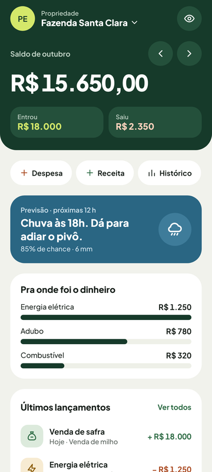
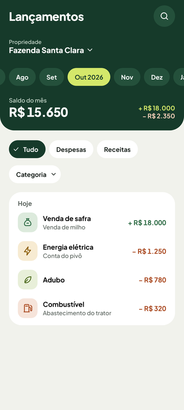
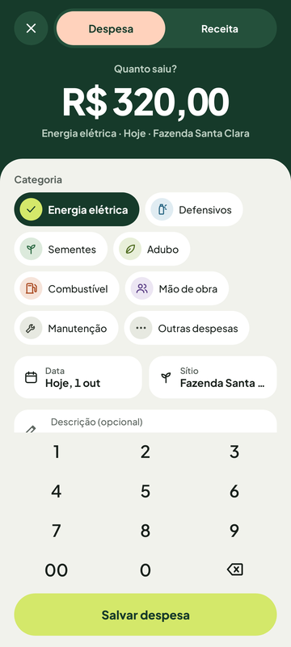
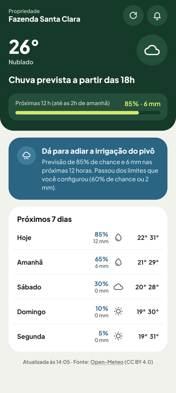
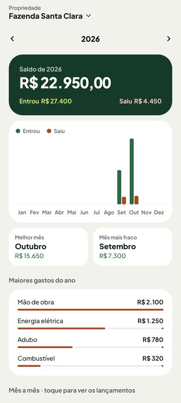
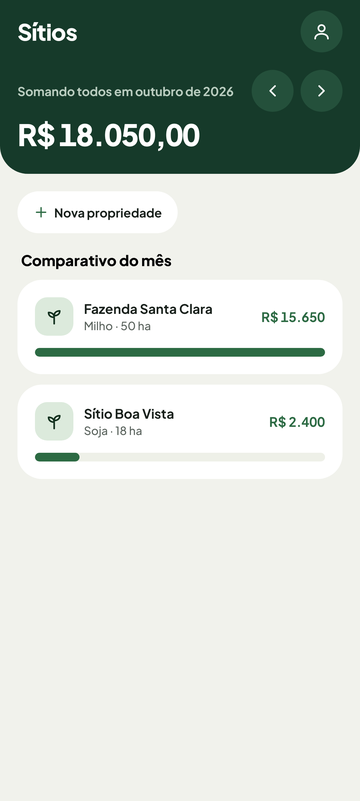
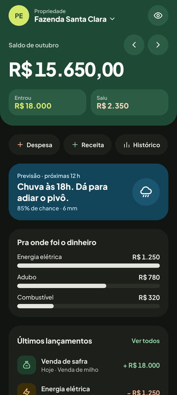
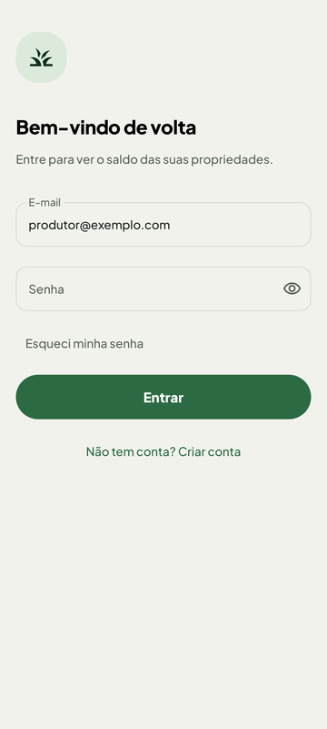

# Funcionalidades (telas)

## Galeria de telas

Capturas geradas pelos testes (`CapturasDeTelaTest`, com o Roborazzi) usando dados de exemplo fictícios.

| Início | Lançamentos | Novo lançamento | Clima |
| --- | --- | --- | --- |
|  |  |  |  |

| Histórico | Sítios | Início (escuro) | Login |
| --- | --- | --- | --- |
|  |  |  |  |

Cada tela do app segue o mesmo trio. A **`XxxRoute`** é a "cola" com o Android: obtém o ViewModel com `hiltViewModel()`, coleta o estado com `collectAsStateWithLifecycle()` (só coleta enquanto a tela está visível) e trata efeitos de uma vez só, como `Toast`, navegação após salvar (`LaunchedEffect` + `rememberUpdatedState`) e o evento `ON_RESUME` (`LifecycleEventEffect`). A **`XxxScreen`** é *stateless*: recebe um `XxxUiState` e lambdas `aoXxx`, não conhece o ViewModel e por isso tem `@Preview` (pense num componente React que só recebe props). O **`XxxViewModel`** guarda um `MutableStateFlow` privado e expõe `uiState: StateFlow<XxxUiState>`. Ele é anotado com `@HiltViewModel` e recebe o que usa pelo construtor (`@Inject`), como um service do NestJS injetado.

Algumas peças aparecem em quase toda feature:

- **`SelecaoAtual`** (`@Singleton` no `PreferenciasModule`): propriedade e mês escolhidos, compartilhados entre as abas. Trocar o mês no Início troca também em Lançamentos e Sítios.
- **`repetirAposErro { }`**: quando a leitura do banco falha, a mensagem vai para `uiState.erro` e o fluxo tenta de novo sozinho, com espera crescente (definido em `core/util/Erros.kt`).
- **`tentar { }`**: envolve gravações. O resultado vira `onSuccess`/`onFailure` e a mensagem chega ao usuário por `mensagemParaUsuario(...)`.
- **`Desfazer`** (`@Singleton` no `RepositoriosModule`): depois de uma exclusão, oferece "Desfazer" e guarda uma função que regrava o que foi apagado.
- **Valores ocultos ("olho")**: `LocalValoresOcultos` é um `CompositionLocal` (parecido com um Context do React) lido pelas telas que mostram dinheiro. Com ele ligado, valores, cores de sinal e barras proporcionais são escondidos.
- **Eventos como flags no estado**: `salvo`, `excluido`, `naoEncontrado`, `concluido` e `irParaConsentimento` são `Boolean` no `UiState`, e a Route reage a eles com `LaunchedEffect`.

## Mapa das telas

Os requisitos listados são só os que aparecem citados em comentários do código ou em nomes de testes (`app/src/test`).

| Tela | Arquivos | ViewModel | Requisitos atendidos |
|---|---|---|---|
| Início | `inicio/InicioScreen.kt`, `inicio/CartoesDoInicio.kt` | `InicioViewModel` | RF08, RF10 (navegação de mês), RN03 (saldo), RN04 (cartão de chuva) |
| Lançamentos (lista) | `lancamento/LancamentoListaScreen.kt`, `CabecalhoDaLista.kt`, `FiltrosDaLista.kt` | `LancamentoListaViewModel` | RF09 (filtros), RF10 (meses), RN03, RN07 (faixa de meses) |
| Novo / editar / lançar de novo | `lancamento/LancamentoFormScreen.kt`, `TopoDoLancamento.kt`, `CamposDoLancamento.kt`, `TecladoNumerico.kt`, `LancamentoFormAcoes.kt` | `LancamentoFormViewModel` | RF06 (categorias), RN01, RN06, RN07 |
| Sítios (lista) | `propriedade/PropriedadeListaScreen.kt` | `PropriedadeListaViewModel` | RF11 (comparativo), RN03 |
| Cadastro / edição de propriedade | `propriedade/PropriedadeFormScreen.kt` | `PropriedadeFormViewModel` | RN02 (exclusão em cascata) |
| Clima | `clima/ClimaScreen.kt`, `CartoesDoClima.kt`, `IconesDoTempo.kt` | `ClimaViewModel` | RF12, RF13, RN04 |
| Ajustes do aviso de chuva | `clima/AjustesAvisoScreen.kt` | `AjustesAvisoViewModel` | RN04 (limites); configura o aviso testado como RF14 |
| Histórico do ano | `historico/HistoricoScreen.kt` | `HistoricoViewModel` | RF10, RN07 (até o ano seguinte) |
| Login | `conta/LoginScreen.kt` | `LoginViewModel` | RF02 |
| Criar conta | `conta/CadastroScreen.kt` | `CadastroViewModel` | RF01 |
| Consentimento LGPD | `conta/ConsentimentoScreen.kt` | `CadastroViewModel` (compartilhado) | RNF10, RF01 |
| Novo aceite da política | `conta/NovoConsentimentoScreen.kt` | `NovoConsentimentoViewModel` | (LGPD; sem ID no código) |
| Política de privacidade | `conta/PoliticaScreen.kt` | nenhum | — |
| Conta | `conta/ContaScreen.kt` | `ContaViewModel` | RF16 (excluir conta) |
| Alterar senha | `conta/AlterarSenhaScreen.kt` | `AlterarSenhaViewModel` | — |
| Bloqueio do app | `conta/TelaBloqueio.kt` | nenhum | — |
| Oferta de bloqueio | `conta/OfertaDeBloqueio.kt` | nenhum | — |

## `feature/inicio/`

**O que o usuário faz aqui:**
- Vê o saldo do mês da propriedade escolhida, quanto entrou e quanto saiu, e troca de mês ou de propriedade.
- Usa atalhos para lançar uma despesa ou uma receita, ou abrir o histórico.
- Vê a previsão de chuva das próximas horas e toca nela para abrir o Clima.
- Confere os maiores gastos e os últimos lançamentos, toca num lançamento para editá-lo e esconde os valores com o "olho".

### `InicioViewModel.kt`

Contém `InicioUiState`, `CartaoChuvaUi` e o `InicioViewModel`, que monta a tela inicial juntando lançamentos, propriedades, seleção atual e previsão do tempo. Segundo um comentário no código, os totais são agregados em memória a partir de todos os lançamentos a cada emissão, e há um `TODO` para levar essa agregação para SQL se o volume crescer.

- **Classes:** `InicioUiState`, `CartaoChuvaUi(rotulo, frase, detalhe, vaiChover)` e `InicioViewModel`.
- **Funções internas:** `montarEstado(...)` (chama `ResumoFinanceiro.propriedadeAtual`, `doMes`, `totais` e `rankingDeGastos`) e `cartaoChuva(previsao, limites)` (chama `RegraDeChuva.avaliar` e os textos de `TextosDaChuva`).

| Grupo | Campos de `InicioUiState` |
|---|---|
| Controle | `carregando`, `erro` (falha de leitura que se resolve sozinha), `hoje` (referência para "Hoje"/"Ontem") |
| Propriedade | `temPropriedade`, `nomePropriedade`, `propriedades` |
| Mês e dinheiro | `mes`, `saldoCentavos`, `receitasCentavos`, `despesasCentavos`, `proporcaoReceitas` (0..1; 0,5 sem movimento) |
| Listas | `gastosPorCategoria` (até `MAXIMO_CATEGORIAS = 3`), `ultimosLancamentos` (os 4 mais recentes do mês) |
| Extras | `chuva: CartaoChuvaUi?` (nulo sem previsão em cache), `iniciais` (do usuário logado) |

**Ações:** `aoAvancarMes()`, `aoVoltarMes()`, `aoSelecionarPropriedade(id)` (as três delegam para `SelecaoAtual`) e `aoVoltarParaATela()`.

**Dependências:** `LancamentoRepository`, `PropriedadeRepository`, `ClimaRepository`, `AjustesAvisoRepository`, `SelecaoAtual` e o `UsuarioLogadoRepository` (o nome vira as iniciais) e um `Clock` injetável (`relogio`), que permite testar com hora fixa.

**Decisões no código:**
- **Quatro coletores independentes:** o estado financeiro (`combine` de cinco fluxos com `repetirAposErro`), as iniciais, a atualização da previsão (`clima.atualizarSeNecessario`) e o cartão de chuva. Quando o coletor principal emite, ele copia `chuva` e `iniciais` do estado atual para não apagar o que os outros coletores calcularam.
- **`ON_RESUME`:** `aoVoltarParaATela()` chama `selecao.acompanharMesCorrente(...)` para acompanhar a virada do mês e incrementa `voltasATela`, um contador que força o recálculo do que depende do relógio. A primeira chamada é ignorada, pois o `init` já cobre esse caso.
- **Quatro estados do cartão de chuva:** previsão desatualizada, vai chover ("Dá para adiar o pivô"), pode chover abaixo do limite do usuário (para não exibir "Sem chuva" ao lado de uma probabilidade alta) e sem chuva.

### `InicioScreen.kt`

Tem a `InicioRoute`, a `InicioScreen` e os pedaços do cabeçalho.

- **Composables:** `InicioRoute`, `InicioScreen`, `Cabecalho` (privado), `BotaoConta`, `BotaoMes`, `InicioVazio` e as prévias `InicioPreview` (normal e "Fonte 2x"), `InicioEscuroPreview` e `InicioVazioPreview`.
- **Função auxiliar:** `rotuloDoMes(mes, hoje)` devolve "outubro" ou "outubro de 2025" quando o mês é de outro ano.
- **Lambdas recebidas da navegação:** `aoNovoLancamento(TipoLancamento)`, `aoEditarLancamento(id)`, `aoAbrirClima`, `aoAbrirHistorico`, `aoAbrirLancamentos`, `aoAbrirConta`, `aoAlternarValores` (o "olho") e `aoCadastrarPropriedade`.

**Decisões no código:**
- **`ON_RESUME` na Route:** `LifecycleEventEffect(Lifecycle.Event.ON_RESUME)` chama `viewModel.aoVoltarParaATela()`.
- **Estados da tela:**
  - Carregando: o cabeçalho escuro aparece já nessa fase, para manter claros os ícones da status bar.
  - Erro sem propriedade: aparece o erro, e não o convite "cadastre um sítio", porque a pessoa pode já ter um.
  - Sem propriedade: `InicioVazio`.
  - Com dados: uma `LazyColumn` com `key` em cada item.
- **Layout do cabeçalho:** os botões de mês ficam longe do botão de esconder valores, para evitar toque acidental.
- **Saldo negativo** ganha a cor de despesa, exceto quando os valores estão ocultos.
- **Acessibilidade:** `semantics { heading() }` nos títulos e `contentDescription = "Abrir conta"` no botão de iniciais. O "olho" alterna o rótulo entre "Mostrar valores" e "Esconder valores".

### `CartoesDoInicio.kt`

Cartões do corpo do Início.

- **`Atalhos` / `Atalho`:** botões "Despesa", "Receita" e "Histórico". A linha tem rolagem horizontal para caber com fonte grande, e cada botão tem `contentDescription` próprio ("Nova despesa", por exemplo).
- **`CartaoChuva(chuva, aoClicar)`:** com `chuva` nulo (sem cache), mostra textos padrão e funciona como atalho para o Clima.
- **`CartaoGastos`:** título "Pra onde foi o dinheiro", com uma barra por categoria. Cada linha usa `semantics(mergeDescendants = true)` para o TalkBack ler categoria e valor como um item só.
- **`Barra(proporcao, oculto)`:** feita com dois `Box` em vez de `LinearProgressIndicator`, porque o M3 desenha um vão e um marcador na trilha. Com valores ocultos fica só a trilha, já que o comprimento revelaria a proporção. A largura mínima é de 3%.
- **`CartaoUltimos`:** usa `LinhaLancamento` com data relativa curta. Se a lista estiver vazia, mostra um texto orientando a usar o "+".

## `feature/lancamento/`

**O que o usuário faz aqui:**
- Navega pelos lançamentos do mês, agrupados por dia, e troca o mês pelas "pílulas" do cabeçalho.
- Filtra por tipo (tudo, despesas, receitas) e por categoria, vendo a quantidade e o total do que ficou filtrado.
- Busca por descrição ou categoria em todos os meses, sem diferenciar acento nem maiúscula.
- Cria, edita, exclui (com "Desfazer") ou "lança de novo" um lançamento, digitando o valor num teclado numérico próprio.

### `LancamentoListaViewModel.kt`

Monta a lista da propriedade e do mês em `SelecaoAtual`, com filtros e busca. O estado é recalculado por inteiro a cada emissão de qualquer fonte.

- **Tipos:** `FiltroLancamento { TUDO, DESPESAS, RECEITAS }` (RF09), `GrupoDoDia(data, rotulo, lancamentos)` e `LancamentoListaUiState`.
- **Tipos privados:** `LancamentoParaBusca` (guarda a descrição já normalizada) e `Filtros(tipo, categoria, busca)`.
- **Funções do `companion`:** `mesesDoCabecalho(selecionado, hoje)` e `normalizar(texto)` (remove espaços nas pontas, tira acentos via NFD e passa para minúsculas).

| Grupo | Campos de `LancamentoListaUiState` |
|---|---|
| Controle | `carregando`, `erro`, `temPropriedade`, `nomePropriedade`, `propriedades` |
| Mês | `mes`, `meses` (lista para as pílulas) |
| Filtros | `filtro`, `categoria` (null = todas), `categoriasDoMes` (só as presentes, mais a selecionada), `busca` |
| Resultado | `lancamentos`, `grupos` (por dia, mais recente primeiro), `quantidade`, `totalFiltradoCentavos` |
| Totais do mês | `saldoCentavos`, `receitasCentavos`, `despesasCentavos`: o mês inteiro, sem considerar filtro nem busca |
| Derivados | `temFiltro`, `buscando` |

**Ações:** `aoVoltarParaATela()`, `aoAvancarMes()`, `aoVoltarMes()`, `aoSelecionarMes(mes)`, `aoMudarFiltro(filtro)` (desmarca a categoria se ela não combinar com o novo tipo), `aoMudarCategoria(categoria)` (tocar de novo desmarca), `aoLimparFiltros()` (preserva a busca), `aoBuscar(texto)` (limitado a 60 caracteres), `aoFecharBusca()` e `aoSelecionarPropriedade(id)`.

**Dependências:** `LancamentoRepository`, `PropriedadeRepository`, `SelecaoAtual`, além de um `Clock` (`relogio`) e dos `Despachantes` injetáveis.

**Decisões no código:**
- **Trabalho fora da main thread:** o estado é montado em `flowOn(despachantes.calculo)` (`Dispatchers.Default` em produção).
- **Normalização uma vez só:** a descrição é normalizada uma vez por emissão do repositório, e não a cada tecla digitada.
- **Busca em todos os meses:** a busca ignora o mês e procura em todos os lançamentos da propriedade.
- **Troca de mês fecha a busca:** se o mês mudar por outra tela, um coletor de `selecao.mes.drop(1)` chama `aoFecharBusca()`, porque a busca esconderia o mês escolhido. O `drop(1)` ignora o valor inicial.
- **Faixa das pílulas:** vai de 24 meses atrás até 12 à frente (o limite da RN07) e se estende para incluir o mês selecionado se ele estiver fora.
- **`ON_RESUME`:** acompanha a virada do mês e recalcula os rótulos relativos depois da meia-noite.

### `LancamentoListaScreen.kt`

- **Composables:** `LancamentoListaRoute`, `LancamentoListaScreen`, `ItemDoCartao` e a extensão `LazyListScope.itensDaLista(...)`. As prévias cobrem os estados normal, "Fonte 2x", escuro e vazio.
- **Estados exibidos:** carregando, sem propriedade, erro, vazio (com texto diferente para busca, filtro ou mês sem lançamentos, e o botão "Limpar filtros" quando há filtro) e lista.

**Decisões no código:**
- **Campo de busca aberto vs. busca ativa:** `buscaAberta` (`rememberSaveable`) é separado de `uiState.buscando`, porque o campo pode estar aberto e vazio.
- **Foco no campo de busca:** `focarBusca` é um pedido de foco único. Ele evita reabrir o teclado a cada recomposição ou rolagem.
- **Fechar a busca:** `LaunchedEffect(uiState.mes)` fecha o campo quando o ViewModel já limpou a busca, e `BackHandler(enabled = buscaAberta)` fecha a busca no botão voltar.
- **Um cartão em vários itens:** títulos de dia e linhas são itens separados da `LazyColumn` (e por isso preguiçosos), mas `ItemDoCartao` arredonda o topo do primeiro e a base do último para parecerem um cartão só. Os títulos de dia têm `heading()`.

### `CabecalhoDaLista.kt`

Cabeçalho escuro da lista.

- **`Cabecalho(...)`:**
  - No modo busca, mostra `CampoDeBusca` e a contagem "N resultados em todos os meses", com `liveRegion` para o leitor de tela anunciar.
  - Fora dele, mostra o título, o botão de busca (desabilitado sem propriedade), `SeletorPropriedade` (só com mais de uma propriedade), `PilulasDeMes` e `ResumoDoMes`.
- **`CampoDeBusca`:** usa `FocusRequester` com `LaunchedEffect(focar)`. A tecla de busca do teclado (`ImeAction.Search`) só tira o foco.
- **`PilulasDeMes`:** uma `LazyRow` que mantém dois meses anteriores visíveis à esquerda do selecionado e anima a rolagem.
  - O mês selecionado e os janeiros mostram o ano ("Out 2026").
  - Semântica: `selected` e `contentDescription` com o rótulo completo.
  - `sangrarNasLaterais` faz a fileira ocupar a largura toda.
- **`ResumoDoMes`:** saldo do mês mais as linhas "+ entrou" e "− saiu". Com valores ocultos, o `contentDescription` diz "valor escondido".

### `FiltrosDaLista.kt`

- **`Filtros`:** chips "Tudo", "Despesas" e "Receitas" (`ChipSafra`) e o `FiltroDeCategoria`. Usa `FlowRow` em vez de rolagem horizontal para que, com fonte grande, nenhum chip fique fora da tela.
- **`FiltroDeCategoria`:** chip com menu das categorias. A opção "Todas as categorias" reenvia a categoria selecionada, o que a desmarca (toggle).
- **`ResumoDoFiltro`:** mostra "N lançamentos · total com sinal" quando há filtro ou busca. O botão "Limpar" aparece só quando há filtro.

### `LancamentoFormViewModel.kt`

Formulário de criação, edição e cópia ("Lançar de novo"). Os parâmetros `lancamentoId`, `copiaDe` e `tipoInicial` (vindo dos atalhos do Início) decidem o modo.

- **Classes:** `LancamentoFormUiState` e `LancamentoFormViewModel`.
- **Função interna:** `editar(mudanca)` aplica a mudança e grava os campos no `SavedStateHandle`.
- **Constantes:** `AVISO_NAO_ENCONTRADO`, `MESES_NO_FUTURO` (RN07) e `MAXIMO_DE_DIGITOS` (teto de R$ 9.999.999,99).

| Grupo | Campos de `LancamentoFormUiState` |
|---|---|
| Dados do lançamento | `tipo`, `categoria`, `valorDigitos` (centavos como string: "125050" = R$ 1.250,50), `data` (texto BR), `propriedadeId`, `descricao` |
| Apoio | `propriedades`, `hoje` |
| Erros | `erroValor`, `erroData`, `erroGeral` |
| Ciclo de vida | `ehEdicao`, `carregado`, `salvando`, `salvo`, `excluido`, `naoEncontrado` |
| Derivados (`get()`) | `categoriasDisponiveis`, `nomePropriedadeSelecionada`, `valorCentavos`, `rotuloData` ("Hoje, 4 out"), `resumo` ("Combustível · Hoje · nome do sítio") |

**Ações:**
- Edição dos campos: `aoMudarTipo` (reseta a categoria para a primeira do novo tipo), `aoMudarCategoria`, `aoMudarDescricao`, `aoMudarPropriedade`.
- Teclado: `aoTeclar(digitos)`, `aoApagarDigito()`, `aoLimparValor()` (toque longo).
- Data: `aoEscolherData(data)`, `aoUsarHoje()`, `aoUsarOntem()`.
- Gravação: `aoSalvar()`, `aoExcluir()`.

**Dependências:** `LancamentoRepository`, `PropriedadeRepository`, `SelecaoAtual`, `Desfazer` e `SavedStateHandle` (entregue pelo Hilt, com os argumentos da rota e o rascunho).

**Decisões no código:**
- **Sobrevive à morte do processo:** os campos editáveis vão para o `SavedStateHandle`, com valores `String` para caber no `Bundle`. Na edição, o valor restaurado vale mais que o do banco.
  - Nada é guardado antes de `carregado`, para o estado padrão não sobrescrever o que seria restaurado.
  - A restauração descarta categoria de outro tipo e propriedade que não existe mais.
- **Lançamento sumiu:** se o lançamento em edição não existe mais, `naoEncontrado = true`. Salvar recriaria o registro com o id antigo, então a tela avisa e fecha.
- **Proteção contra toque duplo:** `aoSalvar()` não faz nada se `salvando`, `salvo` ou `naoEncontrado` estiverem ligados, e a tela desabilita o botão enquanto `salvando`.
- **Teclado:**
  - Os dígitos entram pela direita, nos centavos, e zeros à esquerda são descartados.
  - Uma tecla que estouraria o limite é ignorada por inteiro.
  - Antes de carregar, as teclas são ignoradas, porque o valor do banco apagaria o que foi digitado.
- **Validação na tela:**
  - Valor maior que zero (RN06).
  - Data válida e no máximo 12 meses à frente (`Lancamento.dataDentroDoLimite`, RN07).
  - Propriedade escolhida (RN01).
- **Depois de salvar:** seleciona em `SelecaoAtual` a propriedade e o mês do lançamento, para ele aparecer nas listas. Na edição, o mês só muda se a data mudou de mês, porque trocar o mês fecharia a busca.
- **Excluir:** apaga sem confirmação e oferece "Desfazer" com `desfazer.oferecer(...)`, que regrava o lançamento.
- **Fallback de propriedade:** se a propriedade selecionada foi excluída, o formulário usa a primeira da lista.

### `LancamentoFormScreen.kt`

- **Composables:** `LancamentoFormRoute`, `LancamentoFormScreen`, `Folha`, um `CamposDoLancamento` privado (que organiza categoria, data, sítio e descrição), `SemPropriedade` e `BarraDeSalvar`. As prévias cobrem os estados normal, "Fonte 2x" e escuro.
- **Título por modo:** "Editar lançamento", "Lançar de novo" ou "Novo lançamento".

**Decisões no código:**
- **Um ViewModel por modo:** `hiltViewModel()` cria um ViewModel por entrada da navegação, então cada modo (novo, edição, cópia) tem o seu. O id, a cópia e o tipo vêm da rota pelo `SavedStateHandle` (construtor secundário `@Inject`).
- **Efeitos de uma vez:** `LaunchedEffect(uiState.salvo, uiState.excluido)` fecha a tela. Para `naoEncontrado`, a Route mostra um `Toast` com `AVISO_NAO_ENCONTRADO` e depois fecha.
- **As ações viram um objeto:** são agrupadas em `LancamentoFormAcoes`, criado com `remember(viewModel, lancamentoId)`.
- **Teclado numérico próprio em vez do teclado do sistema:** o layout fica estável entre aparelhos, a tecla "00" está garantida e nada cobre os outros campos. Com o teclado do sistema aberto (campo de descrição), o numérico some (`WindowInsets.isImeVisible`).
- **Dois layouts:**
  - Com `maxHeight` menor que `760.dp × escala da fonte`, tudo rola menos a barra de salvar, e o teclado numérico vem antes dos campos.
  - Em tela alta, o topo e o teclado ficam fixos e só os campos rolam.
- **Acessibilidade:** `paneTitle` com o título da tela. O erro geral fica logo acima do botão, sempre visível, com `liveRegion`. O botão de salvar tem pelo menos `60.dp` de altura (é "o botão do polegar").
- **Calendário:** o `CalendarioDialogo` recebe `ultimaPermitida = hoje + MESES_NO_FUTURO`.

### `LancamentoFormAcoes.kt`

Uma `data class` `@Immutable` com as 15 ações da tela (`aoFechar`, `aoMudarTipo`, `aoTeclar`, `aoSalvar`, `aoExcluir`, `aoLancarDeNovo` etc.), todas com padrão `{}`. Segundo o comentário, antes a tela recebia 15 lambdas soltas: chamar a tela num preview ou teste era "uma parede de `aoX = {}`". Agora basta preencher o que interessa. Como é imutável, o Compose a trata como estável e evita recomposições à toa.

### `TopoDoLancamento.kt`

Topo escuro do formulário.

- **`Topo(uiState, reduzido, ...)`:** botão "Fechar sem salvar", `SeletorDeTipo` e `MenuDaEdicao` (só na edição), mais o valor grande e o resumo.
  - `reduzido` esconde a legenda "Quanto saiu?/Quanto entrou?" e diminui o valor.
  - O valor usa `BasicText` com `TextAutoSize.StepBased` (de 24 a 52 sp, ou até 40 sp quando reduzido), para o valor máximo caber em telas estreitas.
  - `liveRegion` faz o TalkBack anunciar "Valor: R$ ..." a cada tecla.
  - Havendo `erroValor`, ele aparece no lugar do resumo.
- **`SeletorDeTipo` / `OpcaoDeTipo`:** alternador Despesa/Receita em `selectableGroup` com `Role.RadioButton`. A opção marcada muda de cor e também de peso da fonte, para não depender só da cor.
- **`MenuDaEdicao`:** menu com "Lançar de novo" e "Excluir lançamento". Não há confirmação, porque a exclusão se desfaz pelo snackbar "Desfazer".

### `CamposDoLancamento.kt`

Campos reutilizados pelo formulário.

- **`Categorias` / `ChipCategoria`:** `FlowRow` com todas as categorias do tipo, sem truncar. Cada chip é `selectable` com `Role.RadioButton`, e o selecionado exibe um ✓ para indicar o estado sem depender só da cor. Altura mínima de `48.dp`.
- **`CampoDeEscolha`:** campo clicável com ícone, legenda e valor. Ganha uma borda vermelha quando há erro.
- **`CampoData`:** menu com "Hoje", "Ontem" e "Escolher no calendário". O erro aparece abaixo, com `liveRegion`.
- **`CampoSitio`:** menu de propriedades, desabilitado quando há uma só.
- **`CampoDescricao`:** `TextField` de linha única que começa frases com maiúscula. A tecla "Concluído" tira o foco.
- **`CalendarioDialogo`:** `DatePickerDialog` cujo `SelectableDates` bloqueia datas depois de `ultimaPermitida` (RN07). As datas trafegam em milissegundos UTC (`emMillisUtc`, `paraLocalDateUtc`).

### `TecladoNumerico.kt`

Teclado "de calculadora de feira": digitar 1, 2, 5 dá R$ 1,25.

- **`TecladoNumerico`:** teclas 1 a 9, "00", "0" e ⌫.
- **`TeclaDigito`:** pelo menos `52.dp` de altura. A tecla "00" é lida como "Zero zero".
- **`TeclaApagar`:** usa `combinedClickable`. Um toque apaga um dígito e o toque longo zera o valor, com os rótulos de acessibilidade "Apagar o último número" e "Apagar o valor inteiro".

## `feature/propriedade/`

**O que o usuário faz aqui:**
- Vê todas as propriedades com o saldo do mês de cada uma, uma barra comparativa e o total somado, e troca o mês.
- Cadastra uma propriedade (nome, cultura, área, latitude e longitude) ou preenche as coordenadas com a localização do celular.
- Edita ou exclui uma propriedade. A exclusão leva junto os lançamentos dela e pode ser desfeita.

### `PropriedadeListaViewModel.kt`

Lista com comparativo de saldo do mês (RF11). O saldo não é gravado: ele é derivado dos lançamentos a cada emissão.

- **Classes:** `PropriedadeComSaldo(propriedade, saldoCentavos, proporcao)` (a proporção é |saldo| dividido pelo maior |saldo|, em 0..1), `PropriedadeListaUiState(carregando, mes, itens, totalCentavos, erro)` e o ViewModel.
- **Ações:** `aoAvancarMes()` e `aoVoltarMes()`, ambas via `SelecaoAtual`.
- **Dependências:** `PropriedadeRepository`, `LancamentoRepository` e `SelecaoAtual`.

**Decisões no código:** `combine` de propriedades, lançamentos e mês com `ResumoFinanceiro.resumoDoMes(...)`. O divisor da proporção vale no mínimo 1, evitando divisão por zero. Usa `repetirAposErro`.

### `PropriedadeListaScreen.kt`

- **Composables:** `PropriedadeListaRoute`, `PropriedadeListaScreen`, `Cabecalho`, `BotaoNova` e `CartaoPropriedade`. As prévias cobrem com dados, "Fonte 2x", vazio e carregando.
- **Lambdas recebidas:** `aoAbrirNova`, `aoAbrirPropriedade(id)` (tocar no cartão abre a edição) e `aoAbrirConta`.

**Decisões no código:**
- **Cabeçalho:** mostra o título "Sítios" e o botão de conta. O total "Somando todos em &lt;mês>" e as setas de mês só aparecem quando há propriedades.
- **`CartaoPropriedade`:**
  - Saldo negativo ganha um "−" explícito, para não depender só da cor.
  - Com valores ocultos, cor e sinal ficam neutros e a barra mostra só a trilha.
- **Títulos:** com `heading()` ("Sítios", "Comparativo do mês").

### `PropriedadeFormViewModel.kt`

Criação e edição de propriedade. Toda a validação fica aqui, e a tela só exibe os erros do estado.

- **Classes:** `PropriedadeFormUiState` e a interface selada privada `Area` (`Valida(hectares)`, `Ambigua`, `Invalida`).
- **Funções:** `lerArea(texto)` (com as regex `AREA_COM_MILHAR`, `AREA_COM_VIRGULA` e `AREA_COM_PONTO_DECIMAL`) e, no `companion`, `ficaNoBrasil(latitude, longitude)`.

| Grupo | Campos de `PropriedadeFormUiState` |
|---|---|
| Campos (texto digitado) | `nome`, `cultura`, `area`, `latitude`, `longitude` |
| Erros e avisos | `erroNome`, `erroArea`, `erroCoordenadas`, `avisoCoordenadas` (fora do Brasil), `erroGeral` |
| Ciclo de vida | `ehEdicao`, `salvando`, `salvo`, `excluido`, `naoEncontrado` |
| Derivado | `leituraDaArea` (como a área será gravada, ex.: "= 1.000 ha") |

**Ações:**
- Edição: `aoMudarNome`, `aoMudarCultura`, `aoMudarArea`, `aoMudarLatitude` e `aoMudarLongitude` (cada uma limpa o erro do seu campo).
- Sinal: `aoInverterSinalLatitude()` e `aoInverterSinalLongitude()` (o botão ± existe porque o teclado numérico de alguns aparelhos não tem o sinal de menos).
- Localização: `aoUsarLocalizacao(lat, lon)` (6 casas decimais, com vírgula).
- Gravação: `aoSalvar()` e `aoExcluir()`.

**Dependências:** `PropriedadeRepository`, `SelecaoAtual`, `Desfazer` e `SavedStateHandle`.

**Decisões no código:**
- **Números ficam como texto até a validação.** A área é lida "como a pessoa escreve no Brasil": "1.000" é mil, não um. O ponto decimal ("12.5") é aceito quando não pode ser confundido com milhar, e o que sobra é recusado como ambíguo, com uma mensagem que explica o formato.
- **Aviso, não bloqueio, para coordenadas fora do Brasil:** um retângulo aproximado do território detecta o sinal de menos esquecido.
  - O primeiro "Salvar" mostra o aviso. O segundo toque, com as mesmas coordenadas, confirma, e o botão passa a dizer "Salvar mesmo assim".
  - Coordenadas vindas do GPS ou do banco não pedem confirmação (`coordenadasConferidas`).
- **`SavedStateHandle`** guarda o texto de cada campo, inclusive as coordenadas do GPS. Na edição, o valor restaurado vale mais que o do banco.
- **Proteção contra toque duplo e registro sumido:** a mesma de lançamentos (`salvando`/`salvo`/`naoEncontrado`).
- **Ao salvar:** a cultura vazia vira "Não informada", o mesmo id é mantido na edição (o repositório faz upsert) e a propriedade passa a ser a selecionada.
- **Excluir (RN02):** `excluirComLancamentos(id)` roda numa transação e devolve o que foi removido. Depois, `selecao.limparSeFor(id)` limpa a seleção se era essa propriedade, e o "Desfazer" chama `restaurar(...)` com os mesmos ids.

### `PropriedadeFormScreen.kt`

- **Composables:** `PropriedadeFormRoute`, `PropriedadeFormScreen`, `BotaoSinal`, mais as prévias nova (normal e "Fonte 2x") e com erro.

**Decisões no código:**
- **Um ViewModel por propriedade:** `hiltViewModel()` cria um ViewModel por entrada da navegação (o id vem da rota pelo `SavedStateHandle`), então uma propriedade nunca reaproveita o ViewModel de outra nem o da criação.
- **Localização fica na Route:** `rememberBuscaDeLocalizacao` depende da Activity para pedir permissão. Manter isso fora da Screen deixa o `@Preview` funcionando. A mensagem de sucesso ou falha da localização é estado local da Route.
- **Campos:** o campo de área mostra como o número foi entendido quando não há erro. Latitude e longitude têm um campo por linha, cada um com o botão ± (`contentDescription` "Trocar o sinal da latitude").
- **Excluir pede confirmação** num `AlertDialog`, cujo estado aberto/fechado é `rememberSaveable`. O texto avisa que os lançamentos também serão apagados e que dá para desfazer.
- **Ao concluir:** `LaunchedEffect` fecha a tela após `salvo` ou `excluido`. Em `naoEncontrado`, mostra um `Toast` e fecha.

## `feature/clima/`

**O que o usuário faz aqui:**
- Vê a temperatura atual, a chance e o volume de chuva das próximas horas e uma recomendação para o pivô (adiar ou não a irrigação).
- Vê a previsão dos próximos 7 dias e quando ela foi atualizada. Funciona sem internet, mostrando a última previsão salva.
- Atualiza manualmente, troca de propriedade e permite as notificações.
- Ajusta o aviso de chuva: liga ou desliga, define a chance mínima e a chuva mínima, e escolhe quais propriedades avisam.

### `ClimaViewModel.kt`

Previsão da propriedade selecionada (RF12, RF13). Segundo o comentário do arquivo, a interface observa sempre o cache local (`ClimaRepository.observar`). A rede só atualiza o cache, e só automaticamente quando ele tem mais de 1 hora.

- **Classes:** `DiaUi(rotulo, condicao, maxima, minima, probabilidade, chuva)` (valores já formatados), `ClimaUiState` e o enum privado `FalhaDeAtualizacao { SEM_INTERNET, SERVICO }`.
- **Funções internas:** `buscar(propriedade, forcar)`, `montar(...)`, `resumo(...)` e `recomendacao(...)` (título e texto da recomendação).

| Grupo | Campos de `ClimaUiState` |
|---|---|
| Controle | `carregando`, `erro` (leitura do cache), `atualizando`, `mensagem` (falha da última atualização) |
| Propriedade | `temPropriedade`, `propriedadeId`, `nomePropriedade`, `propriedades` |
| Agora | `temPrevisao`, `temperaturaAtual`, `condicaoAtual`, `resumo` |
| Janela de chuva | `janelaHoras`, `janelaAte` ("até as 7h de amanhã"), `probabilidadeJanela`, `chanceEVolume`, `vaiChover` |
| Recomendação | `recomendacaoTitulo`, `recomendacaoTexto` |
| Dias e fonte | `dias` (até 7, a partir de hoje), `atualizadaEm` |
| Aviso | `avisoAtivo` |

**Ações:** `aoSelecionarPropriedade(id)`, `aoAtualizar()` (força a busca, ignorando a validade do cache) e `aoVoltarParaATela()`.

**Dependências:** `PropriedadeRepository`, `ClimaRepository`, `AjustesAvisoRepository` e `SelecaoAtual`. O `Clock` (`relogio`, com o fuso) é injetável.

**Decisões no código:**
- **Guarda de geração:** só existe uma busca por vez. Uma nova busca cancela a anterior (`busca?.cancel()`), e o contador `geracao` impede que uma busca antiga, terminando depois, altere o estado da atual.
- **`finally` desliga `atualizando`:** mesmo em cancelamento (troca de propriedade). Sem isso, o indicador poderia ficar preso em `true`.
- **Proteção contra toque repetido:** `aoAtualizar()` e `aoVoltarParaATela()` não disparam nada enquanto `atualizandoAgora` está ligado.
- **`ON_RESUME`:** a primeira chamada é ignorada (o `init` já cobre). Depois disso, o ViewModel incrementa `voltasATela` para recalcular "Hoje" e a hora da chuva, e confere se o cache venceu.
- **Troca de propriedade:** limpa a mensagem de falha (`ultimaFalha = null`), porque ela pertencia à propriedade anterior.
- **Mensagens diferentes conforme o cache:** "Sem internet. Mostrando a última previsão salva." quando há cache, e "...Tente de novo quando o celular tiver sinal." quando não há.
- **Data na hora da atualização:** `atualizadaEm` inclui o dia, porque o cache vale até 2 dias e "às 14:05" de ontem pareceria de hoje.
- **Quatro recomendações:** previsão desatualizada, "Dá para adiar a irrigação do pivô", "Pode chover, mas abaixo do seu limite" e "Sem chuva relevante à vista", sempre citando os limites configurados.

### `ClimaScreen.kt`

- **Composables:** `ClimaRoute`, `ClimaScreen`, `Cabecalho` (privado) e as prévias normal, "Fonte 2x", escuro e sem internet.
- **Lambdas recebidas:** `aoAbrirAjustes` e `aoCadastrarPropriedade`. A Route também obtém `rememberPermissaoNotificacao()`.

**Decisões no código:**
- **`ON_RESUME`** com `LifecycleEventEffect`.
- **Ordem do corpo:** erro, faixa de aviso (`FaixaDeAviso`), `CartaoPermissao` (quando o aviso está ativo e a permissão não foi dada) e, por fim, a previsão. Sem previsão, aparece `Carregando` se estiver atualizando, ou "Ainda sem previsão" com "Tentar de novo".
- **Atribuição obrigatória:** o rodapé "Fonte: Open-Meteo (CC BY 4.0)" tem link (`LinkAnnotation.Url`). O comentário explica que a licença CC BY 4.0 exige atribuição com link.
- **Cabeçalho:**
  - O botão de atualizar vira um `CircularProgressIndicator` durante a busca.
  - O sino abre os ajustes.
  - Temperatura e condição são lidas juntas (`mergeDescendants`).
  - A barra de chance da janela tem largura mínima de 2%.

### `CartoesDoClima.kt`

- **`CartaoRecomendacao`:** ícone de chuva ou ✓, com título (`heading()`) e texto vindos do ViewModel.
- **`CartaoDias` / `LinhaDia`:** "Próximos 7 dias". Cada linha é lida como um item só (`mergeDescendants`), e o ícone tem `contentDescription` com o nome da condição.
- **`CartaoPermissao`:** explica por que o app precisa de notificação e traz o botão "Permitir notificações".

### `IconesDoTempo.kt`

A extensão `CondicaoTempo.icone(): ImageVector` mapeia cada condição para um ícone Material. Ela fica na camada de UI para o domínio não depender do Compose. Garoa, chuva e pancadas usam a gota, e o rótulo em texto diferencia.

### `AjustesAvisoViewModel.kt`

Ajustes do aviso de chuva. As alterações ficam só no estado da UI até `aoSalvar()`, e sair sem salvar descarta tudo.

- **Classes:** `SitioDoAviso(id, nome, avisa)`, `AjustesAvisoUiState` e o ViewModel.
- **Constantes:** `PROBABILIDADE_MIN = 30`, `PROBABILIDADE_MAX = 90`, `CHUVA_MIN = 1.0`, `CHUVA_MAX = 10.0`.

| Grupo | Campos de `AjustesAvisoUiState` |
|---|---|
| Liga/desliga | `ativo` |
| Limites (RN04) | `probabilidadeMinima`, `chuvaMinimaMm`, `janelaHoras` |
| Propriedades | `sitios`, derivado `mostrarSitios` (com 2 ou mais propriedades, ou se alguma estiver desligada) |
| Evento | `salvo` |

**Ações:**
- `aoMudarAtivo(ativo)`.
- `aoMudarProbabilidade(valor)` (arredonda para múltiplos de 5).
- `aoMudarChuva(valor)` (arredonda para passos de 0,5 mm).
- `aoMudarSitio(id, avisa)`.
- `aoSalvar()`.
- `aoVerificarAgora()` (para testes e diagnóstico).

**Dependências:** `AjustesAvisoRepository`, `AgendaDeVerificacao` e `PropriedadeRepository`.

**Decisões no código:**
- **Lista de propriedades:** mesmo com uma propriedade só, a lista aparece se ela estiver desligada. Caso contrário, não haveria como religá-la depois de excluir as outras.
- **Ids desligados preservados:** os ids desligados no momento da abertura (`semAvisoAoAbrir`) são mantidos ao salvar mesmo que não estejam na lista atual, como em propriedades de outra conta ou exclusão desfeita.
- **Ao salvar:** com o aviso ativo, chama `agenda.ligar()`. Desativado, chama `agenda.desligar()`, que cancela o trabalho periódico em segundo plano.

### `AjustesAvisoScreen.kt`

- **Composables e tipos:** `AjustesAvisoRoute`, `AjustesAvisoScreen`, `CartaoLimite` (sliders), a classe `FerramentasDeTeste(aoMostrarExemplo, aoVerificarAgora)` e `AjustesAvisoPreview`.

**Decisões no código:**
- **Ferramentas só em debug:** a Route detecta build debug em tempo de execução com `ApplicationInfo.FLAG_DEBUGGABLE`. Só nesse caso passa `FerramentasDeTeste` ("Mostrar notificação de exemplo" via `NotificadorDeChuva` e "Verificar chuva agora").
- **Ao salvar:** a Route mostra o `Toast` "Ajustes salvos" e volta.
- **Sliders:** `steps = 11` (de 30 a 90, de 5 em 5) e `steps = 17` (de 1 a 10, de 0,5 em 0,5). O comentário lembra que `steps` não conta as pontas. Os sliders ficam desabilitados com o aviso desligado.
- **Propriedades avisadas:** cada linha é `toggleable` com `Role.Switch` na linha inteira, e o `Switch` usa `onCheckedChange = null`.
- **Permissão de notificação:** sem ela, um cartão explica que o aviso só apareceria dentro do Clima.
- **Janela de horas:** é exibida como texto, sem controle para alterá-la.

## `feature/historico/`

**O que o usuário faz aqui:**
- Vê o ano inteiro (janeiro a dezembro) da propriedade: o saldo do ano, quanto entrou, quanto saiu e um gráfico de barras por mês.
- Confere o melhor mês, o mês mais fraco e os maiores gastos do ano.
- Navega entre anos (até o ano seguinte) e troca de propriedade.
- Toca num mês para abrir a lista de Lançamentos já nesse mês.

### `HistoricoViewModel.kt`

Histórico anual (RF10). Usa o ano-calendário, que segundo o comentário está alinhado ao fechamento contábil e ao IR rural, e não os últimos 12 meses. Os totais são derivados a cada emissão.

- **Classes:** `MesDoHistorico(mes, receitasCentavos, despesasCentavos, futuro)` (com `saldoCentavos` e `temMovimento` derivados), `HistoricoUiState` (com `mesesNaLista`, os meses que aparecem na lista) e o ViewModel.

| Grupo | Campos de `HistoricoUiState` |
|---|---|
| Controle | `carregando`, `erro`, `temPropriedade`, `nomePropriedade`, `propriedades` |
| Ano | `ano`, `podeAvancar`, `meses` (sempre 12) |
| Totais | `receitasCentavos`, `despesasCentavos`, `maiorValorMensal` (a escala do gráfico); derivados `saldoCentavos` e `temMovimento` |
| Destaques | `melhorMes`, `piorMes`, `gastosDoAno` (até `MAXIMO_CATEGORIAS = 5`) |

**Ações:** `aoVoltarAno()`, `aoAvancarAno()` (até `hoje().year + 1`, porque a RN07 permite lançamentos até 12 meses à frente), `aoSelecionarPropriedade(id)` e `aoAbrirMes(mes)` (grava o mês em `SelecaoAtual` antes de a tela navegar).

**Dependências:** `LancamentoRepository`, `PropriedadeRepository` e `SelecaoAtual`.

**Decisões no código:**
- **Ano inicial:** o do mês selecionado globalmente.
- **Meses futuros:** ficam marcados como `futuro` e não entram na comparação de melhor e pior mês, pois só têm lançamentos agendados.
- **`piorMes` fica nulo:** quando há menos de dois meses com movimento, ou quando o menor saldo empata com o maior.
- **Erro de leitura:** usa `repetirAposErro`.

### `HistoricoScreen.kt`

- **Composables:** `HistoricoRoute`, `HistoricoScreen`, `SeletorAno`, `CartaoDoAno`, `CartaoGrafico`, `Legenda`, `Destaques`/`Destaque`, `CartaoGastos`, `LinhaMes`, `Secao`, a função `corDoSaldo` e as prévias normal e "Fonte 2x".

**Decisões no código:**
- **Abrir um mês:** a Route compõe `aoAbrirMes`, chamando primeiro `viewModel.aoAbrirMes(mes)` e depois a navegação.
- **Gráfico em `Canvas`:** barras de receita e despesa por mês, escaladas por `maiorValorMensal`.
  - Altura mínima de `2.dp` para valores pequenos não sumirem.
  - Meses futuros com 40% de opacidade.
  - Para acessibilidade, o `contentDescription` traz um resumo em texto dos meses com movimento.
- **Valores ocultos:**
  - As barras do gráfico somem, porque a altura revelaria a proporção.
  - O `LinearProgressIndicator` dos gastos fica em 0.
  - `corDoSaldo` usa uma cor neutra, para a cor não revelar o sinal.
- **Lista mês a mês:**
  - Cada linha é `clickable` com `Role.Button` e `onClickLabel` "Ver os lançamentos do mês".
  - Meses futuros sem lançamento são omitidos. A regra mora no `HistoricoUiState.mesesNaLista` (ViewModel), e a tela só desenha essa lista.
  - O botão "Próximo ano" fica desabilitado quando `podeAvancar` é falso.

## `feature/conta/`

**O que o usuário faz aqui:**
- Cria uma conta local (nome, e-mail, senha com requisitos visíveis), aceita o termo LGPD e entra com e-mail e senha.
- Na tela Conta, vê os próprios dados e a data do aceite, abre os ajustes de aviso, a política e as propriedades, troca a senha e sai.
- Liga o bloqueio por digital ou PIN, que é oferecido logo após o cadastro e pedido ao abrir o app.
- Exclui a conta e todos os dados, confirmando com a senha. Também aceita de novo a política quando ela muda.

### `LoginViewModel.kt`

Login (RF02). Não navega: o sucesso abre a sessão no `ContaService`, que é a fonte única de "logado ou não" observada pela navegação.

- **`LoginUiState`:** `email`, `senha`, `erro` e `entrando`.
- **Ações:** `aoMudarEmail` (com trim), `aoMudarSenha` e `aoEntrar()`.
- **Dependência:** `ContaService`.

**Decisões no código:**
- **Proteção contra toque duplo:** `aoEntrar()` não faz nada enquanto `entrando` estiver ligado.
- **Senha apagada do estado** em qualquer resultado.
- **Mensagem única** ("E-mail ou senha incorretos.") para e-mail inexistente e senha errada, o que evita enumeração de contas.
- **`Bloqueado`:** mostra o tempo de espera com `formatarEspera(...)`.

### `LoginScreen.kt`

- **Composables:** `LoginRoute`, `LoginScreen` e as prévias normal, "Fonte 2x" e com erro. A Route só recebe `aoCriarConta`: não há callback de sucesso.

**Decisões no código:**
- **`imePadding()` antes do scroll:** o campo em foco continua acessível com o teclado aberto.
- **Enter no último campo:** `CampoSenha(ultimoCampo = true, aoConfirmar = aoEntrar)` faz o Enter do teclado entrar.
- **"Esqueci minha senha":** abre um diálogo explicando que a conta existe só no celular e que ainda não há recuperação por e-mail.

### `CadastroViewModel.kt`

Compartilhado entre o formulário de cadastro e a tela de consentimento. O formulário só coleta e valida, e a conta é gravada apenas no aceite do termo. Por isso, voltar ou recusar não grava nada (consentimento antes do tratamento).

| Grupo | Campos de `CadastroUiState` |
|---|---|
| Campos | `nome`, `email`, `senha`, `confirmacao` |
| Erros | `erroNome`, `erroEmail`, `erroSenha`, `erroConfirmacao`, `erroGeral` (exibido no consentimento) |
| Progresso | `verificando` (checando o e-mail), `criando` (gravando a conta) |
| Evento | `irParaConsentimento` |
| Derivado | `requisitos` (`RegrasDeConta.requisitosDaSenha(senha, email, nome)`) |

**Ações:** `aoMudarNome`, `aoMudarEmail`, `aoMudarSenha`, `aoMudarConfirmacao`, `aoContinuar()`, `aoAbrirConsentimento()` (consome o evento) e `aoAceitarTermo()`.

**Dependências:** `ContaService` e as regras puras de `RegrasDeConta`.

**Decisões no código:**
- **E-mail duplicado conferido antes:** `aoContinuar()` checa `emailEmUso` antes do consentimento, para não falhar só depois do aceite.
- **Revalidação no aceite:** não há `SavedStateHandle` aqui, então depois da morte do processo o formulário chega vazio. `aoAceitarTermo()` valida de novo e pede para preencher outra vez.
- **Proteção contra toque duplo:** com `verificando` e `criando`.
- **Ao concluir:** `senha` e `confirmacao` são limpas. A sessão já foi aberta pelo `ContaService`, e a navegação segue para o início.

### `CadastroScreen.kt`

- **Composables:** `CadastroRoute`, `CadastroScreen` e as prévias normal e com erros.

**Decisões no código:**
- **ViewModel injetado:** `CadastroRoute` recebe o `viewModel` sem valor padrão, porque a `AppNavegacao` o compartilha com o consentimento.
- **Evento consumido antes de navegar:** o `LaunchedEffect` chama `aoAbrirConsentimento()` antes de navegar. Sem isso, voltar do consentimento o reabriria.
- **Requisitos de senha:** `CartaoRequisitosSenha` mostra os requisitos acompanhando a digitação.

### `ConsentimentoScreen.kt`

Consentimento LGPD do cadastro (RNF10).

- **Composables:** `ConsentimentoRoute`, que usa o `CadastroViewModel` compartilhado, `ConsentimentoScreen`, `CartaoPonto` e `ConsentimentoPreview`.

**Decisões no código:**
- **Tela reutilizável:** `ConsentimentoScreen` recebe `titulo`, `introducao` e `textoRecusar` como parâmetros com padrão, o que permite reaproveitá-la no novo aceite.
- **Conteúdo:** quatro `CartaoPonto` resumem o tratamento: dados no celular, só as coordenadas vão para a Open-Meteo, GPS só sob demanda e exclusão quando quiser.
- **Botão recusar:** fica desabilitado enquanto `criando` estiver ligado.

### `NovoConsentimentoViewModel.kt`

Novo aceite após mudança da política.

- **`NovoConsentimentoUiState`:** `processando` e `erro`.
- **Ações:**
  - `aoAceitar()` chama `conta.registrarNovoAceite()`. Se não gravar, mostra "Não foi possível registrar o aceite. Entre de novo.".
  - `aoRecusar()` chama `conta.sair()`, porque sem aceite o tratamento não é permitido.
- **Dependência:** `ContaService`. Há proteção contra toque duplo via `processando`.

### `NovoConsentimentoScreen.kt`

`NovoConsentimentoRoute` e `NovoConsentimentoScreen` reaproveitam `ConsentimentoScreen` com outro título ("A política de privacidade mudou"), outra introdução e o botão "Não aceito e quero sair". Há uma prévia.

### `PoliticaScreen.kt`

A política de privacidade completa, sem ViewModel. É *stateless* porque é aberta tanto antes de existir conta (no consentimento) quanto pela tela Conta.

- **Conteúdo:** uma lista privada `SECOES` de `Secao(titulo, texto)`, mais o rodapé com `TermoDePrivacidade.VERSAO_ATUAL`.
- **Regra no comentário:** qualquer mudança no texto exige incrementar `VERSAO_ATUAL`, o que dispara o novo aceite (`NovoConsentimentoScreen`).

### `ContaViewModel.kt`

Dados do usuário logado, consentimento, bloqueio do app e as ações exigidas pela LGPD (sair e excluir).

| Grupo | Campos de `ContaUiState` |
|---|---|
| Usuário | `carregando`, `nome`, `email`, `iniciais` |
| LGPD | `consentimentoEm` (já formatado, ex.: "30/09/2026 às 19:40"), `versaoTermo` |
| Resumo | `quantidadePropriedades`, derivado `resumoPropriedades` ("Nenhuma cadastrada", "1 cadastrada"...) |
| Segurança | `bloqueioAtivo` |
| Exclusão | `excluindo`, `erroExclusao` |

**Ações:** `aoSair()`, `aoDefinirBloqueio(ativo)` (chamada só depois de a tela confirmar a autenticação), `aoExcluirConta(senha)` e `aoCancelarExclusao()` (limpa o erro para ele não reaparecer na próxima abertura do diálogo).

**Dependências:** `ContaService`, `PropriedadeRepository` e `BloqueioRepository`.

**Decisões no código:**
- **Um `combine` de quatro fluxos:** usuário, propriedades, `bloqueio.ativo` e o estado privado `EstadoExclusao`. Com o usuário nulo, o estado fica vazio. Isso é transitório depois de sair ou excluir, até a navegação trocar de tela.
- **Exclusão:**
  - Exige a senha e ignora novos toques durante a operação.
  - Mapeia `ResultadoExclusao`: `Sucesso`, `SenhaIncorreta`, `Bloqueado` (com tempo de espera) e `SemSessao`.

### `ContaScreen.kt`

- **Composables:** `ContaRoute`, `ContaScreen`, `Cabecalho`, `ItemConta`, `ItemBloqueio`, `DialogoExclusao` e as prévias normal e "Fonte 2x".
- **Lambdas recebidas:** só destinos que mantêm a sessão (`aoAbrirPrivacidade`, `aoAlterarSenha`, `aoAbrirAvisoChuva`, `aoAbrirPropriedades`). Sair e excluir encerram a sessão, e a `AppNavegacao` leva ao login.

**Decisões no código:**
- **Ligar ou desligar o bloqueio na Route:**
  - Sem `FragmentActivity` ou sem biometria/PIN no aparelho, mostra um `Toast` orientando a cadastrar.
  - Caso contrário, `Biometria.confirmarMudancaDoBloqueio(...)` pede a autenticação e só então chama `aoDefinirBloqueio`.
- **Diálogo de exclusão:**
  - Seu estado é `rememberSaveable` para sobreviver a mudança de configuração.
  - Exige a senha, para evitar exclusão por terceiros.
  - Não fecha enquanto `excluindo`, e o botão vira um indicador de progresso.
- **Acessibilidade:** `ItemConta` usa `clickable(role = Role.Button)`. `ItemBloqueio` usa `toggleable` com `Role.Switch` na linha inteira, e o `Switch` tem `onCheckedChange = null`.
- **Cor do botão "Excluir conta":** usa a cor de despesa, e não a de erro, porque excluir é uma ação legítima, não uma falha.

### `AlterarSenhaViewModel.kt`

Troca de senha do usuário logado. Exige a senha atual, para que alguém com o aparelho desbloqueado não consiga tomar a conta.

| Grupo | Campos de `AlterarSenhaUiState` |
|---|---|
| Campos | `senhaAtual`, `novaSenha`, `confirmacao` |
| Erros | `erroSenhaAtual`, `erroNovaSenha`, `erroConfirmacao` |
| Ciclo | `salvando`, `concluido` |
| Para validação | `email`, `nome` (a nova senha não pode contê-los), derivado `requisitos` |

**Ações:** `aoMudarSenhaAtual`, `aoMudarNovaSenha`, `aoMudarConfirmacao` e `aoSalvar()`.

**Dependência:** `ContaService` (o `init` lê nome e e-mail com `observarUsuarioLogado().first()`).

**Decisões no código:**
- **Validação local antes do serviço:** campo vazio, requisitos e confirmação são conferidos antes de chamar o `ContaService`.
- **Resultados mapeados** em `ResultadoAlteracaoSenha`: `Sucesso` (limpa os campos), `SenhaAtualIncorreta`, `NovaIgualAAtual`, `NovaNaoCumpreRequisitos`, `Bloqueado` e `SemSessao`.
- **Proteção contra toque duplo** via `salvando`.

### `AlterarSenhaScreen.kt`

`AlterarSenhaRoute`, `AlterarSenhaScreen` e uma prévia. Em `concluido`, a Route mostra o `Toast` "Senha alterada" e volta. Segundo o comentário, usa `Toast` em vez de Snackbar porque ele continua visível depois de voltar para Conta. Os três `CampoSenha` são seguidos de `CartaoRequisitosSenha`.

### `TelaBloqueio.kt`

Tela de bloqueio exibida no lugar do conteúdo. Não tem ViewModel.

- **Composables:** `TelaBloqueioRoute`, `TelaBloqueioScreen` e as prévias normal e com erro.

**Decisões no código:**
- **Prompt automático:** `LaunchedEffect(Unit)` abre o prompt biométrico ao entrar na composição, e "Desbloquear" o reabre se tiver sido cancelado.
- **Credencial removida:** se o aparelho não tem mais digital nem PIN (removidos depois de o bloqueio ser ligado), a tela mostra uma mensagem orientando a entrar com e-mail e senha.
- **Saída de emergência:** `aoUsarSenha` encerra a sessão e exige login com senha, sem expor dados.
- **Botão voltar:** é tratado na `AppNavegacao`, segundo o comentário.

### `OfertaDeBloqueio.kt`

Oferta, logo depois do cadastro, de ligar o bloqueio por digital ou PIN.

- **Composables:** `OfertaDeBloqueioRoute`, `OfertaDeBloqueioDialog` e uma prévia.

**Decisões no código:**
- **Só com biometria disponível:** a Route não mostra nada se o aparelho não tiver biometria nem credencial (`Biometria.disponivel`).
- **Ligar exige confirmação:** `aoLigar` só é chamado depois de a pessoa confirmar no prompt (`Biometria.confirmarMudancaDoBloqueio`), como acontece na tela Conta.
- **"Agora não":** dispensa a oferta. O ajuste continua disponível na tela Conta.

---
**Veja também:** [Início](./index.mdx) · [Arquitetura](./arquitetura.mdx) · [Estrutura de pastas](./estrutura-de-pastas.mdx)
